# Agent Architecture Patterns: A Catalog Grounded in the Atlas Use Cases

**As of 2026-10-01.** Scope: LLM-driven systems that use tools and take multi-step actions with some autonomy (an agent loop or an agentic workflow). Plain chatbots and single-prompt apps are out of scope. This file is the pattern layer of the atlas: [01-frameworks-landscape.md](./01-frameworks-landscape.md) says *what to build with*, this file says *what shape to build*, and the twelve dossiers in [./use-cases/](./use-cases/) show those shapes in production exemplars.

**How each pattern section is laid out:** a Mermaid diagram, then **Mechanism**, **Use when / avoid when**, **Trade-offs** (cost, latency, reliability), **Atlas** (which use cases use it, with links) and the sources behind it. Section 7 is the use-case × pattern matrix, section 8 is a decision procedure and section 9 lists sources.

---

## 0. Evidence rules and limits

Research was done live on 2026-10-01. Numbers in square brackets point to the source list in section 9. Tags:

| Tag | Meaning |
|---|---|
| **[n]** | A source I fetched and read this session (section 9, "Fetched"). The fetch tool summarises pages with a small model, so quotes are as returned, not re-verified against the page. |
| **[V]** | A number reported by the vendor or paper authors (or a README), not independently verified. |
| **[D]** | Documented in an atlas dossier (linked by use-case ID, for example [01](./use-cases/01-interactive-coding-agents.md)); the dossier carries its own evidence tags and sources. |
| **[Inferred]** | My synthesis or reconstruction. Stated as such where it matters. |
| **[older]** | Source published before 2025, kept because it is the canonical reference for the pattern. |
| **[N]** | Named from background knowledge but **not fetched** this session. Treat as unverified. |

**Limits you should know about before relying on this file:**

1. **The WebSearch budget was already exhausted (200 of 200) and the egress proxy blocked many pages.** I could not read: OpenAI's "A practical guide to building agents" PDF (`cdn.openai.com`), the LangGraph and LangChain multi-agent docs and blog (`langchain-ai.github.io`, `docs.langchain.com`, `blog.langchain.com`), every arXiv paper, Cognition's "Don't build multi-agents" post, Simon Willison's "lethal trifecta" post, Meta's "Agents Rule of Two" post, and Hugging Face paper pages. 
2. **Academic patterns are therefore cited through the authors' GitHub READMEs** (ReAct, Reflexion, Self-Refine, CodeAct, Tree of Thoughts, LATS, ReWOO, LLMCompiler, multi-agent debate, Voyager). Venues, authors and headline numbers are as the READMEs state them. I did not read the papers.
3. **OpenAI's guidance is cited through the Agents SDK documentation** (manager versus handoff orchestration, guardrails), not through the practical-guide PDF. LangChain's guidance is cited through the `langgraph-supervisor` and `langgraph-swarm` READMEs.
4. **Blackboard architectures**: I read no LLM-era source. The pattern is classical (it predates LLMs [N]); the atlas mappings in section 4.5 are my reading of shared-state designs the dossiers document, tagged [Inferred].
5. The "use when / avoid when" lines are my synthesis from the cited facts, not vendor claims.

**The twelve atlas use cases** (columns `01` to `12` in the matrix):

| ID | Use case | Autonomy | Complexity (1-5) |
|---|---|---|---|
| [01](./use-cases/01-interactive-coding-agents.md) | Interactive terminal and IDE coding agents | supervised | 3 |
| [02](./use-cases/02-sre-security-investigation-agents.md) | SRE, SOC and security-research investigation agents | semi-autonomous | 4 |
| [03](./use-cases/03-async-coding-agent-fleets.md) | Asynchronous cloud coding agents and fleets | semi-autonomous | 4 |
| [04](./use-cases/04-support-resolution-agents.md) | Customer and employee support resolution agents | semi-autonomous | 3 |
| [05](./use-cases/05-voice-agents.md) | Real-time voice agents | semi-autonomous | 4 |
| [06](./use-cases/06-gtm-sales-marketing-creative-agents.md) | Sales, marketing, recruiting and creative-content agents | supervised | 3 |
| [07](./use-cases/07-workplace-knowledge-agents.md) | Workplace and delegated knowledge-work agents | semi-autonomous | 4 |
| [08](./use-cases/08-back-office-case-processing-agents.md) | Document-centric back-office and case-processing agents | supervised | 4 |
| [09](./use-cases/09-deep-research-analyst-agents.md) | Deep research and domain-analyst agents | supervised | 4 |
| [10](./use-cases/10-computer-use-browser-agents.md) | Computer-use, browser and always-on personal agents | supervised | 4 |
| [11](./use-cases/11-embodied-simulated-world-agents.md) | Embodied, game-playing and simulated-world agents | semi-autonomous | 5 |
| [12](./use-cases/12-scientific-engineering-discovery-agents.md) | Scientific and engineering discovery agents | semi-autonomous | 4 |

---

## 1. The pattern space on one page

The organising axis is **who owns control flow**. In a *workflow*, code owns it: "LLMs and tools are orchestrated through predefined code paths". In an *agent*, the model owns it: "LLMs dynamically direct their own processes and tool usage" [1] [older, 2024-12-19]. Every pattern below sits somewhere on that axis, and the engineering question is how far to the right the task really needs to go, because each step right buys flexibility and costs predictability, tokens and testability.

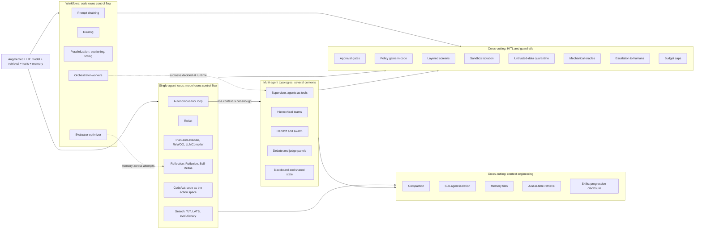

**Three observations from the atlas that shape the rest of this file.**

1. **Production systems are hybrids.** No dossier is a pure agent or a pure workflow. Async coding fleets ([03](./use-cases/03-async-coding-agent-fleets.md)) wrap tool-loop nodes in a fixed blueprint of deterministic lint, test and push steps; back-office agents ([08](./use-cases/08-back-office-case-processing-agents.md)) keep a deterministic pipeline and quarantine the model inside it; support agents ([04](./use-cases/04-support-resolution-agents.md)) put policy in code and procedures in versioned files. Control flow is given to the model only where the path is genuinely unknowable.
2. **The cross-cutting layers carry more of the engineering than the loop does.** The tool loop can be tiny (mini-SWE-agent: a bash-only loop of about 100 lines, README claim of over 74% on SWE-bench Verified [V] [01](./use-cases/01-interactive-coding-agents.md)), while the reliability comes from context management and layered action gates. The same dossier notes that infrastructure config alone moved Terminal-Bench 2.0 scores by about 6 points, so harness and model must be evaluated together [D].
3. **Multi-agent is the exception, not the default.** Anthropic's own guidance is to start with a single agent; multi-agent runs cost about 3-10x the tokens of a single-agent approach and are justified by context protection, parallelization or specialization [12] (2026-01-23). Where the dossiers document delegation depth ([07](./use-cases/07-workplace-knowledge-agents.md), [09](./use-cases/09-deep-research-analyst-agents.md)), it is one level.

### 1.1 The cost ladder

| Rung | Typical calls | What it buys | Evidence for the price |
|---|---|---|---|
| Single LLM call with retrieval and in-context examples | 1 | Usually enough for many applications | [1] "optimizing single LLM calls with retrieval and in-context examples is usually enough" [older] |
| Workflow (chain, route, parallelize) | N, fixed | Predictability, easy testing | cost is the sum of calls; latency is the sum or the max |
| Single-agent loop | variable, unbounded without caps | Open-ended problem solving | Agents "trade latency and cost for better task performance" [1] |
| Multi-agent | 3-10x single agent | Context isolation, breadth, specialization | [12] 3-10x; Anthropic's research system about 15x a chat, and token usage alone explained 80% of the variance on BrowseComp [2] [V] |

**Rule that follows:** move down the ladder only when an eval shows the cheaper rung failing. Anthropic reports teams that spent months on elaborate multi-agent architectures and later found improved single-agent prompting matched them [12].

---

## 2. Workflow patterns (code owns control flow)

### 2.1 Prompt chaining

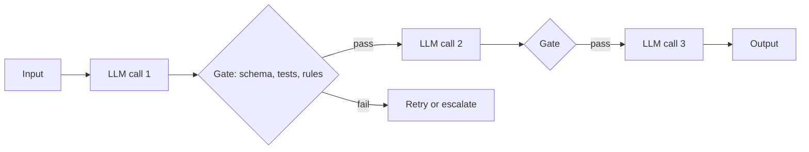

**Mechanism.** Decompose the task into a fixed sequence; each call consumes the previous output, and programmatic "gates" between steps check progress [1]. The atlas variant is the **blueprint**: a fixed graph that mixes deterministic nodes (format, lint, test, commit) with agent nodes (implement, fix), with hard caps such as about two CI rounds [D [03](./use-cases/03-async-coding-agent-fleets.md)]. Role-based pipelines such as MetaGPT ("Code = SOP(Team)": product manager, architect, engineer roles following standard operating procedures; ICLR 2024 paper) are the same idea with a persona per step [34] [older] [Inferred].

**Use when.** The task cleanly decomposes into fixed subtasks and accuracy matters more than latency [1]; each step has a checkable output (schema, tests, arithmetic); you need an audit trail per step.
**Avoid when.** The number or kind of steps depends on intermediate results (use a loop); the use case is latency-bound (voice); an early wrong step cannot be caught by a gate, because errors propagate down the chain.

**Trade-offs.** *Cost:* linear and predictable (sum of calls). *Latency:* sum of calls, so it is the wrong shape for sub-second budgets. *Reliability:* high when each gate is mechanical (structured outputs with a JSON schema, validators); low when gates are LLM opinions.

**Atlas.** [03](./use-cases/03-async-coding-agent-fleets.md) (blueprint: hydrate context, implement, lint and test, fix, LLM judge, push, CI), [08](./use-cases/08-back-office-case-processing-agents.md) (classify, extract, validate, match, draft, with schema-constrained outputs as the contract between links), [06](./use-cases/06-gtm-sales-marketing-creative-agents.md) (provider waterfall that stops when data is found), [05](./use-cases/05-voice-agents.md) (state-machine tasks for regulated call flows), [09](./use-cases/09-deep-research-analyst-agents.md) (scoping, research, one-shot report writing in Open Deep Research), [10](./use-cases/10-computer-use-browser-agents.md) (hybrid deterministic code with natural-language primitives).

### 2.2 Routing

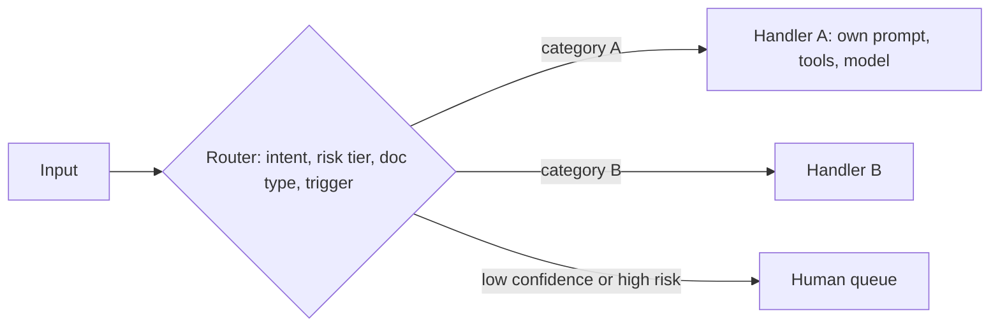

**Mechanism.** Classify the input and send it to a specialised downstream handler, which separates concerns and allows prompts, tool sets and models to be tuned per category [1]. In the atlas the router is often a small, cheap model, and the fallback branch is a human.

**Use when.** There are distinct categories with different procedures, risk or cost profiles; a cheap classifier can be evaluated on its own.
**Avoid when.** Categories overlap so that misrouting is common and silent; there is only one procedure (a single agent with tools is simpler).

**Trade-offs.** *Cost:* one small call. *Latency:* one extra hop (visible in voice). *Reliability:* bounded by router accuracy, so evaluate the router separately and add a confidence threshold that sends doubtful cases to a human.

**Atlas.** [04](./use-cases/04-support-resolution-agents.md) (intent and risk-tier router chooses the procedure agent or the human queue), [05](./use-cases/05-voice-agents.md) (routing and handoff, only one specialist active at a time), [07](./use-cases/07-workplace-knowledge-agents.md) (routing by trigger: about 90% of Notion's agent turns come from automations such as page events, Slack mentions and schedules [D]), [08](./use-cases/08-back-office-case-processing-agents.md) (document-type routing; Rocket Money runs a Haiku classifier then Sonnet subagents [D]), [06](./use-cases/06-gtm-sales-marketing-creative-agents.md) (reply classifier: interested, objection, unsubscribe, out of office).

### 2.3 Parallelization: sectioning and voting

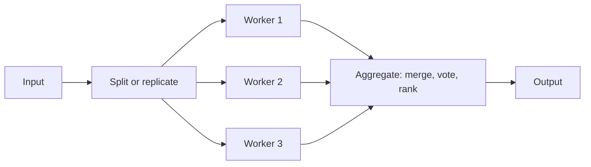

**Mechanism.** Run LLM operations at the same time and aggregate. *Sectioning* splits a task into independent subtasks; *voting* runs the same task several times for diverse outputs [1].

**Use when.** Subtasks are independent and latency matters, or you want several attempts or perspectives. Parallel writers must be isolated (a sandbox or git worktree each) or arbitrated (lock files).
**Avoid when.** Subtasks depend on one another; voting over copies of the same model whose errors are correlated (the Project Vend dossier found same-model oversight shared the original agent's blind spots [D [11](./use-cases/11-embodied-simulated-world-agents.md)]).

**Trade-offs.** *Cost:* roughly linear in branches, worse if each branch repeats a large shared context. *Latency:* about the slowest branch. *Reliability:* voting reduces variance only if errors are independent; sectioning needs a merge step that does not lose information.

**Atlas.** [02](./use-cases/02-sre-security-investigation-agents.md) (one read-only worker per hypothesis), [03](./use-cases/03-async-coding-agent-fleets.md) (fleet fan-out: one prebuilt sandbox per task), [08](./use-cases/08-back-office-case-processing-agents.md) (one reader per document or asset class), [09](./use-cases/09-deep-research-analyst-agents.md) (sectioning of research sub-questions), [10](./use-cases/10-computer-use-browser-agents.md) (Agent S3 behavior best-of-N over rollouts), [12](./use-cases/12-scientific-engineering-discovery-agents.md) (parallel evaluators and trajectories), [05](./use-cases/05-voice-agents.md) (about 30 specialist verifiers run beside the central model in Hippocratic AI's "constellation" [D]), [06](./use-cases/06-gtm-sales-marketing-creative-agents.md) (map-reduce fan-out nodes in Clay's agent graph), [07](./use-cases/07-workplace-knowledge-agents.md) (parallel fan-out of sub-agents), [11](./use-cases/11-embodied-simulated-world-agents.md) (concurrent modules in the PIANO architecture).

### 2.4 Orchestrator-workers

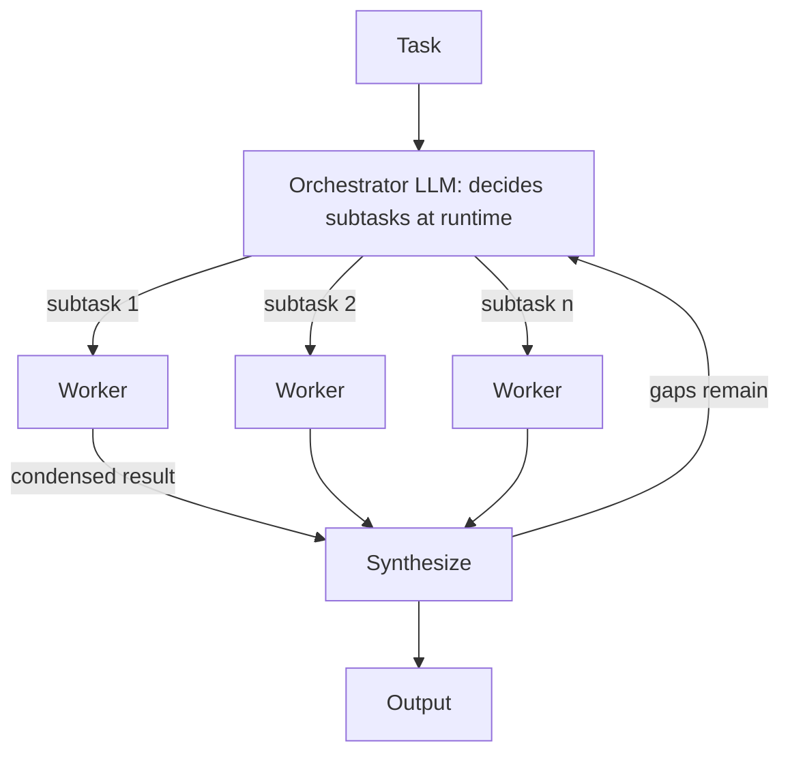

**Mechanism.** A central LLM breaks the task down at runtime, delegates to workers and synthesises. It differs from parallelization in that the subtasks are not predefined; they depend on the input [1]. Anthropic's Research feature is the reference: a lead agent (Claude Opus 4) spawns parallel subagents (Claude Sonnet 4) and a citation agent; the multi-agent setup scored 90.2% on an internal research eval versus single-agent Opus 4, at about 15x the tokens of a chat [2] [V]. Effort-scaling rules sit in the prompt: 1 agent and 3-10 tool calls for fact-finding, 2-4 subagents with 10-15 calls each for comparisons, 10 or more subagents for complex research [2].

**Use when.** The subtasks cannot be predicted in advance and are largely independent (research, investigation, broad code search).
**Avoid when.** Agents "need to share the same context or involve many dependencies"; Anthropic names most coding tasks as a poor fit [2]. Also avoid when the orchestrator would spawn workers for simple queries, a failure mode Anthropic observed alongside vague task descriptions and duplicated work [2].

**Trade-offs.** *Cost:* 3-10x a single agent [12], dominated by duplicated context and handoff summaries. *Latency:* parallel workers cut wall-clock time, but the orchestrator is a serial bottleneck. *Reliability:* synthesis loses detail ("game of telephone"), which is why subagents write outputs to files and return references [2] [09](./use-cases/09-deep-research-analyst-agents.md).

**Atlas.** [09](./use-cases/09-deep-research-analyst-agents.md) (lead plus researchers plus citation verifier), [02](./use-cases/02-sre-security-investigation-agents.md) (hypothesis workers), [06](./use-cases/06-gtm-sales-marketing-creative-agents.md) (LinkedIn's supervisor with intake, sourcing and evaluation sub-agents), [11](./use-cases/11-embodied-simulated-world-agents.md) (the low-level VLA model sits behind one blocking tool called by a reasoning orchestrator), [12](./use-cases/12-scientific-engineering-discovery-agents.md) (Robin and Kosmos parallel trajectories), [01](./use-cases/01-interactive-coding-agents.md) (subagents that keep exploration out of the main context), [03](./use-cases/03-async-coding-agent-fleets.md) (planner, worker and judge for multi-day builds), [07](./use-cases/07-workplace-knowledge-agents.md) (Managed Agents roster; Notion's task board), [05](./use-cases/05-voice-agents.md) (talker and thinker split), [08](./use-cases/08-back-office-case-processing-agents.md) (read-only orchestrator with an independent critic), [10](./use-cases/10-computer-use-browser-agents.md) (Magentic-UI's orchestrator with web, coder and file specialists).

### 2.5 Evaluator-optimizer

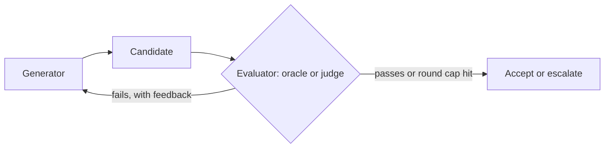

**Mechanism.** One call generates; another evaluates against explicit criteria and feeds back, looping until the criteria are met or a cap is hit. It works "when we have clear evaluation criteria, and when iterative refinement provides measurable value" [1]. The value of the loop is set by evaluator strength. Anthropic's SDK guidance lists three kinds of feedback: rules-based ("the best form of feedback is providing clearly defined rules for an output, then explaining which rules failed"), visual (screenshots and renders), and an LLM judge for fuzzy criteria [13].

**Use when.** A machine-checkable evaluator exists (tests, crash replay, Lean kernel, schema, simulator), or a rubric is clear enough for a separate judge.
**Avoid when.** The only evaluator is the generator's own model with no external signal; it will approve its own blind spots. Keep scoring code and held-out data outside the generator's write scope so it cannot game them [D [12](./use-cases/12-scientific-engineering-discovery-agents.md)].

**Trade-offs.** *Cost:* proportional to rounds, so cap rounds. *Latency:* serial. *Reliability:* exactly as good as the evaluator.

**Atlas.** [02](./use-cases/02-sre-security-investigation-agents.md) (Buttercup-style oracle: replay the crash or PoV, rebuild, rerun tests), [03](./use-cases/03-async-coding-agent-fleets.md) (deterministic verifiers, then an LLM judge, then CI, with about two CI rounds), [12](./use-cases/12-scientific-engineering-discovery-agents.md) (AlphaEvolve works because every candidate is scored by a user-owned, machine-gradeable `evaluate()`; its authors name that as the main limitation [D]), [11](./use-cases/11-embodied-simulated-world-agents.md) (an independent success detector closes every step), [09](./use-cases/09-deep-research-analyst-agents.md) (citation verifier), [06](./use-cases/06-gtm-sales-marketing-creative-agents.md), [07](./use-cases/07-workplace-knowledge-agents.md), [08](./use-cases/08-back-office-case-processing-agents.md), [10](./use-cases/10-computer-use-browser-agents.md), [01](./use-cases/01-interactive-coding-agents.md) (a fresh-context reviewer subagent checks the diff).

---

## 3. Single-agent loops (the model owns control flow)

### 3.1 Autonomous tool loop (the augmented LLM in a loop)

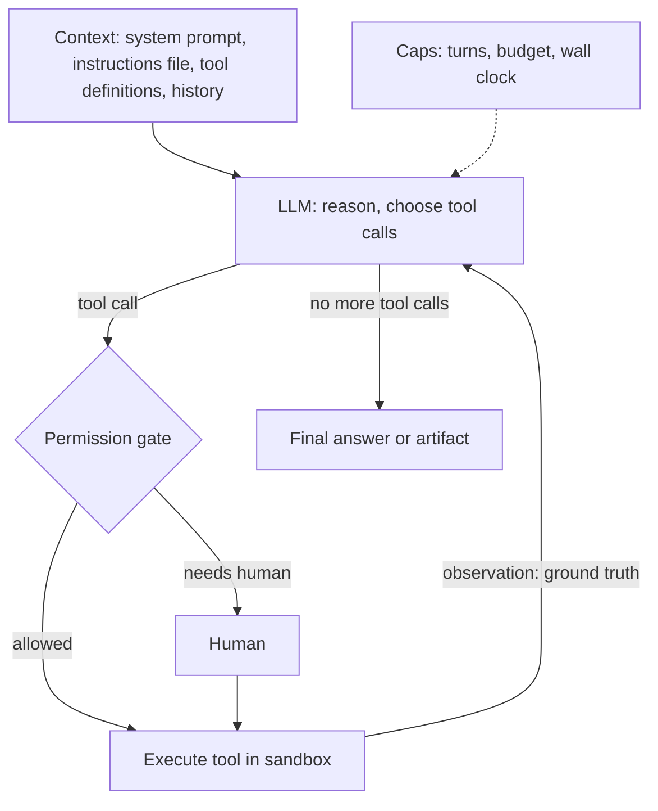

**Mechanism.** The foundation is the *augmented LLM*: a model with retrieval, tools and memory that it actively uses to generate queries, pick tools and decide what to retain [1]. The agent is "typically just LLMs using tools based on environmental feedback in a loop", with human checkpoints and stopping conditions [1]. Anthropic's SDK frames the loop as gather context, take action, verify work, repeat [13]. The model supplies reasoning; the code around it (tools, context management, permissions) is the *harness* [01](./use-cases/01-interactive-coding-agents.md).

**Use when.** The path is open-ended and you cannot hardcode the number of steps, *and* the environment gives ground truth at each step (exit codes, test output, API results) [1].
**Avoid when.** The path is known (use a workflow) or the environment gives no checkable feedback; or when the tool surface is large and ill-described, because tool design (the agent-computer interface) then dominates the failure rate. Anthropic's tool guidance: a few thoughtful tools aimed at high-impact workflows, namespaced, returning high-signal context, with token-efficient responses and descriptions written like onboarding notes [4].

**Trade-offs.** *Cost:* unbounded without caps (turns, `max_budget_usd`-style limits). *Latency:* one LLM call per step. *Reliability:* set by tool design, verification and context hygiene more than by loop code. Evaluate with outcome graders and report pass^k, not only pass@k, when reliability matters (pass@k asks for at least one success in k tries, pass^k for all k; they diverge sharply by k=10) [11].

**Atlas.** Dominant in [01](./use-cases/01-interactive-coding-agents.md), [04](./use-cases/04-support-resolution-agents.md), [05](./use-cases/05-voice-agents.md), [07](./use-cases/07-workplace-knowledge-agents.md), [10](./use-cases/10-computer-use-browser-agents.md); the working core inside nodes of [03](./use-cases/03-async-coding-agent-fleets.md), [06](./use-cases/06-gtm-sales-marketing-creative-agents.md), [08](./use-cases/08-back-office-case-processing-agents.md), [09](./use-cases/09-deep-research-analyst-agents.md), [02](./use-cases/02-sre-security-investigation-agents.md), [11](./use-cases/11-embodied-simulated-world-agents.md), [12](./use-cases/12-scientific-engineering-discovery-agents.md).

### 3.2 ReAct

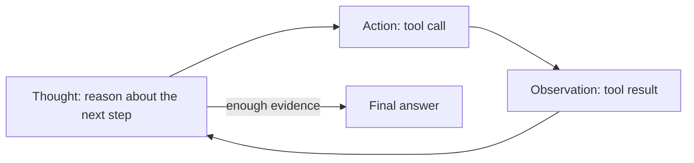

**Mechanism.** Interleave reasoning traces with actions: reasoning decides and revises the plan, actions fetch the information that grounds the next thought. *ReAct: Synergizing Reasoning and Acting in Language Models* (Yao et al., ICLR 2023) [older]; the authors' repo reports, for its GPT-3 prompting code, HotpotQA 30.4 exact match, FEVER 54, ALFWorld 78.4% and WebShop 35.8% success [24] [V]. Today most tool-calling models implement the pattern natively through interleaved thinking and tool calls, so an explicit "Thought:" format is rarely needed [Inferred]; the *structure* (act, observe, re-plan) is what survives. Browser Use's prompt shows a modern structured form: evaluate the previous action against the screenshot, update a short memory string, state the next goal [10](./use-cases/10-computer-use-browser-agents.md).

**Use when.** Each step depends on the last observation (debugging, browsing, investigation).
**Avoid when.** The plan is stable and tool results rarely change it (plan-and-execute is cheaper), or the per-step latency is unaffordable.

**Trade-offs.** *Cost and latency:* one call per step, and the context grows every step, so pair with compaction or tool-result clearing (section 5.1). *Reliability:* good at error recovery, weak at long-horizon coherence without a plan or notes.

**Atlas.** Named as the dominant loop in [01](./use-cases/01-interactive-coding-agents.md) and [10](./use-cases/10-computer-use-browser-agents.md); ReAct workers inside [02](./use-cases/02-sre-security-investigation-agents.md) and [09](./use-cases/09-deep-research-analyst-agents.md); the observe-act loop of the orchestrator in [11](./use-cases/11-embodied-simulated-world-agents.md). [03](./use-cases/03-async-coding-agent-fleets.md) calls its agent nodes an "autonomous tool loop", which is the same structure [Inferred].

### 3.3 Plan-and-execute (with ReWOO and LLMCompiler)

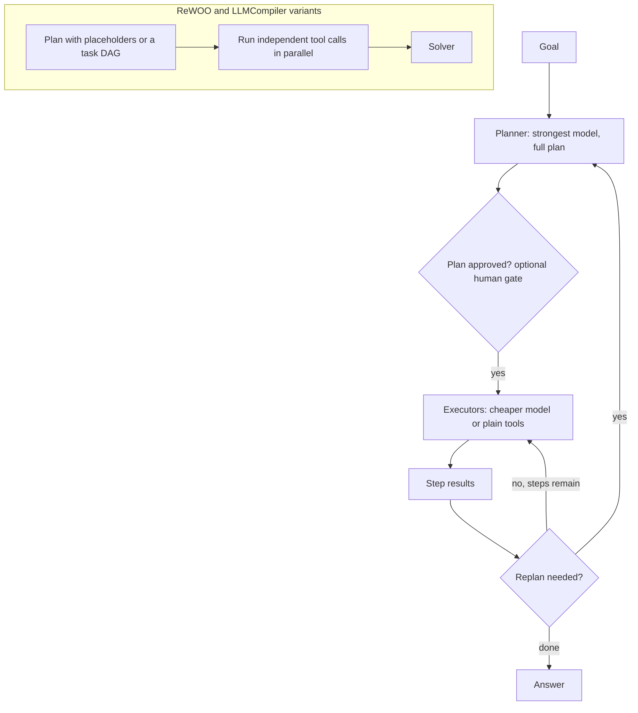

**Mechanism.** A planner produces a multi-step plan up front; cheaper executors carry out the steps; an optional replanner revises after results. *ReWOO* (Xu et al., 2023 [older]) decouples reasoning from observations; its README reports 5x token efficiency and a 4% accuracy gain on HotpotQA, and a 7B model fine-tuned to plan [30] [V]. *LLMCompiler* (ICML 2024) has a planner, a task-fetching unit and an executor over a DAG of function calls, reporting up to 3.7x latency speedup [31] [V]. A permission mode can make the plan a human checkpoint: Claude Code's plan mode does read-only exploration and then asks for approval [01](./use-cases/01-interactive-coding-agents.md).

**Use when.** The task decomposes up front; tool results rarely invalidate the plan; cost or latency matter (small executors, parallel DAG); a human should approve the plan before side effects.
**Avoid when.** The environment surprises you (live web pages, GUIs), so plans go stale after one step; replan every step or use ReAct. The planner needs the strongest model: in DeepMind's Gemini Robotics ER ablation, swapping the orchestrator for Gemini 2.5 Flash raised total sub-task failure from 22% to 44.5%, mostly through planning errors [D [11](./use-cases/11-embodied-simulated-world-agents.md)] [V].

**Trade-offs.** *Cost:* fewer large-model calls. *Latency:* parallelisable. *Reliability:* brittle to a bad plan, strong when step outcomes are verifiable.

**Atlas.** [11](./use-cases/11-embodied-simulated-world-agents.md) (plan-and-execute with replanning and observation after every step), [06](./use-cases/06-gtm-sales-marketing-creative-agents.md) (LinkedIn's small-business hiring agent uses plan-execute-replan), [09](./use-cases/09-deep-research-analyst-agents.md) (GPT Researcher and STORM are plan-and-execute pipelines), [04](./use-cases/04-support-resolution-agents.md) (the human-authored SOP *is* the plan the model follows), [01](./use-cases/01-interactive-coding-agents.md) (plan mode). LangChain's own plan-and-execute write-up was not readable this session [N].

### 3.4 Reflection and self-critique (Reflexion, Self-Refine)

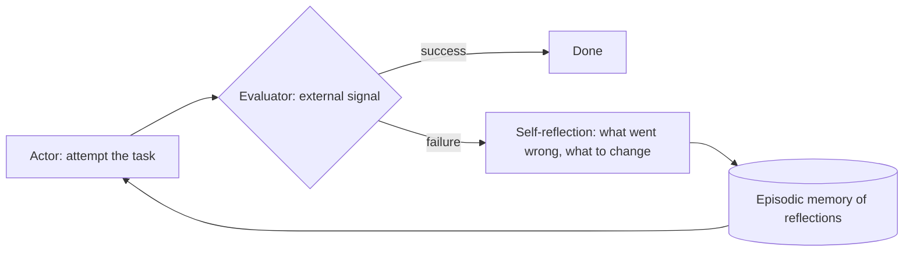

**Mechanism.** *Reflexion* (Shinn et al., NeurIPS 2023 [older]) is "verbal reinforcement learning": after a failed trial the agent writes a self-reflection that is stored in episodic memory and conditions the next attempt, with no weight updates [25]. *Self-Refine* (Madaan et al., 2023 [older]) loops generate, feedback, refine inside one task; its README notes it needs a sufficiently capable model, since weak models cannot find real flaws [26]. Both are evaluator-optimizer loops (section 2.5) plus memory across attempts.

**Use when.** An external signal tells the agent it failed (tests, environment reward, a validator) and attempts can repeat.
**Avoid when.** There is no external signal: self-critique then cannot find errors the model cannot already see, and it can reinforce them. Always cap iterations.

**Trade-offs.** *Cost:* extra calls per retry with diminishing returns. *Latency:* serial. *Reliability:* improves only as far as the signal is informative.

**Atlas.** [12](./use-cases/12-scientific-engineering-discovery-agents.md) (Co-Scientist-style reflection and meta-review feed the next generation prompts), [02](./use-cases/02-sre-security-investigation-agents.md) (patching agents retry with reflection and hard caps), [10](./use-cases/10-computer-use-browser-agents.md) (Agent S3 keeps procedural memory and a reflection agent), [11](./use-cases/11-embodied-simulated-world-agents.md) (generative-agent memory, retrieval and reflection loop).

### 3.5 CodeAct: code as the action space

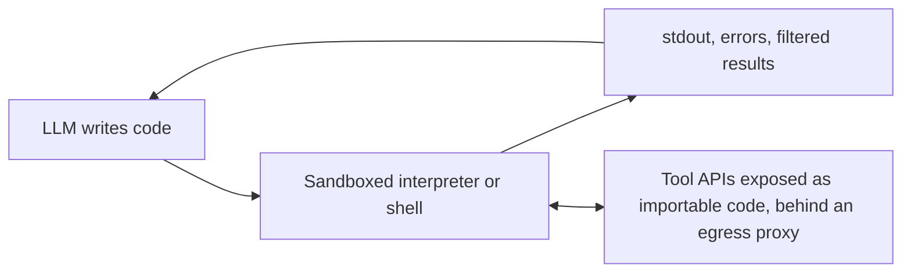

**Mechanism.** Instead of one JSON tool call per step, the model emits executable code, which gives loops, variables and composition in a single action, and the interpreter's output feeds the next step. *Executable Code Actions Elicit Better LLM Agents* (Wang et al., ICML 2024 [older]); the README reports up to 20% higher success than Text and JSON actions across 17 LLMs on API-Bank and M3ToolEval [27] [V]. Modern descendants: Anthropic's *code execution with MCP*, where agents write code against tool files laid out as a filesystem, reduced a 150,000-token workflow to 2,000 tokens (98.7%) and keep intermediate data out of context [7] [V]; *programmatic tool calling*, which cut average tokens from 43,588 to 27,297 (37%) in Anthropic's test [8] [V]; bash-only scaffolds such as mini-SWE-agent [01](./use-cases/01-interactive-coding-agents.md); smolagents' `CodeAgent` ([01-frameworks-landscape.md](./01-frameworks-landscape.md)).

**Use when.** Many tool calls must be composed, results are large and need filtering, or the action space is open (data work, shell tasks).
**Avoid when.** You have no real isolation boundary (the smolagents local executor is explicitly not one) or every call needs an individual approval, since code hides the individual calls; place the gate at the sandbox boundary (filesystem and network allowlists, credentials in a proxy) instead.

**Trade-offs.** *Cost:* usually lower (fewer round trips, results filtered outside context). *Latency:* fewer turns. *Reliability:* flexible but harder to constrain; the security surface is the sandbox.

**Atlas.** [01](./use-cases/01-interactive-coding-agents.md) (bash-only minimal scaffold, "CodeAct in spirit"), [12](./use-cases/12-scientific-engineering-discovery-agents.md) (Biomni), [09](./use-cases/09-deep-research-analyst-agents.md) (code-based filtering of search results before they enter context), [03](./use-cases/03-async-coding-agent-fleets.md) and [07](./use-cases/07-workplace-knowledge-agents.md) (sandbox shells) [Inferred for the last two].

### 3.6 Search over trajectories (Tree of Thoughts, LATS, evolutionary search)

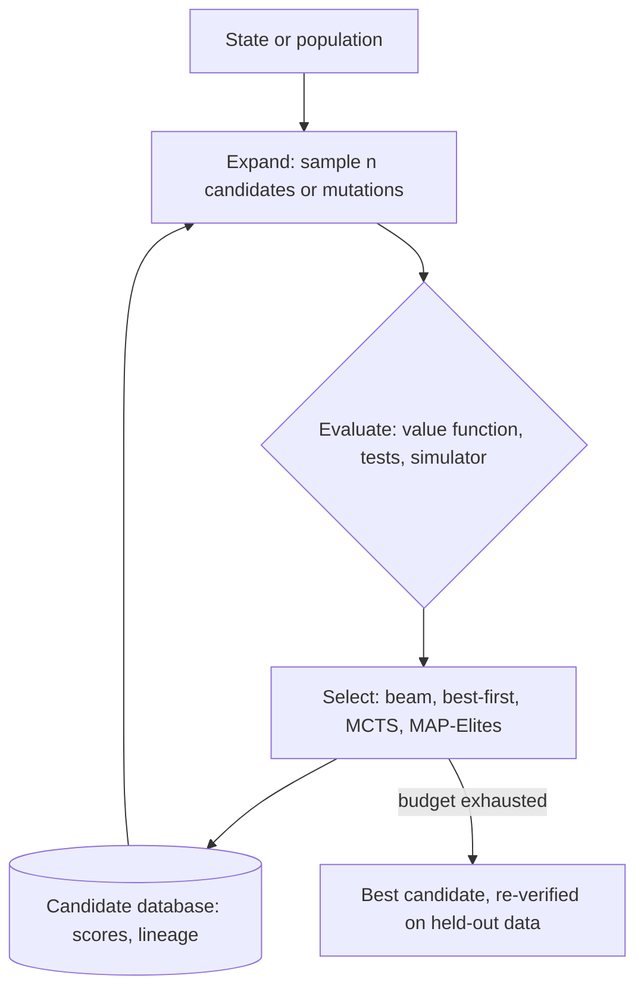

**Mechanism.** Explore several candidate thoughts, actions or programs with an evaluator guiding which to expand. *Tree of Thoughts* (Yao et al., NeurIPS 2023 [older]) generates and evaluates thoughts under BFS or DFS; its repo reports about 74% on Game of 24 with GPT-4 (a 69% reproduction) [28] [V]. *LATS* (ICML 2024 [older]) applies Monte Carlo tree search to reasoning, acting and planning [29]. At the engineering end, AlphaEvolve-style evolutionary search keeps a program database, samples a parent plus inspirations, asks an LLM ensemble for a diff and scores it with a cascade of evaluators [12](./use-cases/12-scientific-engineering-discovery-agents.md); AIDE and AI Scientist v2 search trees of solution scripts [12](./use-cases/12-scientific-engineering-discovery-agents.md); Agent S3's best-of-N picks among whole rollouts [10](./use-cases/10-computer-use-browser-agents.md).

**Use when.** A cheap, reliable evaluator exists and the space is branchy (algorithm discovery, kernel optimisation, GUI tasks with checkable outcomes).
**Avoid when.** The evaluator is a soft LLM judge: search then amplifies the judge's errors, and tournaments only measure agreement with the judge [12](./use-cases/12-scientific-engineering-discovery-agents.md).

**Trade-offs.** *Cost:* breadth × depth × evaluator cost. *Latency:* parallelisable. *Reliability:* bounded by evaluator; diversity needs explicit management (MAP-Elites, islands, novelty rejection) or the population collapses into near-duplicates [12](./use-cases/12-scientific-engineering-discovery-agents.md).

**Atlas.** [12](./use-cases/12-scientific-engineering-discovery-agents.md) (dominant), [10](./use-cases/10-computer-use-browser-agents.md) (best-of-N), [11](./use-cases/11-embodied-simulated-world-agents.md) [Inferred for simulation search].

---

## 4. Multi-agent topologies (several contexts)

**When multi-agent is justified.** Anthropic names three situations: *context protection* (one subtask's information pollutes later subtasks), *parallelization* (a larger search space explored concurrently) and *specialization* (conflicting tool sets or behaviours); the cost is typically 3-10x the tokens, from duplicated context, coordination messages and summaries at handoffs [12]. Anthropic's research post adds the exclusion: it underperforms when agents must share one context or have many dependencies, with coding as the example [2]. LangChain's `langgraph-supervisor` README now says it recommends building the supervisor pattern directly with tools for most use cases, because that gives better control over context engineering [22]. Cognition's "Don't build multi-agents" post argues the same side for coding; I could not read it [N].

### 4.1 Supervisor (manager, agents as tools)

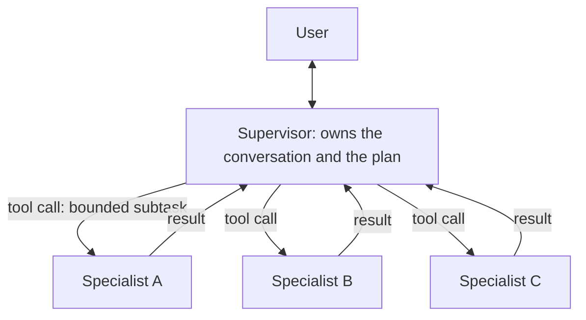

**Mechanism.** One agent keeps control and calls specialists as tools. OpenAI's Agents SDK docs: use *agents as tools* "when a specialist should help with a bounded subtask but should not take over the user-facing conversation" [18]. The `langgraph-supervisor` README describes a central supervisor that controls all communication and delegation through handoff tools, with `full_history` or `last_message` output modes [22]. Because a subagent starts with a fresh context, the delegation message must carry everything it needs [15].

**Use when.** You want one point of control and audit, and the specialists have distinct tools or prompts.
**Avoid when.** The supervisor becomes a bottleneck or compresses away evidence; pass references to files instead of paraphrases.

**Trade-offs.** *Cost:* an LLM hop per delegation plus summary tokens. *Latency:* serial unless the supervisor fans out. *Reliability:* easiest topology to reason about and trace.

**Atlas.** [06](./use-cases/06-gtm-sales-marketing-creative-agents.md) (LinkedIn Hiring Assistant: supervisor with intake, sourcing and evaluation sub-agents, sub-agents treated as tools [D]), [09](./use-cases/09-deep-research-analyst-agents.md) (single-level supervisor; Managed Agents `callable_agents` allows one delegation level, research preview [D]), [12](./use-cases/12-scientific-engineering-discovery-agents.md) (Co-Scientist supervisor), [07](./use-cases/07-workplace-knowledge-agents.md) (Managed Agents roster of up to 20 agents, one level deep [D]), [02](./use-cases/02-sre-security-investigation-agents.md) (lead agent plus hypothesis workers), [05](./use-cases/05-voice-agents.md) (chat-supervisor: a thinker model handles hard tool calls while the talker keeps the conversation moving [D]).

### 4.2 Hierarchical teams

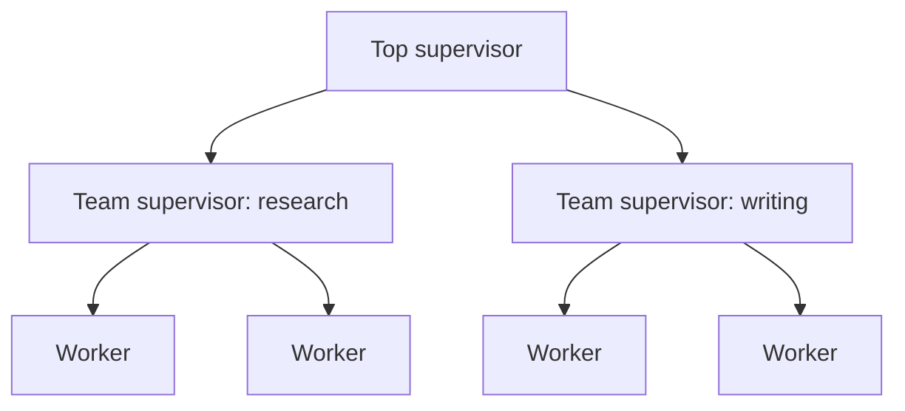

**Mechanism.** Supervisors manage other supervisors, so each team has its own context and specialists; the `langgraph-supervisor` README gives the example of a research team and a writing team under a top-level supervisor [22]. Claude Code subagents can spawn their own subagents up to 3 layers deep by default, adjustable with an environment variable, and the `Agent` tool is withheld at the limit [15]. Managed Agents is one level deep [07](./use-cases/07-workplace-knowledge-agents.md) [09](./use-cases/09-deep-research-analyst-agents.md). Cursor's research builds use planners that spawn sub-planners, company-reported and unverified [D [03](./use-cases/03-async-coding-agent-fleets.md)].

**Use when.** There are many specialists or domain partitions that each need their own context.
**Avoid when.** The depth only adds summarization hops; failure localisation and budget accounting get worse with every layer, so cap depth and concurrency outside the model ([09](./use-cases/09-deep-research-analyst-agents.md) governor).

**Trade-offs.** *Cost:* multiplies per layer. *Latency:* each layer adds a hop. *Reliability:* information loss compounds across layers.

**Atlas.** [06](./use-cases/06-gtm-sales-marketing-creative-agents.md), [12](./use-cases/12-scientific-engineering-discovery-agents.md), [03](./use-cases/03-async-coding-agent-fleets.md) (all light usage; most documented systems stay flat).

### 4.3 Handoff and swarm (decentralised)

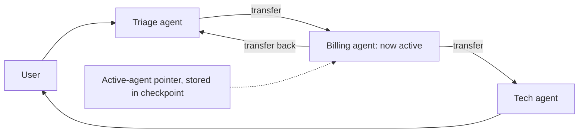

**Mechanism.** Agents transfer control of the conversation. In OpenAI's Agents SDK a handoff is exposed to the model as a tool named like `transfer_to_refund_agent`; use it "when routing itself is part of the workflow and you want the chosen specialist to own the remainder of the current turn" [18] [19]; input filters decide what history the next agent sees [19]. `langgraph-swarm` adds that the system remembers which agent was last active, which needs a checkpointer [23]. OpenAI's original Swarm repo is educational and was replaced by the Agents SDK [21].

**Use when.** The specialist should own the user-facing conversation (support, voice) and there is no need for a central coordinator.
**Avoid when.** You need a single audit point or consistent policy enforcement (pair handoffs with a deterministic policy gate), or peers can ping-pong without a hop cap. Passing full history inflates context, so filter it.

**Trade-offs.** *Cost:* lower than a supervisor (no relay). *Latency:* lowest of the topologies. *Reliability:* risk of loops and context bloat; each agent's tool set stays small, which helps tool selection.

**Atlas.** [05](./use-cases/05-voice-agents.md) (only one specialist active at a time; per-agent small contexts), [04](./use-cases/04-support-resolution-agents.md) (triage to specialists is common in demos, but a single procedure-following agent is the simpler default [Inferred] [D]), [08](./use-cases/08-back-office-case-processing-agents.md) (handoffs between agents travel as allowlisted, payload-validated events [D]).

### 4.4 Debate and judge panels

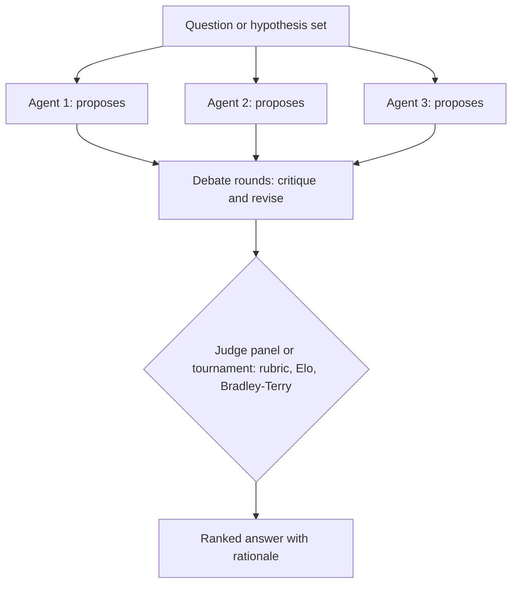

**Mechanism.** Several model instances propose and critique over rounds, then a consensus rule or a judge picks. *Improving Factuality and Reasoning in Language Models through Multiagent Debate* (Du et al., ICML 2024 [older]) reports gains on mathematical problem solving, GSM, biographical questions and MMLU [32] [V]. Production variants: Co-Scientist-style generate, reflect and pairwise-rank tournaments with Elo or Bradley-Terry scoring [12](./use-cases/12-scientific-engineering-discovery-agents.md); TradingAgents' bull/bear debate with a risk manager [09](./use-cases/09-deep-research-analyst-agents.md); a fresh-context reviewer that tries to refute a finding before it ships [02](./use-cases/02-sre-security-investigation-agents.md).

**Use when.** There is no hard oracle and adversarial review adds information (ranking hypotheses, risk assessment).
**Avoid when.** A mechanical oracle exists (use it instead), or all debaters are the same model with the same blind spots. A pairwise tournament measures agreement with a judge, not truth [12](./use-cases/12-scientific-engineering-discovery-agents.md).

**Trade-offs.** *Cost:* agents × rounds, the most expensive pattern here. *Latency:* rounds are serial. *Reliability:* benchmark gains are reported, production value depends on rubric quality and human spot-checks.

**Atlas.** [12](./use-cases/12-scientific-engineering-discovery-agents.md) (dominant), [09](./use-cases/09-deep-research-analyst-agents.md) (bull/bear debate in an open-source finance framework), [02](./use-cases/02-sre-security-investigation-agents.md) (judge pass).

### 4.5 Blackboard and shared state

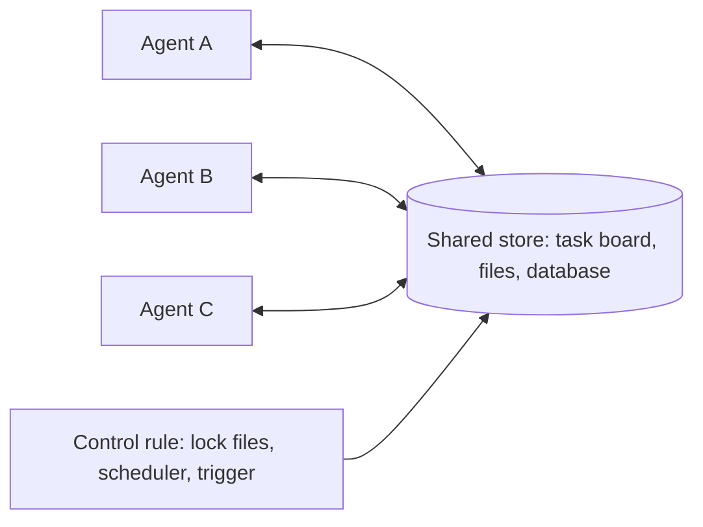

**Mechanism.** Agents do not message one another. They read and write a shared store, and a control rule (a scheduler, a lock convention, triggers on state change) decides who acts. The architecture is classical and predates LLMs [N]; I read no LLM-era source this session. The atlas documents shared-state designs that fit it [Inferred mapping]: Anthropic's 16-agent C-compiler build, where each agent claims a task by writing a file in `current_tasks/` on a shared git remote and git arbitrates collisions [03](./use-cases/03-async-coding-agent-fleets.md); Notion's task board as orchestrator, where agents start on a "ready to start" state [07](./use-cases/07-workplace-knowledge-agents.md); the candidate or program database with scores and lineage that parallel samplers and evaluators share in evolutionary search [12](./use-cases/12-scientific-engineering-discovery-agents.md); research subagents that write outputs to a filesystem to avoid a game of telephone [09](./use-cases/09-deep-research-analyst-agents.md).

**Use when.** Many peers advance a shared, evolving artifact and you want decoupling and an auditable log.
**Avoid when.** Steps are tightly sequential, or concurrency control (stale reads, merge conflicts, duplicate work) would become the main problem. The C-compiler dossier concludes that test quality and coordination design decide success [03](./use-cases/03-async-coding-agent-fleets.md).

**Trade-offs.** *Cost:* low coordination overhead. *Latency:* scales with workers. *Reliability:* depends on the store's semantics and test coverage.

**Atlas.** [03](./use-cases/03-async-coding-agent-fleets.md), [07](./use-cases/07-workplace-knowledge-agents.md), [09](./use-cases/09-deep-research-analyst-agents.md), [12](./use-cases/12-scientific-engineering-discovery-agents.md) (shared-state variants, [Inferred]); no dossier names blackboard as its dominant pattern.

---

## 5. Context-engineering patterns

Anthropic defines context engineering as curating the optimal set of tokens at inference time: system instructions, tools, MCP, external data and message history. The motivating failure is *context rot*: as the number of tokens grows, the model's ability to recall information from the context decreases [3] (2025-09-29). Every pattern in this section is a way to put fewer, better tokens in front of the model. They compose; the atlas systems that run for hours combine three or four of them.

| Horizon or problem | First choice | Source |
|---|---|---|
| Long back-and-forth in one session | Compaction (5.1) | [3] "compaction for extensive back-and-forth" |
| Iterative work with milestones, or many sessions | Memory files and notes (5.3) | [3] "note-taking for iterative development with milestones" |
| Parallel exploration or noisy subtasks | Sub-agent isolation (5.2) | [3] "multi-agent systems for parallel exploration" |
| Large corpora or many tools | Just-in-time retrieval, tool search, code-mediated tools (5.4) | [3] [7] [8] |
| Many procedures, few relevant per task | Skills with progressive disclosure (5.5) | [5] |

### 5.1 Compaction and tool-result clearing

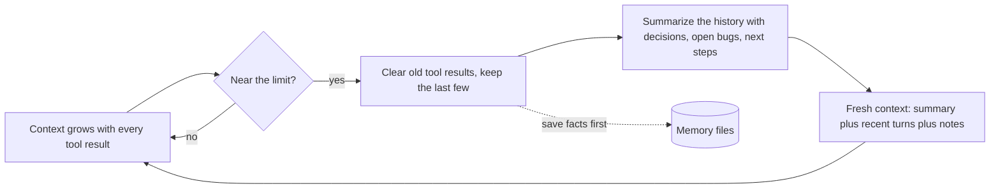

**Mechanism.** Summarize the conversation as the window fills and restart from the summary; Anthropic says this "distills the contents of a context window in a high-fidelity manner" [3]. The Agent SDK summarizes automatically near the limit [13]. On the API, server-side compaction is the recommended primary strategy for long conversations, and *context editing* offers fine-grained clearing: `clear_tool_uses` with defaults of a 100,000-input-token trigger and the last 3 tool uses kept, plus options such as `exclude_tools`; it is in beta, and with the memory tool the model is warned before clearing so it can save facts [16]. Claude Code clears older tool output first and summarizes second [01](./use-cases/01-interactive-coding-agents.md). An alternative is a *context reset with structured handoff*, which beat compaction for models showing "context anxiety" while newer models reduced that need [03](./use-cases/03-async-coding-agent-fleets.md).

**Use when.** A single session runs long with much back-and-forth.
**Avoid when.** The detail lost in summarization is the product. Open Deep Research compresses researcher transcripts but instructs the compressor to keep relevant statements verbatim with their citations, because summarizing away the quote destroys verifiability [09](./use-cases/09-deep-research-analyst-agents.md). Prune in batches so prompt caching survives (Anthropic's computer-use guidance: keep the last few screenshots, prune about every 25 turns) [10](./use-cases/10-computer-use-browser-agents.md).

**Trade-offs.** *Cost:* large savings per later turn. *Latency:* one summarization call. *Reliability:* lossy; test that the summary preserves what the next step needs.

**Atlas.** [01](./use-cases/01-interactive-coding-agents.md) (dominant), [03](./use-cases/03-async-coding-agent-fleets.md), [05](./use-cases/05-voice-agents.md) (older turns summarized on long calls; after a barge-in only the spoken text is committed), [07](./use-cases/07-workplace-knowledge-agents.md), [09](./use-cases/09-deep-research-analyst-agents.md) (plan saved before compaction), [10](./use-cases/10-computer-use-browser-agents.md), [11](./use-cases/11-embodied-simulated-world-agents.md) (summarize at a message threshold).

### 5.2 Sub-agent context isolation

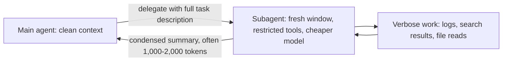

**Mechanism.** A subagent runs in its own context window with its own system prompt, tool access and permissions, handles verbose output in isolation and returns only a summary [15]. Claude Code ships read-only `Explore` and `Plan` subagents and lets you define custom ones in Markdown with YAML frontmatter (`tools`, `model`, `permissionMode`, `maxTurns`, `skills`, `memory`, `isolation: worktree`) [15]. Anthropic's context-engineering post describes subagents returning condensed summaries to a coordinator [3]; the research dossier cites the guidance as "often 1,000-2,000 tokens" [09](./use-cases/09-deep-research-analyst-agents.md).

**Use when.** A task produces verbose output, needs tool restrictions, is self-contained and can return a summary, or can run in parallel [15].
**Avoid when.** The task needs frequent back-and-forth, several phases share context, or latency is critical; the Claude Code docs say to stay in the main conversation then [15]. Split by the context a task needs, not by phase [07](./use-cases/07-workplace-knowledge-agents.md).

**Trade-offs.** *Cost:* protects the main window but multiplies tokens (3-10x if overused [12]). *Latency:* parallel-friendly. *Reliability:* the subagent knows only what the task message tells it, so vague delegation causes duplicated or missed work [2].

**Atlas.** [01](./use-cases/01-interactive-coding-agents.md), [07](./use-cases/07-workplace-knowledge-agents.md), [09](./use-cases/09-deep-research-analyst-agents.md) (dominant); [02](./use-cases/02-sre-security-investigation-agents.md), [05](./use-cases/05-voice-agents.md) (greeter, specialist and background researcher keep contexts small), [08](./use-cases/08-back-office-case-processing-agents.md) (a reader that sees only the document is isolation used as a security control, see 6.5).

### 5.3 Memory files and structured note-taking

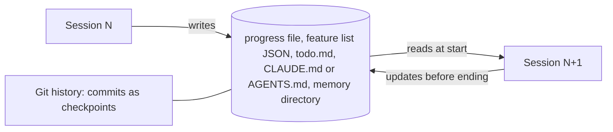

**Mechanism.** The agent persists state outside the window in files it reads at the start of work and updates as it goes. Anthropic calls structured note-taking "persistent memory with minimal overhead" [3]. The *memory tool* is a client-side `/memories` directory with view, create, str_replace, insert, delete and rename commands, and the API adds a protocol telling the model to check memory first and to "assume interruption" [17]. For multi-session builds Anthropic's harness has an *initializer* session that creates `init.sh`, a `claude-progress.txt` log, a JSON feature list with every feature initially marked failing, and an initial git commit; later sessions make incremental progress and leave a clean state, using git as the checkpoint, and a feature counts as done only after end-to-end verification [6] [17]. Static instruction files (CLAUDE.md, AGENTS.md) and a capped auto-memory index (200 lines or 25KB) are the same pattern at the project level [01](./use-cases/01-interactive-coding-agents.md).

**Use when.** The horizon exceeds one window, work spans sessions, or the agent must resume after interruption.
**Avoid when.** Memory could leak across principals (never recall a memory written under one user's permissions under another's [Inferred] [07](./use-cases/07-workplace-knowledge-agents.md)) or could persist an injection: OpenClaw bars untrusted-origin content from its curated core memory and carries provenance on every entry [10](./use-cases/10-computer-use-browser-agents.md). Cap file sizes and validate paths (memory-tool path traversal is a documented risk [17]).

**Trade-offs.** *Cost:* cheap. *Latency:* an extra read at start. *Reliability:* depends on write discipline; preference learning as prose (Metaview rewrites a markdown ICP from user decisions) beats keyword weights [06](./use-cases/06-gtm-sales-marketing-creative-agents.md).

**Atlas.** [01](./use-cases/01-interactive-coding-agents.md), [03](./use-cases/03-async-coding-agent-fleets.md), [07](./use-cases/07-workplace-knowledge-agents.md), [10](./use-cases/10-computer-use-browser-agents.md) (dominant); [02](./use-cases/02-sre-security-investigation-agents.md), [06](./use-cases/06-gtm-sales-marketing-creative-agents.md), [08](./use-cases/08-back-office-case-processing-agents.md) (the case file is the memory), [09](./use-cases/09-deep-research-analyst-agents.md), [11](./use-cases/11-embodied-simulated-world-agents.md), [12](./use-cases/12-scientific-engineering-discovery-agents.md) (a `marathon.md` log bundled with each submission).

### 5.4 Just-in-time retrieval

```mermaid
flowchart LR
  CTX["Context holds identifiers: paths, links, queries, tool names"] --> LOOK["Lookup tool: grep, glob, read, search, tool search"]
  LOOK --> PART["Load only the needed slice"]
  PART --> CTX
  PRE[("Pre-computed index: optional hybrid")] -.-> LOOK
```

**Mechanism.** Hold lightweight references and load content on demand. Anthropic recommends hybrid strategies that combine pre-computed retrieval with just-in-time exploration [3]. Agentic search over the filesystem with `grep` and `tail` is the Agent SDK's default way to gather context; Anthropic notes that semantic search "is usually faster than agentic search, but less accurate, more difficult to maintain, and less transparent" [13]. At tool scale: the *Tool Search Tool* loads definitions on demand and, in Anthropic's test, cut token consumption by about 85% and raised Opus 4 accuracy from 49% to 74% [8] [V]; *code execution with MCP* exposes tools as files so only needed definitions load [7]. Permission-aware retrieval filters by ACL *before* the model sees text [07](./use-cases/07-workplace-knowledge-agents.md).

**Use when.** Corpora or tool sets are large or change often.
**Avoid when.** The corpus is small and static (put it in a cached prompt) or latency is tight (voice runs retrieval in parallel behind filler speech [05](./use-cases/05-voice-agents.md)).

**Trade-offs.** *Cost:* fewer tokens. *Latency:* extra lookups. *Reliability:* tool naming and response design decide it; trim responses with pagination, filtering and helpful truncation hints [4].

**Atlas.** [01](./use-cases/01-interactive-coding-agents.md), [07](./use-cases/07-workplace-knowledge-agents.md) (dominant); [03](./use-cases/03-async-coding-agent-fleets.md) (tool-server pulls of docs, tickets and build status), [09](./use-cases/09-deep-research-analyst-agents.md) (filter before ingest, notes loaded on demand).

### 5.5 Skills and progressive disclosure

```mermaid
flowchart TD
  L1["Level 1: name and description of every skill, in the system prompt"] -->|"model judges relevant"| L2["Level 2: SKILL.md body loaded"]
  L2 -->|"as needed"| L3["Level 3: linked files and bundled scripts"]
  L3 -->|"run code, load nothing"| OUT["Result"]
```

**Mechanism.** Agent Skills are "organized folders of instructions, scripts, and resources that agents can discover and load dynamically" [5] (2025-10-16). Metadata is always in context, the `SKILL.md` body loads when the model judges the skill relevant, and linked files load only as needed; bundled code can run without its source entering context. Anthropic advises installing skills only from trusted sources, since a skill is both an instruction channel and a code-execution channel [5]. Research precedent: Voyager's ever-growing library of executable skills, with an automatic curriculum and iterative prompting on environment feedback, reports 3.3x more unique items and up to 15.3x faster tech-tree milestones than prior state of the art in Minecraft [33] [V] [older].

**Use when.** You have many procedures and only a few apply per task; procedures should be versioned in git and shared (plugins).
**Avoid when.** The source is untrusted, or the description is vague so the skill never triggers.

**Trade-offs.** *Cost:* near zero when idle. *Latency:* one read when triggered. *Reliability:* depends on description quality; Parlant's per-turn guideline matching is an alternative mechanism for the same job in support agents [04](./use-cases/04-support-resolution-agents.md).

**Atlas.** [07](./use-cases/07-workplace-knowledge-agents.md) (dominant: org procedures as skills and plugins); [01](./use-cases/01-interactive-coding-agents.md), [03](./use-cases/03-async-coding-agent-fleets.md), [04](./use-cases/04-support-resolution-agents.md) (SOPs), [06](./use-cases/06-gtm-sales-marketing-creative-agents.md) (skill registry at scale, skills as the unit of procedure), [09](./use-cases/09-deep-research-analyst-agents.md) (playbooks such as a legal playbook file).

---

## 6. Human-in-the-loop and guardrail patterns

Think in four layers, cheapest and strongest first: **(1)** shrink what the model *can* do (tools, sandbox, scopes); **(2)** deterministic checks on what it *tries* to do (policy gates, hooks, schemas); **(3)** probabilistic checks (classifiers, judges, verifiers); **(4)** a human for what is irreversible or high-value. Two facts motivate the layering. Claude Code users approve 93% of permission prompts, so blanket approval turns into approval fatigue [10] (2026-03-25); and sandboxing "safely reduces permission prompts by 84%" in Anthropic's internal testing [9]. A sentence from the GTM dossier is the design rule: the approval boundary is a *missing tool*, not a prompt [06](./use-cases/06-gtm-sales-marketing-creative-agents.md).

### 6.1 Human approval gate

```mermaid
flowchart TD
  A["Agent proposes an action"] --> P{"Policy: allow, ask or deny"}
  P -->|"deny"| BK["Return reason to the agent"]
  P -->|"allow"| EX["Execute"]
  P -->|"ask"| Q["Durable approval request with diff and evidence"]
  Q -->|"approve, token bound to call id, tool and args"| EX
  Q -->|"reject or edit"| BK
  EX --> AUD["Audit log"]
```

**Mechanism.** Gate by risk tier. Claude Code offers modes (manual, accept-edits, plan, auto) plus allow, ask and deny rules [01](./use-cases/01-interactive-coding-agents.md); Managed Agents policies are `always_allow`, `always_ask` and `auto`, with MCP toolsets defaulting to `always_ask` [07](./use-cases/07-workplace-knowledge-agents.md); HolmesGPT mints an approval token bound to the call id, tool name and arguments [02](./use-cases/02-sre-security-investigation-agents.md); drafting agents simply have no send tool, so a human-held send action is the only way out [06](./use-cases/06-gtm-sales-marketing-creative-agents.md); back-office agents use an *authority matrix* (within limit: commit; above: exception queue) [08](./use-cases/08-back-office-case-processing-agents.md). For waits that last days, persist the request (a `defer` hook or a durable workflow engine) rather than holding a process open [07](./use-cases/07-workplace-knowledge-agents.md).

**Use when.** Actions are irreversible or externally visible, or decisions are regulated.
**Avoid when.** You would ask on every call: tier by risk and automate the low tier with a sandbox or classifier. Auto-approval is not a human checkpoint [07](./use-cases/07-workplace-knowledge-agents.md).

**Trade-offs.** *Cost:* low. *Latency:* human time. *Reliability:* high only if the approver sees the diff and evidence.

**Atlas.** Dominant in [01](./use-cases/01-interactive-coding-agents.md), [02](./use-cases/02-sre-security-investigation-agents.md), [03](./use-cases/03-async-coding-agent-fleets.md), [06](./use-cases/06-gtm-sales-marketing-creative-agents.md), [07](./use-cases/07-workplace-knowledge-agents.md), [08](./use-cases/08-back-office-case-processing-agents.md), [10](./use-cases/10-computer-use-browser-agents.md), [12](./use-cases/12-scientific-engineering-discovery-agents.md) (human-gated experiment submission); present in all twelve.

### 6.2 Deterministic policy gate (policy in code)

```mermaid
flowchart LR
  M["LLM: tool call with arguments"] --> G{"Gate in code: authz, limits, idempotency, suppression list, schema"}
  G -->|"allowed"| T["Tool executes"]
  G -->|"DENIED with reason"| M
  ID["Identity bound by the harness, not the model"] --> G
```

**Mechanism.** Put limits where the model cannot argue with them. Read tools return derived policy facts (eligibility, maximum amount); write tools enforce limits and idempotency and return `DENIED` with a reason [04](./use-cases/04-support-resolution-agents.md). Hooks (`PreToolUse`) and deny rules run before any model judgement [07](./use-cases/07-workplace-knowledge-agents.md). Sending is blocked unless a suppression list, a daily cap and a "claim has a source URL" check pass [06](./use-cases/06-gtm-sales-marketing-creative-agents.md). Physical systems put a policy gate and e-stop *below* the model [11](./use-cases/11-embodied-simulated-world-agents.md). A model-based gate has limits: Claude Code's auto-mode classifier sees only user messages and tool calls (it is reasoning-blind by design), had a 0.4% false-positive rate on real traffic, but missed 17% of 52 genuinely overeager actions, so Anthropic says it is not for high-stakes infrastructure [10] [V].

**Use when.** Always, for write paths.
**Avoid when.** The rule cannot be enumerated; then add a human gate. Pair with a sandbox, since rules miss what nobody foresaw.

**Trade-offs.** *Cost and latency:* negligible. *Reliability:* high for enumerated rules, nil for the rest.

**Atlas.** Dominant in [04](./use-cases/04-support-resolution-agents.md), [06](./use-cases/06-gtm-sales-marketing-creative-agents.md), [08](./use-cases/08-back-office-case-processing-agents.md), [11](./use-cases/11-embodied-simulated-world-agents.md); present in [01](./use-cases/01-interactive-coding-agents.md), [02](./use-cases/02-sre-security-investigation-agents.md), [03](./use-cases/03-async-coding-agent-fleets.md), [05](./use-cases/05-voice-agents.md), [07](./use-cases/07-workplace-knowledge-agents.md), [10](./use-cases/10-computer-use-browser-agents.md).

### 6.3 Layered guardrails: input, tool and output screens

```mermaid
flowchart LR
  IN["User or tool input"] --> IG["Input screen: injection, abuse, PII, relevance"]
  IG -->|"blocking mode: before the agent runs"| AG["Agent"]
  IG -.->|"parallel mode: lower latency, may waste tokens"| AG
  AG --> TG["Tool guardrails: before and after each call"]
  TG --> OG["Output check: grounded, on-policy, no leaks"]
  OG --> OUT["User"]
  IG -->|"tripwire"| HALT["Halt and escalate"]
```

**Mechanism.** OpenAI's Agents SDK defines three kinds: input guardrails (run for the first agent only), output guardrails (for the agent that produces the final output) and tool guardrails (on every guarded function-tool call); a tripwire halts the run; input guardrails can run in parallel (default, lower latency, but tokens may be spent) or in blocking mode (no tokens or side effects if tripped); and for workflows with managers or handoffs the docs advise tool guardrails over relying on agent-level ones [20]. NVIDIA NeMo Guardrails names five rail types: input, dialog, retrieval, execution and output [36]. For injection specifically, Anthropic layers RL training, classifiers on untrusted content and human red-teaming, and reports roughly a 1% attack success rate against an adaptive best-of-N attacker on Claude for Chrome while stating "No browser agent is immune" [14] [V].

**Use when.** Customer-facing or untrusted-input agents.
**Avoid when.** A classifier is your only defence; a screen is a filter, not a boundary.

**Trade-offs.** *Cost:* a small model per screen. *Latency:* blocking mode adds a hop. *Reliability:* false positives hurt UX; false negatives are inevitable.

**Atlas.** [04](./use-cases/04-support-resolution-agents.md) (dominant: input screen, policy gate, output check); [01](./use-cases/01-interactive-coding-agents.md), [05](./use-cases/05-voice-agents.md) (debounced output guardrail on accumulated transcript deltas), [07](./use-cases/07-workplace-knowledge-agents.md), [10](./use-cases/10-computer-use-browser-agents.md).

### 6.4 Sandbox and credential isolation

```mermaid
flowchart LR
  AG["Agent and generated code"] --> SB["Sandbox: filesystem allowlist, network allowlist, resource limits"]
  SB -->|"egress only via proxy"| PX["Credential and egress proxy: holds secrets, logs, allowlists hosts"]
  PX --> NET["Internet and internal services"]
```

**Mechanism.** Anthropic's position: effective sandboxing needs *both* filesystem and network isolation, because without network isolation a compromised agent can exfiltrate files such as SSH keys, and without filesystem isolation it can escape the sandbox; Claude Code uses Linux bubblewrap and macOS seatbelt [9] (2025-10-20). Stronger isolation (microVM or gVisor class) suits untrusted code [03](./use-cases/03-async-coding-agent-fleets.md). Credentials stay in a proxy or vault, substituted at egress, so the agent never sees them [07](./use-cases/07-workplace-knowledge-agents.md) [03](./use-cases/03-async-coding-agent-fleets.md).

**Use when.** Any agent that runs code, shell, a browser or untrusted tools.
**Avoid when.** Never skip it for those; weigh isolation strength against startup latency and compatibility.

**Trade-offs.** *Cost:* infrastructure. *Latency:* snapshots and prebuilt images keep startup low [03](./use-cases/03-async-coding-agent-fleets.md). *Reliability:* the best reliability and security return per unit of effort.

**Atlas.** Dominant in [01](./use-cases/01-interactive-coding-agents.md), [03](./use-cases/03-async-coding-agent-fleets.md); [02](./use-cases/02-sre-security-investigation-agents.md), [07](./use-cases/07-workplace-knowledge-agents.md), [10](./use-cases/10-computer-use-browser-agents.md), [12](./use-cases/12-scientific-engineering-discovery-agents.md).

### 6.5 Untrusted-data quarantine

```mermaid
flowchart LR
  DOC["Untrusted document, email, page or log"] --> RD["Quarantined reader: no tools, length-capped schema-validated JSON"]
  RD --> VAL["Deterministic validators"]
  VAL --> OR["Privileged orchestrator, read-only"]
  OR --> CR["Independent critic re-verifies"]
  CR --> WR["Single writer role, never sees outsider content"]
```

**Mechanism.** Split the agent so that no single model both reads attacker-controlled text and holds powerful tools. The financial-services agents in the back-office dossier use a reader with no tools that returns length-capped, schema-validated JSON, a read-only orchestrator, an independent critic and exactly one writer role that never sees outsider content [08](./use-cases/08-back-office-case-processing-agents.md). CaMeL (Google, Google DeepMind and ETH Zurich) formalises it with a privileged and a quarantined LLM and capability-based data-flow control; its repo says it is research-grade code that will not be maintained [35]. Design heuristics that say the same thing, the "lethal trifecta" (private data, untrusted content, outbound communication) and Meta's "Agents Rule of Two", could not be read this session [N]: the shared idea is to remove at least one leg or put a human on it.

**Use when.** An agent reads email, documents, web pages or telemetry *and* can write, send or spend.
**Avoid when.** Reading untrusted text is all the agent does and it has no tools; then ordinary output validation suffices.

**Trade-offs.** *Cost:* extra calls and plumbing. *Latency:* extra hops. *Reliability:* strong for structured tasks, awkward for open-ended ones.

**Atlas.** [08](./use-cases/08-back-office-case-processing-agents.md) (dominant); [02](./use-cases/02-sre-security-investigation-agents.md) (treat telemetry text as untrusted data), [04](./use-cases/04-support-resolution-agents.md), [06](./use-cases/06-gtm-sales-marketing-creative-agents.md) (enrichment and email are data, never instructions), [10](./use-cases/10-computer-use-browser-agents.md) (untrusted-page wrapping).

### 6.6 Mechanical oracle and independent verifier

```mermaid
flowchart LR
  C["Candidate: patch, plan, action, claim"] --> V{"Verifier outside the agent's write scope"}
  V -->|"tests, crash replay, simulator, schema, kernel"| R["Pass or fail with evidence"]
  R -->|"fail"| FIX["Back to the agent with the failing rule"]
  R -->|"pass"| ACC["Accept"]
```

**Mechanism.** Wherever a property is machine-checkable, check it with code, and grade outcomes rather than prescribed paths because agents find valid approaches you did not anticipate [11]. For physical or GUI actions use an *independent* success detector, a separate model call or the environment's own signal, not the actor's opinion [11](./use-cases/11-embodied-simulated-world-agents.md) [10](./use-cases/10-computer-use-browser-agents.md). Anthropic's long-horizon harness addresses premature completion claims with a structured feature list whose items flip only after end-to-end verification [6].

**Use when.** Tests, replays, validators or simulators exist.
**Avoid when.** The oracle sits inside the agent's write scope (reward hacking); keep scoring code and held-out data outside it and independently re-run winners [12](./use-cases/12-scientific-engineering-discovery-agents.md).

**Trade-offs.** *Cost:* the oracle's own cost. *Latency:* serial. *Reliability:* the strongest lever in the atlas.

**Atlas.** Dominant in [02](./use-cases/02-sre-security-investigation-agents.md), [03](./use-cases/03-async-coding-agent-fleets.md), [11](./use-cases/11-embodied-simulated-world-agents.md), [12](./use-cases/12-scientific-engineering-discovery-agents.md); [01](./use-cases/01-interactive-coding-agents.md) (runnable checks), [08](./use-cases/08-back-office-case-processing-agents.md) (deterministic validators), [10](./use-cases/10-computer-use-browser-agents.md).

### 6.7 Escalation and warm handoff to a human

```mermaid
flowchart LR
  AG["Agent"] -->|"cannot resolve, high risk, caller asks, over limit"| PK["Handoff packet: asked, verified, done, blocked"]
  PK --> Q["Human queue or live transfer"]
  Q --> HU["Human decides or takes over"]
  HU --> FB["Overrides become eval cases and rules"]
```

**Mechanism.** The handoff carries a summary so the person never repeats themselves (what was asked, what was verified, what was done, what is blocked) [04](./use-cases/04-support-resolution-agents.md); voice agents do a warm transfer with a consult call and briefing [05](./use-cases/05-voice-agents.md); back-office agents route exceptions to a queue with reason codes, evidence and a recommended action [08](./use-cases/08-back-office-case-processing-agents.md); browser agents offer takeover and "critical point" pauses [10](./use-cases/10-computer-use-browser-agents.md). Overrides should become eval cases.

**Use when.** The agent cannot resolve a case within policy or confidence.
**Avoid when.** Success is measured by *deflection*: measure true resolution separately, since vendor figures vary widely (for example 51% average versus up to 86% in one Intercom Fin case study [V] [04](./use-cases/04-support-resolution-agents.md)).

**Trade-offs.** *Cost:* human time. *Latency:* queueing. *Reliability:* the safety net for everything else.

**Atlas.** Dominant in [04](./use-cases/04-support-resolution-agents.md), [05](./use-cases/05-voice-agents.md), [08](./use-cases/08-back-office-case-processing-agents.md); [06](./use-cases/06-gtm-sales-marketing-creative-agents.md), [10](./use-cases/10-computer-use-browser-agents.md).

### 6.8 Budgets, step caps and circuit breakers

```mermaid
flowchart LR
  LOOP["Agent loop"] --> CNT["Counters: turns, tokens or dollars, wall clock, retries, depth, concurrency"]
  CNT --> BR{"Any limit hit?"}
  BR -->|"no"| LOOP
  BR -->|"yes"| STOP["Stop, return partial result, escalate or notify"]
```

**Mechanism.** Hard limits outside the model: `max_turns` and `max_budget_usd` [01](./use-cases/01-interactive-coding-agents.md), about two CI rounds and a per-task budget [03](./use-cases/03-async-coding-agent-fleets.md), a governor for budget, depth and concurrency [09](./use-cases/09-deep-research-analyst-agents.md), a 15-step cap "to prevent infinite tool-calling loops" [11](./use-cases/11-embodied-simulated-world-agents.md), `max_tool_steps` for voice turns [05](./use-cases/05-voice-agents.md). Inside the prompt, effort-scaling rules keep the model from over-spawning [2].

**Use when.** Always.
**Avoid when.** Never skip; instead decide what a stop means (partial result, escalation) so a cap does not silently drop work.

**Trade-offs.** *Cost:* bounds the worst case. *Latency:* bounds it too. *Reliability:* converts runaway failures into visible ones.

**Atlas.** Dominant in [03](./use-cases/03-async-coding-agent-fleets.md), [09](./use-cases/09-deep-research-analyst-agents.md); present in [01](./use-cases/01-interactive-coding-agents.md), [02](./use-cases/02-sre-security-investigation-agents.md), [04](./use-cases/04-support-resolution-agents.md), [05](./use-cases/05-voice-agents.md), [06](./use-cases/06-gtm-sales-marketing-creative-agents.md), [07](./use-cases/07-workplace-knowledge-agents.md), [10](./use-cases/10-computer-use-browser-agents.md), [11](./use-cases/11-embodied-simulated-world-agents.md), [12](./use-cases/12-scientific-engineering-discovery-agents.md).

---

## 7. Use-case × pattern matrix

Columns `01` to `12` are the atlas dossiers ([01](./use-cases/01-interactive-coding-agents.md), [02](./use-cases/02-sre-security-investigation-agents.md), [03](./use-cases/03-async-coding-agent-fleets.md), [04](./use-cases/04-support-resolution-agents.md), [05](./use-cases/05-voice-agents.md), [06](./use-cases/06-gtm-sales-marketing-creative-agents.md), [07](./use-cases/07-workplace-knowledge-agents.md), [08](./use-cases/08-back-office-case-processing-agents.md), [09](./use-cases/09-deep-research-analyst-agents.md), [10](./use-cases/10-computer-use-browser-agents.md), [11](./use-cases/11-embodied-simulated-world-agents.md), [12](./use-cases/12-scientific-engineering-discovery-agents.md); names in section 0). Cells are derived from each dossier's "Reference architecture" (section 4), "Frameworks" (6) and "Context" (8) sections and its pattern list.

**Legend.** **●** = the dossier names it as a dominant or defining pattern for that use case. **○** = documented in the dossier as a secondary pattern or a component of the system. **·** = my [Inferred] fit, or optional; the dossier does not document it in use. Blank = not applicable or not documented. **dom.** counts ● per row; **used** counts ● and ○. This is a reading of twelve dossiers, not a measurement: two readers could move a few ○ and · cells.

| Pattern | 01 | 02 | 03 | 04 | 05 | 06 | 07 | 08 | 09 | 10 | 11 | 12 | dom. | used |
|---|---|---|---|---|---|---|---|---|---|---|---|---|---|---|
| **Workflow patterns** | | | | | | | | | | | | | | |
| W1 Prompt chaining |  | · | ● | · | ○ | ● |  | ● | ○ | ○ |  | · | 3 | 6 |
| W2 Routing |  |  | · | ● | ● | ○ | ● | ● | · | · |  |  | 4 | 5 |
| W3 Parallelization | · | ● | ● |  | ○ | ○ | ○ | ● | ● | ○ | ○ | ○ | 4 | 10 |
| W4 Orchestrator-workers | ○ | ● | ○ |  | ○ | ● | ○ | ○ | ● | ○ | ● | ● | 5 | 11 |
| W5 Evaluator-optimizer | ○ | ● | ● |  | · | ○ | ○ | ○ | ○ | ○ | ● | ● | 4 | 10 |
| **Single-agent loops** | | | | | | | | | | | | | | |
| L1 Tool loop (augmented LLM) | ● | ○ | ○ | ● | ● | ○ | ● | ○ | ○ | ● | ○ | ○ | 5 | 12 |
| L2 ReAct | ● | ○ | · | · | · |  | · | · | ○ | ● | ○ | · | 2 | 5 |
| L3 Plan-and-execute | ○ |  |  | ○ |  | ○ | · |  | ○ | · | ● | · | 1 | 5 |
| L4 Reflection | · | ○ | · |  |  |  |  |  |  | ○ | ○ | ● | 1 | 4 |
| L5 CodeAct | ○ |  | · |  |  |  | · |  | ○ |  |  | ○ | 0 | 3 |
| L6 Search / tree / evolutionary |  |  |  |  |  |  |  |  |  | ○ | · | ● | 1 | 2 |
| **Multi-agent topologies** | | | | | | | | | | | | | | |
| M1 Supervisor |  | ○ | · |  | ○ | ● | ○ | · | ● |  | · | ● | 3 | 6 |
| M2 Hierarchical |  |  | ○ |  |  | ○ |  |  |  |  |  | ○ | 0 | 3 |
| M3 Handoff / swarm |  |  |  | ○ | ● |  |  | · |  |  |  |  | 1 | 2 |
| M4 Debate / judge panel |  | ○ | · |  |  |  |  |  | ○ |  |  | ● | 1 | 3 |
| M5 Blackboard / shared state |  |  | ○ |  |  |  | ○ |  | ○ |  | · | ○ | 0 | 4 |
| **Context engineering** | | | | | | | | | | | | | | |
| C1 Compaction / tool-result clearing | ● | · | ○ | · | ○ |  | ○ |  | ○ | ○ | ○ | · | 1 | 7 |
| C2 Sub-agent context isolation | ● | ○ | · |  | ○ |  | ● | ○ | ● |  | · | · | 3 | 6 |
| C3 Memory files / notes | ● | ○ | ● | · | · | ○ | ● | ○ | ○ | ● | ○ | ○ | 4 | 10 |
| C4 Just-in-time retrieval | ● | · | ○ | · | · | · | ● |  | ○ |  |  |  | 2 | 4 |
| C5 Skills / progressive disclosure | ○ |  | ○ | ○ | · | ○ | ● | · | ○ |  |  |  | 1 | 6 |
| **HITL and guardrails** | | | | | | | | | | | | | | |
| H1 Human approval gate | ● | ● | ● | ○ | ○ | ● | ● | ● | ○ | ● | ○ | ● | 8 | 12 |
| H2 Deterministic policy gate | ○ | ○ | ○ | ● | ○ | ● | ○ | ● | · | ○ | ● | · | 4 | 10 |
| H3 Layered guardrails (screens) | ○ | · |  | ● | ○ | · | ○ |  |  | ○ |  |  | 1 | 5 |
| H4 Sandbox / credential isolation | ● | ○ | ● |  |  |  | ○ | · | · | ○ | · | ○ | 2 | 6 |
| H5 Untrusted-data quarantine |  | ○ |  | ○ |  | ○ | · | ● | · | ○ |  |  | 1 | 5 |
| H6 Mechanical oracle / verifier | ○ | ● | ● |  |  | · |  | ○ | · | ○ | ● | ● | 4 | 7 |
| H7 Escalation / warm handoff |  | · |  | ● | ● | ○ | · | ● |  | ○ |  |  | 3 | 5 |
| H8 Budget / step caps | ○ | ○ | ● | ○ | ○ | ○ | ○ | · | ● | ○ | ○ | ○ | 2 | 11 |

### 7.1 What the matrix says

1. **A human approval gate (H1) appears in all twelve use cases and is dominant in eight** ([01](./use-cases/01-interactive-coding-agents.md), [02](./use-cases/02-sre-security-investigation-agents.md), [03](./use-cases/03-async-coding-agent-fleets.md), [06](./use-cases/06-gtm-sales-marketing-creative-agents.md), [07](./use-cases/07-workplace-knowledge-agents.md), [08](./use-cases/08-back-office-case-processing-agents.md), [10](./use-cases/10-computer-use-browser-agents.md), [12](./use-cases/12-scientific-engineering-discovery-agents.md)). The four where it is not dominant solve the same problem differently: [04](./use-cases/04-support-resolution-agents.md) and [11](./use-cases/11-embodied-simulated-world-agents.md) lean on deterministic policy gates, [05](./use-cases/05-voice-agents.md) on live escalation to a human, and [09](./use-cases/09-deep-research-analyst-agents.md) on hard budgets with sign-off only in domain variants.
2. **The two most common dominant shapes are the tool loop (L1) and orchestrator-workers (W4), five use cases each.** The tool loop dominates the human-facing interactive cases ([01](./use-cases/01-interactive-coding-agents.md), [04](./use-cases/04-support-resolution-agents.md), [05](./use-cases/05-voice-agents.md), [07](./use-cases/07-workplace-knowledge-agents.md), [10](./use-cases/10-computer-use-browser-agents.md)); orchestrator-workers dominates the breadth-first, investigation-style ones ([02](./use-cases/02-sre-security-investigation-agents.md), [06](./use-cases/06-gtm-sales-marketing-creative-agents.md), [09](./use-cases/09-deep-research-analyst-agents.md), [11](./use-cases/11-embodied-simulated-world-agents.md), [12](./use-cases/12-scientific-engineering-discovery-agents.md)).
3. **The exotic end of each axis is rare in production.** CodeAct (L5), hierarchical teams (M2) and blackboard-style shared state (M5) have no dominant use case. Reflection (L4), search (L6), debate (M4) and plan-and-execute (L3) are each dominant in exactly one use case: [12](./use-cases/12-scientific-engineering-discovery-agents.md) for the first three, [11](./use-cases/11-embodied-simulated-world-agents.md) for the last. The discovery use case is where soft evaluators (debate, tournaments) meet hard ones (oracles and search), which is consistent with it using the most patterns.
4. **Where the outcome is machine-checkable, the oracle (H6) is dominant:** [02](./use-cases/02-sre-security-investigation-agents.md) (crash and PoV replay), [03](./use-cases/03-async-coding-agent-fleets.md) (tests, lint, CI), [11](./use-cases/11-embodied-simulated-world-agents.md) (independent success detector), [12](./use-cases/12-scientific-engineering-discovery-agents.md) (`evaluate()`). [01](./use-cases/01-interactive-coding-agents.md) and [08](./use-cases/08-back-office-case-processing-agents.md) also use runnable checks and validators as components.
5. **Context engineering follows horizon, not use-case family.** Memory files (C3) are dominant for the long-running [01](./use-cases/01-interactive-coding-agents.md), [03](./use-cases/03-async-coding-agent-fleets.md), [07](./use-cases/07-workplace-knowledge-agents.md), [10](./use-cases/10-computer-use-browser-agents.md); sub-agent isolation (C2) for [01](./use-cases/01-interactive-coding-agents.md), [07](./use-cases/07-workplace-knowledge-agents.md), [09](./use-cases/09-deep-research-analyst-agents.md); just-in-time retrieval (C4) only where the agent explores an open corpus ([01](./use-cases/01-interactive-coding-agents.md), [07](./use-cases/07-workplace-knowledge-agents.md)). [04](./use-cases/04-support-resolution-agents.md), [05](./use-cases/05-voice-agents.md) and [08](./use-cases/08-back-office-case-processing-agents.md) keep context small by design (procedure per intent, per-agent small contexts, the case file as memory).
6. **Isolation is dominant only for the code-executing coding agents** ([01](./use-cases/01-interactive-coding-agents.md), [03](./use-cases/03-async-coding-agent-fleets.md)); the other use cases that execute code or browsers use it as a component. Untrusted-data quarantine (H5) is dominant only in [08](./use-cases/08-back-office-case-processing-agents.md), where the inputs are attacker-controlled documents by definition.
7. **Row sums:** [01](./use-cases/01-interactive-coding-agents.md), [03](./use-cases/03-async-coding-agent-fleets.md) and [12](./use-cases/12-scientific-engineering-discovery-agents.md) have eight dominant patterns each (the most), [05](./use-cases/05-voice-agents.md) and [10](./use-cases/10-computer-use-browser-agents.md) four (the fewest). Dominant-pattern count does not track the dossiers' complexity rating ([11](./use-cases/11-embodied-simulated-world-agents.md) is rated 5 but has five).

### 7.2 Dominant pattern set and design insight per use case

| Use case | Dominant patterns (from the dossier) | One-line design insight |
|---|---|---|
| [01](./use-cases/01-interactive-coding-agents.md) | Tool loop (ReAct-style) over an augmented LLM; plan-then-act as a permission mode; isolated-context subagents; fresh-context reviewer | The loop is tiny; the engineering is layered action gates against approval fatigue (93% approved) plus context management; evaluate harness and model together. |
| [02](./use-cases/02-sre-security-investigation-agents.md) | Event-triggered orchestrator-workers with one read-only worker per hypothesis; evaluator-optimizer with a mechanical oracle | Separate investigation from action; every write goes through a separate executor with a per-call approval token; telemetry text is untrusted. |
| [03](./use-cases/03-async-coding-agent-fleets.md) | Prompt-chained blueprint of deterministic and agent nodes; evaluator-optimizer; fleet parallelization; durable execution | The model is the small part: a prebuilt isolated environment per task, hard caps (about two CI rounds), layered verification ending in a human-reviewed PR. |
| [04](./use-cases/04-support-resolution-agents.md) | Augmented LLM with routing; human-authored SOP as the plan; layered guardrails; human handoff with summary | Policy in code, procedures in versioned artifacts; measure true resolution, not deflection. |
| [05](./use-cases/05-voice-agents.md) | Streaming STT-LLM-TTS augmented LLM; routing and handoff; talker/thinker split; parallel guardrails; warm transfer | Turn-taking and interruption handling are first-class architecture; tools must never stall the call. |
| [06](./use-cases/06-gtm-sales-marketing-creative-agents.md) | Workflow-heavy hybrid; waterfall chaining; supervisor with sub-agents; deterministic pre-send gate | The approval boundary is a missing tool, not a prompt; scale comes from durable execution and small models for volume. |
| [07](./use-cases/07-workplace-knowledge-agents.md) | Augmented LLM with permission-aware retrieval in a sandboxed tool loop; routing by trigger; approval policy | Identity and the approval gate are the product; auto-approval is not a human checkpoint. |
| [08](./use-cases/08-back-office-case-processing-agents.md) | Prompt-chained pipeline with document-type routing; per-document parallel readers; quarantined reader; authority matrix; exception queue | Keep the backbone deterministic and quarantine the model; economics follow straight-through-processing rate. |
| [09](./use-cases/09-deep-research-analyst-agents.md) | Orchestrator-workers with sectioning; ReAct inside workers; citation-verification pass; single-level supervisor | Context-isolated parallel subagents return evidence to a lead and a separate verifier, under effort-scaling rules and hard budgets. |
| [10](./use-cases/10-computer-use-browser-agents.md) | Observe-act-verify loop; hybrid code plus model primitives; best-of-N; always-on gateway; approval and takeover | The perception choice matters less than the control plane around it; prefer API-native protocols over GUI automation. |
| [11](./use-cases/11-embodied-simulated-world-agents.md) | VLA behind a tool, orchestrator-workers; plan-and-execute with replanning; independent success detector; two-speed hierarchy | Treat the action model as one blocking tool; close every step with an independent detector and a gate and e-stop below the model. |
| [12](./use-cases/12-scientific-engineering-discovery-agents.md) | Supervisor with generate-reflect-rank-evolve roles; two-level evaluator-optimizer; evolutionary and tree search; pairwise tournaments | The evaluator, not the agent graph, separates working systems from demos; pick the architecture by evaluator strength. |

---

## 8. How to choose

### 8.1 The decision procedure

Work top to bottom and stop at the first rung that meets the need. Each rung up must be justified by an eval, not by taste: Anthropic's rule is to add complexity "only when it demonstrably improves outcomes" [1].

**Step 0. Is an LLM, and is an agent, warranted?** Write the task as a spec with a verifiable outcome. If rules or a classifier suffice, use them. If one call with retrieval and examples meets the eval, stop [1].

**Step 1. Classify the shape of the path.**

| If the path is... | Use |
|---|---|
| a fixed sequence with checkable intermediate outputs | prompt chaining with gates (2.1) |
| one of several known categories | routing (2.2), with a human fallback |
| made of independent parts known in advance | parallelization (2.3) |
| made of parts discovered at runtime | orchestrator-workers (2.4) |
| improvable against clear criteria | evaluator-optimizer (2.5) |
| open-ended with ground-truth feedback every step | an agent loop (Step 2) |

**Step 2. If you need a loop, choose its variant.** Default to the tool loop with ReAct-style structure (3.1, 3.2). Add *plan-and-execute* when the plan is stable, cost or latency matters, or a human must approve the plan (3.3). Add *CodeAct* when many tool calls compose or intermediate data is large, and you have a sandbox (3.5). Add *reflection* when an external signal reports failure and attempts can repeat (3.4). Add *search* only when a cheap, exact evaluator exists (3.6).

**Step 3. Gate multi-agent hard.** Proceed only if at least one of Anthropic's three conditions holds (context pollution, parallel breadth, specialization conflict) *and* the subtasks are not tightly coupled to one shared context [12] [2]. Run a single-agent baseline first and keep the multi-agent version only if its measured gain justifies roughly 3-10x the tokens. Then pick the topology:

| Need | Topology |
|---|---|
| parallel independent investigations, one synthesis | supervisor or orchestrator-workers, one level (4.1) |
| a specialist should own the user-facing conversation | handoff (4.3), with a hop cap and a policy gate |
| many specialists with separate contexts | hierarchy (4.2), with depth and concurrency caps |
| adversarial review where no oracle exists | debate or judge panel (4.4), with human spot-checks |
| many peers advancing one artifact | shared state with claims or locks (4.5), backed by strong tests |

**Step 4. Plan the context.** Estimate tokens per run. Past one window: compaction plus notes (5.1, 5.3). Noisy subtasks: isolate them in subagents (5.2). Large corpora or tool sets: just-in-time retrieval, tool search or code-mediated tools (5.4). Many procedures: skills (5.5). Keep evidence verbatim through any compression.

**Step 5. Classify every tool by blast radius and apply the matching guard.**

| Tool class | Guard |
|---|---|
| read-only | least privilege, sandbox, treat outputs as untrusted data |
| reversible write | deterministic policy gate (6.2), audit log, budget cap (6.8) |
| irreversible or external (send, pay, publish, deploy) | human approval gate or draft-first (6.1), authority matrix |
| untrusted input *and* sensitive access *and* outbound action in one agent | quarantine (6.5): remove a leg or put a human on it |
| machine-checkable outcome | mechanical oracle outside the agent's write scope (6.6) |
| customer-facing or injection-exposed | layered screens (6.3) as a filter, never as the boundary; escalation path (6.7) |

**Step 6. Set budgets and evals before launch.** Caps on turns, spend, retries, depth and concurrency (6.8). Outcome-based graders, with pass^k for reliability-sensitive agents [11]. Tier models: strongest model for the planner or lead, cheaper models for workers, screens and classifiers [09](./use-cases/09-deep-research-analyst-agents.md) [06](./use-cases/06-gtm-sales-marketing-creative-agents.md). Turn every human override into an eval case.

**Step 7. Re-check the ladder.** Every added pattern needs a measured delta. If an eval shows the cheaper rung passing, drop back down.

### 8.2 Decision tree

```mermaid
flowchart TD
  S["Task with a verifiable outcome"] --> Q1{"One LLM call with retrieval enough?"}
  Q1 -->|"yes"| A1["Stop: single call"]
  Q1 -->|"no"| Q2{"Are the steps known in advance?"}
  Q2 -->|"fixed sequence"| A2["Prompt chaining with gates"]
  Q2 -->|"known categories"| A3["Routing"]
  Q2 -->|"independent parts"| A4["Parallelization"]
  Q2 -->|"no, open-ended"| Q3{"Does the environment give ground truth each step?"}
  Q3 -->|"no"| A5["Stay a workflow with a human at the unknown step"]
  Q3 -->|"yes"| A6["Tool loop, ReAct-style"]
  A6 --> Q4{"Plan stable and cost or latency matters?"}
  Q4 -->|"yes"| A7["Plan-and-execute"]
  Q4 -->|"no"| Q5{"Many composable tool calls or big intermediate data?"}
  Q5 -->|"yes"| A8["CodeAct with a sandbox"]
  Q5 -->|"no"| Q6{"Cheap exact evaluator and branchy space?"}
  Q6 -->|"yes"| A9["Search or evolutionary loop"]
  Q6 -->|"no"| Q7{"Hit a context, breadth or specialization limit?"}
  A7 --> Q7
  A8 --> Q7
  Q7 -->|"no"| A10["Stay single agent; add context patterns"]
  Q7 -->|"yes"| Q8{"Tightly coupled to one shared context?"}
  Q8 -->|"yes"| A10
  Q8 -->|"no"| Q9{"Which need?"}
  Q9 -->|"parallel breadth"| A11["Supervisor or orchestrator-workers"]
  Q9 -->|"user-facing specialist"| A12["Handoff"]
  Q9 -->|"no oracle, need review"| A13["Debate or judge panel"]
  Q9 -->|"peers on one artifact"| A14["Shared state with claims"]
  A2 --> G["Then apply: context plan, blast-radius guards, budgets, evals"]
  A3 --> G
  A4 --> G
  A5 --> G
  A10 --> G
  A11 --> G
  A12 --> G
  A13 --> G
  A14 --> G
  A9 --> G
```

### 8.3 From problem shape to pattern, with atlas examples

| Problem shape | Start with | Add when | Atlas example |
|---|---|---|---|
| Fixed steps, checkable outputs | Prompt chaining with schema gates | An LLM judge as the last gate only | [08](./use-cases/08-back-office-case-processing-agents.md), [03](./use-cases/03-async-coding-agent-fleets.md) |
| Several procedures or risk tiers | Router plus per-category handler | Human fallback below a confidence threshold | [04](./use-cases/04-support-resolution-agents.md), [07](./use-cases/07-workplace-knowledge-agents.md) |
| Independent items or sub-questions | Parallelization (sectioning) | A lead if sub-questions are discovered at runtime | [08](./use-cases/08-back-office-case-processing-agents.md), [09](./use-cases/09-deep-research-analyst-agents.md) |
| Breadth-first investigation or research | Orchestrator-workers, one level, cheaper workers | A refutation or citation verifier; effort-scaling rules | [09](./use-cases/09-deep-research-analyst-agents.md), [02](./use-cases/02-sre-security-investigation-agents.md) |
| Open-ended task with tool feedback | Tool loop, ReAct-style | Plan mode, compaction, memory files | [01](./use-cases/01-interactive-coding-agents.md), [10](./use-cases/10-computer-use-browser-agents.md) |
| Stable plan, cost or latency matters | Plan-and-execute | Replanning on step failure; strongest model as planner | [11](./use-cases/11-embodied-simulated-world-agents.md), [06](./use-cases/06-gtm-sales-marketing-creative-agents.md) |
| Detectable failure, repeatable attempts | Reflection with memory of attempts | An oracle as the failure signal | [02](./use-cases/02-sre-security-investigation-agents.md), [12](./use-cases/12-scientific-engineering-discovery-agents.md) |
| Many composable calls, large intermediate data | CodeAct or code-mediated tools | Sandbox and egress proxy | [01](./use-cases/01-interactive-coding-agents.md), [12](./use-cases/12-scientific-engineering-discovery-agents.md) |
| Cheap exact evaluator, branchy space | Evolutionary or tree search | Held-out re-verification; diversity control | [12](./use-cases/12-scientific-engineering-discovery-agents.md) |
| Soft evaluator only (taste, novelty) | Pairwise tournament or judge panel | Human review of the top-ranked outputs | [12](./use-cases/12-scientific-engineering-discovery-agents.md), [09](./use-cases/09-deep-research-analyst-agents.md) |
| Wet-lab or other costly ground truth | Human-gated experiment ticket | Surrogate evaluators for pre-screening | [12](./use-cases/12-scientific-engineering-discovery-agents.md) |
| User-facing specialists | Handoff | Policy gate on every write; hop cap | [05](./use-cases/05-voice-agents.md), [04](./use-cases/04-support-resolution-agents.md) |
| Sub-second turn budget | Small fast talker, thinker behind a tool | Async tools with filler speech; speculative generation with commit or discard | [05](./use-cases/05-voice-agents.md) |
| Hours-long or multi-session work | Memory files, compaction, durable execution | Initializer session; progress and feature files | [03](./use-cases/03-async-coding-agent-fleets.md), [01](./use-cases/01-interactive-coding-agents.md) |
| Reads untrusted content and can act | Quarantined reader, single writer | Approval gate; authority matrix | [08](./use-cases/08-back-office-case-processing-agents.md), [06](./use-cases/06-gtm-sales-marketing-creative-agents.md) |
| Irreversible or external action | Draft-first or approval gate | Per-call approval tokens | [06](./use-cases/06-gtm-sales-marketing-creative-agents.md), [02](./use-cases/02-sre-security-investigation-agents.md) |
| Many agents on one repo or artifact | One sandbox per agent; claims or lock files | Planner, worker and judge roles; strong tests | [03](./use-cases/03-async-coding-agent-fleets.md) |
| Customer-facing resolution | Procedure-following agent, policy gate, escalation | Simulated-user regression suite gating each release | [04](./use-cases/04-support-resolution-agents.md) |

**Evaluator-strength ladder (from [12](./use-cases/12-scientific-engineering-discovery-agents.md)).** Choose the architecture by how strong your evaluator is. *Exact or simulated evaluator*: evolutionary or tree search with a program database. *Soft LLM-judge evaluator*: pairwise tournaments, which only measure agreement with the judge. *Wet lab or other real-world ground truth*: a human-gated ticket. Keep scoring code and held-out data outside the agent's write scope and independently re-run winners.

### 8.4 Smells and fixes

| Smell | Why it hurts | Fix | Source |
|---|---|---|---|
| Parallel subagents on a tightly coupled coding task | Agents make conflicting implicit decisions with no shared context | Single loop; subagents only for read-only exploration or review | [2] [12]; Cognition's argument [N] |
| Spawning many subagents for a simple query | Tokens multiply with no gain | Effort-scaling rules in the prompt; caps outside the model | [2] |
| An LLM judge as the only gate | Same blind spots as the generator | Mechanical checks first; judge as last mile; separate generator and evaluator | [13] [03](./use-cases/03-async-coding-agent-fleets.md) |
| Approval prompt on every call | Fatigue: users approve 93% of prompts | Risk tiers, sandbox (84% fewer prompts), classifier for the low tier | [9] [10] |
| Policy written only in the prompt | The model can be argued out of it | Limits in write tools returning DENIED with a reason | [04](./use-cases/04-support-resolution-agents.md) |
| Summarizing away the quote or citation | Destroys verifiability | Preserve statements verbatim with citations through compression | [09](./use-cases/09-deep-research-analyst-agents.md) |
| Memory that stores untrusted text | Persistent injection; cross-principal leaks | Write-time curation, provenance, principal-scoped memory | [10](./use-cases/10-computer-use-browser-agents.md) [07](./use-cases/07-workplace-knowledge-agents.md) |
| Same-model oversight of the same model | Shared blind spots | Independent evaluator, oracle or human | [11](./use-cases/11-embodied-simulated-world-agents.md) |
| Reporting pass@1 only | Hides run-to-run unreliability | Report pass^k as well | [11] [04](./use-cases/04-support-resolution-agents.md) |
| Comparing models without fixing the harness | Infrastructure config moved a benchmark about 6 points | Evaluate harness and model together | [01](./use-cases/01-interactive-coding-agents.md) |
| Counting deflection as resolution | Overstates value | Measure true resolution separately | [04](./use-cases/04-support-resolution-agents.md) |
| Installing skills or tools from untrusted sources | Instruction and code-execution channel | Audit; trusted sources only | [5] |
| Vague delegation message to a subagent | Duplicate or missed work | Objective, output format, sources and boundaries in every delegation | [2] |

---

## 9. Sources

### Fetched this session (basis of the `[n]` citations)

**Anthropic engineering and docs**

1. [Building effective agents](https://www.anthropic.com/engineering/building-effective-agents), 2024-12-19 **[older]**
2. [How we built our multi-agent research system](https://www.anthropic.com/engineering/multi-agent-research-system), 2025-06-13
3. [Effective context engineering for AI agents](https://www.anthropic.com/engineering/effective-context-engineering-for-ai-agents), 2025-09-29
4. [Writing effective tools for AI agents](https://www.anthropic.com/engineering/writing-tools-for-agents), 2025-09-11
5. [Equipping agents for the real world with Agent Skills](https://www.anthropic.com/engineering/equipping-agents-for-the-real-world-with-agent-skills), 2025-10-16
6. [Effective harnesses for long-running agents](https://www.anthropic.com/engineering/effective-harnesses-for-long-running-agents), 2025-11-26
7. [Code execution with MCP](https://www.anthropic.com/engineering/code-execution-with-mcp), 2025-11-04
8. [Introducing advanced tool use](https://www.anthropic.com/engineering/advanced-tool-use), 2025-11-24
9. [Making Claude Code more secure and autonomous with sandboxing](https://www.anthropic.com/engineering/claude-code-sandboxing), 2025-10-20
10. [Claude Code auto mode](https://www.anthropic.com/engineering/claude-code-auto-mode), 2026-03-25
11. [Demystifying evals for AI agents](https://www.anthropic.com/engineering/demystifying-evals-for-ai-agents), 2026-01-09
12. [Building multi-agent systems: when and how to use them](https://claude.com/blog/building-multi-agent-systems-when-and-how-to-use-them), 2026-01-23
13. [Building agents with the Claude Agent SDK](https://claude.com/blog/building-agents-with-the-claude-agent-sdk), 2025-09-29
14. [Prompt injection defenses for browser agents](https://www.anthropic.com/research/prompt-injection-defenses), 2025-11-24
15. [Claude Code: subagents](https://code.claude.com/docs/en/sub-agents)
16. [Claude API: context editing](https://platform.claude.com/docs/en/build-with-claude/context-editing) (beta)
17. [Claude API: memory tool](https://platform.claude.com/docs/en/agents-and-tools/tool-use/memory-tool)

**OpenAI and LangChain framework docs (via GitHub)**

18. [OpenAI Agents SDK: multi-agent orchestration](https://raw.githubusercontent.com/openai/openai-agents-python/main/docs/multi_agent.md)
19. [OpenAI Agents SDK: handoffs](https://raw.githubusercontent.com/openai/openai-agents-python/main/docs/handoffs.md)
20. [OpenAI Agents SDK: guardrails](https://raw.githubusercontent.com/openai/openai-agents-python/main/docs/guardrails.md)
21. [openai/swarm](https://github.com/openai/swarm) (educational; replaced by the Agents SDK)
22. [langchain-ai/langgraph-supervisor-py](https://github.com/langchain-ai/langgraph-supervisor-py)
23. [langchain-ai/langgraph-swarm-py](https://github.com/langchain-ai/langgraph-swarm-py)

**Research repositories (READMEs; papers themselves not read) [older]**

24. [ysymyth/ReAct](https://github.com/ysymyth/ReAct) (ICLR 2023)
25. [noahshinn/reflexion](https://github.com/noahshinn/reflexion) (NeurIPS 2023)
26. [madaan/self-refine](https://github.com/madaan/self-refine) (2023)
27. [xingyaoww/code-act](https://github.com/xingyaoww/code-act) (ICML 2024)
28. [princeton-nlp/tree-of-thought-llm](https://github.com/princeton-nlp/tree-of-thought-llm) (NeurIPS 2023)
29. [lapisrocks/LanguageAgentTreeSearch](https://github.com/lapisrocks/LanguageAgentTreeSearch) (LATS, ICML 2024)
30. [billxbf/ReWOO](https://github.com/billxbf/ReWOO) (2023)
31. [SqueezeAILab/LLMCompiler](https://github.com/SqueezeAILab/LLMCompiler) (ICML 2024)
32. [composable-models/llm_multiagent_debate](https://github.com/composable-models/llm_multiagent_debate) (ICML 2024)
33. [MineDojo/Voyager](https://github.com/MineDojo/Voyager) (2023)
34. [geekan/MetaGPT](https://github.com/geekan/MetaGPT) (ICLR 2024 paper)

**Security and guardrails**

35. [google-research/camel-prompt-injection](https://github.com/google-research/camel-prompt-injection) (CaMeL)
36. [NVIDIA/NeMo-Guardrails](https://github.com/NVIDIA/NeMo-Guardrails)

### Atlas dossiers (the use-case ID links)

- [01](./use-cases/01-interactive-coding-agents.md): Interactive terminal and IDE coding agents
- [02](./use-cases/02-sre-security-investigation-agents.md): SRE, SOC and security-research investigation agents
- [03](./use-cases/03-async-coding-agent-fleets.md): Asynchronous cloud coding agents and agent fleets
- [04](./use-cases/04-support-resolution-agents.md): Customer and employee support resolution agents
- [05](./use-cases/05-voice-agents.md): Real-time voice agents (telephony and in-app)
- [06](./use-cases/06-gtm-sales-marketing-creative-agents.md): Sales, marketing, recruiting and creative-content agents
- [07](./use-cases/07-workplace-knowledge-agents.md): Workplace and delegated knowledge-work agents
- [08](./use-cases/08-back-office-case-processing-agents.md): Document-centric back-office and case-processing agents
- [09](./use-cases/09-deep-research-analyst-agents.md): Deep research and domain-analyst agents
- [10](./use-cases/10-computer-use-browser-agents.md): Computer-use, browser and always-on personal agents
- [11](./use-cases/11-embodied-simulated-world-agents.md): Embodied, game-playing and simulated-world agents
- [12](./use-cases/12-scientific-engineering-discovery-agents.md): Scientific and engineering discovery agents

### Named but not fetched (treat as unverified)

OpenAI, "A practical guide to building agents" (PDF; blocked); LangGraph and LangChain multi-agent docs and the LangChain plan-and-execute and planning-agents posts (blocked); the arXiv papers behind every research repository above; Cognition, "Don't build multi-agents"; Simon Willison, "The lethal trifecta"; Meta, "Agents Rule of Two"; any LLM-era paper on blackboard architectures. Related sources for frameworks, protocols and infrastructure are in [01-frameworks-landscape.md](./01-frameworks-landscape.md).
