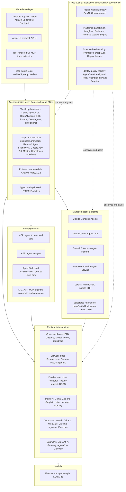
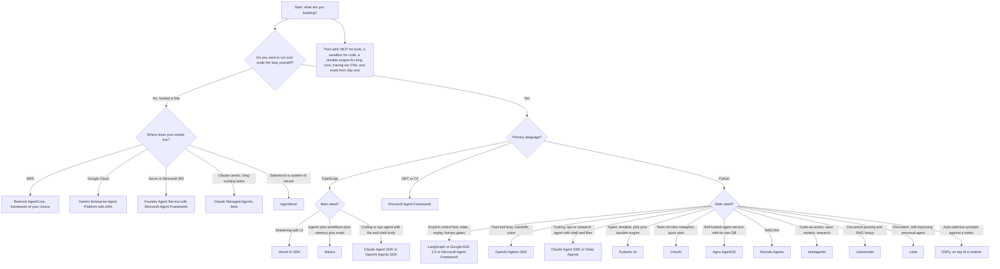
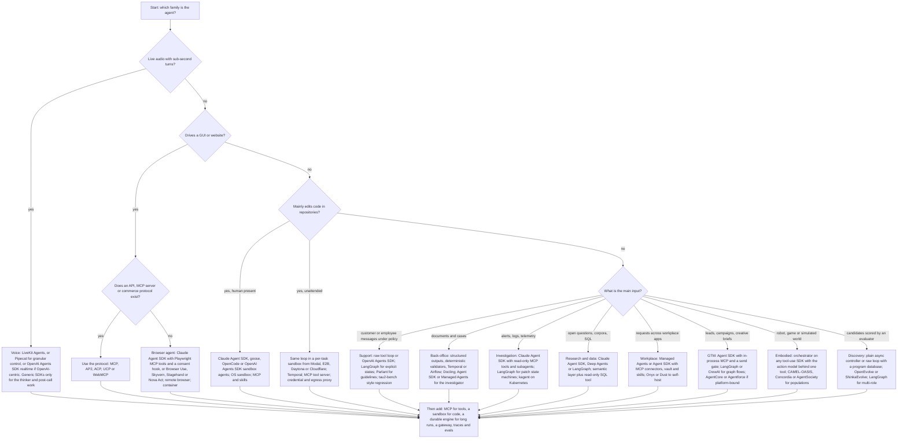

# The AI-Agent Building Stack: Frameworks, Platforms, Protocols, Infra and Evals

**As of 2026-10-01.** Scope: LLM-driven systems that call tools and take multi-step actions with some autonomy (an agent loop or an agentic workflow). Plain chatbots and single-prompt apps are out of scope.

---

## 0. How this was researched, and how to read the evidence

Research was done live on 2026-10-01 with WebSearch and WebFetch. Every URL below is one I actually retrieved or saw in a search result. Nothing here is invented, but the evidence quality varies, so every claim carries a tag where it matters:

| Tag | Meaning |
|---|---|
| **[P]** | Primary: fetched from the vendor's own repo, docs, spec, registry or engineering/product blog. |
| **[S]** | Secondary: a news article, analyst or aggregator page, or a search-result summary. I could not confirm it against the vendor page. Treat as "reported". |
| **[V]** | Vendor self-reported number or benchmark (even when fetched from the vendor). Not independently verified. |
| **[older]** | Source published before 2025. Kept only where it is still the canonical reference. |

**Known limits of this research (read these before relying on any number):**

1. **Many first-party doc sites were blocked by the sandbox's egress proxy**, so I could not read them: `aws.amazon.com`, `docs.aws.amazon.com`, `learn.microsoft.com`, `devblogs.microsoft.com`, `openai.com`, `openai.github.io`, `docs.langchain.com`, `www.langchain.com`, `modelcontextprotocol.io`, `temporal.io`, `langfuse.com`, `opentelemetry.io`, `linuxfoundation.org`, `aaif.io`, `ai-sdk.dev`, `mastra.ai`, `docs.crewai.com`, `strandsagents.com`, `docs.letta.com`, `google.github.io`, `adk.dev`, `www.braintrust.dev`, `opensource.googleblog.com`, `www.salesforce.com`, `agentskills.io`, `infoq.com`. For those vendors I leaned on GitHub READMEs/releases, PyPI/npm registries, and search-result summaries. Where that happened the claim is tagged **[S]**.
2. The fetch tool summarises pages with a small model. Two of its outputs were visibly wrong on dates (it printed 2024 for LangGraph 1.2.12 and OpenAI Agents SDK 0.22.x releases, which is inconsistent with the version numbers and with other 2026 evidence), and PyPI upload timestamps came back unreliable for most packages. **I therefore quote version numbers but omit release dates except where a date was consistent across sources** (Microsoft Agent Framework, Pydantic AI, CrewAI, smolagents).
3. GitHub star counts are as displayed on the repo page on 2026-10-01, rounded as shown.
4. Versions come from the PyPI/npm "latest" metadata as fetched. Some packages have separate Python and JS version lines (for example the Claude Agent SDK is 0.2.x on PyPI and 0.3.x on npm).
5. The "when to choose / when not" guidance is **my synthesis** from the cited facts, not vendor claims.

---

## 1. Executive summary: what changed by October 2026

1. **The "harness" is the new unit of agent software.** Instead of hand-wiring a loop, vendors now ship a batteries-included runtime: the Claude Agent SDK ("the same tools, agent loop, and context management that power Claude Code" [P](https://code.claude.com/docs/en/agent-sdk/overview)), OpenAI Agents SDK sandbox agents [P](https://github.com/openai/openai-agents-python), Strands `create_harness()` [P](https://github.com/strands-agents/harness-sdk), LangChain's Deep Agents ("the batteries-included agent harness") [P](https://github.com/langchain-ai/deepagents), Letta Code [P](https://github.com/letta-ai/letta-code), and Pydantic AI's bundled harness package [P](https://github.com/pydantic/pydantic-ai/releases).
2. **Hosted agent runtimes are now a product category at every hyperscaler and lab.** Anthropic Managed Agents (public beta, April 2026), AWS Bedrock AgentCore (GA October 2025), Google's Gemini Enterprise Agent Platform (April 22, 2026, "a direct evolution of Vertex AI"), Microsoft Foundry Agent Service (GA reported March 2026), plus OpenAI Frontier (February 2026) and Salesforce Agentforce. Details in section 4.
3. **Consolidation is real.** AutoGen and Semantic Kernel are in maintenance mode, replaced by Microsoft Agent Framework 1.0 [P](https://github.com/microsoft/autogen) [P](https://github.com/microsoft/semantic-kernel). IBM's ACP merged into A2A [S](https://zuplo.com/blog/agent-protocol-stack-mcp-a2a-acp-2026). MCP, AGENTS.md and goose moved to the Linux Foundation's Agentic AI Foundation on 2025-12-09 [P](https://www.anthropic.com/news/donating-the-model-context-protocol-and-establishing-of-the-agentic-ai-foundation). Langfuse joined ClickHouse (January 2026) [P](https://github.com/langfuse/langfuse). OpenAI announced it would acquire Promptfoo (March 2026) [S](https://pulse2.com/openai-acquisition-of-ai-security-platform-promptfoo-to-strengthen-enterprise-agent-testing/amp/) and is shutting down its hosted Agent Builder and Evals on 2026-11-30 [S](https://mcp.directory/blog/openai-agentkit-deprecation-2026).
4. **MCP got a big revision.** Spec `2026-07-28` (released July 28, 2026) makes the protocol core stateless, adds a formal extensions framework (Tasks, MCP Apps, Enterprise Managed Authorization), hardens auth, and sets a 12-month deprecation policy [P](https://blog.modelcontextprotocol.io/posts/2026-07-28/).
5. **Durable execution has become table stakes for long-running agents.** Pydantic AI integrates eight durable-execution engines [P](https://github.com/pydantic/pydantic-ai); Temporal's OpenAI Agents SDK integration reportedly went GA for Python in March 2026 [S](https://www.noqta.tn/blog/durable-execution-ai-agents-inngest-trigger-temporal-2026); ADK 2.0 and Microsoft Agent Framework ship graph runtimes with checkpoints and human gates.
6. **Observability standards are still not stable.** OpenTelemetry GenAI semantic conventions were still marked "Development" in mid-2026 [S](https://dev.to/azena-ai/opentelemetrys-genai-semantic-conventions-are-not-stable-yet-heres-what-actually-shipped-in-2026-3mke), so vendors still rely on OpenInference and proprietary SDKs.
7. **Sandbox infra is professionalising and, in one notable case, closing.** Daytona moved its core to a private codebase in June 2026 [P](https://github.com/daytonaio/daytona); E2B remains Apache-2.0 [P](https://github.com/e2b-dev/E2B).

---

## 2. How the layers fit together

Reading the diagram: a **framework** defines the loop or graph; **protocols** are how that loop reaches tools (MCP), peers (A2A), users (AG-UI) and know-how (Skills); a **managed platform** can host the whole thing and bundles several infra pieces (sandbox, memory, identity, observability) so you do not assemble them yourself; **infra** is the set of independently buyable building blocks; **evals/observability** wrap everything.

Anthropic's engineering team describes the managed-runtime split in exactly these terms: separate the **brain** (model plus harness), the **hands** (sandboxes and tools) and the **session** (an append-only event log) so each can fail or be replaced independently [P](https://www.anthropic.com/engineering/managed-agents). The canonical conceptual reference for "workflow versus agent" and the five workflow patterns (prompt chaining, routing, parallelization, orchestrator-workers, evaluator-optimizer) remains Anthropic's "Building effective agents" [older, 2024-12-19] [P](https://www.anthropic.com/engineering/building-effective-agents).

---

## 3. Agent frameworks and SDKs

### 3.1 Comparison table

Stars and versions as of 2026-10-01 (see section 0 for caveats). "n/v" means not verified in the sources I could read.

| Framework | Vendor | Languages | Core abstraction | Multi-agent | HITL | Durable / deploy | License | Stars | Latest version seen |
|---|---|---|---|---|---|---|---|---|---|
| **Claude Agent SDK** | Anthropic | Python, TypeScript | Plain tool loop (Claude Code's loop as a library) | Subagents | Permissions and hooks | Your process; or hosted via Managed Agents | MIT (Python repo); governed by Commercial Terms | 8.2k (Python) | PyPI 0.2.163, npm 0.3.286 |
| **OpenAI Agents SDK** | OpenAI | Python, TypeScript | Agent loop plus handoffs | Handoffs, agents-as-tools | Yes | Self-host; Temporal integration | MIT | 29.8k (Py), 3.9k (JS) | PyPI 0.22.3, npm 0.18.0 |
| **LangGraph** | LangChain Inc. | Python, JS/TS | Stateful graph (Pregel-inspired) | Graphs, subgraphs | `interrupt()` and state edit | Checkpointed; LangSmith Deployment | MIT | 42.5k | PyPI 1.2.12 |
| **LangChain 1.x `create_agent`** | LangChain Inc. | Python, JS/TS | Agent loop with middleware, on LangGraph | Via LangGraph | Middleware | Via LangGraph | MIT | 147.3k | PyPI 1.4.3 |
| **Deep Agents** | LangChain Inc. | Python, TS | Opinionated harness: planning, subagents, filesystem | Subagents | n/v | On LangGraph runtime | MIT | 29.9k | n/v |
| **CrewAI** | CrewAI Inc. | Python | Role-based Crews plus event-driven Flows | Crews | n/v | AMP cloud or on-prem | MIT | 59.2k | 1.15.23 |
| **Microsoft Agent Framework** | Microsoft | .NET, Python (Go repo separate) | Agents plus graph workflows | Sequential, concurrent, handoff, group | Yes, checkpoints | Azure Foundry hosted agents; self-host | MIT | n/v | python-1.19.0, dotnet-1.22.0 |
| **Google ADK** | Google | Python, Java, Go, TypeScript | Agents plus graph Workflow runtime plus Task API | Sub-agents, Task delegation | Tool confirmation, graph gates | Cloud Run, Agent Runtime, Docker | Apache-2.0 | 21.7k (Py) | PyPI 2.10.0 |
| **Pydantic AI** | Pydantic | Python | Typed agent loop, dependency injection, capabilities | n/v on fetched page | Deferred-tool approval | 8 durable-execution engines | MIT | 20.3k | 2.52.0 (also 1.107.x line) |
| **smolagents** | Hugging Face | Python | Code-as-action (`CodeAgent`) | n/v | n/v | Sandboxes: E2B, Blaxel, Modal, Docker | Apache-2.0 | 29.6k | PyPI 1.26.0 |
| **Mastra** | Mastra (YC W25) | TypeScript | Agents plus graph workflows | Via workflows | Suspend/resume | Node server, Next.js | Apache-2.0 core; enterprise license for `ee/` | 28.5k | npm 1.72.0 |
| **Vercel AI SDK** | Vercel | TypeScript | `generateText`/`streamText` plus `ToolLoopAgent` | n/v | Tool-state UI | Any Node 22+; Vercel | see repo | 27.1k | npm 7.0.126 |
| **DSPy** | Stanford NLP | Python | Declarative programs plus optimisers | n/a | n/a | Library | MIT | 38.4k | PyPI 3.4.0 |
| **Letta** | Letta | TypeScript (Letta Code), server/SDK | Stateful agents with self-edited memory | n/v | n/v | Letta Cloud, desktop, self-host | Apache-2.0 | 25k | n/v |
| **Agno** | Agno | Python | Agents, Teams, Workflows on AgentOS runtime | Teams | Approval workflows | AgentOS FastAPI runtime | Apache-2.0 | 42.4k | PyPI 3.0.11 |
| **Strands Agents** | AWS | Python, TypeScript | Model-driven loop plus `create_harness()` | Swarm, graph, agents-as-tools | n/v | Lambda, Fargate, AgentCore | Apache-2.0 | 8.6k (monorepo) | PyPI 1.57.1 |
| **LlamaIndex** | LlamaIndex | Python, TS | Workflows, `AgentWorkflow`, `FunctionAgent` over data indexes | AgentWorkflow | n/v | LlamaCloud | MIT | 52.4k | PyPI 0.14.25 |

Sources for the whole table: each repo README, the PyPI/npm "latest" metadata and the per-framework notes below.

### 3.2 Per-framework notes

Each entry gives vendor, language(s), core abstraction, key primitives, memory, multi-agent, HITL, observability, deployment, maturity signals, and a choose / avoid view. "n/v" = not verified from sources I could read.

#### Claude Agent SDK (Anthropic)
- **What it is:** Claude Code as a library. Python and TypeScript; the Python package bundles the Claude Code CLI [P](https://github.com/anthropics/claude-agent-sdk-python). For other languages, run the CLI headless with `-p` [P](https://code.claude.com/docs/en/agent-sdk/overview).
- **Core abstraction:** a plain, tool-using agent loop with Claude Code's context management; not a graph.
- **Primitives:** built-in tools (read/write/edit files, run commands, web search), hooks at lifecycle points (for example `PreToolUse`), subagents, MCP (including in-process MCP servers defined as Python functions), permissions, sessions (resume or fork), skills/commands/memory loaded from `.claude/`, and plugins [P](https://code.claude.com/docs/en/agent-sdk/overview).
- **Memory:** sessions plus file-based memory/skills loaded from the project and home `.claude/` directories [P].
- **Multi-agent:** subagents for focused subtasks [P]. Anthropic's own multi-agent research system used an orchestrator-worker design and reported a 90.2% outperformance over a single agent on its internal evaluation, at roughly 15x the tokens of chat [V] [P](https://www.anthropic.com/engineering/multi-agent-research-system) (published 2025-06-13).
- **HITL:** permission modes and hook-based approvals [P].
- **Observability:** hooks; OpenInference ships an instrumentation for it and Phoenix lists it [P](https://github.com/Arize-ai/openinference) [P](https://github.com/Arize-ai/phoenix).
- **Deployment:** runs in a process you operate [P]. For hosting, Anthropic's guidance is to compare the SDK with Managed Agents (see 4.1). Anthropic does not allow third parties to offer claude.ai login or its rate limits; use API-key auth [P].
- **Maturity:** pre-1.0 version numbers on both registries; 8.2k stars on the Python repo.
- **Choose when:** you want file/shell/web agents (coding, ops, research, document work) with a battle-tested loop and permissions model. **Avoid when:** you need a custom graph with explicit checkpoints, or a provider-neutral stack (the docs frame it around Claude Code's harness; I did not verify non-Claude model support).

#### OpenAI Agents SDK
- **Vendor/lang:** OpenAI; Python (29.8k stars) and JS/TS (3.9k) [P](https://github.com/openai/openai-agents-python) [P](https://github.com/openai/openai-agents-js). MIT.
- **Core abstraction:** agent loop with **handoffs** between agents.
- **Primitives:** Agents, handoffs/agents-as-tools, guardrails, sessions, tracing, human-in-the-loop, MCP tools, **sandbox agents** (inspect files, run commands, apply patches, preserve workspace state), realtime and voice agents (`gpt-realtime-2.1`) [P].
- **Memory:** sessions (automatic conversation history) [P].
- **Models:** OpenAI Responses and Chat Completions APIs plus "100+ other LLMs" [P].
- **Observability:** built-in tracing [P].
- **Durability:** Temporal integration, reported GA for Python in March 2026 [S](https://www.noqta.tn/blog/durable-execution-ai-agents-inngest-trigger-temporal-2026).
- **Choose when:** OpenAI-centric stack, handoff-style multi-agent, voice/realtime. **Avoid when:** you need native graph checkpoints without bolting on a durable engine. Note the hosted Agent Builder canvas is being shut down; OpenAI points those users to this SDK [S](https://mcp.directory/blog/openai-agentkit-deprecation-2026).

#### LangGraph (LangChain)
- **Vendor/lang:** LangChain Inc.; Python and JS. MIT; 42.5k stars [P](https://github.com/langchain-ai/langgraph).
- **Core abstraction:** a low-level, stateful **graph** orchestration framework "inspired by Pregel and Apache Beam" with a NetworkX-style API [P].
- **Primitives:** state, nodes/edges, checkpointing/persistence, `interrupt()` for human-in-the-loop (1.2.12 added response-schema support for it) [P](https://github.com/langchain-ai/langgraph/releases), streaming, subgraphs, short-term and long-term memory.
- **LangChain 1.0 relationship:** LangChain 1.0 (October 2025) reimplemented `create_agent` on top of LangGraph with a middleware system (built-ins for human-in-the-loop, summarization and PII redaction); `create_react_agent` in LangGraph was deprecated in favour of it [S](https://www.clickittech.com/ai/langchain-1-0-vs-langgraph-1-0/) [S](https://forum.langchain.com/t/we-launched-1-0-versions-of-langchain-and-langgraph/1904).
- **Observability/deploy:** LangSmith for tracing and Studio; LangSmith Deployment for production [P](https://github.com/langchain-ai/langgraph).
- **Adoption signals:** the README names Klarna, Replit and Elastic [P]; secondary sources add Uber and LinkedIn [S](https://www.clickittech.com/ai/langchain-1-0-vs-langgraph-1-0/).
- **Choose when:** you need explicit control flow, durable state, human gates, and replay. **Avoid when:** the task is a simple tool loop (the graph model adds ceremony), or you want zero LangChain-ecosystem gravity.

#### Deep Agents (LangChain)
- 29.9k stars, MIT; Python and TypeScript. "Batteries-included agent harness": planning, sub-agent delegation with isolated contexts, filesystem tools, context management. Built on LangGraph's runtime and LangChain's `create_agent` [P](https://github.com/langchain-ai/deepagents).
- **Choose when:** you want a Claude-Code-style long-horizon agent but on the LangChain stack. **Avoid when:** you need a small, auditable loop.

#### CrewAI
- **Vendor/lang:** CrewAI Inc.; Python; MIT; 59.2k stars. Latest GitHub release seen: **1.15.23** (published September 28, 2026) [P](https://github.com/crewAIInc/crewAI/releases/latest). The README still shows a stale `v0.102.0` CLI example, so trust the releases page [P](https://github.com/crewAIInc/crewAI).
- **Core abstraction:** role-based **Crews** (agents with goals and backstories, assigned Tasks) plus event-driven **Flows** for control [P].
- **Memory:** agents "can utilize memory features" (detail n/v). Checkpointing and async execution are listed [P].
- **Observability/deploy:** the **CrewAI AMP** suite adds tracing, a control plane, security/compliance, cloud or on-premise deployment [P]. The PyPI description says it is built "independent of LangChain" [P](https://pypi.org/pypi/crewai/json).
- **Adoption:** "over 100,000 certified developers" is a [V] claim from the README.
- **Choose when:** you want to model work as a team of specialist roles and ship quickly. **Avoid when:** you need fine-grained deterministic control or minimal abstraction (use Flows or a graph framework).

#### Microsoft Agent Framework (with AutoGen and Semantic Kernel)
- **Vendor/lang:** Microsoft; .NET and Python, with Go in a separate repo; MIT [P](https://github.com/microsoft/agent-framework).
- **Status:** README says General Availability. Version 1.0 GA was reported on April 2-3, 2026 [S](https://techstrong.ai/features/microsoft-ships-agent-framework-1-0-a-production-ready-foundation-for-multi-agent-ai/). Latest releases seen: **python-1.19.0 and dotnet-1.22.0 (both 2026-09-18)** [P](https://github.com/microsoft/agent-framework/releases).
- **Core abstraction:** agents (multiple providers) plus **graph-based workflows** supporting sequential, concurrent, handoff and group-collaboration patterns; "Agent Skills" for domain knowledge [P].
- **Memory/data:** shared vector-store abstractions with in-memory and cloud backends (Azure AI Search, Redis, Qdrant, PostgreSQL) landed in python-1.18.0; MongoDB and Azure DocumentDB connectors in 1.19.0 [P](https://github.com/microsoft/agent-framework/releases).
- **HITL/durability:** checkpointing, restartability and human-in-the-loop control are headline features [P]; .NET 1.22.0 mentions approval binding on replay [P].
- **Observability/protocols:** built-in OpenTelemetry; MCP and A2A support referenced [P].
- **Lineage:** both AutoGen (61.2k stars, "in maintenance mode... community-managed") and Semantic Kernel (28.6k stars, "Semantic Kernel is now Microsoft Agent Framework!") point users to it and provide migration guides [P](https://github.com/microsoft/autogen) [P](https://github.com/microsoft/semantic-kernel). **AG2** is the community-run continuation of AutoGen (5k+ stars, Apache-2.0; v1.0 uses `import ag2`, and the old `autogen` namespace moved to "AG2 Classic") [P](https://github.com/ag2ai/ag2).
- **Deployment:** Foundry hosted agents are framework-agnostic and list Agent Framework first [S](https://devblogs.microsoft.com/foundry/agent-service-build2026/).
- **Choose when:** .NET/C# or Azure/Microsoft-365-centric shops; you need a supported successor to AutoGen/SK. **Avoid when:** you are a Python/TS-only team with no Azure gravity and want the largest community.

#### Google Agent Development Kit (ADK)
- **Vendor/lang:** Google; Python (21.7k stars, Apache-2.0); Java, Go and TypeScript variants reported [P](https://github.com/google/adk-python) [S](https://www.opensourceforu.com/2026/09/google-unveils-agent-developer-kit/).
- **ADK 2.0:** reported GA for Python on 2026-05-19, Go on 2026-06-30 and TypeScript on 2026-08-21 [S]. It adds a graph-based **Workflow runtime** (routing, fan-out/fan-in, loops, retry, dynamic nodes, nested workflows, human-in-the-loop gates that can pause and resume) and a **Task API** for structured agent-to-agent delegation [P](https://github.com/google/adk-python) [S]. 2.0 rewrote the execution layer; using 2.0 code on 1.x databases risks data loss and event schemas changed [S].
- **Other primitives:** tool confirmation, MCP tools, Agent Config (no-code), `adk eval` evaluation [P].
- **Deployment:** Cloud Run, Vertex/Agent Runtime, Docker, local CLI [P]. Google says ADK processes six trillion tokens a month on Gemini [V] [P](https://cloud.google.com/blog/products/ai-machine-learning/introducing-gemini-enterprise-agent-platform).
- **Choose when:** you deploy on Google Cloud or want A2A-native agents with a graph runtime. **Avoid when:** you cannot tolerate a major-version migration, or need a non-Google deployment story.

#### Pydantic AI
- **Vendor/lang:** Pydantic; Python; MIT; 20.3k stars [P](https://github.com/pydantic/pydantic-ai). Latest: **v2.52.0 (2026-09-29)**, with a **v1.107.7** backport line alive [P](https://github.com/pydantic/pydantic-ai/releases).
- **Core abstraction:** a typed agent loop with dependency injection, structured outputs and composable "capabilities" (tools, instructions, hooks, model settings bundled) [P].
- **Durable execution:** integrates **eight** engines: Temporal, DBOS, Prefect, Restate, AWS Lambda, Kitaru, Airflow, Absurd (first five co-maintained with the vendors) [P].
- **HITL:** deferred tools with approval [P]. **Protocols:** MCP, AG-UI and Vercel AI event streams [P].
- **Recent features:** workspaces (`ctx.workspace`) and sandbox integrations (Sprites, E2B) in 2.52.0 [P](https://github.com/pydantic/pydantic-ai/releases).
- **Observability:** OTel-native; **Logfire** is Pydantic's backend [P].
- **Choose when:** Python team that values type safety, testability and a choice of durable engines. **Avoid when:** you want a visual builder or a hosted platform bundled in.

#### smolagents (Hugging Face)
- Python; Apache-2.0; 29.6k stars; PyPI 1.26.0 [P](https://github.com/huggingface/smolagents) [P](https://pypi.org/pypi/smolagents/json).
- **Core abstraction:** **code-as-action**: `CodeAgent` writes its actions as Python rather than JSON tool calls; the README claims "30% fewer steps" [V]. The core is under 1,000 lines [P].
- **Sandboxes:** E2B, Blaxel, Modal, Docker; the local Python executor "is not a security boundary" [P].
- **Models/protocols:** model-agnostic (transformers, Ollama, HF providers, OpenAI, Anthropic, 100+ via LiteLLM); tools from any MCP server [P].
- **Choose when:** research, open models, code-as-action experiments. **Avoid when:** you need production features (durable state, HITL, deployment story) out of the box.

#### Mastra
- TypeScript; Apache-2.0 core with a separate enterprise license for `ee/` directory features; 28.5k stars; YC W25; npm `@mastra/core` 1.72.0 [P](https://github.com/mastra-ai/mastra) [P](https://registry.npmjs.org/@mastra/core/latest).
- **Primitives:** agents; graph workflows (`.then()`, `.branch()`, `.parallel()`); conversation memory plus **Observational Memory**; RAG; evals; suspend/resume human-in-the-loop; 40+ model providers [P].
- **Deployment:** inside React/Next.js/Node apps or as a standalone server; built-in observability [P].
- **Choose when:** TypeScript-first team that wants agents, workflows, memory and evals in one package. **Avoid when:** you need Python or heavyweight durable orchestration beyond suspend/resume.

#### Vercel AI SDK
- TypeScript; 27.1k stars; npm `ai` 7.0.126 [P](https://github.com/vercel/ai) [P](https://registry.npmjs.org/ai/latest).
- **Primitives:** `generateText`/`streamText`, typed structured output (`Output.object()` with Zod), `ToolLoopAgent`, `createAgentUIStreamResponse()` for streaming agent messages, typed tool-invocation UI states, framework hooks (React, Svelte, Vue, Angular), Vercel AI Gateway as default provider layer, MCP registry integration. Node 22+ [P].
- **Observability:** Langfuse and Phoenix list integrations [P](https://github.com/langfuse/langfuse) [P](https://github.com/Arize-ai/phoenix).
- **Choose when:** the product is a web app and the agent's value is in streaming UI. **Avoid when:** you need long-running, multi-day, durable agents (the fetched sources show no built-in durable-execution story, so you would add a durable engine yourself).

#### DSPy
- Stanford NLP; Python; MIT; 38.4k stars; PyPI 3.4.0 [P](https://github.com/stanfordnlp/dspy).
- **Core abstraction:** "programming, not prompting": declarative signatures and modules whose prompts and weights are *optimised* against a metric. Optimisers include MIPRO (June 2024) and **GEPA** (July 2025, "Reflective Prompt Evolution Can Outperform Reinforcement Learning") [P]. Supports ReAct-style agent loops [P].
- **Choose when:** you have an eval metric and a labelled/dev set and want to auto-improve prompts across models. **Avoid when:** you need a runtime (state, deployment, HITL); pair it with one.

#### Letta
- Apache-2.0; 25k stars for the original repo (MemGPT lineage). Active development moved to `letta-code` (3.5k stars); the old V1 API server code is on an `archive` branch [P](https://github.com/letta-ai/letta) [P](https://github.com/letta-ai/letta-code).
- **Core abstraction:** **stateful agents** whose memory they rewrite themselves: memory blocks, **MemFS** (all context tracked in git and synced to GitHub) and sleep-time compute ("dreaming") during idle heartbeats/cron [P].
- **Deployment:** local CLI/desktop, chat.letta.com, Slack/Telegram/Discord channels, Letta Cloud, remote computers, GitHub Actions [P].
- **Choose when:** a persistent personal or team agent that must learn over weeks. **Avoid when:** you need stateless, horizontally scaled request/response agents.

#### Agno
- Apache-2.0; 42.4k stars; PyPI 3.0.11 [P](https://github.com/agno-agi/agno).
- **Core abstraction:** Agents, Teams and Workflows running on **AgentOS**, a FastAPI runtime with 50+ endpoints (SSE and websockets), scheduling, human approval flows, and Slack/Telegram/Discord interfaces. Sessions, memory, knowledge and traces live in a database you own; OpenTelemetry tracing, run history, audit logs, JWT RBAC and multi-tenant isolation [P].
- **Choose when:** you want a self-hosted agent *service* quickly, with data ownership. **Avoid when:** you want a thin library rather than a runtime.

#### Strands Agents (AWS)
- Apache-2.0; Python and TypeScript; the monorepo `strands-agents/harness-sdk` has 8.6k stars. The standalone TypeScript repo was archived on 2026-06-03 and moved into the monorepo [P](https://github.com/strands-agents/harness-sdk) [P](https://github.com/strands-agents/sdk-typescript). PyPI `strands-agents` 1.57.1 [P](https://pypi.org/pypi/strands-agents/json).
- **Core abstraction:** a model-driven loop; `create_harness()`/`createHarness()` returns a "fully assembled" agent with benchmarked defaults, and you can drop to the SDK to own the loop. Multi-agent: swarm, graph, agents-as-tools. First-class Bedrock, Anthropic, OpenAI and Gemini; built-in MCP; lifecycle controls (turn limits, token budgets, cancellation); Lambda and Fargate [P].
- AgentCore documents Strands as a supported framework [P](https://github.com/awslabs/amazon-bedrock-agentcore-samples); AG-UI lists it as a first-party integration [P](https://github.com/ag-ui-protocol/ag-ui).
- **Choose when:** AWS shops, especially deploying to AgentCore. **Avoid when:** you want vendor-neutral governance or a rich built-in HITL story (n/v).

#### LlamaIndex
- MIT; 52.4k stars; PyPI 0.14.25 [P](https://github.com/run-llama/llama_index).
- **Abstractions:** Workflows, `AgentWorkflow`, `FunctionAgent`, `VectorStoreIndex`; 300+ integrations. The README now states the company's focus is "the best AI-powered engine for document parsing and extraction" (LlamaParse, LiteParse, LlamaCloud) [P].
- **Choose when:** document-heavy agents (parsing, extraction, RAG). **Avoid when:** you want a general-purpose agent runtime as the company's centre of gravity has shifted.

#### Others worth knowing
- **Haystack (deepset):** Apache-2.0, 26.6k stars; modular pipelines plus agents with lifecycle hooks for guardrails and token/step tracking [P](https://github.com/deepset-ai/haystack).
- **OpenHands:** MIT, 89.7k stars; self-hosted control centre for coding agents (OpenHands, Claude Code, Codex, Gemini), with a Python SDK and Cloud/Enterprise offerings [P](https://github.com/OpenHands/OpenHands).
- **Low-code builders:** n8n (206.4k stars; fair-code Sustainable Use License; 1,500+ integrations) [P](https://github.com/n8n-io/n8n); Dify (157.6k; Apache-2.0-based license with extra conditions; MCP support) [P](https://github.com/langgenius/dify); Langflow (155.4k; MIT; can deploy flows as an MCP server) [P](https://github.com/langflow-ai/langflow).
- **Cloudflare Agents SDK / Project Think (April 2026):** durable "fibers" in SQLite, sub-agents with isolated storage, persistent sessions, sandboxed code via Dynamic Workers; reported as a preview [S](https://blog.cloudflare.com/project-think/) [S](https://lilting.ch/en/articles/cloudflare-agents-week-think-browser-run-workflows).
- **LiteLLM** (59.9k stars) is a gateway/SDK for 100+ providers with an **MCP gateway** and an **A2A agent gateway** [P](https://github.com/BerriAI/litellm).

---

## 4. Managed agent platforms

| Platform | Vendor | Status (as of 2026-10-01) | Core idea | Framework neutrality |
|---|---|---|---|---|
| **Claude Managed Agents** | Anthropic | Public beta (launched 2026-04-08) | Hosted agent harness plus cloud or self-hosted sandbox, sessions as event logs | Claude-only harness, configured by API |
| **AWS Bedrock AgentCore** | AWS | GA (2025-10); harness GA reported 2026-06-18 | Modular services: Runtime, Memory, Gateway, Identity, Tools, Observability, Evaluation, Policy | Framework- and model-agnostic |
| **Gemini Enterprise Agent Platform** | Google Cloud | Launched 2026-04-22 (successor to Vertex AI) | Build (ADK, Agent Studio), scale (Runtime, Sandbox, Memory Bank), govern (Identity, Registry, Gateway), optimise | ADK-first; Claude and 200+ models in Model Garden |
| **Microsoft Foundry Agent Service** | Microsoft | GA reported 2026-03; hosted agents GA expected early July 2026 | Managed control plane plus hosted-agent sandboxes | Framework-agnostic hosted runtime |
| **OpenAI Frontier / AgentKit / Responses API** | OpenAI | Frontier announced 2026-02-05; Agent Builder and Evals shut down 2026-11-30 | Enterprise "AI coworkers" layer; hosted tools | OpenAI-centric |
| **Salesforce Agentforce** | Salesforce | In production, reported earnings metrics | CRM-native agents on Salesforce data | Salesforce platform |
| **Others** | LangSmith Deployment/Fleet; CrewAI AMP; Agno AgentOS; Letta Cloud | Various | Vendor-framework hosting | Mostly own framework |

### 4.1 Anthropic: Claude Managed Agents (and how it relates to the Agent SDK)
- **What:** "Pre-built, configurable agent harness that runs in managed infrastructure," best for long-running and asynchronous work. Status **beta**; every endpoint needs the `managed-agents-2026-04-01` beta header. Concepts: **Agent** (model, system prompt, tools, MCP servers, skills), **Environment** (Anthropic cloud sandbox or **self-hosted sandbox**), **Session**, **Events** (streamed via SSE; history persisted server-side). Built-in tools: bash, file ops, web search/fetch (with allow/block lists), MCP. Also scheduled deployments (cron). MCP tunnels and "dreaming" are in a narrower research preview. It is **not** currently eligible for Zero Data Retention or HIPAA BAA coverage because it is stateful [P](https://platform.claude.com/docs/en/managed-agents/overview).
- **Launch facts:** public beta on 2026-04-08; standard token rates plus **$0.08 per session-hour**; multi-agent coordination in research preview; named customers: Notion, Rakuten, Asana, Vibecode, Sentry, Atlassian; Anthropic reports up to 10 points better task success than standard prompting on structured file-generation tasks in internal testing [V] [P](https://claude.com/blog/claude-managed-agents).
- **Architecture:** brain/hands/session decoupling; Anthropic reports time-to-first-token down about 60% at p50 and over 90% at p95 after removing container coupling from inference [V]; credentials never reach the sandbox where generated code runs (vault plus proxy for MCP OAuth) [P](https://www.anthropic.com/engineering/managed-agents).
- **Agent SDK versus Managed Agents:** Agent SDK = a library you run in your own process; Managed Agents = Anthropic hosts the loop. Anthropic's published guidance is to prototype with the SDK and graduate to Managed Agents for production [S](https://pasqualepillitteri.it/en/news/755/anthropic-managed-agents-cowork-ga-april-9-2026) (the docs comparison table confirms the split [P](https://code.claude.com/docs/en/agent-sdk/overview)). Managed Agents is also offered on Claude Platform on AWS with some differences [P].

### 4.2 AWS: Amazon Bedrock AgentCore
- **GA:** October 2025 [S](https://aws.amazon.com/about-aws/whats-new/2025/10/amazon-bedrock-agentcore-available) (page not fetchable; summarised in search results). At GA: VPC, PrivateLink, CloudFormation and tagging for all services; Runtime with up to eight-hour execution windows, session isolation and A2A; Memory with a self-managed strategy; Gateway that connects existing MCP servers and supports IAM as well as OAuth; Identity with token vault; Observability on CloudWatch with OpenTelemetry export to Datadog, LangSmith, Langfuse [S](search results above).
- **Modules (from AWS Labs' samples repo, 3.4k stars):** Runtime, Gateway, Memory, Identity, Tools (Code Interpreter, Browser, Web Search), Observability, Evaluation, and **Policy (Cedar)**. Framework-agnostic: Strands, CrewAI, LangGraph, LlamaIndex, Google ADK, OpenAI Agents; Python and TypeScript [P](https://github.com/awslabs/amazon-bedrock-agentcore-samples). `bedrock-agentcore` SDK 1.24.0 [P](https://pypi.org/pypi/bedrock-agentcore/json).
- **Harness:** a "AgentCore harness" reached GA on 2026-06-18 per a news aggregator [S](https://aws-news.com/article/2026-06-18-amazon-bedrock-agentcore-harness-is-now-generally-available-go-from-idea-to-production-grade-agent-in-minutes) (title only; page blocked).
- **Choose when:** AWS estate, need IAM/VPC-grade controls, framework freedom. **Avoid when:** you want an opinionated end-to-end app builder.

### 4.3 Google Cloud: Gemini Enterprise Agent Platform
- Launched **2026-04-22** at Next '26 as the evolution of Vertex AI: "all Vertex AI services and roadmap evolutions will be delivered exclusively through Agent Platform going forward" [P](https://cloud.google.com/blog/products/ai-machine-learning/introducing-gemini-enterprise-agent-platform).
- **Build:** Agent Studio (low-code), ADK, Agent Garden templates. **Scale:** Agent Runtime (sub-second cold starts, multi-day workflows, agent-to-agent orchestration), Agent Sandbox (code and browser automation), Agent Memory Bank with Memory Profiles, Agent Sessions. **Govern:** Agent Identity (cryptographic IDs), Agent Registry, Agent Gateway (with Model Armor), anomaly/threat detection, Security Dashboard. **Optimise:** Agent Simulation, Agent Evaluation (multi-turn autoraters on live traffic), Agent Observability, Agent Optimizer. 200+ models in Model Garden, including Claude [P].
- Google also announced a $750 million partner fund for agent builders [S](https://thejournal.com/articles/2026/05/04/google-announces-new-gemini-enterprise-agent-platform.aspx).

### 4.4 Microsoft: Foundry Agent Service
- All of this is **[S]**; Microsoft's own devblogs and Learn pages were blocked.
- Core service reported to move preview to GA in **March 2026** [S](https://www.dio.me/en/articles/azure-ai-agent-service-em-2026-o-que-muda-na-pratica-154762e92d76) (low-quality source; confirm before relying on it).
- **Hosted agents** (announced April 2026) give sandboxed sessions, state and filesystem access, and a framework-agnostic runtime (Microsoft Agent Framework, GitHub Copilot SDK, LangGraph) with GA expected by early July 2026 [S](https://devblogs.microsoft.com/foundry/introducing-the-new-hosted-agents-in-foundry-agent-service-secure-scalable-compute-built-for-agents) [S](https://devblogs.microsoft.com/foundry/agent-service-build2026/). Build 2026 (2026-06-02) added memory primitives in public preview, Toolboxes with MCP governance, tracing/evaluation for hosted agents and an agent optimizer loop [S](https://letsdatascience.com/news/microsoft-foundry-adds-runtime-tooling-governance-for-agents-0a102598).
- Claude is reported GA in Microsoft Foundry [S](https://www.dio.me/en/articles/azure-ai-agent-service-em-2026-o-que-muda-na-pratica-154762e92d76). A2A is reported natively supported [S](https://www.linuxfoundation.org/press/a2a-protocol-surpasses-150-organizations-lands-in-major-cloud-platforms-and-sees-enterprise-production-use-in-first-year).

### 4.5 OpenAI: Responses API, Agents SDK, AgentKit, Frontier
- **Timeline [S]:** the Responses API and Agents SDK shipped in March 2025; AgentKit (Agent Builder canvas, Connector Registry, ChatKit) in October 2025 [S](https://openai.com/index/introducing-agentkit/) (not fetchable). On **2026-06-03** OpenAI announced it is **winding down Agent Builder and Evals**: Evals goes read-only 2026-10-31 and both are gone 2026-11-30, with the Agents SDK (for code) and "Workspace Agents" in ChatGPT (for natural language) as the recommended replacements [S](https://mcp.directory/blog/openai-agentkit-deprecation-2026) [S](https://www.developersdigest.tech/blog/openai-agent-builder-evals-migration). The Assistants API was planned to be discontinued by mid-2026 [S].
- **Frontier (announced 2026-02-05):** an enterprise platform for building and managing "AI coworkers", a "semantic layer for the enterprise"; early adopters named in coverage: HP, Intuit, Oracle, State Farm, Thermo Fisher, Uber [S](https://itbrief.co.uk/story/openai-unveils-frontier-to-deploy-ai-coworkers-at-scale) [S](https://openai.com/index/introducing-openai-frontier/).
- **Implication:** if you built on the hosted visual builder, plan a migration before 2026-11-30.

### 4.6 Salesforce Agentforce
- Q3 FY26 (quarter ended 2025-10-31): "over 9,500 paid Agentforce deals," Agentforce ARR above half a billion dollars, Agentforce plus Data 360 near $1.4B ARR [S](https://www.salesforce.com/news/press-releases/2025/12/03/fy26-q3-earnings/) (summarised via search; page blocked).
- Q2 FY27 (reported 2026-08-26): Agentforce ARR above $1.5B (up over 240% YoY), Agentforce plus Data 360 ARR near $3.9B, 7.0 billion "Agentic Work Units" delivered to date [S](https://investor.salesforce.com/news/news-details/2026/Salesforce-Delivers-Record-Second-Quarter-Fiscal-2027-Results/default.aspx) [S](https://pulse2.com/salesforce-net-income-jumps-87-as-agentforce-and-data-360-arr-surges-more-than-210-to-nearly-3-9-billion/). These are company-reported metrics. "Agentic Work Unit" is Salesforce's own metric, so it is not comparable with other vendors' numbers.
- **Choose when:** your system of record is Salesforce. **Avoid when:** agents must span non-Salesforce data as the primary use.

### 4.7 Other hosting options
- **LangSmith:** Deployment, plus Fleet (the Agent Builder product renamed on 2026-03-20), Engine, Sandboxes (GA) and an LLM Gateway announced at Interrupt 2026 [S](https://agentmarketcap.ai/blog/2026/08/18/langchain-langsmith-fleet-nvidia-framework-to-runtime-pivot). Treat this as reported until confirmed in LangChain's own docs.
- **CrewAI AMP**, **Agno AgentOS**, **Letta Cloud**, **Cloudflare Agents** are covered under their frameworks above.

---

## 5. Protocols and open standards

| Protocol | Layer | Governance / status | Key facts |
|---|---|---|---|
| **MCP** (Model Context Protocol) | Agent to tools/data | Donated to the Linux Foundation's Agentic AI Foundation (AAIF) on 2025-12-09; spec `2026-07-28` is current | See 5.1 |
| **A2A** (Agent2Agent) | Agent to agent | Linux Foundation project, Apache-2.0, 26k stars; v1.0 reported March 2026 | See 5.2 |
| **AG-UI** | Agent to user interface | Open source, MIT, 16.2k stars; CopilotKit-led | See 5.3 |
| **Agent Skills / SKILL.md** | Agent to reusable know-how | Open standard published by Anthropic (reported 2025-12-18) | See 5.4 |
| **AGENTS.md** | Agent to repo conventions | Founding AAIF project (from OpenAI) | See 5.4 |
| **AP2 / ACP / UCP** | Agent to payments and commerce | Mixed; see 5.5 | See 5.5 |
| **WebMCP** | Browser to agent | W3C Community Group draft, not a Standard | See 5.6 |

### 5.1 MCP
- **Spec 2026-07-28** (released 2026-07-28) [P](https://blog.modelcontextprotocol.io/posts/2026-07-28/), also the latest schema date in the spec repo (9.4k stars) [P](https://github.com/modelcontextprotocol/modelcontextprotocol). Headline changes: a **stateless core** (self-describing requests that land on any server instance behind a load balancer); **multi round-trip requests** replacing server-initiated requests over held-open streams; `Mcp-Method`/`Mcp-Name` headers so gateways and WAFs can route without parsing JSON; cacheable list results (`ttlMs`, `cacheScope`); auth hardening (RFC 9207 issuer validation, a shift from Dynamic Client Registration to Client ID Metadata Documents); a **formal extensions framework** (Tasks moves to `io.modelcontextprotocol/tasks`; MCP Apps; Enterprise Managed Authorization); and a 12-month minimum deprecation window, with Roots, Sampling, Logging and the legacy HTTP+SSE transport called out as deprecated [P].
- **MCP Apps** (SEP-1865) lets servers ship interactive HTML UIs rendered by hosts in a sandboxed iframe [S](https://blog.modelcontextprotocol.io/posts/2026-07-28-release-candidate/) (search summary).
- **Adoption (as of 2025-12-09, Anthropic's figures [V]):** over 10,000 active public MCP servers; 97M+ monthly SDK downloads (Python and TypeScript); integrated into ChatGPT, Cursor, Gemini, Microsoft Copilot and VS Code [P](https://www.anthropic.com/news/donating-the-model-context-protocol-and-establishing-of-the-agentic-ai-foundation). No later official adoption figure was retrievable.
- **AAIF:** the Linux Foundation hub for MCP, Block's goose and OpenAI's AGENTS.md. Platinum members include AWS, Anthropic, Block, Bloomberg, Cloudflare, Google, Microsoft and OpenAI [S](https://www.enterpriseaiworld.com/Articles/News/News/The-Linux-Foundation-Announces-the-Formation-of-the-Agentic-AI-Foundation-172815.aspx) [S](https://workos.com/blog/the-linux-foundation-launches-the-aaif).
- **Practical implication:** servers written for the old stateful model will need to adapt to the stateless core; plan for the deprecations (Sampling, Roots, Logging, HTTP+SSE).

### 5.2 A2A
- Open protocol for opaque agent apps to collaborate. Concepts: **Agent Card** (discovery), **Task**, **Message**; JSON-RPC 2.0 over HTTP(S), SSE streaming, push notifications; SDKs for Python, Go, JavaScript, Java, .NET and Rust [P](https://github.com/a2aproject/A2A).
- **Timeline [S]:** announced 2025-04-09; donated to the Linux Foundation 2025-06-23; **v1.0 in March 2026** with signed Agent Cards, multi-tenancy, and JSON-RPC plus gRPC bindings; 150+ supporting organisations by April 2026; native support in Azure AI Foundry, AgentCore and ADK [S](https://www.linuxfoundation.org/press/a2a-protocol-surpasses-150-organizations-lands-in-major-cloud-platforms-and-sees-enterprise-production-use-in-first-year) [S](https://opensource.googleblog.com/2026/04/a-year-of-open-collaboration-celebrating-the-anniversary-of-a2a.html).
- **IBM's ACP merged into A2A** (August 2025) [S](https://zuplo.com/blog/agent-protocol-stack-mcp-a2a-acp-2026). Note that "ACP" is also the name of an unrelated commerce protocol (5.5).
- **Reality check:** protocol *support* in platforms is widespread, but I found no independent data on how many production systems actually use cross-vendor A2A rather than in-framework multi-agent.

### 5.3 AG-UI
- "An open, lightweight, event-based protocol that standardizes how AI agents connect to user-facing applications." About 16 standard event types; transport via SSE, WebSockets or webhooks. First-party integrations: Microsoft Agent Framework, Google ADK, AWS Strands, Mastra, Pydantic AI, LlamaIndex, AG2; partnerships with LangGraph and CrewAI; community support for the Claude Agent SDK. Built by and integrated with CopilotKit [P](https://github.com/ag-ui-protocol/ag-ui).

### 5.4 Skills and AGENTS.md
- **Agent Skills:** portable folders with a `SKILL.md` and optional scripts/resources, loaded with progressive disclosure (name and description at startup, full body on trigger, reference files on demand). Anthropic published it as an open standard (reported 2025-12-18); adopters reported include Microsoft, OpenAI, GitHub, Cursor, Figma, Atlassian, Gemini CLI, VS Code and others [S](https://www.unite.ai/anthropic-opens-agent-skills-standard-continuing-its-pattern-of-building-industry-infrastructure). The Claude Agent SDK loads skills from `.claude/` [P] and Microsoft Agent Framework has "Agent Skills" [P], consistent with that adoption.
- **AGENTS.md:** repo-level instructions for coding agents; now an AAIF founding project (above). Temporal's and Restate's repos both contain an `AGENTS.md` [P](https://github.com/temporalio/temporal) [P](https://github.com/restatedev/restate).

### 5.5 Agent commerce and payments
- **ACP (Agentic Commerce Protocol):** OpenAI and Stripe, Apache-2.0, first released September 2025. OpenAI's Instant Checkout in ChatGPT launched February 2026, but OpenAI reportedly retired it in March 2026 in favour of retailer apps inside ChatGPT (Walmart, Target, Instacart) [S](https://wetheflywheel.com/en/agentic-commerce/acp-vs-ap2/).
- **AP2 (Agent Payments Protocol):** launched by Google in September 2025 as an A2A extension; reported 60+ partners by Q1 2026; v0.2 reportedly donated to the FIDO Alliance on 2026-04-28 [S](https://crossmint.com/learn/agentic-payments-protocols-compared).
- **UCP (Universal Commerce Protocol):** Google, announced at NRF in January 2026, with backers including Shopify, Walmart, Target, Best Buy, Etsy, PayPal, Visa, Stripe and American Express [S](https://wetheflywheel.com/en/agentic-commerce/acp-vs-ap2/).
- This area is the least settled in the stack; one major deployment was already pulled back within a month.

### 5.6 WebMCP
- A browser API (`navigator.modelContext.registerTool`) co-developed by Google and Microsoft in the W3C Web Machine Learning Community Group; a Community Group Draft Report (2026-04-23) that "is not a W3C Standard"; Chrome 146 early preview in February 2026 and a Chrome 149 origin trial [S](https://venturebeat.com/infrastructure/google-chrome-ships-webmcp-in-early-preview-turning-every-website-into-a) [S](https://studiomeyer.io/en/blog/webmcp-reality-check-may-2026). As of May 2026, none of the mainstream agents were reported to call it directly [S].

---

## 6. Runtime infrastructure

### 6.1 Code sandboxes
| Option | Facts | Source |
|---|---|---|
| **E2B** | Open source (Apache-2.0), 14.1k stars; JS/TS and Python SDKs; Code Interpreter SDK and Desktop SDK (computer use); self-host via Terraform on AWS/GCP/Azure/Linux. Third parties describe Firecracker microVM isolation and about 150 ms starts (not in the README). | [P](https://github.com/e2b-dev/E2B) [S](https://blogs.novita.ai/best-ai-agent-sandboxes-2026/) |
| **Daytona** | 71.7k stars; "sandboxes that spin up in under 90ms" [V]; vendor says each sandbox gets a dedicated kernel, filesystem, network stack and allocated resources. **As of June 2026 core development moved to a private codebase; the public repo gets no further updates**, citing AI-assisted vulnerability hunting against open repos. A third-party comparison characterises its isolation differently (Docker containers), so verify isolation claims yourself. | [P](https://github.com/daytonaio/daytona) [S](https://daytona.io/dotfiles/updates/daytona-is-going-closed-source) [S](https://www.morphllm.com/comparisons/daytona-alternative) |
| **Modal** | Serverless Python functions and GPU; gVisor isolation and about 400 ms starts per a third-party benchmark; a smolagents executor. | [S](https://www.superagent.sh/blog/ai-code-sandbox-benchmark-2026) [P](https://github.com/huggingface/smolagents) |
| **Vercel Sandbox, Cloudflare Sandbox / Dynamic Workers** | Container-based per third-party comparisons; Cloudflare adds edge execution. | [S](https://www.superagent.sh/blog/ai-code-sandbox-benchmark-2026) |
| **Integrated sandboxes** | Managed Agents cloud/self-hosted sandbox; AgentCore Code Interpreter; Gemini Agent Sandbox; Foundry hosted-agent sandboxes; LangSmith Sandboxes; Pydantic AI integrations (Sprites, E2B); smolagents executors (Blaxel too). | sections 3-4 |

Isolation model (kernel-per-sandbox microVM versus shared-kernel container versus gVisor) is the main security differentiator. Cold-start numbers above are vendor or third-party benchmark claims and are not comparable across sources.

### 6.2 Browser infrastructure
- **Browserbase:** hosted headless browsers with persistent sessions and anti-bot handling; $40M Series B (Notable Capital, June 2025), $67.5M total [S](https://www.cbinsights.com/company/browserbase). Its **Stagehand** SDK (25.5k stars, MIT, TypeScript/Python/Go) supports its Model Gateway and residential proxies [P](https://github.com/browserbase/stagehand).
- **Browser Use:** open-source (MIT) library with **116.8k stars**; hosted Browser Use Cloud at $0.02 per browser-hour with stealth, proxies and profiles; works with Claude, GPT, Gemini and local models [P](https://github.com/browser-use/browser-use). A $17M seed (Felicis) was reported [S](https://www.joinmassive.com/blog/browser-infrastructure-companies-funding).
- **Anchor Browser:** $6M seed (November 2025) [S](https://en.globes.co.il/en/article-1001524333). **Steel** also appears in this category [S].
- **Built into platforms:** AgentCore Browser tool [P], Gemini Agent Sandbox (browser automation) [P], Cloudflare Browser Run [S].

### 6.3 Durable execution
- **Temporal:** MIT, 23.4k stars [P](https://github.com/temporalio/temporal). Reported: OpenAI Agents SDK integration GA for Python in March 2026; a $5B valuation with OpenAI and Block in production [S](https://www.noqta.tn/blog/durable-execution-ai-agents-inngest-trigger-temporal-2026) [S](https://temporal.io/blog/announcing-openai-agents-sdk-integration) (page blocked).
- **Restate:** 4.5k stars; durable workflows and stateful agents [P](https://github.com/restatedev/restate).
- **Inngest:** event-driven, serverless-first; $21M Series A (September 2025) [S](https://www.noqta.tn/blog/durable-execution-ai-agents-inngest-trigger-temporal-2026). **Trigger.dev** is named alongside it [S].
- **DBOS, Prefect, Airflow, AWS Lambda, Kitaru, Absurd:** listed as Pydantic AI durable-execution integrations [P](https://github.com/pydantic/pydantic-ai).
- **Cloudflare Durable Objects / fibers** (Project Think) [S](https://blog.cloudflare.com/project-think/).
- **Framework-native alternatives:** LangGraph checkpointing, ADK 2.0 workflow runtime, Microsoft Agent Framework checkpointing, Mastra suspend/resume (section 3).
- **Rule of thumb (my synthesis):** use framework-native checkpoints when a run lasts minutes and one team owns the whole stack; add a dedicated durable engine when runs last hours or days, cross services, or must survive deploys.

### 6.4 Memory layers
| System | Model | Facts |
|---|---|---|
| **Mem0** | Add-on memory layer: user, session and agent levels; single-pass extraction, entity linking, multi-signal retrieval (semantic, BM25, entity) | Apache-2.0; 66.4k stars. Its own April 2026 numbers: 92.5 LoCoMo, 94.4 LongMemEval, 64.1 BEAM at 1M tokens, from its own paper [V]. Integrates with LangGraph, CrewAI, Vercel AI SDK [P](https://github.com/mem0ai/mem0). |
| **Zep / Graphiti** | **Temporal knowledge graph** tracking how facts change, with provenance | Graphiti: Apache-2.0, 31.3k stars; Neo4j, FalkorDB, Neptune backends; MCP server. Zep is the commercial product on top, claiming sub-200 ms retrieval [V] [P](https://github.com/getzep/graphiti). |
| **Letta** | Agent is its own memory: blocks, git-backed MemFS, sleep-time compute | See 3.2 [P](https://github.com/letta-ai/letta-code). |
| **Cognee** | Knowledge graph from broad data sources | Mentioned in comparisons [S](https://www.cognee.ai/blog/guides/best-ai-memory-layers-for-ai-agents-in-2026-comparison). |
| **Managed memory** | AgentCore Memory (with a self-managed extraction strategy), Gemini Agent Memory Bank/Profiles, Foundry memory (public preview) | [S](search results above) [P](https://cloud.google.com/blog/products/ai-machine-learning/introducing-gemini-enterprise-agent-platform) [S](https://letsdatascience.com/news/microsoft-foundry-adds-runtime-tooling-governance-for-agents-0a102598) |

**Benchmark warning:** memory benchmarks do not agree. Mem0 reports 94.4 on LongMemEval [V], while a third-party roundup lists Mem0 at 49% on LongMemEval and Zep at 63.8% [S](https://mcp.directory/blog/mem0-vs-letta-vs-zep-vs-cognee-2026). Different harnesses, prompts and judge models explain much of this. Run your own evaluation on your own traffic before choosing.

### 6.5 Vector and retrieval databases
- **Qdrant:** Rust, Apache-2.0, 34.9k stars; dense, sparse and multi-vector search, payload filtering, hybrid fusion, quantization, GPU indexing [P](https://github.com/qdrant/qdrant). A $50M Series B (March 2026) was reported [S](https://dev.to/moksh/qdrant-raised-50m-pinecone-explored-a-sale-picking-a-vector-database-in-2026-2klj).
- **Weaviate:** Go, BSD-3-Clause, 16.9k stars; hybrid search (vector plus BM25), multi-tenancy, RBAC [P](https://github.com/weaviate/weaviate).
- **Chroma:** Apache-2.0, 29.4k stars, "search infrastructure for AI" with vector, hybrid and full-text search [P](https://github.com/chroma-core/chroma).
- **pgvector:** Postgres extension, 23.2k stars, v0.8.6, HNSW and IVFFlat [P](https://github.com/pgvector/pgvector).
- **Pinecone:** managed service; founder Edo Liberty moved to Chief Scientist with Ash Ashutosh as CEO, and press reported the company explored a sale, which the new CEO publicly downplayed [S](https://venturebeat.com/infrastructure/pinecone-founder-edo-liberty-appoints-googler-ash-as-ceo) [S](https://www.techtarget.com/searchdatamanagement/news/366631366/Vector-database-vendor-Pinecone-eyes-future-under-new-CEO).
- **Also in the field (not verified here):** LanceDB (an AAIF silver member [S](https://workos.com/blog/the-linux-foundation-launches-the-aaif)), turbopuffer, Milvus.
- **Trend [S]:** hyperscalers and Postgres absorb vector search, squeezing pure-play vendors. A common third-party recommendation is to start with pgvector under roughly 10 million vectors [S](https://dev.to/moksh/qdrant-raised-50m-pinecone-explored-a-sale-picking-a-vector-database-in-2026-2klj). I did not find an independent benchmark to back that threshold.

### 6.6 Gateways
LiteLLM (unified API for 100+ providers, MCP and A2A gateways) [P](https://github.com/BerriAI/litellm); Vercel AI Gateway (default provider layer for AI SDK) [P](https://github.com/vercel/ai); AgentCore Gateway (turns APIs/Lambdas into MCP tools; fronts MCP servers) [P](https://github.com/awslabs/amazon-bedrock-agentcore-samples); Google Agent Gateway (with Model Armor) [P](https://cloud.google.com/blog/products/ai-machine-learning/introducing-gemini-enterprise-agent-platform). The MCP 2026-07-28 header-based routing is aimed squarely at this gateway layer [P](https://blog.modelcontextprotocol.io/posts/2026-07-28/).

---

## 7. Evaluation and observability

| Product | Type | Facts | Source |
|---|---|---|---|
| **LangSmith** | Commercial platform (LangChain) | Tracing, evals, deployment; framework-agnostic ("works with any LLM application"). Reported pricing: Developer free (1 seat, 5k traces/month), Plus $39/seat/month. LangChain raised a reported $125M Series B at $1.25B (October 2025). | [P](https://github.com/langchain-ai/langsmith-sdk) [S](https://agentmarketcap.ai/blog/2026/08/18/langchain-langsmith-fleet-nvidia-framework-to-runtime-pivot) [S](https://sacra.com/c/langchain) |
| **Langfuse** | Open source (MIT, excluding enterprise dirs), 35.2k stars | Tracing, prompt management, evals (LLM-as-judge, datasets), playground; Docker/K8s/Terraform self-host; 20+ integrations. **Part of ClickHouse as of January 2026**, alongside ClickHouse's $400M Series D. | [P](https://github.com/langfuse/langfuse) [S](https://clickhouse.com/blog/clickhouse-acquires-langfuse-open-source-llm-observability) [S](https://businesswire.com/news/home/20260116008883/en/ClickHouse-Raises-$400M-Series-D-Led-by-Dragoneer-to-Accelerate-Expansion-Across-Analytics-and-AI-Infrastructure) |
| **Braintrust** | Commercial eval/observability | Reported $80M Series B led by ICONIQ at an $800M post-money valuation (February 2026). Docs not readable here; I make no feature claims. | [S](https://www.axios.com/pro/enterprise-software-deals/2026/02/17/ai-observability-braintrust-80-million-800-million) |
| **Arize Phoenix** | Source-available (**Elastic License 2.0**, not OSI open source), 11.7k stars | Tracing, evals, datasets, experiments, prompt management, playground; 40+ instrumentations across Python, JS, Java, Go (OpenAI Agents SDK, Claude Agent SDK, Mastra, BeeAI, LangGraph, CrewAI and others) via **OpenInference**. | [P](https://github.com/Arize-ai/phoenix) |
| **W&B Weave** | Apache-2.0 client, 1.1k stars | `@weave.op` tracing and evaluations; requires a W&B account. | [P](https://github.com/wandb/weave) |
| **Pydantic Logfire** | Commercial backend | OTel-native tracing, real-time debugging and cost tracking; free tier. | [P](https://github.com/pydantic/pydantic-ai) |
| **OpenInference** | Convention + instrumentations (Arize) | Complements OpenTelemetry; 40+ Python packages including the Claude Agent SDK; Java instrumentations for LangChain4j, Spring AI and Google ADK; 1.2k stars. | [P](https://github.com/Arize-ai/openinference) |
| **OpenTelemetry GenAI semantic conventions** | Standard | Spans, metrics and events for GenAI clients, **MCP**, and provider-specific conventions in a dedicated `semantic-conventions-genai` repo. As of mid-2026 every `gen_ai.*` attribute, span, metric and event reportedly still carried "Development" stability, with no published timeline for Stable; the opt-in variable `OTEL_SEMCONV_STABILITY_OPT_IN` manages transitions. | [P](https://github.com/open-telemetry/semantic-conventions-genai) (repo contents) [S](https://dev.to/azena-ai/opentelemetrys-genai-semantic-conventions-are-not-stable-yet-heres-what-actually-shipped-in-2026-3mke) [S](https://www.dash0.com/knowledge/opentelemetry-genai-semantic-conventions-explained) (stability) |
| **Promptfoo** | Test and red-team tool | OpenAI announced it would acquire it in March 2026 and fold it into OpenAI Frontier; press cites 350,000+ developers and use at over 25% of the Fortune 500 [V]. | [S](https://pulse2.com/openai-acquisition-of-ai-security-platform-promptfoo-to-strengthen-enterprise-agent-testing/amp/) |
| **DeepEval, Ragas, Inspect AI** | Open-source eval frameworks | DeepEval: pytest-style unit tests with dozens of metrics and a hosted dashboard (Confident AI). Ragas: RAG-focused metrics. Inspect: originally built by the UK AI Safety Institute, code-first, first-class agent and tool evaluation. | [S](https://atlan.com/know/llm-evaluation-frameworks-compared/) [S](https://www.callmissed.com/en/blog/agent-evaluation-frameworks-compared-braintrust-vs-inspect-vs-langfuse-vs-diy-20) |
| **Platform-native** | Evals inside managed platforms | AgentCore Evaluation and Observability (CloudWatch plus OTel export); Gemini Agent Simulation, Evaluation, Observability and Optimizer; Foundry tracing, evaluation and agent optimizer; ADK `adk eval`; Mastra evals; Managed Agents session tracing. | sections 3-4 |

**What the evidence says about the state of the field:**
- The multi-agent research system write-up reports that token usage alone explained about 80% of performance variance on BrowseComp and that small (20-query) eval sets surfaced high-impact issues early [V] [P](https://www.anthropic.com/engineering/multi-agent-research-system) (2025-06-13). Start evals small and early.
- Hosted evals are a fragile dependency: OpenAI's own hosted Evals product goes away on 2026-11-30 [S]. Prefer evals that live in your repo (Inspect, DeepEval, Promptfoo-style configs) with exportable datasets.
- Pick instrumentation that emits OTel (and OpenInference where needed) so you can swap backends; the OTel GenAI conventions are still "Development", so pin versions.

---

## 8. Which one should I pick? A decision guide

This section is my synthesis. It is built from the facts above and is meant as a starting point, not a verdict.

### 8.1 Decision flow

### 8.2 Rules of thumb

1. **Start with the simplest thing that works.** Anthropic's guidance: use direct API calls or a minimal loop first, add workflow patterns only when they demonstrably help, and use frameworks cautiously so they do not hide prompts and responses [older, 2024-12-19] [P](https://www.anthropic.com/engineering/building-effective-agents).
2. **Workflow versus agent:** if the path is known, write a workflow (chaining, routing, parallelization). If the path is open-ended and the environment is trusted, use an agent loop [P, same source].
3. **Match the abstraction to the failure mode you fear.**
   - Fear *unbounded behaviour*: graph frameworks with checkpoints and human gates (LangGraph, ADK 2.0, Microsoft Agent Framework).
   - Fear *slow iteration*: tool-loop harnesses (Claude Agent SDK, OpenAI Agents SDK, Strands, Deep Agents).
   - Fear *runtime bugs*: typed frameworks (Pydantic AI) and strong evals.
4. **Long-running work needs three things regardless of framework:** a durable execution story (native checkpoints or an engine), a sandbox with a real isolation boundary, and a session/event log you can replay. Managed platforms bundle these; otherwise assemble them.
5. **Lock-in map.** Least portable: hosted visual builders (OpenAI Agent Builder is being removed), cloud-specific runtimes. Most portable: MCP tools, A2A agents, OTel traces, framework-neutral hosts (AgentCore, Foundry hosted agents, Cloudflare).
6. **Pre-1.0 and fast-moving:** the Claude Agent SDK, OpenAI Agents SDK, DSPy-adjacent tooling, and many infra pieces still carry sub-1.0 or rapidly churning version numbers. Pin versions and budget for upgrades. ADK 2.0 shows how a major version can break storage and event schemas [S].
7. **Security posture.** Treat sandbox choice as a security decision (kernel-per-sandbox versus shared kernel). The smolagents local executor is explicitly not a security boundary [P]. Credentials should not live inside the sandbox where generated code runs, which is how Managed Agents is designed [P].
8. **Check the license.** Phoenix is Elastic License 2.0; n8n is fair-code; Mastra has an enterprise-licensed `ee/` directory; Dify uses a modified Apache-2.0; Daytona's code is now closed [P]. The Claude Agent SDK is governed by Anthropic's Commercial Terms [P].

### 8.3 Scenario shortcuts

| Scenario | A reasonable default | Why |
|---|---|---|
| Internal coding or ops agent on your repos | Claude Agent SDK, or OpenAI Agents SDK with sandbox agents; OpenHands for a ready-made UI | Harnesses ship file, shell and permission primitives |
| Customer-support or back-office workflow with approvals | LangGraph, ADK 2.0 or Microsoft Agent Framework plus durable execution | Explicit state, interrupts, replay |
| Next.js product with a streaming agent UI | Vercel AI SDK or Mastra, optionally AG-UI/CopilotKit | UI-first TS ecosystem |
| Enterprise on a hyperscaler wanting identity/policy/memory managed | AgentCore, Gemini Enterprise Agent Platform or Foundry | Governance and runtime bundled |
| Research or prototype with open models | smolagents or Pydantic AI | Lightweight, model-agnostic |
| Document-heavy extraction agents | LlamaIndex (LlamaParse) | Product focus |
| Agent that must remember users for months | Letta, or Mem0/Zep layered onto your framework | Purpose-built memory |
| Need to prove quality before launch | Promptfoo/DeepEval/Inspect in CI plus Langfuse, Phoenix, LangSmith or Braintrust for traces | Repo-local evals plus trace platform |

---

## 9. Risks, open questions and things I could not verify

- **First-party pages I could not read** (section 0): AWS, Microsoft, OpenAI, LangChain, MCP site, Temporal, OTel, Linux Foundation and others. The most important claims relying on search-result summaries are: AgentCore GA details and harness GA (June 2026); Foundry GA timing; A2A v1.0 date and 150-org count; OpenAI Agent Builder/Evals shutdown dates; Salesforce earnings figures; OTel GenAI "Development" status; LangChain valuation and LangSmith product renames; Temporal GA and valuation. Re-verify before citing externally.
- **Version/date reliability:** see section 0, item 2. Version numbers in the comparison table are from registries; release dates are mostly omitted on purpose.
- **Not covered in depth:** Semantic-layer and data platforms' agent offerings (Databricks, Snowflake), ServiceNow, Copilot Studio, Spring AI, LangChain4j, Rust or Go agent frameworks, other agent-memory vendors (Supermemory, Hindsight), and open-weight model serving. Several appeared in sources but I did not verify them.
- **Metrics that cannot be compared:** vendor-defined units (Salesforce "Agentic Work Units", Google "tokens processed by ADK"), vendor memory benchmarks, and sandbox cold-start numbers.
- **Fast-moving facts:** the MCP spec just changed (2026-07-28), OpenAI's hosted tooling is being retired, Daytona closed its source, and ADK went through a breaking 2.0. Expect this document to age quickly.

---

## 10. Source index (grouped)

**Primary (fetched):**
- Anthropic: [Agent SDK overview](https://code.claude.com/docs/en/agent-sdk/overview), [Managed Agents overview](https://platform.claude.com/docs/en/managed-agents/overview), [Managed Agents engineering post](https://www.anthropic.com/engineering/managed-agents), [Managed Agents launch post](https://claude.com/blog/claude-managed-agents), [Multi-agent research system](https://www.anthropic.com/engineering/multi-agent-research-system), [Building effective agents](https://www.anthropic.com/engineering/building-effective-agents), [MCP donation to AAIF](https://www.anthropic.com/news/donating-the-model-context-protocol-and-establishing-of-the-agentic-ai-foundation).
- Google: [Gemini Enterprise Agent Platform](https://cloud.google.com/blog/products/ai-machine-learning/introducing-gemini-enterprise-agent-platform).
- MCP: [2026-07-28 release post](https://blog.modelcontextprotocol.io/posts/2026-07-28/), [spec repo](https://github.com/modelcontextprotocol/modelcontextprotocol).
- GitHub repos (READMEs and releases) for every framework, infra and eval tool named above; PyPI JSON metadata for `langgraph`, `openai-agents`, `crewai`, `agent-framework`, `google-adk`, `pydantic-ai`, `smolagents`, `claude-agent-sdk`, `dspy`, `agno`, `strands-agents`, `llama-index`, `langchain`, `bedrock-agentcore`; npm registry metadata for `ai`, `@mastra/core`, `@openai/agents`, `@anthropic-ai/claude-agent-sdk`, `@langchain/langgraph`.

**Secondary (search results; not independently confirmed):** [Microsoft Agent Framework 1.0 coverage](https://techstrong.ai/features/microsoft-ships-agent-framework-1-0-a-production-ready-foundation-for-multi-agent-ai/), [ADK 2.0 coverage](https://www.opensourceforu.com/2026/09/google-unveils-agent-developer-kit/), [AgentCore GA announcement](https://aws.amazon.com/about-aws/whats-new/2025/10/amazon-bedrock-agentcore-available), [Foundry at Build 2026](https://devblogs.microsoft.com/foundry/agent-service-build2026/), [OpenAI AgentKit wind-down guide](https://mcp.directory/blog/openai-agentkit-deprecation-2026), [OpenAI Frontier coverage](https://itbrief.co.uk/story/openai-unveils-frontier-to-deploy-ai-coworkers-at-scale), [Salesforce Q2 FY27](https://investor.salesforce.com/news/news-details/2026/Salesforce-Delivers-Record-Second-Quarter-Fiscal-2027-Results/default.aspx), [A2A one-year release](https://www.linuxfoundation.org/press/a2a-protocol-surpasses-150-organizations-lands-in-major-cloud-platforms-and-sees-enterprise-production-use-in-first-year), [agent protocol stack overview](https://zuplo.com/blog/agent-protocol-stack-mcp-a2a-acp-2026), [AAIF launch](https://www.enterpriseaiworld.com/Articles/News/News/The-Linux-Foundation-Announces-the-Formation-of-the-Agentic-AI-Foundation-172815.aspx), [Daytona closing source](https://daytona.io/dotfiles/updates/daytona-is-going-closed-source), [sandbox benchmark](https://www.superagent.sh/blog/ai-code-sandbox-benchmark-2026), [durable execution roundup](https://www.noqta.tn/blog/durable-execution-ai-agents-inngest-trigger-temporal-2026), [Cloudflare Project Think](https://blog.cloudflare.com/project-think/), [memory layer comparison](https://mcp.directory/blog/mem0-vs-letta-vs-zep-vs-cognee-2026), [Qdrant and Pinecone 2026](https://dev.to/moksh/qdrant-raised-50m-pinecone-explored-a-sale-picking-a-vector-database-in-2026-2klj), [ClickHouse acquires Langfuse](https://clickhouse.com/blog/clickhouse-acquires-langfuse-open-source-llm-observability), [Braintrust Series B](https://www.axios.com/pro/enterprise-software-deals/2026/02/17/ai-observability-braintrust-80-million-800-million), [Promptfoo acquisition](https://pulse2.com/openai-acquisition-of-ai-security-platform-promptfoo-to-strengthen-enterprise-agent-testing/amp/), [OTel GenAI status](https://dev.to/azena-ai/opentelemetrys-genai-semantic-conventions-are-not-stable-yet-heres-what-actually-shipped-in-2026-3mke), [agent payments protocols](https://crossmint.com/learn/agentic-payments-protocols-compared), [WebMCP](https://venturebeat.com/infrastructure/google-chrome-ships-webmcp-in-early-preview-turning-every-website-into-a).

---

## 11. Used in the atlas: framework × use case

*Added 2026-10-01. This section and the next two connect this landscape to the twelve use-case dossiers in [./use-cases/](./use-cases/). Patterns (what shape to build) live in [00-architecture-patterns.md](./00-architecture-patterns.md); this file stays about what to build with.*

**The twelve use cases** (columns `01` to `12` below): [01](./use-cases/01-interactive-coding-agents.md) interactive coding agents; [02](./use-cases/02-sre-security-investigation-agents.md) SRE and security investigation; [03](./use-cases/03-async-coding-agent-fleets.md) async coding agents and fleets; [04](./use-cases/04-support-resolution-agents.md) support resolution; [05](./use-cases/05-voice-agents.md) voice; [06](./use-cases/06-gtm-sales-marketing-creative-agents.md) GTM, sales, marketing and creative; [07](./use-cases/07-workplace-knowledge-agents.md) workplace knowledge agents; [08](./use-cases/08-back-office-case-processing-agents.md) back-office case processing; [09](./use-cases/09-deep-research-analyst-agents.md) deep research and analysts; [10](./use-cases/10-computer-use-browser-agents.md) computer-use and browser agents; [11](./use-cases/11-embodied-simulated-world-agents.md) embodied and simulated-world agents; [12](./use-cases/12-scientific-engineering-discovery-agents.md) scientific and engineering discovery.

**Legend.** **●** = the dossier names the tool as used by a documented exemplar, in its own reference stack or in its build sketch. **○** = the dossier names it only as an option, an alternative or an [Inferred] fit, or the source was not opened (marked † in the dossier). Blank = not named in that dossier. **●** and **named** are row counts. Evidence tag for this whole section: **[D]**, derived from each dossier's "Frameworks and stack" section and framework list, not from a new reading of vendor pages.

**Two cautions before using the matrices.**
1. **Absence is not unsuitability.** A blank means a dossier did not name the tool, and the dossiers' own build sketches lean on Anthropic's stack (the Claude Agent SDK, the Messages API, Managed Agents, MCP, Agent Skills) because that is what the research environment could run and verify; other frameworks mostly appear as [Inferred] alternatives. Treat the matrices as "what the atlas evidence supports", not as a market share chart.
2. **A reading, not a measurement.** I assigned the cells by reading twelve dossiers. A few ○ cells could reasonably be ●, or the reverse.

### 11.1 Agent frameworks, SDKs and managed platforms

Rows follow sections 3 and 4 of this file, plus two rows for approaches the dossiers use that are not in those sections (a raw provider-SDK tool loop, and Claude Cowork plugins).

| Framework or tool | 01 | 02 | 03 | 04 | 05 | 06 | 07 | 08 | 09 | 10 | 11 | 12 | ● | named |
|---|---|---|---|---|---|---|---|---|---|---|---|---|---|---|
| Claude Agent SDK | ● | ● | ● | ○ |  | ● | ● | ● | ● | ● | ○ | ○ | 8 | 11 |
| OpenAI Agents SDK | ○ |  |  | ● | ● |  | ○ |  | ○ | ○ | ○ | ○ | 2 | 8 |
| LangGraph |  | ● |  | ● | ○ | ● | ○ |  | ● | ○ | ○ | ● | 5 | 9 |
| LangChain 1.x |  |  |  |  |  | ● |  |  |  |  |  |  | 1 | 1 |
| Deep Agents | ○ |  |  |  |  |  |  |  | ● |  |  |  | 1 | 2 |
| CrewAI |  |  |  |  |  | ● |  |  |  |  |  |  | 1 | 1 |
| Microsoft Agent Framework |  |  |  |  |  |  |  | ○ | ○ |  |  |  | 0 | 2 |
| Google ADK |  |  |  |  |  |  |  |  | ○ |  | ○ | ○ | 0 | 3 |
| Pydantic AI |  |  |  |  |  |  |  |  |  |  |  |  | 0 | 0 |
| smolagents |  |  |  |  |  |  |  |  |  |  |  |  | 0 | 0 |
| Mastra |  |  |  |  |  |  | ○ |  |  |  |  |  | 0 | 1 |
| Vercel AI SDK |  |  |  |  |  |  | ○ |  |  |  |  |  | 0 | 1 |
| DSPy |  |  |  |  |  |  |  |  | ● |  |  |  | 1 | 1 |
| Letta |  |  |  |  |  |  |  |  |  | ● | ○ |  | 1 | 2 |
| Agno |  |  |  |  |  |  |  |  |  |  |  |  | 0 | 0 |
| Strands Agents | ○ |  |  |  |  |  |  |  |  |  |  |  | 0 | 1 |
| LlamaIndex |  |  |  |  |  |  |  | ○ |  |  |  |  | 0 | 1 |
| Raw provider SDK tool loop (Anthropic Messages API) |  |  |  | ● |  |  |  | ● |  |  | ● | ● | 4 | 4 |
| Claude Managed Agents | ○ |  | ● |  |  |  | ● | ● | ● | ○ |  |  | 4 | 6 |
| Claude Cowork plugins |  |  |  |  |  | ● | ● | ● | ● |  |  |  | 4 | 4 |
| Amazon Bedrock AgentCore |  |  |  |  |  | ● |  |  |  | ● |  |  | 2 | 2 |
| Amazon Bedrock (Knowledge Bases, Converse) |  |  |  | ● |  |  |  | ● |  |  |  |  | 2 | 2 |
| Gemini Enterprise Agent Platform |  |  |  |  |  |  |  |  |  |  |  | ○ | 0 | 1 |
| Microsoft Foundry Agent Service |  |  |  |  |  |  |  |  |  |  |  |  | 0 | 0 |
| Salesforce Agentforce |  |  |  |  |  | ● |  |  |  |  |  |  | 1 | 1 |

### 11.2 Domain-specific frameworks and runtimes

Tools the dossiers name that are not general agent frameworks: voice stacks, browser agents, coding harnesses, simulation and discovery frameworks.

| Framework or tool | 01 | 02 | 03 | 04 | 05 | 06 | 07 | 08 | 09 | 10 | 11 | 12 | ● | named |
|---|---|---|---|---|---|---|---|---|---|---|---|---|---|---|
| Pipecat |  |  |  |  | ● |  |  |  |  |  |  |  | 1 | 1 |
| LiveKit Agents |  |  |  |  | ● |  |  |  |  |  |  |  | 1 | 1 |
| Hosted voice platforms (ElevenLabs, Vapi, Retell) |  |  |  |  | ○ |  |  |  |  |  |  |  | 0 | 1 |
| Parlant |  |  |  | ● |  |  |  |  |  |  |  |  | 1 | 1 |
| Low-code builders (n8n, Dify, Langflow) |  |  |  | ○ |  |  | ● |  |  |  |  |  | 1 | 2 |
| Browser Use |  |  |  |  |  |  |  |  |  | ● |  |  | 1 | 1 |
| Skyvern |  |  |  |  |  |  |  |  |  | ● |  |  | 1 | 1 |
| Stagehand |  |  |  |  |  |  |  |  | ○ | ● |  |  | 1 | 2 |
| Amazon Nova Act |  |  |  |  |  |  |  |  |  | ● |  |  | 1 | 1 |
| Agent S (Simular) |  |  |  |  |  |  |  |  |  | ● |  |  | 1 | 1 |
| Magentic-UI |  |  |  |  |  |  |  |  |  | ● |  |  | 1 | 1 |
| OpenClaw |  |  |  |  |  |  |  |  |  | ● |  |  | 1 | 1 |
| goose | ● |  | ● |  |  |  |  |  |  | ● |  |  | 3 | 3 |
| OpenHands | ○ |  | ● |  |  |  |  |  |  |  |  |  | 1 | 2 |
| OpenCode | ● |  | ● |  |  |  |  |  |  |  |  |  | 2 | 2 |
| Aider | ● |  |  |  |  |  |  |  |  |  |  |  | 1 | 1 |
| mini-SWE-agent | ● |  | ● |  |  |  |  |  |  |  |  |  | 2 | 2 |
| Qodo PR-Agent |  |  | ● |  |  |  |  |  |  |  |  |  | 1 | 1 |
| kagent (Kubernetes agents) |  | ● |  |  |  |  |  |  |  |  |  |  | 1 | 1 |
| Docling |  |  |  |  |  |  |  | ● |  |  |  |  | 1 | 1 |
| Onyx, Dust, Vercel Chat SDK (workplace stacks) |  |  |  |  |  |  | ● |  |  |  |  |  | 1 | 1 |
| Gemini Interactions and Live APIs, Gemini Robotics SDK, openpi, Isaac GR00T, MuJoCo |  |  |  |  |  |  |  |  |  |  | ● |  | 1 | 1 |
| CAMEL / OASIS, Concordia, AgentSociety |  |  |  |  |  |  |  |  |  |  | ● | ○ | 1 | 2 |
| OpenEvolve, ShinkaEvolve, AIDE |  |  |  |  |  |  |  |  |  |  |  | ● | 1 | 1 |

### 11.3 Protocols and standards

| Framework or tool | 01 | 02 | 03 | 04 | 05 | 06 | 07 | 08 | 09 | 10 | 11 | 12 | ● | named |
|---|---|---|---|---|---|---|---|---|---|---|---|---|---|---|
| MCP | ● | ● | ● | ○ | ● | ● | ● | ● | ● | ● | ● | ● | 11 | 12 |
| Agent Skills (SKILL.md) | ● |  | ● | ● |  | ● | ● | ● | ● |  |  |  | 7 | 7 |
| AGENTS.md | ● |  | ● |  |  |  |  |  |  |  |  |  | 2 | 2 |
| A2A |  | ● |  | ○ | ○ |  | ○ |  | ○ | ○ |  |  | 1 | 6 |
| AG-UI |  | ● |  | ○ |  |  | ● |  |  |  | ○ |  | 2 | 4 |
| AP2 / ACP / UCP (agent commerce) |  |  |  |  |  |  |  |  |  | ● |  |  | 1 | 1 |
| WebMCP |  |  |  |  |  |  | ○ |  |  | ● |  |  | 1 | 2 |

### 11.4 Runtime infrastructure

| Framework or tool | 01 | 02 | 03 | 04 | 05 | 06 | 07 | 08 | 09 | 10 | 11 | 12 | ● | named |
|---|---|---|---|---|---|---|---|---|---|---|---|---|---|---|
| OS-level sandbox (bubblewrap, seatbelt) | ● |  |  |  |  |  |  |  |  |  |  |  | 1 | 1 |
| Docker / Kubernetes sandboxes |  |  | ● |  |  |  |  |  | ● | ● |  | ● | 4 | 4 |
| Modal |  |  | ● |  |  |  |  |  |  | ○ | ○ | ● | 2 | 4 |
| E2B |  |  | ○ |  |  |  | ○ |  | ○ | ○ | ○ | ○ | 0 | 6 |
| Daytona |  |  | ○ |  |  |  | ○ |  | ○ | ○ | ○ | ○ | 0 | 6 |
| Cloudflare Sandbox / Durable Objects |  |  | ● |  |  |  |  |  |  |  |  |  | 1 | 1 |
| Temporal |  | ○ | ● | ○ | ○ | ○ | ● | ● | ○ | ○ | ○ | ○ | 3 | 11 |
| Restate |  | ○ | ○ |  | ○ | ○ | ○ |  | ○ | ○ | ○ | ○ | 0 | 9 |
| Inngest |  | ○ | ○ | ○ | ○ | ○ | ○ |  | ○ | ○ |  | ○ | 0 | 9 |
| DBOS |  | ○ | ○ | ○ |  |  |  |  |  |  |  |  | 0 | 3 |
| Airflow |  |  |  |  |  |  |  | ● |  |  |  |  | 1 | 1 |
| pgvector |  |  |  | ○ |  |  | ○ | ○ | ○ |  | ○ | ○ | 0 | 6 |
| Qdrant |  |  |  | ○ |  |  | ○ | ○ | ○ |  | ○ | ○ | 0 | 6 |
| Mem0, Zep (memory layers) |  |  |  |  |  |  |  |  |  |  | ○ |  | 0 | 1 |
| LiteLLM (gateway) | ● | ● | ○ |  |  |  |  |  | ○ |  | ● | ● | 4 | 6 |
| Telephony and SIP (Twilio, Telnyx, trunks) |  |  |  |  | ● |  |  |  |  |  |  |  | 1 | 1 |

### 11.5 Evaluation and observability

| Framework or tool | 01 | 02 | 03 | 04 | 05 | 06 | 07 | 08 | 09 | 10 | 11 | 12 | ● | named |
|---|---|---|---|---|---|---|---|---|---|---|---|---|---|---|
| OpenTelemetry / GenAI conventions | ● | ● | ○ |  | ● |  | ○ |  |  |  | ○ |  | 3 | 6 |
| LangSmith |  |  | ○ | ○ |  | ● | ○ |  | ○ | ○ | ○ | ○ | 1 | 8 |
| Langfuse |  | ○ | ○ | ○ |  |  | ○ |  | ○ | ○ | ○ | ○ | 0 | 8 |
| Arize Phoenix |  |  |  | ○ |  |  |  |  | ○ | ○ | ○ | ○ | 0 | 5 |
| Braintrust |  |  | ○ | ○ |  |  |  |  | ○ | ○ |  |  | 0 | 4 |
| W&B Weave |  |  |  |  |  |  |  |  |  |  |  | ○ | 0 | 1 |
| Inspect AI |  |  | ○ | ○ |  |  |  |  | ○ |  | ○ | ○ | 0 | 5 |
| Promptfoo |  |  | ○ | ○ |  |  |  | ○ | ○ |  |  | ○ | 0 | 5 |
| DeepEval, Ragas |  |  |  |  |  |  |  |  | ○ |  |  | ○ | 0 | 2 |
| Public benchmark harnesses (Terminal-Bench, tau2-bench, OSWorld, MLE-bench, BrowseComp) | ● |  |  | ● | ● |  |  |  | ● | ● |  | ● | 6 | 6 |

### 11.6 What the matrices say

1. **MCP is the one near-universal standard:** ● in 11 of 12 dossiers and ○ in the twelfth ([04](./use-cases/04-support-resolution-agents.md)). Agent Skills (`SKILL.md`) is ● in seven ([01](./use-cases/01-interactive-coding-agents.md), [03](./use-cases/03-async-coding-agent-fleets.md), [04](./use-cases/04-support-resolution-agents.md), [06](./use-cases/06-gtm-sales-marketing-creative-agents.md), [07](./use-cases/07-workplace-knowledge-agents.md), [08](./use-cases/08-back-office-case-processing-agents.md), [09](./use-cases/09-deep-research-analyst-agents.md)). A2A is ● only in [02](./use-cases/02-sre-security-investigation-agents.md) (kagent) and ○ in five others; AG-UI is ● in [02](./use-cases/02-sre-security-investigation-agents.md) (experimental) and [07](./use-cases/07-workplace-knowledge-agents.md).
2. **The Claude Agent SDK is named in 11 of 12 dossiers** (all but [05](./use-cases/05-voice-agents.md)), ● in eight ([01](./use-cases/01-interactive-coding-agents.md), [02](./use-cases/02-sre-security-investigation-agents.md), [03](./use-cases/03-async-coding-agent-fleets.md), [06](./use-cases/06-gtm-sales-marketing-creative-agents.md), [07](./use-cases/07-workplace-knowledge-agents.md), [08](./use-cases/08-back-office-case-processing-agents.md), [09](./use-cases/09-deep-research-analyst-agents.md), [10](./use-cases/10-computer-use-browser-agents.md)). Treat that as the Anthropic-centric bias described above, and as evidence that a general tool-loop harness covers many shapes.
3. **A raw provider-SDK loop is the build-sketch base for four use cases** ([04](./use-cases/04-support-resolution-agents.md), [08](./use-cases/08-back-office-case-processing-agents.md), [11](./use-cases/11-embodied-simulated-world-agents.md), [12](./use-cases/12-scientific-engineering-discovery-agents.md)), where the loop is small and the value is in tools, gates and the evaluator. The voice dossier is the one that picks a purpose-built framework ([05](./use-cases/05-voice-agents.md): LiveKit Agents, with Pipecat as the granular alternative), because the media loop is the hard part.
4. **Graph and multi-agent frameworks cluster where explicit state matters:** LangGraph is ● in [02](./use-cases/02-sre-security-investigation-agents.md), [04](./use-cases/04-support-resolution-agents.md), [06](./use-cases/06-gtm-sales-marketing-creative-agents.md), [09](./use-cases/09-deep-research-analyst-agents.md), [12](./use-cases/12-scientific-engineering-discovery-agents.md); CrewAI only in [06](./use-cases/06-gtm-sales-marketing-creative-agents.md); DSPy only in [09](./use-cases/09-deep-research-analyst-agents.md) (STORM); the OpenAI Agents SDK is ● in [04](./use-cases/04-support-resolution-agents.md) and [05](./use-cases/05-voice-agents.md) and ○ in six others.
5. **Section 3 frameworks that no dossier names:** Pydantic AI, smolagents and Agno (and, among platforms, Microsoft Foundry Agent Service). Named only as options (○): Microsoft Agent Framework ([08](./use-cases/08-back-office-case-processing-agents.md), [09](./use-cases/09-deep-research-analyst-agents.md)), Google ADK ([09](./use-cases/09-deep-research-analyst-agents.md), [11](./use-cases/11-embodied-simulated-world-agents.md), [12](./use-cases/12-scientific-engineering-discovery-agents.md)), Mastra and the Vercel AI SDK ([07](./use-cases/07-workplace-knowledge-agents.md)), Strands ([01](./use-cases/01-interactive-coding-agents.md)) and LlamaIndex ([08](./use-cases/08-back-office-case-processing-agents.md)). That says the atlas could not evidence them, not that they are weak.
6. **Durable execution is named almost everywhere and documented rarely.** Temporal is named in 11 of 12 dossiers but ● only in [03](./use-cases/03-async-coding-agent-fleets.md), [07](./use-cases/07-workplace-knowledge-agents.md) (Dust) and [08](./use-cases/08-back-office-case-processing-agents.md); Restate, Inngest and DBOS appear only as [Inferred] equivalents. Sandboxes follow the same split: Docker or Kubernetes (four dossiers) and Modal ([03](./use-cases/03-async-coding-agent-fleets.md), [12](./use-cases/12-scientific-engineering-discovery-agents.md)) are documented in use, while E2B and Daytona are named in six dossiers each as options.
7. **Evaluation and tracing tools are mostly [Inferred] options.** Documented use is thin: LangSmith in [06](./use-cases/06-gtm-sales-marketing-creative-agents.md), OpenTelemetry in [01](./use-cases/01-interactive-coding-agents.md), [02](./use-cases/02-sre-security-investigation-agents.md), [05](./use-cases/05-voice-agents.md), and public benchmark harnesses (Terminal-Bench, tau2-bench, OSWorld, MLE-bench, BrowseComp) in six. Pick a trace platform on its merits (section 7 of this file) and plan on building a small replay eval of your own.
8. **Widest documented tool surface:** [10](./use-cases/10-computer-use-browser-agents.md) (browser and always-on agents, 16 ● rows), [03](./use-cases/03-async-coding-agent-fleets.md) (async fleets, 14) and [01](./use-cases/01-interactive-coding-agents.md) (12). The narrowest are [11](./use-cases/11-embodied-simulated-world-agents.md) (5), then [04](./use-cases/04-support-resolution-agents.md) and [05](./use-cases/05-voice-agents.md) (7 each), whose loops are small or purpose-built.

---

## 12. Which framework for which use case

### 12.1 Decision tree

This tree starts from the use-case family rather than from the framework, which is the order in which the atlas dossiers made their choices. It complements section 8.1, which starts from hosting and language. Leaves name the dossier's own build base first and alternatives after it.

### 12.2 Per-use-case defaults and alternatives

| Use case | Default (what the dossier builds on) | Alternatives the dossier names | Note |
|---|---|---|---|
| [01](./use-cases/01-interactive-coding-agents.md) | Claude Agent SDK (`ClaudeSDKClient`, `can_use_tool`, `PreToolUse` hook), in a container or OS sandbox | OpenAI Agents SDK sandbox agents, Deep Agents, Strands, OpenHands (named, not verified there); goose, OpenCode, Aider as products | Third parties may not offer claude.ai login through the SDK; use API-key auth [D]. |
| [02](./use-cases/02-sre-security-investigation-agents.md) | Claude Agent SDK: in-process read-only MCP tools, programmatic subagents, structured output, `dontAsk` | LangGraph (Buttercup's patcher), kagent with A2A on Kubernetes | A durable engine is suggested for hours-long investigations [Inferred]. |
| [03](./use-cases/03-async-coding-agent-fleets.md) | Claude Agent SDK (Spotify) in a per-task sandbox, with deterministic lint and test gates | goose, OpenHands SDK, OpenCode (Ramp, company-reported), mini-swe-agent; Temporal; Modal, E2B, Daytona, Cloudflare | Prefer microVM or gVisor-class isolation for untrusted code. |
| [04](./use-cases/04-support-resolution-agents.md) | Raw Anthropic Messages tool loop with a numbered SOP | OpenAI Agents SDK, LangGraph, Parlant | Gate each release with a simulated-user suite. |
| [05](./use-cases/05-voice-agents.md) | LiveKit Agents | Pipecat, OpenAI Agents SDK realtime | Generic agent SDKs fit the thinker and post-call sides, not the media loop. |
| [06](./use-cases/06-gtm-sales-marketing-creative-agents.md) | Claude Agent SDK with an in-process MCP server and a `can_use_tool` send gate | LangGraph with LangSmith (LinkedIn, Clay), CrewAI (DocuSign, brief-only), AgentCore (Epsilon), Agentforce | Do not give a free-running agent send credentials. |
| [07](./use-cases/07-workplace-knowledge-agents.md) | Claude Managed Agents (hosted) or the Agent SDK in your process | LangGraph, OpenAI Agents SDK, Mastra, Vercel AI SDK, n8n, Dify; Onyx and Dust to self-host | Identity binding and approval policy matter more than the loop. |
| [08](./use-cases/08-back-office-case-processing-agents.md) | Messages API with structured outputs and deterministic validators; Agent SDK or Managed Agents for the investigator | Temporal, Airflow, Microsoft Agent Framework; Docling for parsing | Citations cannot be combined with structured outputs in one request; choose per step [D]. |
| [09](./use-cases/09-deep-research-analyst-agents.md) | Claude Agent SDK lead with researcher and verifier subagents | Managed Agents, LangGraph (Open Deep Research), Deep Agents, DSPy (STORM), Google ADK, Microsoft Agent Framework | `allowed_tools` pre-approves rather than hides tools; use a hook to stop the lead searching [D]. |
| [10](./use-cases/10-computer-use-browser-agents.md) | Claude Agent SDK with in-process Playwright MCP tools, host allowlist and consent hook | Browser Use, Skyvern, Stagehand, Nova Act, Agent S, Magentic-UI; LangGraph or OpenAI Agents SDK for custom planners | Prefer API-native protocols wherever they exist. |
| [11](./use-cases/11-embodied-simulated-world-agents.md) | Raw tool-use loop with a stub or MuJoCo world, an independent verifier and a policy gate | Gemini Robotics SDK and Interactions API; Agent SDK, OpenAI Agents SDK, LangGraph, ADK; CAMEL-OASIS, Concordia, AgentSociety | The loop is small; the value is the tools and the evaluator. |
| [12](./use-cases/12-scientific-engineering-discovery-agents.md) | Raw loop in an AlphaEvolve-style evolve loop with a program database and an evaluator cascade | LangGraph (both Co-Scientist adaptations), ADK, Agent SDK, OpenAI Agents SDK, plain `asyncio`; OpenEvolve, ShinkaEvolve | Keep scoring code and held-out data outside the agent's write scope. |

---

## 13. Minimal stack per agent archetype

"Minimal" means the smallest stack the dossier's own build sketch ran or that its evidence supports, plus the first upgrades. Model IDs should come from configuration (the dossiers read them from an environment variable), never be hard-coded. Pin versions: most of these SDKs are pre-1.0 or churn quickly (section 8.2, item 6). The pattern names refer to sections of [00-architecture-patterns.md](./00-architecture-patterns.md).

| Archetype | Minimal stack (day one) | Add for production | Patterns it uses | Atlas |
|---|---|---|---|---|
| **Coding (interactive)** | Claude Agent SDK (Python) `ClaudeSDKClient` with a `can_use_tool` approval callback; a `PreToolUse` hook that hard-denies dangerous Bash; allowlisted Bash prefixes; project `CLAUDE.md` via `setting_sources`; `max_turns` and `max_budget_usd`; review with `git diff`; run in a container or OS sandbox | MCP servers, skills, read-only subagents (Explore and a reviewer), OpenTelemetry export, an LLM gateway such as LiteLLM, Terminal-Bench or SWE-bench evals | tool loop (3.1), plan mode (3.3), subagent isolation (5.2), memory files (5.3), approval and sandbox (6.1, 6.4) | [01](./use-cases/01-interactive-coding-agents.md) |
| **Coding (async fleet)** | The same SDK in `dontAsk` mode with a tool allowlist and a budget, inside a git worktree or container; deterministic `ruff` and `pytest` gates with a two-round fix cap; `gh` to open a draft PR | A durable workflow (Temporal-style), prebuilt sandbox images and snapshots (Modal, E2B, Daytona), an MCP tool server, a credential and egress proxy, an LLM judge before CI | prompt-chained blueprint (2.1), evaluator-optimizer (2.5), fan-out (2.3), caps (6.8) | [03](./use-cases/03-async-coding-agent-fleets.md) |
| **Support** | A raw Anthropic Messages tool loop (model from `AGENT_MODEL`) with a numbered SOP in the system prompt; identity-bound read tools; one policy-gated write tool that returns `DENIED` with a reason; an `escalate_to_human` tool; a hard turn cap | A small-model input and tool-output screen, versioned KB retrieval, a tau-bench-style simulated-user regression suite gating releases; then OpenAI Agents SDK or LangGraph (checkpointed interrupts) and Parlant if procedures multiply; Temporal when cases wait days | routing (2.2), SOP as plan (3.3), policy gate (6.2), layered screens (6.3), escalation (6.7) | [04](./use-cases/04-support-resolution-agents.md) |
| **Research** | Claude Agent SDK lead with researcher and verifier subagents on a cheaper tier; built-in WebSearch and WebFetch; plan, notes and report as files; `max_budget_usd` plus subagent depth and concurrency caps; an LLM-judge eval on about 20 queries | MCP corpora and playbook skills for domain variants; a `PreToolUse` hook if the lead must not search itself; Managed Agents for hosted runs; durable execution for hours-long runs | orchestrator-workers (2.4), isolation (5.2), compaction with verbatim evidence (5.1), citation verifier (2.5), budgets (6.8) | [09](./use-cases/09-deep-research-analyst-agents.md) |
| **Browser** | Claude Agent SDK with in-process MCP browser tools over Playwright (an indexed element snapshot); a host allowlist; untrusted-page wrapping; a `PreToolUse` consent hook for risky clicks; a container or remote browser with step and budget caps | A remote browser service (Browserbase, Browser Use Cloud), or a batteries-included agent (Browser Use, Skyvern, Stagehand, Nova Act); API-first routes (MCP, AP2, ACP, UCP, WebMCP); WebArena, OSWorld and Online-Mind2Web evals; an injection classifier | observe-act-verify loop (3.1), approval and takeover (6.1), quarantine (6.5), caps (6.8) | [10](./use-cases/10-computer-use-browser-agents.md) |
| **Voice** | LiveKit Agents `AgentSession`: streaming STT, a small fast LLM, streaming TTS, VAD and preemptive generation; function tools with dynamic tool exposure and `ToolError` self-correction; `WarmTransferTask` for human handoff; scripted and judge tests with `session.run()`; model IDs from config | A SIP trunk and noise cancellation; a thinker model behind one tool for hard turns; async tools with filler speech; Temporal or similar for post-call work (summaries, CRM write-back); tau-voice for model selection; Pipecat if you need finer control | routing and handoff (4.3), talker and thinker (2.4), escalation (6.7), parallel screens (6.3) | [05](./use-cases/05-voice-agents.md) |
| **Data (text-to-SQL, analytics)** | A tool loop on any SDK with `describe_schema` and `run_sql(dry_run=True, row_limit=1000)` on a read-only database role, over a versioned semantic layer (WrenAI-style models, relationships, metrics, approved joins); structured errors with hints; always show the query | Evidence recorded at the tool boundary; gold-result equivalence evals on your own governed schema (Spider 2.0 as a public reference); Docling or a parser for document inputs; the multi-agent decomposition (intent, table selection, column pruning) only if single-agent accuracy plateaus | tool loop (3.1), policy gate (6.2), just-in-time retrieval (5.4), oracle (6.6) | [09](./use-cases/09-deep-research-analyst-agents.md) (thin: WrenAI documented; Uber QueryGPT, LinkedIn SQL Bot and Databricks Genie [Inferred]) |
| **Multi-agent pipeline** | Typed stages with schema-validated JSON between them (Pydantic or structured outputs); Claude Agent SDK subagents (`AgentDefinition`) with isolated contexts and restricted tools, or a plain `asyncio` controller or LangGraph state machine; `dontAsk` permissions with write tools denied; `max_turns` and `max_budget_usd`; a shared store (files, SQLite) for state | A durable engine (Temporal, Restate, Inngest, DBOS) and a queue (Redis) for multi-day runs and approvals; an independent critic or oracle; a replay eval corpus; Managed Agents roster (one delegation level, up to 20 agents) if hosted | orchestrator-workers (2.4), supervisor (4.1), shared state (4.5), oracle (6.6), caps (6.8) | [02](./use-cases/02-sre-security-investigation-agents.md), [08](./use-cases/08-back-office-case-processing-agents.md), [12](./use-cases/12-scientific-engineering-discovery-agents.md) |

**Other atlas archetypes, one line each.**

| Archetype | Minimal stack | Atlas |
|---|---|---|
| SRE and security investigation | Agent SDK with read-only telemetry tools and one hypothesis-tester subagent per hypothesis; `dontAsk`, Bash and Edit denied; writes only through a separate executor with per-call approval tokens | [02](./use-cases/02-sre-security-investigation-agents.md) |
| GTM and creative drafting | Agent SDK with an in-process MCP server (CRM lookup, cited enrichment, `queue_draft`), a `can_use_tool` gate (suppression list, length and source-URL checks), built-in Bash, Write, Edit and web tools disallowed, a human review queue | [06](./use-cases/06-gtm-sales-marketing-creative-agents.md) |
| Workplace delegated agent | Agent SDK with an ACL-filtered `kb_search` read tool and a gated `post_message` write tool, `can_use_tool` approval, `tools=[]` to drop built-ins, an audit log; production moves to Managed Agents (scheduled deployments, vaults, budgets) | [07](./use-cases/07-workplace-knowledge-agents.md) |
| Back-office case processing | Messages API with Pydantic structured outputs and base64 PDF blocks for a no-tools reader; deterministic Python validators over a read-only ERP stub; SQLite audit table and exception queue with reason codes | [08](./use-cases/08-back-office-case-processing-agents.md) |
| Embodied and simulated worlds | Raw Messages loop with three tools (observe, run_skill, estop), a stub or MuJoCo world, an independent verifier call, a denylist policy gate and a step budget | [11](./use-cases/11-embodied-simulated-world-agents.md) |
| Scientific and engineering discovery | Raw Messages loop in an AlphaEvolve-style evolve loop: program database, prompt from parent plus inspirations, subprocess or container evaluator with a smoke-then-full cascade and a held-out score | [12](./use-cases/12-scientific-engineering-discovery-agents.md) |

**Rules that held across the archetypes.** (1) Start with the loop, tools and gate; add a framework when explicit state, replay or hosting is the pain. (2) Every minimal stack already contains a *gate in code* and a *hard cap*; neither is an upgrade. (3) Durable execution, a credential proxy and an eval suite are the first three production additions in nearly every row. (4) Where a machine-checkable outcome exists, the verifier is part of the minimal stack, not an extra.
