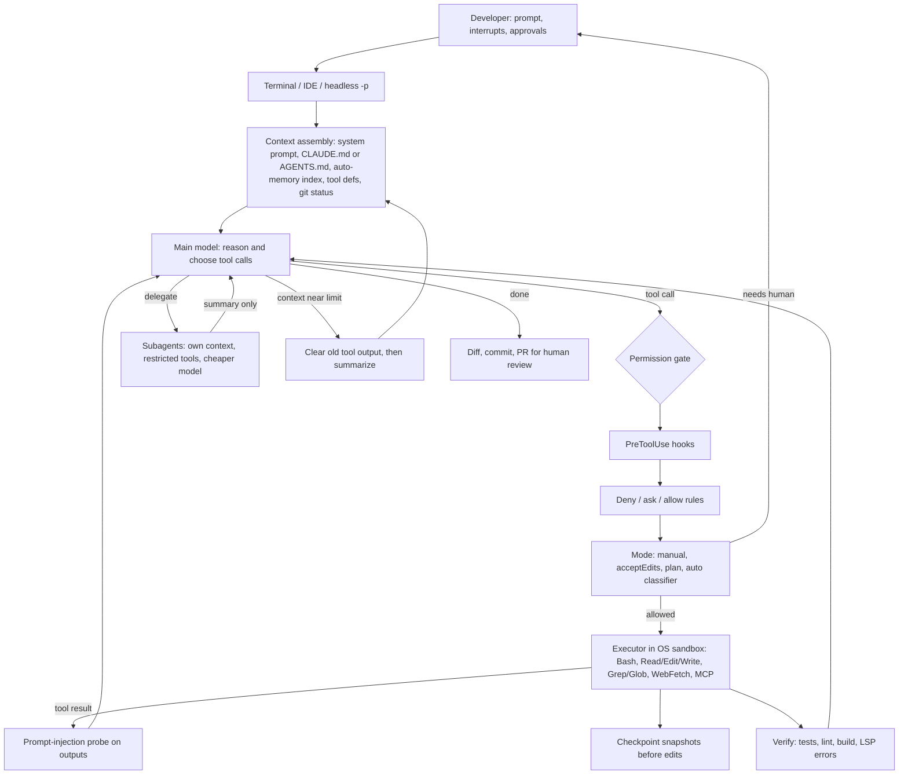

# 01 — Interactive terminal and IDE coding agents

*As of 2026-10-01. Evidence tags: **[Documented]** = read in a primary source this session (citation given); **[Inferred]** = my reconstruction (basis stated); **[Secondary]** = third-party or search-snippet only, page not read. Sources dated before 2025 are marked **(older)**. Research limits are listed at the end of section 14.*

## 1. TL;DR

A single agent loop runs in a terminal or IDE. It reads the repository, edits files, runs shell commands and tests, calls git and MCP tools, and returns a diff the human reviews. Every action passes through a permission gate (per-action approval, a rule allowlist, a classifier, or an OS sandbox). Anthropic describes the loop as three blended phases, gather context, take action, verify results, repeated until the task is done, with the human able to interrupt at any point [1]. The model supplies reasoning and tools supply action. The code around them (tools, context management, permissions) is the "harness" [1].

Why an agent rather than a fixed workflow or one prompt: the path is not knowable in advance. "Fix the failing tests" becomes run, read the error, search, read, edit, re-run, and each step depends on the last tool result [1]. The environment gives ground truth every step (exit codes, test output, type errors), which is the condition Anthropic's agent definition requires [20]. Coding is also unusually verifiable, so the loop can close on its own when a runnable check exists [9].

## 2. Real-world exemplars

| Name | Org | Type | Maturity and scale signals | Source |
|---|---|---|---|---|
| Claude Code | Anthropic | Product (terminal, IDE, desktop, web, Slack, CI) | Repo shows 148.7k stars. Enterprise average about $13 per developer per active day (Anthropic docs). | [27] [1] [8] |
| Codex CLI | OpenAI | Open-source product | Rust workspace `codex-rs`; distributed via npm and Homebrew | [28] |
| Cline | Cline (OSS) | Open-source IDE and CLI agent | 69.6k stars, Apache-2.0; VS Code, JetBrains, CLI, desktop, SDK | [29] |
| Aider | Aider (OSS) | Open-source terminal pair programmer | 49.3k stars; project reports 6.8M weekly pip installs and 15B tokens per week | [30] |
| mini-SWE-agent / SWE-agent | Princeton, Stanford | Research and OSS | Agent class is about 100 lines; README claims over 74% on SWE-bench Verified | [31] |
| Gemini CLI | Google | Open-source product | Apache-2.0; 1M-token context; free tier 60 req/min, 1,000 req/day | [32] |
| OpenCode | sst (OSS) | Open-source product | 211.2k stars (as displayed), MIT, TypeScript monorepo; build and plan agents | [34] |
| goose | Block, now in AAIF | Open-source general agent | 54.8k stars, Rust, 70+ MCP extensions | [33] |
| Claude Agent SDK | Anthropic | Library (the Claude Code harness) | Python and TypeScript; reused for non-coding agents | [14] [18] |

Named in the brief but **not verified this session** (vendor domains blocked): GitHub Copilot agent mode, Databricks Genie Code, Snowflake Cortex Code, dbt. Spend figures such as Menlo Ventures' roughly $4B coding spend in 2025 are **[Secondary]** and unread.

## 3. Problem shape

| Dimension | Typical value |
|---|---|
| Inputs | Natural-language task, repo working tree, git state, CLAUDE.md or AGENTS.md, MCP servers, optionally screenshots or piped logs [1] [5] |
| Outputs | Edited files, commits or PR, plus a transcript the human can audit; checkpoints allow rewind [6] |
| Environment | Developer's own machine (default), OS sandbox, container or VM, or a managed cloud VM [1] [7] |
| Action space | File read/edit/write, glob/grep, shell, web fetch, subagents, MCP tools [1] [10] |
| Autonomy | Assistive to supervised by default; semi-autonomous under allowlists, classifier or sandbox; unattended only in headless/CI use [2] [9] |
| Latency budget | Seconds per step, minutes to hours per task; the user watches and can interrupt [1] |
| Risk and blast radius | Arbitrary shell on a machine with credentials; checkpoints do not cover Bash side effects or remote systems [1] [6] |
| Human in the loop | Prompt per action, plan approval, diff review, `Esc` interrupt, hooks [2] [3] |

## 4. Reference architecture

**Dominant pattern:** an autonomous tool loop (ReAct-style: reason, act, observe) over an augmented LLM (tools, retrieval, memory), with three secondary patterns. First, plan-then-act as a permission mode, not a separate planner service [2]. Second, orchestrator-workers through subagents with isolated context windows, used mainly to keep exploration out of the main context [4]. Third, evaluator-optimizer when a fresh-context reviewer subagent checks the diff [9]. Minimal scaffolds collapse the action space to a single bash tool, which is CodeAct in spirit (the model acts by writing shell) [31].



**Components**

- **Model roles and tiering.** A strong main model handles reasoning. Cheaper models handle subagents (frontmatter `model: haiku` is documented for simple tasks) [4] [8]. Auto mode adds a second model as an action classifier [16]. Aider's architect mode splits a planning model from an editing model via the `editor-diff`/`editor-whole` formats [30].
- **Controller.** No separate planner. The loop plus a todo/plan tool and plan mode (read-only exploration, then approval) [2] [9].
- **Tools.** Small primitive set: file ops, search, execution, web, code intelligence, subagent spawn, ask-user, plus MCP [1] [10].
- **Memory.** Instruction files loaded every session (CLAUDE.md, AGENTS.md), model-written auto-memory (index capped at 200 lines or 25KB), per-session JSONL transcripts [5] [1].
- **Retrieval.** Just-in-time: grep/glob/read with lightweight identifiers rather than a pre-built index [17]. Aider is the contrasting design (precomputed repo map) [30].
- **State and persistence.** Local JSONL sessions, resume and fork, file snapshots for the 100 most recent checkpoints [1] [6].
- **HITL checkpoints.** Per-action prompts, plan approval, diff review, interrupt-and-steer, escalation after repeated classifier denials [1] [16].
- **Guardrails.** Hooks (deterministic), permission rules, OS sandbox, working-directory boundary, trust verification, fail-closed matching [3] [7] [15].

## 5. Exemplar teardowns

**Claude Code.**
- **[Documented]** Loop is gather, act, verify. Tools fall into five categories: file ops, search, execution, web, code intelligence [1].
- **[Documented]** Context: when full, it "clears older tool outputs first, then summarizes"; project-root CLAUDE.md is re-read after `/compact`; auto-compaction stops after a few attempts instead of looping when one output refills context [1] [5]. MCP tool definitions are deferred and loaded on demand [1]. Anthropic's tool-search beta reports about 85% fewer tool-definition tokens (about 77K to 8.7K in its example) [22].
- **[Documented]** Subagents are markdown files with YAML frontmatter (`tools`, `model`, `permissionMode`, `memory`, `isolation: worktree`). They start with fresh context and return a summary. Built-in Explore and Plan agents are read-only and skip CLAUDE.md and git status to stay cheap [4].
- **[Documented]** Permission modes: `default`, `acceptEdits`, `plan`, `auto`, `dontAsk`, `bypassPermissions` [2] [13]. Evaluation order in the SDK is hooks, deny rules, ask rules, mode, allow rules, then the `can_use_tool` callback [13].
- **[Documented]** Auto mode (March 2026 post): a server-side injection probe scans tool outputs; a transcript classifier sees only user messages and tool calls (assistant prose and tool outputs are stripped, so it is "reasoning-blind"); stage 1 is a fast single-token filter, stage 2 adds chain-of-thought only when flagged. Reported on 10,000 real prompts: false positive rate 8.5% (stage 1) falling to 0.4% (full pipeline). On 52 real overeager actions, false negatives were 6.6% (stage 1) rising to 17% (full pipeline). On 1,000 synthetic exfiltration cases, 1.8% rising to 5.7%. After 3 consecutive or 20 total denials it escalates to the human, or terminates in headless mode. Baseline: users approve 93% of prompts [16].
- **[Documented]** OS sandbox: Seatbelt on macOS, bubblewrap on Linux, filesystem plus network isolation; Anthropic reports 84% fewer permission prompts [15] [11].
- **[Documented]** Hooks cover tool, session, compaction and subagent events; exit code 2 blocks; `PreToolUse` can rewrite input [3]. Checkpoints snapshot file edits before each prompt-turn but do not track Bash side effects or most subagent edits [6].
- **[Inferred]** The public repo tree (plugins, examples, scripts) suggests the agent core is not in that repo [27].

**Codex CLI.**
- **[Documented]** Rust workspace with crates for `core`, `exec`, `linux-sandbox`, `sandboxing`, `execpolicy`, `codex-mcp`, `app-server`, `protocol`, `git-utils`, plus Ollama and LM Studio providers [28].
- **[Documented]** `core/src` contains `compact.rs`, `context_manager.rs`, `apply_patch.rs`, `exec_policy/`, `guardian/`, `mcp_tool_call.rs` [28].
- **[Documented]** The Linux sandbox uses bubblewrap (read-only root bind, writable roots, `.git` and `.codex` re-protected), user/PID/network namespaces, `PR_SET_NO_NEW_PRIVS` and a seccomp network filter. Filesystem-restricted policies require bubblewrap; the README says the legacy Landlock option is rejected for them because it cannot isolate app-server Unix sockets [28].
- **[Documented]** `execpolicy` is a Starlark rule engine (`prefix_rule`) that returns allow, prompt or forbidden; the strictest match wins [28].
- **[Inferred]** `guardian/` is a safety-review component analogous to Claude's auto-mode classifier. Based on directory names only; third-party descriptions of it as an LLM subagent are **[Secondary]**.

**Cline.** **[Documented]** Plan mode explores and proposes; Act mode edits. Every file edit and terminal command requires approval. Checkpoints undo changes. MCP is supported. A shared agent core powers the CLI, VS Code, JetBrains and desktop apps, and a Node SDK. It is model-agnostic [29].

**Aider.**
- **[Documented]** Repo map: tree-sitter tag extraction (`grep_ast`), a file-dependency graph ranked with `networkx.pagerank` using personalization from chat context, tags cached in diskcache/SQLite, and a binary search to fit `--map-tokens` (default 1,000) [30].
- **[Documented]** Six edit formats exist (whole, diff, diff-fenced, udiff, editor-diff, editor-whole). They were tuned to model quirks, for example udiff to reduce GPT-4 Turbo "lazy coding" [30].
- **[Documented]** Auto-commits with sensible messages, runs lint and tests after changes [30].

**mini-SWE-agent / SWE-agent.**
- **[Documented]** mini-SWE-agent has only a bash tool, a linear message history (every step appends), and a fresh `subprocess.run` per action. Control flow: `run()` loops `step()` = `execute_actions(query())`. Termination is by step limit, cost limit, wall-time limit, or consecutive format errors. A LiteLLM model layer makes it model-agnostic. The README also claims it beats Claude Code and Codex on DeepSWE (project-reported; I did not examine that benchmark) [31].
- **[Documented]** SWE-agent's ACI lessons: lint-gated edits, a 100-line windowed file viewer, compact search output, and an explicit "ran successfully with no output" message [31].
- **[older, Jan 2025]** Anthropic's own scaffold used two tools (persistent bash, string-replace editor) with minimal prompting, scoring 49% on SWE-bench Verified with Claude 3.5 Sonnet, and noted 100k+ tokens per task [21].

**Gemini CLI, OpenCode, goose (brief).** **[Documented]** Gemini CLI: built-in file, shell and web tools, GEMINI.md context file, MCP via `~/.gemini/settings.json`, checkpointing, sandboxing and Trusted Folders [32]. OpenCode: switchable `build` (full access) and `plan` (read-only) agents plus a `general` subagent, with LSP and MCP [34]. goose: Rust, MCP-based extensions, 15+ providers [33]. All converge on the same loop and the same mode split.

**Adjacent variants.**
- **Non-coding reuse [Documented].** Anthropic teams use Claude Code for non-engineering work: legal phone-tree prototypes, growth-marketing ad generation with two sub-agents, security runbooks, data-science onboarding [26]. The Agent SDK is positioned for finance, personal assistant, support and research agents on the same loop [18].
- **Data-engineering agents (Databricks, Snowflake, dbt) [Inferred].** I could not read vendor docs. I expect the same loop with warehouse/catalog metadata as context and SQL/pipeline tools, and the same approval gating before writes. Treat as unverified.
- **Long-horizon harness [Documented].** For multi-session work, Anthropic used an initializer agent (init.sh, progress file, 200+ feature list in JSON, baseline commit) plus a coding agent making incremental commits. This countered premature completion [23].

## 6. Frameworks and stack

- **Harness as library:** Claude Agent SDK (Python and TypeScript). Anthropic says it gives "the same tools, agent loop, and context management that power Claude Code", and it works by running the Claude Code binary as a library. Third parties may not offer claude.ai login through it; use API-key auth [14] [37]. Anthropic also offers Managed Agents as a hosted harness [37]. Other options in the catalog: OpenAI Agents SDK (sandbox agents), LangChain Deep Agents, Strands, OpenHands. I did not verify these here, so choose by model-vendor fit.
- **Protocols:** MCP for external tools; Agent Skills (`SKILL.md`) loaded on demand; AGENTS.md read directly by Claude Code v2.1.277+ when no CLAUDE.md exists [5] [9]. MCP (donated by Anthropic), AGENTS.md (OpenAI) and goose (Block) were the founding projects of the Agentic AI Foundation, announced 2025-12-09 [36].
- **Isolation:** OS primitives (Seatbelt, bubblewrap, seccomp) [15] [28]; dev containers or VMs for stronger isolation [7]; managed cloud VMs with a git proxy so credentials never enter the sandbox [7] [15].
- **Observability and cost:** OpenTelemetry export of per-user token, cost and tool metrics; LiteLLM as an LLM gateway [8].
- **Evals:** Terminal-Bench via the Harbor harness [35]; SWE-bench; Inspect and similar (not verified).

## 7. Tool design

Core set (names from Claude Code's docs; signatures are my sketch, **[Inferred]**) [10]:

| Tool | Sketched signature | Design note |
|---|---|---|
| `Bash` | `(command, description, timeout?, run_in_background?)` | Read-only subset auto-allowed; persistent state matters [21] |
| `Read` | `(file_path, offset?, limit?)` | Windowed reads protect context [31] |
| `Edit` | `(file_path, old_string, new_string, replace_all?)` | Exact-match replace fails loudly (poka-yoke) [21] |
| `Write` | `(file_path, content)` | Prefer Edit for existing files |
| `Glob` / `Grep` | `(pattern, path?, ...)` | Agentic search instead of an index [17] |
| `Agent` | `(prompt, subagent_type, model?)` | Context isolation; summary returns [4] |
| `WebFetch` | `(url, prompt)` | Runs in a separate context window for injection hygiene [7] |
| MCP | `mcp__server__tool` | Deferred loading to save tokens [1] |

Lessons: absolute paths and exact-match edits remove classes of error [21]. Return compact, high-signal output with pagination and truncation; namespace tools; consolidate overlapping tools [19]. Lint-gate edits and return explicit empty-output messages [31]. Describe tools as you would for a new teammate; small description changes move accuracy [19]. Prefer CLI tools (`gh`, `aws`) over MCP servers where they exist, because they add no per-tool listing [8].

## 8. Context and memory engineering

- **Context is the scarce resource.** Anthropic's best-practice guide builds most advice on the fact that performance degrades as the window fills [9].
- **Layers:** always-on instructions (CLAUDE.md under about 200 lines; path-scoped `.claude/rules/`; skills load on demand) [5]. Auto-memory notes (user, feedback, project, reference types) are stored outside the repo [5].
- **Lifecycle:** clear old tool results, then summarize; `/compact` with custom instructions; rewind with "summarize from here"; `/clear` between unrelated tasks; start fresh after two failed corrections [1] [6] [9].
- **Offload:** subagents for exploration, hooks that pre-filter noisy output (grep errors from a 10,000-line log), and file-based notes for long runs [8] [17] [23].
- **Prompt caching** dominates cost in long sessions. The cache lifetime is one hour on subscriptions and five minutes on API keys by default, and a miss re-reads the full context [8].
- **Aider alternative:** a ranked repo map in a fixed token budget [30].

## 9. Evaluation

- **Benchmarks.** SWE-bench Verified (GitHub issues, tests as grader) and Terminal-Bench (end-to-end terminal tasks such as building a kernel) [24]. The Terminal-Bench repo (under the `laude-institute` GitHub org) points to the Harbor framework for running 2.0 [35]. Third-party trackers describe SWE-bench Verified as saturating and Terminal-Bench 2.0 (89 tasks) as harder, with top entries in the low 80s percent **[Secondary]**.
- **Measure harness and model together.** Anthropic's eval guidance: tasks, repeated trials, code-based, model-based and human graders, and pass@k versus pass^k for consistency [24].
- **Infrastructure confounds.** Resource limits alone moved Terminal-Bench 2.0 scores by 6 points (p < 0.01) between strictest and uncapped setups, and about 1.5 points on SWE-bench; Anthropic advises skepticism toward leaderboard gaps under 3 points unless configs match [25].
- **Harness versus model, what the evidence says.**
  - Anthropic's Jan 2025 scaffold: "keep scaffolding minimal" yet state of the art at the time (older) [21].
  - mini-SWE-agent: about 100 lines, bash only, over 74% on Verified (README, model not stated) [31].
  - A third-party tracker claims model choice matters more than scaffold on Terminal-Bench **[Secondary, unverified]**. Two 2026 papers on terminal-agent harnesses appeared in search results but arXiv was blocked, so I did not read them.
  - **[Inferred]** A thin harness captures most single-task gain. Rich harnesses (context management, permissions, subagents, memory) pay off in long-horizon reliability, cost, safety and UX, which benchmarks measure poorly.
- **Product metrics.** Approval rate (users approved 93% of prompts), prompts avoided (84% with sandbox), classifier FPR/FNR [15] [16]. Independent productivity evidence is mixed; I could not retrieve the METR study this session, so I give no figure.

## 10. Failure modes, safety and guardrails

| Failure | Mechanism | Mitigation |
|---|---|---|
| Approval fatigue | 93% of prompts approved; humans stop reading [16] | Sandbox plus allowlists plus classifier [15] [16] |
| Classifier misses | 17% false negatives on real overeager actions [16] | Keep deny rules and hooks as hard layer; sandbox as backstop |
| Prompt injection via files, web, MCP output | Untrusted text enters context | Injection probe, isolated WebFetch context, network allowlist, no auto-approved `curl` [7] [16] |
| Premature "done" | Looks complete without a check [9] [23] | Verification commands, Stop hook, feature-list JSON, fresh-context reviewer [9] [23] |
| Context rot and thrash | Long sessions; huge outputs [1] [9] | `/clear`, subagents, hooks that filter output |
| Instructions ignored | CLAUDE.md is context, not enforcement [5] | Use hooks for must-run rules |
| Irreversible side effects | Checkpoints skip Bash and subagent edits [6] | Git as source of truth, worktrees, sandbox |
| Reviewer over-engineering | A reviewer told to find gaps will find some [9] | Restrict findings to correctness |

Permission layering [Documented]: deterministic hooks and deny rules first; rules and modes next; human last [13]. Cloud sessions add isolated VMs, scoped git credentials via proxy and branch-restricted pushes [7].

## 11. Build it yourself

1. **Raw loop (day 1).** One bash tool, linear history, step/cost/time limits, format-error counter (the mini-SWE-agent shape) [31]. Run it in a Docker container.
2. **Add file tools.** Exact-match `edit`, windowed `read`, `grep`/`glob`; absolute paths [21].
3. **Add a verification contract.** The system prompt requires running tests/lint before finishing; add a Stop-style gate [9].
4. **Permissions.** Allowlist of safe commands; prompt for everything else; hard-deny list via pre-tool hook [3] [13].
5. **Sandbox.** Filesystem and network isolation; credentials outside the sandbox [15].
6. **Memory.** Load a short AGENTS.md/CLAUDE.md; add compaction (clear old tool results, then summarize) [1].
7. **Subagents.** Read-only explorer on a cheaper model with isolated context [4].
8. **Checkpoints and git.** Snapshot before edits; commit per task; worktrees for parallel runs [6] [9].
9. **MCP and skills.** Add MCP servers sparingly; defer tool definitions [1] [22].
10. **Eval and telemetry.** A private task set with repeated trials and pinned infrastructure; trace cost per task [24] [25] [8].

MVP sketch (Claude Agent SDK, Python). API calls below were confirmed in the SDK reference, README and `__init__.py` this session [12] [13] [14]. The `AGENT_MODEL` value comes from config.

```python
import asyncio, os, subprocess
from claude_agent_sdk import (ClaudeSDKClient, ClaudeAgentOptions, HookMatcher, AssistantMessage,
    ResultMessage, ToolUseBlock, PermissionResultAllow, PermissionResultDeny)

MODEL = os.environ["AGENT_MODEL"]
REPO = os.environ.get("REPO", ".")
SAFE = ("pytest", "git diff", "git status", "ruff")          # auto-approved Bash prefixes
BAD = ("rm -rf", "git push", "curl ", "sudo ")               # hard-denied by hook

async def block_bad(input_data, tool_use_id, context):       # deterministic layer
    cmd = input_data["tool_input"].get("command", "")
    if any(b in cmd for b in BAD):
        return {"hookSpecificOutput": {"hookEventName": "PreToolUse",
                "permissionDecision": "deny",
                "permissionDecisionReason": f"policy blocks: {cmd[:60]}"}}
    return {}

async def human_gate(tool_name, tool_input, context):        # reached only if no rule/mode approved
    shown = tool_input.get("command") or tool_input.get("file_path") or str(tool_input)[:200]
    ans = await asyncio.to_thread(input, f"[approve?] {tool_name}: {shown} (y/N) ")
    if ans.strip().lower() == "y":
        return PermissionResultAllow()
    return PermissionResultDeny(message="Declined by user; propose another approach.")

async def main(task: str):
    options = ClaudeAgentOptions(
        model=MODEL, cwd=REPO, max_turns=40, max_budget_usd=5.0,
        system_prompt="Reproduce the issue with a failing test, fix it, run the tests. "
                      "Never weaken tests to make them pass. Summarize evidence at the end.",
        permission_mode="default",
        allowed_tools=["Read", "Grep", "Glob"] + [f"Bash({p} *)" for p in SAFE],
        disallowed_tools=["WebFetch"],
        can_use_tool=human_gate,
        hooks={"PreToolUse": [HookMatcher(matcher="Bash", hooks=[block_bad])]},
        setting_sources=["project"],                          # loads CLAUDE.md and project settings
    )
    async with ClaudeSDKClient(options=options) as client:
        await client.query(task)
        async for msg in client.receive_response():
            if isinstance(msg, AssistantMessage):
                for b in msg.content:
                    if isinstance(b, ToolUseBlock):
                        print("tool>", b.name, str(b.input)[:80])
            elif isinstance(msg, ResultMessage):
                print(f"{msg.subtype}: turns={msg.num_turns} cost=${msg.total_cost_usd}")
    print(subprocess.run(["git", "diff", "--stat"], cwd=REPO, capture_output=True, text=True).stdout)

asyncio.run(main(input("task> ")))
```

## 12. Economics

- **Per-developer cost [Documented, Anthropic docs]:** average about $13 per developer per active day, $150–250 per month, under $30 per active day for 90% of users [8].
- **Drivers:** full conversation resent each turn (cached reads); long sessions; cache misses after idle periods; thinking tokens billed as output; subagents and agent teams (about 7x tokens in plan mode); compaction itself being a large request [8].
- **Levers:** match model to task, Haiku for simple subagents, clear between tasks, deferred MCP tools, CLI over MCP, hooks that pre-filter output, specific prompts, plan mode before big changes [8] [9].
- **Benchmark-style tasks** can cost 100k+ tokens each (Jan 2025 scaffold) (older) [21].
- **Pricing models:** subscription seats with rolling five-hour and weekly windows plus usage credits, or per-token API/cloud billing; open-source tools (Cline, Aider) are model-agnostic, so you pay the model provider (**[Inferred]**) [8] [29] [30].
- **ROI evidence:** Anthropic's own non-engineering team anecdotes (ad generation in minutes rather than hours) are vendor-reported [26]. Independent measurement is thin; run your own A/B on cycle time and review burden.

## 13. Related use cases

- [03 — Asynchronous cloud coding agent fleets](./03-async-coding-agent-fleets.md): same loop run unattended in cloud sandboxes, many in parallel.
- [07 — Workplace and delegated knowledge-work agents](./07-workplace-knowledge-agents.md): the same harness reused by non-engineers.
- [02 — SRE, SOC and security-research investigation agents](./02-sre-security-investigation-agents.md): investigate-and-validate loop with shell and log tools.
- [10 — Computer-use, browser and always-on personal agents](./10-computer-use-browser-agents.md): same loop with GUI and browser actions.
- [12 — Scientific and engineering discovery agents](./12-scientific-engineering-discovery-agents.md): code execution as the main tool, experiments as ground truth.

## 14. Sources

1. https://code.claude.com/docs/en/how-claude-code-works
2. https://code.claude.com/docs/en/permission-modes
3. https://code.claude.com/docs/en/hooks
4. https://code.claude.com/docs/en/sub-agents
5. https://code.claude.com/docs/en/memory
6. https://code.claude.com/docs/en/checkpointing
7. https://code.claude.com/docs/en/security
8. https://code.claude.com/docs/en/costs
9. https://code.claude.com/docs/en/best-practices
10. https://code.claude.com/docs/en/tools-reference
11. https://code.claude.com/docs/en/sandboxing
12. https://code.claude.com/docs/en/agent-sdk/python
13. https://code.claude.com/docs/en/agent-sdk/permissions
14. https://github.com/anthropics/claude-agent-sdk-python (README and `src/claude_agent_sdk/__init__.py`)
15. https://www.anthropic.com/engineering/claude-code-sandboxing (2025-10-20)
16. https://www.anthropic.com/engineering/claude-code-auto-mode (2026-03-25)
17. https://www.anthropic.com/engineering/effective-context-engineering-for-ai-agents (2025-09-29)
18. https://claude.com/blog/building-agents-with-the-claude-agent-sdk (2025-09-29)
19. https://www.anthropic.com/engineering/writing-tools-for-agents (2025-09-11)
20. https://www.anthropic.com/engineering/building-effective-agents (2024-12-19, older)
21. https://www.anthropic.com/research/swe-bench-sonnet (Jan 2025, older)
22. https://www.anthropic.com/engineering/advanced-tool-use (2025-11-24)
23. https://www.anthropic.com/engineering/effective-harnesses-for-long-running-agents (2025-11-26)
24. https://www.anthropic.com/engineering/demystifying-evals-for-ai-agents (2026-01-09)
25. https://www.anthropic.com/engineering/infrastructure-noise (2026-02-05)
26. https://claude.com/blog/how-anthropic-teams-use-claude-code (2025-07-24)
27. https://github.com/anthropics/claude-code
28. https://github.com/openai/codex (plus `/tree/main/codex-rs`, `/tree/main/codex-rs/core/src`, raw `codex-rs/linux-sandbox/README.md`, raw `codex-rs/execpolicy/README.md`, `/tree/main/docs`)
29. https://github.com/cline/cline (and raw `README.md`)
30. https://github.com/Aider-AI/aider (plus raw `aider/repomap.py`, `aider/website/docs/repomap.md`, `aider/website/docs/more/edit-formats.md`)
31. https://github.com/SWE-agent/SWE-agent , https://github.com/SWE-agent/mini-swe-agent (plus raw `src/minisweagent/agents/default.py`, raw SWE-agent `docs/background/aci.md`)
32. https://github.com/google-gemini/gemini-cli
33. https://github.com/block/goose
34. https://github.com/sst/opencode
35. https://github.com/laude-institute/terminal-bench
36. https://www.anthropic.com/news/donating-the-model-context-protocol-and-establishing-of-the-agentic-ai-foundation (2025-12-09)
37. https://code.claude.com/docs/en/agent-sdk/overview

**Research limits.** WebSearch hit its 200-call session budget mid-run. The egress proxy blocked arxiv.org, developers.openai.com, openai.com, aider.chat, docs.cline.bot, docs.github.com, github.blog, docs.databricks.com, docs.snowflake.com, databricks.com, upriverdata.com, constellationr.com, menlovc.com, metr.org, tbench.ai, swebench.com and morphllm.com, and I did not try to route around those blocks. As a result: OpenAI first-party docs, the Terminal-Bench and SWE-bench leaderboards, the Copilot and data-engineering vendors, and independent productivity studies were not read. The fetch tool summarises pages with a small model, so each quoted figure came through that summary. Claims marked [Secondary] come from search-result snippets and were not confirmed.
