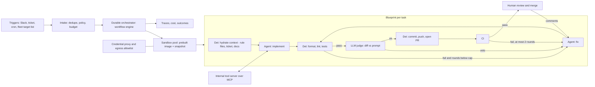

# 03 — Asynchronous cloud coding agents and agent fleets

*Research provenance.* Researched 2026-10-01. **†** marks sources whose primary page the egress proxy blocked (stripe.dev, modal.com, engineering.atspotify.com, cursor.com, cognition.com, arxiv.org, docs.github.com); for those I saw only search excerpts or secondary write-ups, so figures are company-reported and unverified against the original. Unmarked sources were fetched and read. Greptile, CodeRabbit, Uber and Pragmatic Engineer pages were not retrievable, so no figures from them appear.

## 1. TL;DR

An async coding-agent fleet takes a ticket, Slack message, cron, or fleet-wide target list; provisions an isolated, fully provisioned dev environment per task; runs a coding agent that edits, runs tests and lints, and iterates against CI; and opens a pull request for a human to review and merge. Dozens to thousands run in parallel. The same plumbing serves feature/bug tasks, large migrations, PR-review and test-generation agents, and multi-day multi-agent builds.

Why an agent rather than a fixed workflow: the *implement/fix* step is open-ended (unknown files, unknown failure causes), but *verification is deterministic* (compiler, tests, CI). That combination is the sweet spot for a bounded autonomous loop. Everything around the loop (provisioning, lint, push, PR creation, retry caps) should be fixed code. The consistent lesson across exemplars is that infrastructure, context, and verification matter more than the model. **[Documented]** Anthropic's guidance says agents suit coding because "Code solutions are verifiable through automated tests" and agents can iterate on test feedback [33]; Stripe, Spotify and Cursor describe the same deterministic-rails-around-agent-nodes shape [1†][2†][7†][11†].

## 2. Real-world exemplars

| Name | Org | Type | Maturity & scale signals | Source |
|---|---|---|---|---|
| Minions | Stripe | internal deployment | 1,300+ merged PRs/week, human-reviewed, "no human-written code" (company-reported; part 1 said 1,000+) | [1†][2†] |
| Inspect | Ramp | internal deployment | ~30% of merged frontend+backend PRs within months (company-reported); later secondary claims "over half" / "three of four" | [3†][4][49†] |
| Honk (background coding agent) | Spotify | internal deployment | 1,500+ merged PRs in first 9 months; 650+ PRs/month per Anthropic customer story; up to 90% time savings on migrations (company-reported) | [5†][9] |
| Cloud Agents on Temporal | Cursor | product | Temporal runs >50M actions/day over >7M workflows; runs last days to weeks | [10†][11†] |
| Parallel-Claude C compiler | Anthropic | research | 16 agents, ~2,000 sessions, ~$20k, 100k-line Rust compiler that boots Linux 6.9 | [14][15] |
| Planner/worker/judge browser build | Cursor | research | ~1 week, >1M LOC, peak >1,000 commits/hour (experimental) | [12†][13†] |
| Initializer + coding-agent harness; planner/generator/evaluator | Anthropic | research | Multi-hour builds, $124–$200 per run | [16][17] |
| Copilot coding agent | GitHub | product | Ephemeral GitHub Actions environment per task | [46†] |
| Jules | Google | product | GA Aug 2025; per-task Cloud VM, plan → PR | [47†] |
| Devin | Cognition | product | 67% of PRs merged vs 34% prior year (vendor-reported) | [45†] |
| OpenHands | OpenHands | open-source | Agent SDK, Docker/K8s workspaces, automation server | [37][38] |
| Open-Inspect (background-agents) | Cole Murray | open-source | Ramp-Inspect-inspired; Cloudflare control plane, Modal/Daytona/E2B sandboxes | [39] |
| Claude Code cloud sessions / Managed Agents | Anthropic | product | Isolated VMs, credential proxy, PR auto-fix | [18][19] |
| Claude Code Review; PR-Agent | Anthropic; Qodo | product; open-source | Review: ~20 min, $15–25 per PR; PR-Agent: single-call tools | [21][40] |
| Google LLM code migrations | Google | internal/research (2025) | 39 migrations, 595 changes; 74.45% of changes LLM-generated | [43†] |
| Amazon Q Developer Transform | AWS | product (2024 figures, older) | "4,500 developer-years" saved, $260M annualized | [44†] |

## 3. Problem shape

- **Inputs:** natural-language task (ticket, Slack thread, emoji reaction), or a fleet target list plus a version-controlled migration prompt. Repo snapshot, rule files, internal docs.
- **Outputs:** a branch and PR with passing CI, description, and evidence (test output, screenshots); or an explicit "needs human" with a summary.
- **Environment:** a per-task sandbox/devbox/VM with the repo, dependencies, services, and browser; network restricted; credentials held outside it.
- **Action space:** read/search/edit files, run tests/linters/builds, limited git, internal tool server (docs, tickets, build status, telemetry). Pushing and PR creation are usually harness-owned, not model-owned.
- **Autonomy:** autonomous to PR, human-gated at merge (semi-autonomous). Stripe: "human-reviewed" merges [1†]; Spotify: owners review and merge [8†].
- **Latency budget:** minutes to hours per task; startup must be seconds so people delegate casually (Stripe reports ~10 s devboxes [48†]; Ramp pre-builds images [4]).
- **Blast radius:** bounded by sandbox, branch-only push rights, CI, and review; risks are prompt injection, leaked secrets, and merged-but-wrong code.
- **Humans:** requester, reviewer/owner (merges), platform team (tools, images, rules).

## 4. Reference architecture

Dominant patterns: **prompt chaining** (a fixed "blueprint" of nodes) with **autonomous tool-loop** nodes inside it; **evaluator-optimizer** (deterministic verifiers plus an LLM judge); **parallelization** (fleet fan-out, one sandbox per task); and, for research-grade builds, **orchestrator-workers** (planners/workers) with a shared-task or lock mechanism [33]. Durable execution wraps the whole thing.



**Components**
- **Model roles/tiering:** one strong coding model for implement/fix; a cheaper or separate model for judge, triage, PR description. Spotify standardized on Claude Sonnet 4.5 as default [9]. Cursor found model choice matters for week-long runs (reported GPT-5.2 better at sustained instruction-following) [12†]. Anthropic separates generator from evaluator because self-grading is biased [17].
- **Controller:** a blueprint/state machine, not an LLM planner, for single-PR tasks. LLM planners appear only in multi-agent builds (Cursor planners spawn sub-planners; workers get one task and write one handoff) [13†].
- **State/persistence:** durable workflow engine (Temporal at Cursor [10†]; Cloudflare Durable Objects at Ramp-style systems [4][39]); append-only session log outside the model context with stateless harness and disposable sandboxes ("cattle") [18].
- **HITL checkpoints:** plan approval (Jules [47†]), PR review (all), permission classifier/escalation after repeated denials [29].
- **Guardrails:** sandbox isolation, egress allowlist, credentials in a proxy, branch restrictions, CI caps, judge veto (Section 10).

## 5. Exemplar teardowns

**5.1 Stripe Minions** — **[Documented†]** Runs one-shot and end to end without interaction [1†]; secondary write-ups describe a Slack emoji/message trigger [48†]. Four named parts: *Devbox* (EC2-based standard dev environment, ~10 s provisioning), *Blueprints* (a sequence of nodes, some deterministic code, some agentic loops), *Toolshed* (central internal MCP server, ~500 tools), and a heavily modified *fork of Block's goose* running the loop [2†][48†]. Rule files are scoped to directories/file patterns and attached automatically as the agent navigates the filesystem; Toolshed fetches dynamic context (docs, tickets, build status, code intelligence) [2†][48†]. At most two CI rounds, then the run terminates at a PR [48†]. **[Inferred]** The cap exists because returns diminish after a couple of CI rounds and flaky CI would otherwise burn tokens; upstream goose recipes already support `max_retries` with shell `checks` that must exit 0 [36], an off-the-shelf primitive for this.

**5.2 Ramp Inspect** — **[Documented†]** Sessions run in sandboxed VMs on Modal with a full dev environment wired to Sentry, Datadog, feature flags and GitHub; the agent runs tests, reads telemetry, queries flags, and verifies UI visually [3†][49†]. Built on OpenCode (server-first, clients on top) [49†]. A secondary breakdown lists Modal sandboxes, an image registry with a 30-minute rebuild cron, snapshots/warm pools, Cloudflare Durable Objects for session state, per-user git attribution, and Slack/web/Chrome-extension clients [4]. **[Inferred]** Pre-built images plus snapshots are what make start-up feel instant; adoption was voluntary and driven by multiplayer clients.

**5.3 Spotify Honk** — **[Documented]** Runs Claude through the Claude Agent SDK inside Fleet Management; prompts are version-controlled for fleet-wide migrations; verification (format, lint, build, test) runs before a PR; engineers can also trigger via an internal Slack bot [9]. **[Documented†]** Part 2: describe end states not steps, state preconditions, give examples, and limit tools [6†][7†]. Part 3: the agent has three constrained tools (a verify tool, a restricted git tool, a bash allowlist like ripgrep) [50†]; on top of deterministic verifiers an LLM judge sees the diff and original prompt and vetoes about a quarter of sessions, after which the agent course-corrects about half the time [7†][50†]. Named failure modes: no PR, PR fails CI, PR passes CI but is functionally wrong [7†]. Part 4 (dataset migrations, Apr 2026): ~1,800 downstream pipelines across three frameworks, 240 PRs, ~10 engineering weeks saved (reported) [8†].

**5.4 Cursor** — **[Documented†]** Cloud Agents: one year of lessons says the biggest quality factor is a full development environment; environment defects degrade output silently so teams blame the model [11†]. They migrated from home-grown durability to Temporal, moving from "eternal" agent workflows to multiple shorter workflows that exit per task, enabling easier version upgrades [10†][11†]. Long-running research: planners explore and create tasks (recursively), workers own tasks in their own repo copy and return one handoff, a judge decides whether to continue and the next iteration starts fresh [12†][13†].

**5.4a Anthropic C compiler** — **[Documented]** 16 Claude Opus 4.6 agents, each in its own Docker container with a shared git remote at `/upstream`; an agent claims a task by writing a text file in `current_tasks/`, git arbitrates collisions, and the cycle is pull, merge, push, remove lock; merge conflicts are tolerated and resolved by the agents [14]. ~2B input / 140M output tokens, ~2,000 sessions, ~$20k, 100k-line compiler [14]. Test-harness lessons: near-flawless tests, grep-friendly error lines, a deterministic `--fast` sample, GCC as an oracle to split kernel compilation into parallelizable bug hunts, and specialist agents (dedup, performance, quality critique, docs) [14]. Limits: regressions when adding features, inefficient output, no 16-bit x86 codegen [14]; the repo's own README disclaims correctness validation [15].

**5.4b Anthropic long-running harnesses** — **[Documented]** Initializer session writes a JSON feature list (200+ features, all `passes: false`), `init.sh`, a progress file and git history; each coding session reads these, verifies the app, works one feature at a time, and may not delete tests [16]. A later three-agent design (planner, generator, evaluator using Playwright MCP) uses sprint contracts and found a $9/20-minute solo run vs $200/6-hour full harness; harness parts get removed as models improve [17].

**5.5 Copilot coding agent, Jules, Devin** — **[Documented†]** Copilot: ephemeral GitHub Actions environment, customizable via `.github/workflows/copilot-setup-steps.yml`, firewall, MCP extensions, optional self-hosted runners [46†]. Jules: clones the repo into a dedicated Cloud VM, presents plan then diff, then opens a PR [47†]. Devin: vendor reports 67% of PRs merged and Nubank migration "12x" efficiency / ">20x" cost savings (older) [45†]. **[Inferred]** Copilot confines the agent to its own branches and requires human approval to run workflows (earlier public docs; not re-verified).

**5.6 OpenHands and Open-Inspect** — **[Documented]** OpenHands: Agent, Conversation, Workspace (local, Docker, Kubernetes), Tools, event log, condenser for context, security analyzer plus confirmation policy [38]; each conversation in its own Docker container with an agent server; separate automation server for cron/webhooks [37]. Open-Inspect: control plane on Cloudflare Workers + Durable Objects, sandbox backends for Modal, Daytona, E2B; Slack/GitHub/Linear bots; child sessions; single-tenant only [39].

**5.7 Claude Code cloud / Managed Agents** — **[Documented]** Each cloud session is an isolated VM; setup script output is cached as a filesystem snapshot (script must finish in ~5 minutes); idle VMs pause and restore; GitHub credentials never enter the VM and a proxy validates pushes; network levels None/Trusted/Full; PR "auto-fix" subscribes to CI failures and review comments [19][20][27]. Managed Agents split brain (stateless harness), hands (disposable, on-demand sandboxes) and session (durable event log), and report ~60% lower p50 and >90% lower p95 time-to-first-token from dropping up-front container setup [18].

**5.8 Review agents** — **[Documented]** Claude Code Review: parallel specialist agents, then a verification step that checks candidates against code to cut false positives; findings tagged Important/Nit/Pre-existing; never blocks merge; averages 20 minutes and $15–25 per review; `REVIEW.md` tunes severity, nit caps, skip paths [21]. PR-Agent: `/review`, `/describe`, `/improve`, `/ask` as single LLM calls (~30 s), model-agnostic via LiteLLM, run as GitHub Action/webhook [40].

**5.9 Migration evidence** — **[Documented†]** Google (FSE 2025): 39 migrations by three developers over 12 months, 595 code changes / 93,574 edits, 74.45% of changes and 69.46% of edits LLM-generated, ~50% estimated time reduction (developer-reported) [43†]. Amazon Q: >4,500 developer-years and $260M annualized savings; average Java 17 upgrade from ~50 dev-days to hours (2024, older) [44†].

## 6. Frameworks & stack

- **Agent loop:** Claude Agent SDK (what Spotify runs [9]; a Python/TS library that drives the Claude Code runtime [26]), goose (Rust, MCP extensions, recipes, AAIF member [35][36]; Stripe's fork base [2†]), OpenHands SDK [38], OpenCode (Ramp [49†]), mini-swe-agent (bash-only ~100-line loop, >74% SWE-bench Verified claim [41]).
- **Sandboxes:** Modal (Ramp), E2B, Daytona (supported by Open-Inspect [39]), Cloudflare Sandbox/Durable Objects, Vercel Sandbox, GitHub Actions runners (Copilot [46†]), Docker/K8s (OpenHands [38]; Spotify reportedly Kubernetes pods [50†], not confirmed in Anthropic's customer story [9]). Prefer microVM/gVisor-class isolation for untrusted code [28].
- **Durable execution:** Temporal (Cursor [10†]); Restate, Inngest, DBOS, Trigger.dev **[Inferred]** equivalent for smaller teams.
- **Tool plumbing:** MCP servers (Stripe Toolshed [2†]), Agent Skills/AGENTS.md/CLAUDE.md for repo conventions [24].
- **Fleet orchestration:** Fleet Management-style target selection (Spotify [9]), GitHub Actions (`claude-code-action`, @mention/issue-assignment/cron triggers [22][42]).
- **Observability/evals:** OpenTelemetry GenAI conventions with Langfuse/LangSmith/Braintrust **[Inferred]**; Inspect AI or Promptfoo for replay evals **[Inferred]**.

## 7. Tool design

Core set (sketched signatures):
```
read_file(path, start=1, end=400) -> str
search_code(pattern, glob=None, max_results=50) -> list[Match]
edit_file(path, old, new) -> Diff | Error(actionable)
run_checks(scope: "lint"|"unit"|"affected"|"all") -> {passed, failures[:20], log_tail}
git(subcmd in {status,diff,log,show}, args) -> str      # no push/reset
bash(cmd)   # allowlist: rg, ls, cat, language toolchain
toolshed.get_ticket(id) / search_docs(q) / get_build_status(pr) / find_owners(path)
```
Lessons: **[Documented]** every added tool is a failure source; Spotify keeps three tools and treats predictability as the goal [50†]. Stripe curates per-agent subsets of a ~500-tool catalog [2†]. Consolidate tools, return high-signal truncated output with actionable errors, and test descriptions against evals [34]; require absolute paths ("poka-yoke") [33]. **[Inferred]** Make `open_pr` and `push` harness steps, so injected instructions cannot publish anything.

## 8. Context & memory engineering

- **Static context:** directory-scoped rule files loaded as the agent traverses (Stripe [2†]); `CLAUDE.md`/`AGENTS.md` kept short because bloated files get ignored [24].
- **Dynamic context:** tool-server pulls (docs, tickets, build status) rather than stuffing the prompt [2†].
- **Prompting:** end-state descriptions with preconditions and examples [6†]; for fleets, store the prompt in git as the migration definition [9].
- **Long horizons:** progress file + feature list + git log as external memory; clean-state sessions [16]; context resets with structured handoff beat compaction for models with "context anxiety", while newer models reduced that need [17]; planners/workers exchange single handoff documents [13†].
- **Output hygiene:** keep logs grep-able, print summaries not megabytes; sample tests deterministically [14].
- **Memory across tasks:** **[Inferred]** mine merged-PR review comments into scoped rule files; no exemplar documents this beyond rule files.

## 9. Evaluation

- **Production metrics (vendor-reported):** share of merged PRs by agent (Ramp ~30% [3†]), merged-PR counts (Stripe 1,300+/week [2†]; Spotify 1,500+ [5†]), merge rate (Devin 67% [45†]), estimated time saved (Google ~50% [43†]; Spotify up to 90% [9]). Treat all as company-reported; none controls for task selection (migrations are easy wins).
- **Pipeline metrics:** judge-veto rate (~25%) and course-correction rate (~50%) at Spotify [7†]; failure taxonomy no-PR / CI-fail / CI-pass-but-wrong [7†]; reviewer 👍/👎 and auto-resolved comments for review agents [21].
- **Benchmarks:** SWE-bench Verified (OpenHands SDK README cites 77.6 [38]; mini-swe-agent >74% [41]). Infra noise: resource configuration moved Terminal-Bench 2.0 by 6 points and SWE-bench by 1.54; treat leaderboard gaps under ~3 points skeptically unless setups match [30].
- **Design your own:** replay closed tickets/PRs with hidden tests; grade outcome (tests, diff) not path; track pass@k vs pass^k (75% per trial gives ~42% pass^3); keep regression suites near 100% [31].

## 10. Failure modes, safety & guardrails

- **Characteristic failures:** premature "done" declarations and undocumented broken state [16]; regressions when adding features [14]; silent environment degradation [11†]; self-praise when agents grade themselves [17]; PRs that pass CI but are wrong [7†]; merge conflicts and duplicate work among parallel agents [14].
- **Prompt injection:** any text the agent reads (issue body, PR comment, README, dependency docs) is an injection vector. **[Documented]** Anthropic: treat all file/tool/network content as injection vectors; environment-layer controls beat probabilistic model-layer defenses; an allowlisted domain (the model API itself) was used to exfiltrate until a defensive proxy validated provenance [28]. Auto mode uses a server-side probe on tool outputs plus a two-stage action classifier (reported 0.4% FPR on 10k real actions, 17% FNR on 52 real overeager actions) [29]; so classifiers reduce but do not remove human/sandbox boundaries.
- **Permissioning:** credentials stay outside the sandbox; a proxy attaches them and validates operations like branch pushes [27][19]. Approval fatigue is real: users approved ~93% of prompts [28]; prefer sandbox + allowlist over per-action prompts (sandboxing cut prompts 84% [27]).
- **Gotchas:** commits made with the default `GITHUB_TOKEN` do not trigger CI [22]; comment-triggered automation (Atlantis, deploy-on-comment) can be fired by agent replies [19]; no webhook on base-branch conflicts [19].
- **HITL & rollback:** merge is human; PRs are drafts by default; budgets (`max_turns`, spend cap), kill switch per fleet job, canary on a few repos before fan-out (Spotify staged rollouts [8†]).
- **Review bottleneck:** **[Inferred]** as agent PR volume climbs, reviewer attention becomes the constraint; mitigations seen are agent pre-review (Code Review [21]), judge vetoes [7†], small scoped PRs, and owner-routed review for fleet PRs [8†]. No independent quantification was retrieved.

## 11. Build it yourself

1. **Local single-task harness:** git worktree + agent loop + your test command; success = tests pass. Run on 20 closed tickets.
2. **Blueprint:** fixed nodes (hydrate context, implement, lint/test, fix, push/PR); cap fix rounds at 2 and cost per task.
3. **Isolate:** container/microVM per task, egress allowlist, credentials in a proxy.
4. **Triggers:** Slack/Linear/GitHub-issue entry points feed a queue and a durable workflow engine so crashes and day-long runs resume.
5. **Fast starts:** periodic image rebuilds with dependencies pre-installed, snapshots, warm pool.
6. **Tool server:** one MCP server for docs, tickets, owners, build status; per-agent tool subsets.
7. **Verification layers:** deterministic checks, then LLM judge on diff vs prompt, then CI; a separate reviewer agent for a second opinion.
8. **Fleet mode:** target list, per-repo PRs, canary batch, owner-routed review, kill switch.
9. **Measure:** replay set, merge rate, veto rate, cost per PR; trace every run.
10. **Scale carefully:** multi-agent teams only for decomposable, test-rich work; expect ~15× chat tokens for multi-agent designs [32].

MVP core loop (Claude Agent SDK; every SDK name below was confirmed in the official Python reference this session [25][26]; `git`/`gh` are standard CLIs; requires the Claude Code runtime and `ANTHROPIC_API_KEY`):

```python
import asyncio, os, subprocess, tempfile, uuid
from claude_agent_sdk import query, ClaudeAgentOptions, ResultMessage

MODEL = os.environ["AGENT_MODEL"]
MAX_CI_ROUNDS = 2                       # cap on agent<->check loops
BUDGET_USD = float(os.environ.get("TASK_BUDGET_USD", "5"))

def sh(cmd, cwd):                       # deterministic node: never touches the LLM
    p = subprocess.run(cmd, cwd=cwd, text=True, capture_output=True)
    return p.returncode, (p.stdout + p.stderr)[-3000:]

async def agent_node(prompt, cwd):
    opts = ClaudeAgentOptions(
        model=MODEL, cwd=cwd, max_turns=40, max_budget_usd=BUDGET_USD,
        permission_mode="dontAsk",      # deny anything not pre-approved
        allowed_tools=["Read", "Grep", "Glob", "Edit", "Write",
                       "Bash(pytest *)", "Bash(ruff *)"],
        disallowed_tools=["WebFetch", "Bash(git push *)", "Bash(curl *)"],
        system_prompt="Implement the task, run lint and tests. Never push or open PRs.")
    final = None
    async for msg in query(prompt=prompt, options=opts):
        if isinstance(msg, ResultMessage):
            final = msg
    return final

async def run_task(repo, task, base="main"):
    wt, branch = tempfile.mkdtemp(prefix="agent-"), f"agent/{uuid.uuid4().hex[:8]}"
    sh(["git", "worktree", "add", "-b", branch, wt, base], repo)   # stand-in for a sandbox
    prompt, cost = f"Task: {task}\nDone = lint and tests pass.", 0.0
    for attempt in range(MAX_CI_ROUNDS + 1):
        res = await agent_node(prompt, wt)
        cost += (res.total_cost_usd or 0) if res else 0
        if res is None or res.is_error:
            return {"status": "agent_error", "cost": cost}
        lint_rc, lint = sh(["ruff", "check", "."], wt)             # deterministic gate 1
        test_rc, test = sh(["pytest", "-x", "-q"], wt)             # deterministic gate 2
        if lint_rc == 0 and test_rc == 0:
            break
        prompt = f"Checks failed (attempt {attempt + 1}). Fix root causes.\n{lint}\n{test}"
    else:
        return {"status": "needs_human", "cost": cost}             # cap hit: hand off
    sh(["git", "add", "-A"], wt)
    sh(["git", "commit", "-m", f"agent: {task[:60]}"], wt)
    sh(["git", "push", "-u", "origin", branch], wt)
    _, url = sh(["gh", "pr", "create", "--draft", "--title", task[:70],
                 "--body", f"Agent-authored. Cost ${cost:.2f}. Human review required."], wt)
    return {"status": "pr_opened", "url": url.strip(), "cost": cost}

if __name__ == "__main__":
    print(asyncio.run(run_task(os.getcwd(), os.environ["TASK"])))
```

## 12. Economics

- **Cost drivers:** tokens per task (long sessions, retries), sandbox compute, idle VM time, CI minutes, review time. Multi-agent runs multiply tokens: ~4× chat for agents, ~15× for multi-agent [32]. Harness overhead: $9 solo vs $200 full harness for the same app idea [17]; 16-agent C compiler ~$20k [14]; a review agent ~$15–25 per PR [21].
- **Latency:** seconds to start (pre-built images/snapshots [4][20]), minutes to hours per task, days for long builds [10†].
- **Pricing models:** per-token API; subscription rate limits (Claude Code cloud has no separate VM charge, shares usage limits [19]); per-review billing [21]; vendor seat/credit pricing not retrieved.
- **ROI evidence (company-reported):** Spotify up to 90% time savings and ~10 engineering weeks on one migration [9][8†]; Google ~50% estimated [43†]; Amazon Q $260M annualized (2024) [44†]. **[Inferred]** ROI is strongest on high-volume, test-covered, repeatable changes and weakest on ambiguous product work, where review cost can exceed authoring savings.

## 13. Related use cases

- [Interactive terminal and IDE coding agents](./01-interactive-coding-agents.md): same harness and tools, human in the loop in real time.
- [SRE, SOC and security-research investigation agents](./02-sre-security-investigation-agents.md): shared sandboxing, tool servers, remediation PRs.
- [Customer and employee support resolution agents](./04-support-resolution-agents.md): same deterministic-rails-plus-agent-nodes pattern.
- [Workplace and delegated knowledge-work agents](./07-workplace-knowledge-agents.md): Slack-triggered delegation UX.
- [Deep research and domain-analyst agents](./09-deep-research-analyst-agents.md): orchestrator-worker cost economics.
- [Computer-use, browser and always-on personal agents](./10-computer-use-browser-agents.md): browser verification of UI changes.
- [Scientific and engineering discovery agents](./12-scientific-engineering-discovery-agents.md): long-horizon, verifier-driven loops.

## 14. Sources

(† = primary page blocked; claim taken from search excerpt or secondary write-up.)

1. https://stripe.dev/blog/minions-stripes-one-shot-end-to-end-coding-agents †
2. https://stripe.dev/blog/minions-stripes-one-shot-end-to-end-coding-agents-part-2 †
3. https://modal.com/blog/how-ramp-built-a-full-context-background-coding-agent-on-modal †
4. https://gist.github.com/dabit3/646e63b3b8fe4a8e0309db78d0a52553 (secondary breakdown of Ramp Inspect; read)
5. https://engineering.atspotify.com/2025/11/spotifys-background-coding-agent-part-1 †
6. https://engineering.atspotify.com/2025/11/context-engineering-background-coding-agents-part-2 †
7. https://engineering.atspotify.com/2025/12/feedback-loops-background-coding-agents-part-3 †
8. https://engineering.atspotify.com/2026/4/background-coding-agents-dataset-migrations-honk-part-4 †
9. https://claude.com/customers/spotify
10. https://www.zenml.io/llmops-database/building-and-operating-agentic-ai-coding-products-at-scale-with-temporal †
11. https://cursor.com/blog/cloud-agent-lessons †
12. https://cursor.com/blog/scaling-agents †
13. https://cursor.com/blog/self-driving-codebases †
14. https://www.anthropic.com/engineering/building-c-compiler
15. https://github.com/anthropics/claudes-c-compiler
16. https://www.anthropic.com/engineering/effective-harnesses-for-long-running-agents
17. https://www.anthropic.com/engineering/harness-design-long-running-apps
18. https://www.anthropic.com/engineering/managed-agents
19. https://code.claude.com/docs/en/claude-code-on-the-web
20. https://code.claude.com/docs/en/cloud-environments
21. https://code.claude.com/docs/en/code-review
22. https://code.claude.com/docs/en/github-actions
23. https://code.claude.com/docs/en/agent-teams
24. https://code.claude.com/docs/en/best-practices
25. https://code.claude.com/docs/en/agent-sdk/python
26. https://github.com/anthropics/claude-agent-sdk-python
27. https://www.anthropic.com/engineering/claude-code-sandboxing
28. https://www.anthropic.com/engineering/how-we-contain-claude
29. https://www.anthropic.com/engineering/claude-code-auto-mode
30. https://www.anthropic.com/engineering/infrastructure-noise
31. https://www.anthropic.com/engineering/demystifying-evals-for-ai-agents
32. https://www.anthropic.com/engineering/multi-agent-research-system
33. https://www.anthropic.com/engineering/building-effective-agents
34. https://www.anthropic.com/engineering/writing-tools-for-agents
35. https://github.com/block/goose
36. https://github.com/block/goose/blob/main/documentation/docs/guides/recipes/recipe-reference.md
37. https://github.com/OpenHands/OpenHands
38. https://github.com/OpenHands/software-agent-sdk
39. https://github.com/ColeMurray/background-agents
40. https://github.com/qodo-ai/pr-agent
41. https://github.com/SWE-agent/mini-swe-agent
42. https://github.com/anthropics/claude-code-action
43. https://arxiv.org/pdf/2504.09691 †
44. https://aws.amazon.com/blogs/devops/amazon-q-developer-just-reached-a-260-million-dollar-milestone/ †
45. https://cognition.com/blog/devin-annual-performance-review-2025 †
46. https://docs.github.com/en/copilot/how-tos/use-copilot-agents/coding-agent/customize-the-agent-environment †
47. https://www.zenml.io/llmops-database/parallel-asynchronous-ai-coding-agents-for-development-workflows † (secondary on Jules)
48. https://lilting.ch/en/articles/stripe-minions-agent-architecture † (secondary on Stripe; also https://blog.bytebytego.com/p/how-stripes-minions-ship-1300-prs †)
49. https://www.zenml.io/llmops-database/building-a-custom-background-coding-agent-with-cloud-based-sandboxes † (secondary on Ramp; also https://infoq.com/news/2026/01/ramp-coding-agent-platform/ †)
50. https://www.ninetwothree.co/blog/honk-spotify-ai-infrastructure † (secondary on Honk tools; also https://www.infoq.com/news/2026/03/spotify-honk-rewrite/ †)
