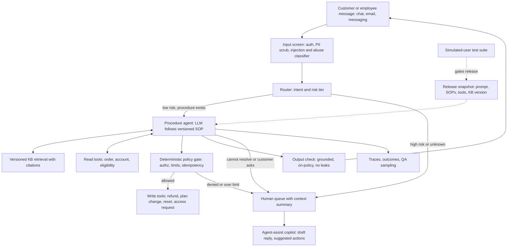

# 04 — Customer and employee support resolution agents

*Research provenance.* Researched 2026-10-01 under a tight tool budget: web search was exhausted early and the egress proxy blocked most vendor pages. **†** marks sources I could not open (sierra.ai, decagon.ai, langchain.com, servicenow.com, moveworks.com, bankofamerica.com, taubench.com); claims about those exemplars come only from the task brief or are my reasoned reconstruction, and are labelled accordingly. Unmarked sources were fetched and read. Resolution-rate figures are vendor-reported unless stated.

## 1. TL;DR

A policy-grounded agent reads a request over chat, email or messaging; retrieves from a versioned knowledge base (KB); calls backend APIs (order lookup, refund, plan change, password reset, access provisioning) following written procedures; and hands off to a human, with a summary, when it cannot or should not resolve. The same architecture serves external customer support and internal IT/HR service desks; agent-assist copilots are the human-in-the-loop variant.

Why an agent rather than a fixed workflow or single prompt: requests are open-ended and multi-turn, and resolution needs several dependent tool calls (identify, check eligibility, act, confirm). **[Documented]** Anthropic lists support as a natural agent fit because it combines conversation with tool access, has clear success criteria, and allows human oversight, and notes some vendors charge only for successful resolutions [21]. Why not a free-running agent: money, PII and brand are at stake, so policy must live in deterministic code and written procedures, not in the model's judgment. The winning design is a hybrid: LLM for understanding and procedure-following, code for authorization and limits.

## 2. Real-world exemplars

| Name | Org | Type | Maturity & scale signals | Source |
|---|---|---|---|---|
| Agent OS / Agent SDK | Sierra | product | Brief: declarative skills, deterministic guardrails, atomic release snapshots; outcome-based pricing | [1†] |
| Agent Operating Procedures (AOPs) | Decagon | product | Brief: Chime case study; Claude case study lists refunds, eligibility checks, payments | [2†][13] |
| AI Assistant | Klarna | internal/consumer deployment | Brief: LangGraph + LangSmith; LangGraph README lists Klarna as adopter; figures are 2024–25, later stance change unverified | [3†][14] |
| Fin | Intercom | product (built on Claude) | "Up to 86%" of volume resolved, "51% average out of the box" (vendor/case study) | [4] |
| Internal AI agents | ServiceNow | internal deployment | Brief: ~90% of internal IT requests (company claim) | [5†] |
| AI Help Desk | Moveworks | product (internal IT/HR) | Brief: 88–95% on narrow flows (vendor-reported) | [6†] |
| EricaAssist | Bank of America | internal assist-only | Brief: generative AI helping human agents (Jul 2026) | [7†] |
| openai-cs-agents-demo | OpenAI | open-source reference | Triage + 5 specialists, handoffs, 2 guardrails | [15] |
| Parlant | Emcie | open-source framework | Guidelines, journeys, canned responses; README claims regulated-sector production use | [18] |
| tau-bench / tau2-bench (τ³) | Sierra Research | benchmark | Airline, retail, telecom, banking_knowledge; text and voice | [8][11] |
| Customer support agent quickstart | Anthropic | reference app | Next.js + Bedrock KB RAG + mood-based redirect | [25] |

Also named in the brief but not retrieved: Expedia/Airbnb service assistants and Khanmigo (education tutor, lower agentic share).

## 3. Problem shape

- **Inputs:** customer/employee message (chat, email, messaging), authenticated identity, account/order context, KB, written procedures.
- **Outputs:** grounded reply, executed actions (refund, plan change, reset, access grant), ticket/CRM updates, or handoff package (summary, attempted steps, customer sentiment).
- **Environment:** helpdesk/CRM, order/billing APIs, KB; internally ITSM, IAM, HRIS.
- **Action space:** read tools (cheap, safe) and write tools (money, entitlements; gated).
- **Autonomy:** supervised to semi-autonomous: autonomous on low-risk narrow flows, human-gated on high-value or ambiguous cases; assist-only where regulation demands (EricaAssist-style [7†]).
- **Latency budget:** seconds per turn for chat; email can be minutes; voice is a separate dossier.
- **Blast radius:** wrong refund, data exposure across accounts, brand-damaging reply, unauthorized access grant.
- **Humans:** support ops authors procedures and QA-samples; human agents take handoffs; supervisors own thresholds.

## 4. Reference architecture

Dominant patterns: **augmented LLM** (retrieval + tools + memory) wrapped in **routing** (intent/risk triage), a **human-authored plan** (the procedure is a plan-and-execute script the model follows), and **layered guardrails** (input screen, deterministic policy gate, output check). Multi-agent **handoff** (triage to specialists) is common in demos [15] but a single procedure-following agent plus tools is the simpler default **[Inferred]**.



**Components**
- **Model tiering:** small fast model for input screening, routing, tool-output screening; stronger model for the procedure agent. Anthropic's guide suggests a larger model for complex multi-step support and a small, fast model where latency across RAG/tool chains dominates [19]; its jailbreak guidance uses a lightweight model as a pre-screen [20].
- **Controller:** the procedure (numbered SOP, skill, or journey). Parlant matches only relevant guidelines per turn rather than stuffing hundreds of rules in one prompt [18]; Agent Skills use progressive disclosure (metadata, body, linked files) [23].
- **Tools:** identity-bound read tools, policy-gated write tools, `escalate_to_human`.
- **Memory/state:** conversation store, customer profile, release/version id on every conversation.
- **Retrieval:** versioned KB with citations (Bedrock Knowledge Bases in Anthropic's quickstart [25]; any vector DB works).
- **HITL:** handoff with summary; approval queue above value thresholds; assist copilot for the human.
- **Guardrails:** Section 10.

## 5. Exemplar teardowns

**5.1 Sierra** — **[Documented†]** per the brief: declarative skills, deterministic guardrails, atomic release snapshots, an "agent development life cycle" [1†]; Sierra Research publishes tau-bench and tau2-bench [12]. **[Inferred]** A "skill" is a typed procedure the model executes; guardrails are code that can veto actions regardless of model output; a snapshot bundles prompt+skills+tools+KB so a release can be rolled back atomically and pre-tested in simulation (consistent with how they benchmark: simulated users against policy and DB state [8][9]). Outcome-based pricing is the commercial counterpart **[Documented†, brief]**.

**5.2 Decagon AOPs** — **[Documented†]** brief: Agent Operating Procedures, Chime case study [2†]. **[Documented]** Decagon's Claude case study says Claude is strong at "intricate, multi-step processes" and lists refunds, eligibility checks, payment processing and policy adherence as tasks [13]. **[Inferred]** AOPs are natural-language SOPs authored by ops staff and executed with tool calls, with engineers adding code-level controls; the page did not disclose tests or guardrails [13].

**5.3 Klarna** — **[Documented†]** brief: built with LangGraph and LangSmith [3†]; **[Documented]** LangGraph describes itself as a low-level framework for long-running stateful agents with checkpointer persistence and human-in-the-loop interrupts, and lists Klarna among adopters [14]. **[Inferred]** The graph encodes routing and tool nodes with LangSmith traces for debugging. Treat Klarna's 2024 headline savings and any later reversal toward human support as unverified here; the brief itself says to verify.

**5.4 Intercom Fin** — **[Documented]** Powered by Claude; four pillars Knowledge, Behavior, Actions (refunds, account changes), Insights; "every change... is rigorously tested against our production baseline"; "up to 86%" of support volume resolved, "51% average resolution rate out of the box"; Lightspeed up to 65% with stable CSAT, AI in 99% of conversations, agents closing 31% more conversations daily; Fundrise >50% of volume in three months at 95% accuracy [4]. The case study does not specify model versions or retrieval internals [4]. Brief: Fin 67–76% vendor-reported vs 38–50% in one independent source (not verified).

**5.5 Internal service desks** — **[Documented†]** brief only: ServiceNow claims about 90% of internal IT requests handled [5]; Moveworks claims 88–95% on narrow flows [6]. **[Inferred]** Internal flows resolve better because the action space is small (reset, unlock, request access), identity is already known (SSO), and success is checkable in the IAM/ITSM system. Access provisioning should route through approval workflows.

**5.6 OpenAI customer-service demo** — **[Documented]** Python backend on the OpenAI Agents SDK with a Next.js/ChatKit UI; Triage agent routes to Flight Information, Booking & Cancellation, Seat & Special Services, FAQ, and Refunds & Compensation agents via handoffs; relevance and jailbreak guardrails both return a fixed refusal [15]. Guardrails in the SDK: input (parallel or blocking), output, and tool guardrails with tripwire exceptions [17].

**5.7 Parlant** — **[Documented]** "Interaction control harness": observations, guidelines (condition-action), journeys (multi-turn SOPs), relationships, canned responses that replace free-form text at critical moments, and Attentive Reasoning Queries [18].

**5.8 Anthropic quickstart** — **[Documented]** Next.js app, Bedrock Knowledge Base RAG, mood detection with agent redirection, citations in a debug sidebar; the checked-in model list is older (Claude 3-era) [25].

## 6. Frameworks & stack

- **Agent loop:** raw tool-use loop on a provider SDK (simplest; used in the sketch below), OpenAI Agents SDK for handoffs/guardrails/sessions/tracing [16][17], LangGraph for explicit state machines with checkpoint persistence and interrupts [14], Parlant for guideline/journey control [18], Claude Agent SDK **[Inferred]** where file/skill-style procedures help. Low-code: Dify, n8n, Langflow **[Inferred]**.
- **Procedures:** Agent Skills (SKILL.md) package SOPs with optional deterministic scripts [23]; Parlant journeys [18].
- **Protocols:** MCP for backend tools; A2A for cross-vendor agent handoff; AG-UI for streaming agent state to UIs **[Inferred]**.
- **Retrieval:** pgvector/Qdrant/Weaviate/Pinecone or Bedrock KB [25]; version the corpus, return passage ids for citations.
- **Durable execution:** Temporal/Inngest/DBOS when a case waits days on an approval or customer reply **[Inferred]**.
- **Observability/evals:** LangSmith, Langfuse, Braintrust, Phoenix; tau2-bench harness and Promptfoo/Inspect AI for regressions **[Inferred]** [8].

## 7. Tool design

```
search_kb(query, audience, max_passages=5) -> [{id, title, text, kb_version}]
get_account() -> {plan, status, entitlements}              # customer id bound by harness
lookup_order(order_id) -> {status, total, age_days, refundable_amount}
check_refund_eligibility(order_id) -> {eligible, reason_code, max_amount}
issue_refund(order_id, amount, reason, idempotency_key) -> OK | DENIED(reason)
change_plan(plan_id, effective) -> OK | DENIED(reason)
reset_password(user_id) / request_access(app, role, justification) -> ticket_id | pending_approval
escalate_to_human(summary, category, urgency, attempted_steps[])
```
Lessons: **[Documented]** consolidate related calls, return high-signal semantic fields not UUID soup, truncate, and write actionable error messages [24]. **[Inferred]** (1) The harness, not the model, supplies customer/employee id, so cross-account access is impossible. (2) Return *derived policy facts* (eligibility, max amount) so the model reads policy rather than computing it. (3) Write tools enforce limits and idempotency in code and return DENIED with a reason the model can relay or escalate on. (4) Provide `escalate_to_human` as a first-class tool and test that it is used.

## 8. Context & memory engineering

- **Procedures:** load only the SOP(s) relevant to the routed intent; Parlant's per-turn guideline matching [18] and skills' progressive disclosure [23] are the two documented mechanisms.
- **KB:** versioned, with owner and effective date; retrieved passages carry ids so answers can cite and QA can audit. Anthropic notes RAG improves accuracy, latency and cost for large static context [19].
- **Untrusted text:** **[Documented]** deliver customer/third-party content in tool results or clearly delimited blocks, JSON-encode it, and state in the system prompt that it is data not instructions [20].
- **Conversation memory:** keep the running transcript; summarize for handoff (what was asked, what was verified, what was done, what is blocked) so the customer never repeats themselves **[Inferred]**.
- **Cross-session memory:** keep to structured profile fields and past-case references; avoid free-form memory of PII **[Inferred]**.
- **Release pinning:** stamp each conversation with prompt/SOP/KB/tool versions for reproducibility **[Inferred, from Sierra's snapshot idea per brief]**.

## 9. Evaluation

- **tau-bench family [Documented]:** simulated user LLM, domain policy, API tools over a database; success judged by final DB state. tau2-bench README (now titled τ³-Bench) lists airline, retail, telecom (dual-control user tools), banking_knowledge (RAG) and a mock domain, text half-duplex and full-duplex voice, and reports "75+ task fixes" from a SABER analysis [8]. Default reward basis for airline/retail/telecom is DB × COMMUNICATE; ACTION, ENV_ASSERTION and an experimental NL_ASSERTION judge exist [9]. Voice adds latency/yield/interruption metrics [10]. tau-bench reports Pass^1..Pass^4; its README baseline (Claude 3.5 Sonnet, airline 0.460, retail 0.692 Pass^1) is **old**, so use the live leaderboard (taubench.com, not retrieved) [11].
- **Eval design [Documented]:** combine state check, transcript constraints (e.g. under 10 turns) and an LLM rubric for tone; simulate the user with a second LLM; beware graders that fail agents for finding legitimate alternatives [22]. pass^k captures consistency (75% per trial is ~42% at three trials) [22].
- **Anthropic's suggested targets [Documented]:** intent comprehension ≥95%, relevance ≥90%, escalation accuracy ≥95%, deflection 70–80% depending on complexity [19].
- **Production metrics:** define *resolution* (no re-contact in N days, confirmed outcome) separately from *deflection* (customer left); track containment, handoff quality, CSAT, policy-violation rate, wrong-action rate, cost per resolution **[Inferred]**. Vendor claims range widely (Fin 51% average vs 86% best-case in one source [4]; 67–76% vs 38–50% in the brief); compare definitions before comparing numbers.
- **Pre-release:** regression-test every change against a production baseline (Intercom [4]) and simulation suites (Sierra, per brief [1†]).

## 10. Failure modes, safety & guardrails

- **Characteristic failures:** invented policy or KB drift; acting on the wrong account; social-engineered refunds; over-escalation (no savings) and under-escalation (harm); looping on unresolvable requests; brand-risky tone; counting deflection as resolution.
- **Prompt injection:** customer messages, forwarded emails, attachments (OCR) and KB pages are untrusted. **[Documented]** Anthropic separates direct injection (the user is the adversary) from indirect (third-party content), and recommends harmlessness/injection screens with a small model and structured output, untrusted content only in tool results, JSON-encoding, least privilege, red-teaming and monitoring [20]. OpenAI's SDK offers input/output/tool guardrails with tripwires [17]. Defense must be layered because any probabilistic defense has a non-zero miss rate [26].
- **Permissioning:** identity bound by harness, per-tool scopes, value thresholds, human approval above limits, idempotency keys, audit log of every action with release id.
- **Hard stops:** Parlant-style canned responses for regulated statements [18]; deterministic gates in write tools; kill switch routing all traffic to humans.
- **HITL:** handoff package; assist mode for high-risk intents; QA sampling of autonomous conversations.
- **Rollback:** immutable release snapshots with canary rollout and one-click revert **[Inferred from Sierra's snapshot concept, brief]**.

## 11. Build it yourself

1. **Scope one flow** (e.g. order refunds). Write the SOP as numbered steps with explicit stop conditions and escalation triggers.
2. **Tools first:** build read tools and one gated write tool; policy lives in code; id bound by harness.
3. **MVP loop** (sketch below): single agent, SOP in system prompt, KB search optional, hard turn cap, handoff on cap.
4. **Simulation suite:** 50–100 scripted/LLM-simulated conversations with DB-state and communication checks (tau-bench style [9]); include adversarial and injection cases.
5. **Guardrails:** input screen, tool-output screen, output check; red-team.
6. **Handoff:** ticket + summary into your helpdesk; measure re-contact.
7. **Release discipline:** version prompt+SOP+tools+KB as one snapshot; canary 5%; automated rollback on regressions.
8. **Shadow then assist then autonomy:** run in agent-assist mode, then autonomous on the narrowest flow.
9. **Expand procedures** one at a time, each with its own eval slice; add routing.
10. **Operate:** weekly QA review, KB-gap loop (unanswered queries to KB owners), cost and resolution dashboards.

MVP core loop (raw tool-use loop on the Anthropic Messages API; `messages.create(model, system, max_tokens, messages, tools)`, `tool_use` blocks with `.name/.input/.id`, and `tool_result` messages were confirmed in Anthropic's official support-agent guide [19]; the order store is a stub):

```python
import json, os
from anthropic import Anthropic

MODEL = os.environ["AGENT_MODEL"]
client, SOP_VERSION = Anthropic(), "refund-sop@2026-09-30"   # release id stamped on every run
SOP = open("sop_refunds.md").read()                          # numbered runbook with stop conditions
ORDERS = {"A100": {"customer": "c1", "total": 40.0, "age_days": 12, "refunded": 0.0}}  # stub DB
AUTO_LIMIT = 50.0
def tool(name, desc, props, req):
    return {"name": name, "description": desc,
            "input_schema": {"type": "object", "properties": props, "required": req}}
S = {"type": "string"}
TOOLS = [tool("lookup_order", "Look up one of THIS customer's orders.", {"order_id": S}, ["order_id"]),
         tool("issue_refund", "Refund an order. Policy is enforced in code and may deny.",
              {"order_id": S, "amount": {"type": "number"}, "reason": S}, ["order_id", "amount", "reason"]),
         tool("escalate_to_human", "Hand off with a summary when policy forbids or data is missing.",
              {"summary": S}, ["summary"])]

def run_tool(name, a, customer_id, st):
    o = ORDERS.get(a.get("order_id", ""))
    if name == "escalate_to_human":
        st["handoff"] = a["summary"]; return "OK: handed off"
    if not o or o["customer"] != customer_id:                  # identity comes from the harness
        return "DENIED: order not found for this customer"
    if name == "lookup_order":
        return json.dumps({k: v for k, v in o.items() if k != "customer"})
    if name == "issue_refund":
        if o["age_days"] > 30: return "DENIED: outside 30-day window; escalate if customer insists"
        if a["amount"] > o["total"] - o["refunded"]: return "DENIED: exceeds refundable amount"
        if a["amount"] > AUTO_LIMIT: return "DENIED: above auto-refund limit; escalate_to_human"
        o["refunded"] += a["amount"]; st["actions"].append(a); return f"OK: refunded {a['amount']:.2f}"
    return "ERROR: unknown tool"

def handle(customer_id, text, max_turns=8):
    st, msgs = {"actions": [], "handoff": None}, [{"role": "user", "content": text}]
    for _ in range(max_turns):
        r = client.messages.create(model=MODEL, max_tokens=1024, system=SOP, tools=TOOLS, messages=msgs)
        msgs.append({"role": "assistant", "content": r.content})
        calls = [b for b in r.content if b.type == "tool_use"]
        if not calls:
            return {"reply": "".join(b.text for b in r.content if b.type == "text"), "sop": SOP_VERSION, **st}
        msgs.append({"role": "user", "content": [{"type": "tool_result", "tool_use_id": c.id,
                     "content": run_tool(c.name, c.input, customer_id, st)} for c in calls]})
        if st["handoff"]: break
    return {"reply": "I've passed this to a teammate who will follow up.", "sop": SOP_VERSION,
            "actions": st["actions"], "handoff": st["handoff"] or "turn cap reached"}
```

## 12. Economics

- **Cost drivers:** tokens per conversation (multi-turn history, retrieved passages, tool outputs), screening calls, human handoffs (the expensive path), QA/ops labor to maintain SOPs and KB, simulation/eval runs. Cache static SOP/KB prefixes and use small models for screening **[Inferred]**.
- **Latency:** chat needs seconds per turn; RAG plus tool chains push toward faster models [19].
- **Pricing models:** per-resolution/outcome pricing is a documented trend [21] (Sierra per brief [1†]); Intercom-style per-resolution fees are widely reported but the figure was not verified here; seat-based pricing remains common for assist copilots **[Inferred]**.
- **ROI evidence (vendor/customer-reported):** Synthesia 6,000+ conversations and 1,300+ hours saved in six months; Lightspeed agents close 31% more conversations per day at stable CSAT; Fundrise automated >50% of volume in three months [4]. ServiceNow's ~90% internal claim and Moveworks' 88–95% are narrow-flow, company-reported [5†][6†]. **[Inferred]** ROI hinges on true resolution rate, cost of wrong actions, and the share of volume that falls in codified procedures.

## 13. Related use cases

- [Real-time voice agents](./05-voice-agents.md): same procedures and guardrails under a hard latency budget; tau2 has a voice mode.
- [Sales, marketing, recruiting and creative-content agents](./06-gtm-sales-marketing-creative-agents.md): other customer-facing agents with brand risk.
- [Workplace and delegated knowledge-work agents](./07-workplace-knowledge-agents.md): internal IT/HR overlaps here.
- [Document-centric back-office and case-processing agents](./08-back-office-case-processing-agents.md): refunds/claims escalate into case processing.
- [Asynchronous cloud coding agents and agent fleets](./03-async-coding-agent-fleets.md): same deterministic-rails-plus-agent-nodes and release discipline.
- [Computer-use, browser and always-on personal agents](./10-computer-use-browser-agents.md): fallback when no API exists.

## 14. Sources

(† = could not be opened; used only as named in the task brief.)

1. https://sierra.ai/blog/agent-development-life-cycle †
2. https://decagon.ai/case-studies/chime †
3. https://www.langchain.com/blog/customers-klarna †
4. https://claude.com/customers/intercom
5. https://www.servicenow.com/uk/blogs/2026/how-is-servicenow-using-ai-agents †
6. https://www.moveworks.com/us/en/solutions/ai-help-desk †
7. https://newsroom.bankofamerica.com/content/newsroom/press-releases/2026/07/bank-of-america-enhances-ericaassist-with-generative-ai-to-help-.html †
8. https://github.com/sierra-research/tau2-bench
9. https://github.com/sierra-research/tau2-bench/blob/main/docs/evaluation.md
10. https://github.com/sierra-research/tau2-bench/blob/main/docs/interaction-metrics.md
11. https://github.com/sierra-research/tau-bench
12. https://github.com/sierra-research
13. https://claude.com/customers/decagon
14. https://github.com/langchain-ai/langgraph
15. https://github.com/openai/openai-cs-agents-demo
16. https://github.com/openai/openai-agents-python
17. https://github.com/openai/openai-agents-python/blob/main/docs/guardrails.md
18. https://github.com/emcie-co/parlant
19. https://platform.claude.com/docs/en/about-claude/use-case-guides/customer-support-chat
20. https://platform.claude.com/docs/en/test-and-evaluate/strengthen-guardrails/mitigate-jailbreaks
21. https://www.anthropic.com/engineering/building-effective-agents
22. https://www.anthropic.com/engineering/demystifying-evals-for-ai-agents
23. https://www.anthropic.com/engineering/equipping-agents-for-the-real-world-with-agent-skills
24. https://www.anthropic.com/engineering/writing-tools-for-agents
25. https://github.com/anthropics/claude-quickstarts/tree/main/customer-support-agent
26. https://www.anthropic.com/engineering/how-we-contain-claude
