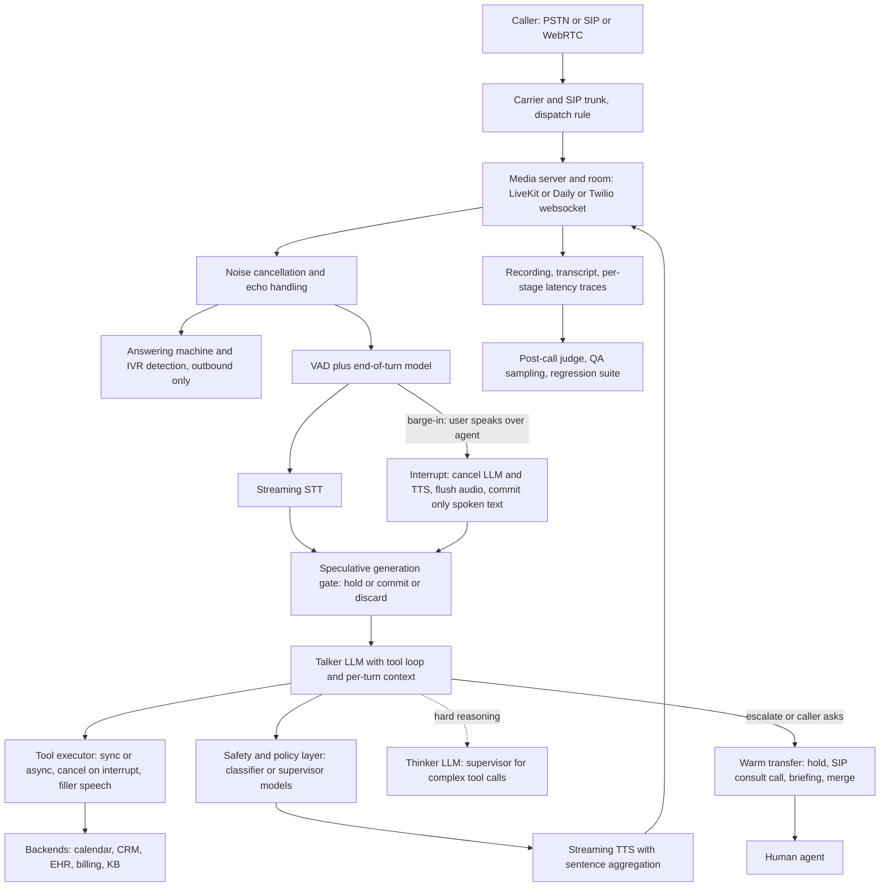

# 05 — Real-time voice agents (telephony and in-app)

*Research provenance.* Researched 2026-10-01 with web search exhausted and most vendor domains blocked by the egress proxy; only GitHub (source and docs repos), PyPI and claude.com were readable. The open-source substrates (Pipecat, LiveKit Agents, tau2-bench, OpenAI's realtime reference repo) are therefore documented from **source code and docs repos**. Commercial exemplars are documented from **conference-talk transcripts and summaries mirrored in a third-party GitHub repo** (`ppruchnerovic/ai-talks-universe`; AI Engineer 2026 and similar events, so first-party speakers but secondary, machine-summarized text) and from a third-party mirror of Hippocratic AI's site and blog feed (api-evangelist). **†** marks sources I could not open (hippocraticai.com, arXiv, decagon.ai, housingwire.com, hlth.com); claims about those rest on the task brief or on my reconstruction and are labelled. All vendor and speaker figures are self-reported. Pricing pages were unreadable, so section 12 gives cost structure, not rate cards.

## 1. TL;DR

A voice agent answers or places phone calls (or in-app audio sessions) by running a streaming loop: audio in, voice activity and end-of-turn detection, speech-to-text (STT), an LLM that may call tools, text-to-speech (TTS), audio out. It handles barge-in (the caller interrupts), authenticates the caller, calls backend tools mid-call (calendar, CRM, EHR, billing), and warm-transfers to a human with a summary when it should not or cannot continue. Deployments: contact-center support, scheduling and leasing, dealership calls, patient outreach.

Why an agent rather than an IVR tree or a single prompt: calls are open-ended, multi-turn and tool-dependent (identify, look up, offer options, commit, confirm), and callers digress. Why not a free-running agent: speech is real time, so the loop is a **latency-constrained augmented LLM**. Anything that can stall (tools, large models, retrieval) has to be hidden behind filler speech, run asynchronously, or moved to a side channel. The defining design insight is that **turn-taking and interruption handling are first-class architecture, not plumbing**, and that reasoning depth is traded against a sub-second response budget.

## 2. Real-world exemplars

| Name | Org | Type | Maturity & scale signals | Source |
|---|---|---|---|---|
| Pipecat | Daily (open source) | open-source framework | v1.12.0 released 2026-09-26 (PyPI); 16.1k stars; PyPI cites 50+ STT, 30+ LLM, 40+ TTS integrations (README says 25+/30+/35+); telephony, evals, multi-agent bus built in | [1][2] |
| LiveKit Agents | LiveKit (open source) | open-source framework | v1.8.3 released 2026-09-23; 14.4k stars; SIP bridge, warm-transfer, AMD, test framework | [20][21] |
| openai-realtime-agents | OpenAI | open-source reference | ~7.0k stars; chat-supervisor and sequential-handoff patterns | [37] |
| tau-voice / tau2-bench voice mode | Sierra Research | benchmark | Full-duplex, 200 ms ticks, OpenAI/Gemini/xAI adapters; arXiv:2603.13686 (2026) cited in repo | [39][40] |
| Polaris constellation, Front Door, Nurse Co-Pilot | Hippocratic AI | product | Talk (2026-08-19): "200 million" conversations, 60+ health systems, 31 models per conversation; vendor figures inconsistent across sources | [48][43][44]† |
| Voice agent at Chime | Decagon | product (vendor-reported) | Brief: 1M+ calls/month. Not opened; the claude.com Decagon page covers text support only | [45]† |
| Voice agents for housing and healthcare; Rentals AI Assist | EliseAI / Zillow | product | Engineering talk (2026-09-15) describes its voice stack; the Zillow integration itself is brief-only | [49][46]† |
| Fin Voice | Intercom | product | Talk (2025-07-18): "full voice stack" shipped in 100 days; no metrics disclosed | [54] |
| Practitioner talks | Together AI, Plivo, Hamming, AWS, OpenAI | talks (self-reported) | Latency budgets, failure rates (Hamming: ~10% error across 10,000 monitored agents), thinker/talker pattern | [50]-[53][55][56] |
| Impel | Impel | product plus internal | claude.com: "digital voice assistants that field dealership calls" (no architecture); a voice roleplay trainer built from 150,000+ Gong calls in ~3 weeks | [47] |
| Ultravox | Fixie / ultravox.ai | open model | Audio-to-LLM projector over Llama 3.3 70B or 8B; text out, no native speech out; v0.7 (Dec 2025) | [41] |
| Moshi | Kyutai | open research model | Full-duplex speech model; 160 ms theoretical, ~200 ms practical latency; no tool-calling story | [42] |

## 3. Problem shape

- **Inputs / outputs:** a live audio stream (8 kHz telephony or wideband WebRTC), caller ID, account metadata, KB and SOPs in; synthesized speech, tool side effects (bookings, notes, payments), disposition, transcript and an escalation package out.
- **Environment and action space:** PSTN/SIP carrier or WebRTC; calendar/CRM/EHR/billing APIs; speak, read tools (cheap), write tools (money, appointments, clinical records), DTMF, transfer, voicemail, hang up.
- **Autonomy:** supervised to semi-autonomous: autonomous inside a narrow script and tool set, deterministic gates on writes, an always-available human exit.
- **Latency budget:** gap from end of user speech to first agent audio. Vendors cite roughly 600-900 ms (brief); OpenAI's repo calls "stitched" STT-LLM-TTS latency "often 1.5s or longer" [37]; tau-voice measures it as L_R [40].
- **Risk and humans:** wrong booking or payment, PHI to the wrong person, clinical misguidance, outbound-consent violations, talking over customers. Supervisors set escalation rules, humans take warm transfers, QA reviewers (clinicians in healthcare) sample calls.

**Latency budget by stage** (response gap = endpointing wait + STT finalization + LLM time-to-first-token + TTS time-to-first-byte + network):

| Stage | Evidence | Label |
|---|---|---|
| Endpointing | LiveKit defaults: min 0.5 s / max 3.0 s fixed; 0.3 s / 2.5 s with streaming detectors [22]. Pipecat built-in STT P99s were measured at VAD `stop_secs=0.2` [11] | Documented |
| STT time-to-final-segment, P99 | Pipecat constants: Deepgram 0.35 s, AssemblyAI 0.42 s, Gemini 0.60 s, Cartesia 0.81 s, Groq 1.54 s, Google 1.57 s, Azure 1.80 s, OpenAI/ElevenLabs batch 2.01 s [11] | Documented |
| Turn classifier | Smart Turn v3 (about 8M params) runs in as little as 10 ms on some CPUs, under 100 ms on most cloud instances, about 65 ms on Pipecat Cloud [9] | Documented |
| LLM time-to-first-token | Together AI talk: 200-300 ms target with 8-30B models; AWS talk: 500-650 ms observed for API LLMs; Plivo: most teams land at 750-1,200 ms end to end and target under 300 ms for the LLM [50][51][53] | Talk-reported |
| Network and playback | AWS talk: 85-120 ms; Together AI: 75 ms drops to about 5 ms when models are co-located [50][53] | Talk-reported |
| End to end | AWS: realistic API pipeline 800-1,300 ms; one practitioner reports about 900 ms using a small model plus a state machine; Rasa's unoptimized example took 3,470 ms [53][55] | Talk-reported |
| TTS time-to-first-byte | Not measured here; plan roughly 100-250 ms for streaming TTS | Inferred |

Speculative execution (section 4) can hide part of the endpointing wait, but only part. The sum shows why sub-second is hard: every stage must be streaming, and P95 matters more than P50 because one slow turn breaks the call [53].

## 4. Reference architecture

Dominant patterns:

- **Augmented LLM in a streaming pipeline** (cascaded STT, LLM, TTS) as the default. Native speech-to-speech models (OpenAI Realtime family, Gemini Live, Moshi, Ultravox as audio-in only) collapse the cascade [1][37][38][41][42].
- **Routing and handoff** among specialist agents, with only one active at a time [15].
- **Orchestrator-workers as a talker/thinker split** ("chat-supervisor"): a fast realtime agent keeps the conversation moving while a stronger text model does tool calls and reasoning [37].
- **Workflow or state machine** for regulated flows: LiveKit `AgentTask` and `TaskGroup`, Pipecat Flows (merged into core in 1.5.0) [27][19].
- **Parallel guardrail layer.** Hippocratic's "constellation": one central conversation model plus about 30 specialist models and verifiers per call, each specialist first deciding "do I need to speak?" so inactive ones short-circuit [48].



**Model roles and tiering.** (1) Talker LLM: small and fast, tight system prompt, per-agent small context. (2) Optional thinker/supervisor LLM for tool-heavy turns; OpenAI's reference pairs `gpt-4o-realtime-mini` with `gpt-4.1` and says this can be cheaper than the full realtime model and that the realtime model "responds to the user right away" while the supervisor works [37]. Together AI's talk describes the same "thinker-talker" split: a small LLM runs the conversation and issues a single tool call to a larger model for complex or governed requests, "keeping the fast path fast" [50]. EliseAI goes further: background agents make the slow tool call and push the result into the main model's context "so that it thinks it made the tool call" [49]. (3) Tiny classifiers: Smart Turn v3 (Whisper-Tiny base plus linear head, 23 languages, 16 kHz mono, up to 8 s) [9]; LiveKit's adaptive interruption detector, which separates real interruptions from backchannel ("mm-hmm") [24]; LLM-based voicemail/IVR classifiers [12][13][25]. (4) Safety or supervisor models. (5) Offline judge LLM for QA.

**Planner/controller.** Mostly the talker LLM's own tool loop (`max_tool_steps` defaults to 3 in LiveKit [23]), constrained by an SOP prompt, or by a state machine whose nodes expose only the tools valid in that state.

**Turn-taking machinery** (the part most dossiers omit):

- Start of user turn: VAD plus first transcription; Pipecat defaults are `VADUserTurnStartStrategy` and `TranscriptionUserTurnStartStrategy`, with min-words, wake-phrase and Krisp variants [4].
- End of user turn: audio-based turn analyzer (default `TurnAnalyzerUserTurnStopStrategy` with `LocalSmartTurnAnalyzerV3`) [4]; LLM-gated completion in which the model marks the turn complete (●), short-incomplete (◐) or long-incomplete (○), and "incomplete" triggers a re-prompt instead of a reply [6].
- **Speculative generation:** LiveKit starts the LLM on an interim "preflight transcript" and discards it if the final transcript differs [26]. Pipecat's `EagerUserTurnStopStrategy` triggers inference on the STT's end-of-turn prediction (`speculation_timeout` 5.0 s); a `SpeculationGate` buffers frames in OPEN/HOLDING/DROPPING states until `UserStoppedSpeakingFrame` commits or `EagerEndOfTurnCancelFrame` or an interruption discards [5].
- **Barge-in:** Pipecat broadcasts `InterruptionFrame`; each processor cancels its task and drops queued data frames; frames with `interruptible=False` (e.g. `FunctionCallResultFrame`) survive; TTS clears its buffers; and "the aggregator commits the partial, spoken-so-far text" so the context reflects what the caller actually heard [10]. LiveKit adds false-interruption recovery: `resume_false_interruption` and `false_interruption_timeout=2.0` s let paused speech resume if the overlap was noise or backchannel [22][26].

**Tools that must not stall the call.** Sync tools by default; async tools via `cancel_on_interruption=False`, which injects a started message, optional progress updates and a final result as developer messages later [7][8]. Filler speech either from the handler (`TTSSpeakFrame("Looking up...")`) [14] or from LiveKit's `_FillerScheduler`, with delay, interval and max steps, which yields to the caller [26].

**HITL checkpoints.** Warm transfer with briefing; supervisor approval tools; post-call review. **Guardrails:** deterministic gates on write tools, scope limits in the SOP, output screening (OpenAI's Realtime SDK debounces guardrail checks on accumulated transcript deltas [38]), and dynamic tool exposure.

## 5. Exemplar teardowns

### Pipecat [Documented, source and docs repos]
- **Pipeline of frame processors:** `transport.input() → stt → user_aggregator → llm → tts → transport.output() → assistant_aggregator` [17]; context summarization exists for long calls [3].
- **Tools:** `register_function(..., cancel_on_interruption=True, timeout_secs=None, cancellable_by_llm=False)`; parallel calls grouped (`group_parallel_tools=True`) so the LLM runs once after the batch [7].
- **Telephony:** websocket serializers (Twilio, Telnyx, Plivo, Exotel) for basic control; Daily WebRTC/PSTN; SIP for "full control, including transfers, forwarding, multi-party" [16]. `VoicemailDetector` classifies in a parallel pipeline while a `gate()` buffers bot speech (`decision_timeout` 1 s) [12]; `IVRNavigator` uses DTMF with `IVRStatus` COMPLETED/STUCK/DETECTED [13].
- **Multi-agent and evals:** `LLMWorker` agents on a shared bus, handoff via `activate_worker(deactivate_self=True)` with activation messages as context [15]; scripted and simulated (persona plus goal, LLM plays caller) scenarios with an LLM judge covering function calls, interruption recovery and per-event latency [16].
- **Decision worth copying:** swappable service interfaces plus observers/metrics let you replace STT/LLM/TTS vendors without touching call logic.

### LiveKit Agents [Documented, source and examples]
- **Process model:** `AgentServer` schedules jobs; each call runs an `@server.rtc_session()` entrypoint that builds an `AgentSession` (vad, stt, llm, tts) and starts an `Agent` (instructions, tools) in a room [20]. Handoffs: `session.update_agent()`, or `AgentTask[T]` sub-tasks that `complete()` with a typed result [27].
- **Turn config:** modes `stt`/`vad`/`realtime_llm`/`manual`; fixed or dynamic (EMA) endpointing; interruption mode `adaptive` or `vad` (defaults in section 3 and 4); preemptive generation on by default with `preemptive_tts` off, `max_speech_duration` 10 s, `max_retries` 3 [22][26][28]. The adaptive detector takes 16 kHz audio (3 s buffer, 0.1 s batches) and returns `is_interruption` plus a probability from LiveKit's hosted inference gateway (`/bargein`), a vendor dependency [24].
- **Telephony:** a Go SIP-to-WebRTC bridge with trunks and dispatch rules, Redis for state [30]; AMD verdicts human / machine-ivr / machine-vm / machine-unavailable / uncertain [25]; DTMF, credit-card, DOB, name and address collection tasks in `beta/workflows` [29].
- **Warm transfer:** `WarmTransferTask` opens a second room, dials the human over SIP with hold music for the caller, briefs the human's separate `AgentSession` with the conversation summary, and exposes `connect_to_caller`, `decline_transfer` and `voicemail_detected` tools; failures surface as `ToolError` [31].
- **Healthcare example (progressive disclosure):** authentication gates everything; doctor/slot tools are built dynamically with enum-constrained arguments "to prevent premature invocation or parameter hallucination"; the card is collected via structured tasks [32].
- **Testing:** `session.run()` returns events asserted with `expect.next_event().is_function_call(...)`, `.judge(llm, intent=...)` and `mock_tools`; the front-desk example ships 10 scenarios including adversarial ones plus a `JudgeGroup` [33][34][35].

### OpenAI realtime-agents (chat-supervisor) [Documented, README]
A realtime model (`gpt-4o-realtime-mini`) handles small talk and acknowledgments; for tool use it defers to a text supervisor (`gpt-4.1`). The README's schematic caption shows about 2 s between the spoken "give me a moment" line and the supervisor-based answer, and the realtime model still replies immediately [37]. Sequential handoffs reconfigure the session via `session.update` with new instructions and tools. The OpenAI Agents SDK realtime module offers `RealtimeAgent`/`RealtimeRunner`, `semantic_vad`, `interrupt_response`, tool approval events, `OpenAIRealtimeSIPModel` for SIP calls, and debounced output guardrails [38].

### tau-voice (tau2-bench) [Documented]
A tick-based (default 0.2 s) full-duplex harness: a user simulator speaks via ElevenLabs TTS with degradation (noise, frame drops, accents, interruptions); `DiscreteTimeAdapter` bridges OpenAI Realtime, Gemini Live or xAI Grok Voice to the loop; tool results are queued and flushed back mid-audio; max call 600 s [39][40].

### Hippocratic AI Polaris [Documented via engineering talk and third-party mirrors; self-reported; arXiv/site sources marked †]
- **Talk (Vivek Muppalla, AI Engineering lead, AI Engineer 2026-08-19) [48]:** a three-stage pipeline (hear, reason, speak). *Hearing:* a custom "decoder only audio LLM" ASR (fine-tuned Whisper V3 Large Turbo, a conformer projector that keeps prosody, context injection of history and patient details, a secondary pass for one-word answers; claims over 50% better medical-word accuracy than off-the-shelf). *Brain:* "31 models at any given point of time for every conversation", one central conversation model plus 30 specialists (labs, medications, scheduling and so on); every specialist first asks "do I need to speak?" and short-circuits if not; verifiers check tool-call parameters and responses synchronously, with offline verifiers catching errors post-call. Design principle: a single model is "one point of failure." *Speaking:* custom voice and a clinical documentation engine. Latency work: 4-bit quantization, speculative decoding, KV-cache compression ("96% hit rate", "18 times faster" pre-fill); no end-to-end millisecond budget was stated.
- **Scale and safety claims (self-reported):** "200 million" clinical conversations, 60+ health systems, "over 10,000 calls a day" for the scheduling use case, 8.5/10 patient satisfaction, "zero significant safety incidents"; 7,000+ clinicians have rated close to 800,000 conversations on a correctness/no-harm/minor/severe/death scale, with "99.89%" no-harm versus about 81% for human clinicians; a custom empathy benchmark (HEART). Escalation example: shortness of breath after hospitalization triggers immediate nurse handoff [48].
- **Mirrored company materials [43][44]:** "a ~5T-parameter constellation built around a 700B-parameter core" (latest generation) and "a 4.2 Trillion Parameter Suite" (Polaris 3.0); 6,234 clinicians reviewing 307,000+ calls with correct guidance rising from about 80% to 99.38% under Polaris 3.0; "more than 7,500 U.S.-licensed clinicians across more than 725,000 test calls"; training scale "over 1.85M real-world patient calls" (3.0) versus "more than 180m real patient interactions" (5.0). The 2024 paper "Polaris: A Safety-focused LLM Constellation Architecture for Healthcare" (title confirmed in the mirror, arXiv ID 2403.13313 from memory; not opened†) is described as "the primary conversational agent backed by specialized supervisor models" [43]. **Figures differ across sources and units (and the brief flags this); treat all as marketing-grade.**
- **Scope limits:** the company "explicitly excludes diagnosis, prescription, hospice care, mental health disorders, and pediatric care under age two"; AI Front Door ("voice agent for inbound patient phone calls, scheduling, intake, and triage handoff") and Nurse Co-Pilot are the named products [44].

### EliseAI [Documented via engineering talk; Zillow integration brief-only†]
Bohan Li's talk (AI Engineer, 2026-09-15) shows a healthcare (OB-GYN scheduling) call and frames the stack like an autonomy stack: *perception* is a "streaming speculative transcriber" pairing a fast streaming STT (Flux) with a slower, context-aware batch transcriber (Scribe V2) whose corrections supersede earlier text; *planning* is the LLM with background agents doing tool calls and injecting results into the main model's context; *control* is streaming TTS with a **prefix cache** that replays previously generated audio for repeated word sequences while the rest of the sentence is still being generated [49]. The talk gives no latency numbers, call volume, handoff or Zillow details. The company says it works in "housing, health care" [49].

### Intercom Fin Voice
Peter Bar's talk (AI Engineer World's Fair, 2025-07-18; older) says Fin Voice integrates transcription, an LLM, TTS, RAG and telephony into "tools that fit seamlessly into existing human support workflows" including handover, built in 100 days; no latency, model or scale figures [54].

### Decagon at Chime; Impel
- Decagon/Chime†: brief says 1M+ calls/month (vendor-reported). Decagon's architecture is text-side Agent Operating Procedures (see [04](./04-support-resolution-agents.md)); a voice variant presumably layers STT/TTS and turn-taking over the same procedure engine **[Inferred]**.
- Impel [Documented, claude.com]: 400+ Claude Enterprise seats; Opus for reasoning-heavy work and Sonnet for lighter executor tasks (company-internal). Its roleplay trainer "speaks via speech-to-text and text-to-speech" and was built from 150,000+ recorded calls in about 3 weeks; STT/TTS vendors and the customer-facing assistant's architecture are not described [47].

## 6. Frameworks & stack

- **Voice orchestration:** Pipecat (most granular control, evals, multi-agent bus), LiveKit Agents (batteries included: SIP, AMD, warm transfer, tests, hosted inference), OpenAI Agents SDK realtime (OpenAI-model-centric, SIP), hosted builders (ElevenLabs, Vapi, Retell, PolyAI-style platforms; vendor listicles, treat as marketing). Generic agent SDKs (LangGraph etc.) do not fit the media loop; they suit the *thinker* or post-call side.
- **Models:** streaming STT (Deepgram, AssemblyAI, Cartesia), small fast LLMs for the talker (Claude and other plugins exist in both frameworks), streaming TTS (Cartesia, ElevenLabs, Inworld), native speech-to-speech (OpenAI, Gemini Live, AWS Nova Sonic) [1][20]. Gradium's CEO argues every shipping realtime voice model is half duplex and that naturalness has cost reasoning capacity [55]; Moshi is the open full-duplex counterexample [42].
- **Transport and protocols:** SIP trunks and a SIP-WebRTC bridge for transfers; websocket serializers for fast starts; DTMF for card and PIN capture; MCP for tools (native in LiveKit [20], `mcp` examples in Pipecat [18]); a bus or A2A for specialist agents.
- **Durable execution, observability, evals:** Temporal/Restate/Inngest fit post-call work (summaries, CRM write-back), not the live loop **[Inferred]**; Pipecat metrics/observers with OpenTelemetry and Sentry [1]; LiveKit `telemetry` module [28]; per-turn spans make wasted speculative work visible [26]; Pipecat Evals, LiveKit `RunResult` tests and tau-voice for model selection.

## 7. Tool design

Core tools (sketched signatures):

```
verify_caller(date_of_birth: str) -> {verified: bool}           # read; gates all else
lookup_account(caller_id) -> {name, plan, open_cases}           # read
list_available_slots(service, date_range) -> [{slot_id, label}] # read
book_slot(slot_id: enum) -> {confirmation}                      # write, idempotent
take_payment_dtmf() -> {status}                                 # runs outside the LLM transcript
transfer_to_human(reason: str) -> {connected | declined | voicemail}
send_followup(channel: enum[sms,email], template_id) -> {sent}
end_call(disposition: enum) -> None
```

Lessons:
1. **Progressive disclosure.** Expose write tools only after authentication, and build argument schemas from live data (enum of valid slots) so the model cannot invent options [32].
2. **Fail with a message the model can speak.** Raise `ToolError` for invalid slots so the model self-corrects instead of confirming a hallucination [33].
3. **Match tool timing to the call.** Fast reads synchronous with a filler; slow work asynchronous with a started/progress/result lifecycle; per-tool timeouts [7][8][14]. LiveKit also has duplicate-call modes (reject/confirm/replace/allow) for repeated invocations [26].
4. **Interruption-safe writes.** Barge-in cancels synchronous tool calls by default [7], so a write can be cut off mid-flight. Use idempotency keys and read-your-write checks. **[Inferred]**
5. **Never put card numbers through the LLM.** Collect with DTMF or a masked capture task and keep digits out of transcripts and logs. **[Inferred]**
6. **Speak-friendly outputs.** Return short, normalized strings (spoken times, digit groups), no markdown.
7. **Transfer is a tool**, with a confirm-first instruction and a failure path that offers a callback.

## 8. Context & memory engineering

- Keep the system prompt short and cached; a voice turn pays for it every time. Keep per-agent contexts small by splitting greeter/specialist/background researcher [15].
- **Commit only what was heard** after barge-in, or the LLM will "remember" saying things the caller never heard [10].
- Long calls: summarize older turns (Pipecat `context-summarization`) [3]. Cross-session memory is a CRM/EHR lookup at call start plus a post-call write-back, not an unbounded vector store **[Inferred]**.
- Human handoff payload: conversation summary and verified identity (LiveKit passes `chat_ctx` into the consulting session) [31].
- STT biasing for names and codes and spoken-form normalization matter more than retrieval for most scripts: Plivo advocates dynamic (context-aware) keyword boosting plus an LLM post-correction pass [51]; Hippocratic injects history and patient details into ASR [48]. Retrieval is for FAQ-style answers, run in parallel or behind a filler.

## 9. Evaluation

- **tau-voice metrics** (8, computed offline from 200 ms tick trajectories with no judges): response latency L_R, yield latency L_Y, response rate R_R, yield rate R_Y (agent stops within 2 s), agent interruption rate I_A, and selectivity scores for backchannels, vocal tics and non-directed speech [40]. Task reward follows tau2's DB-state plus communicate checks, with persona and speech-complexity ablations (control vs regular) [39][40]. The repo excerpt I read gives no pass-rate numbers.
- **Developer loop:** Pipecat scripted and simulated scenarios with an LLM judge; LiveKit `run()` event assertions, `mock_tools`, adversarial scenarios [16][33][34].
- **Production metrics:** containment/resolution, transfer rate and reasons, abandonment, P50/P95 response latency, false-barge-in rate, task success by accent and noise segment, tool-error rate, cost per resolved call. In healthcare, clinician review of sampled calls on a harm scale; Hippocratic says about "450 tests" give 99% confidence of catching a 1% error rate [48].
- **Field-level evals beat end-to-end evals for data capture.** Plivo reports data collection causes 50-60% of voice failures, and field-level evals plus typed fields moved accuracy "from 30% to like 95%" without fine-tuning [51]. Hamming reports monitoring 10,000 agents with an observed error rate "closer to 10%" and adversarial testing that can "break one in five agents" [52].
- Caveat: clinician-correctness and error-rate figures are self-reported; no independent replication was found.

## 10. Failure modes, safety & guardrails

- **Turn-taking failures:** cutting the caller off (endpoint too early), dead air (too late), talking over the user, stopping on a cough or "mm-hmm", echo-triggered self-interruption. Mitigate with semantic turn models, backchannel filtering, AEC warm-up, dynamic endpointing [22][24][26].
- **Recognition and action failures:** misheard names, emails, digits, accents; hallucinated or premature actions (Hamming's examples: claiming a booking that never happened, skipping verification, applying unauthorized discounts [52]; Together AI's: a model offering an 8% discount [50]). Read back critical fields, offer DTMF, constrain schemas, state-gate tools, require confirmation turns. Normalize text before TTS (strip markdown and emoji, custom pronunciation dictionaries for names and brands) [51].
- **Context decay and stale state:** AWS reports models may ignore the system prompt or turn verbose after 15-20 turns, and Rasa lists subsystems acting on stale context and context loss across handoffs [53][55].
- **Outbound failures:** talking to voicemail, an IVR, or another bot. Use AMD/IVR classifiers [12][13][25] and cap retries.
- **Prompt injection by voice:** anyone on the line can speak instructions, and TTS audio from a third party can be transcribed. Treat caller speech as untrusted, keep policy in code, and never expose tools that bypass authentication. **[Inferred]**
- **Identity and fraud:** voice cloning defeats voice-based identity; use knowledge-based factors plus out-of-band verification for high-risk actions. **[Inferred]**
- **Regulatory and consent [Inferred, from background knowledge, not re-verified this session]:** outbound AI calls fall under telemarketing consent rules (in the US the FCC has treated AI-generated voices as "artificial" under the TCPA); recording-consent laws vary by state or country; disclose that the caller is speaking to an AI; PHI handling needs a HIPAA-grade pipeline end to end, including STT/TTS vendors.
- **Clinical safety:** scope exclusions (diagnosis, prescribing) enforced outside the model; conservative escalation on red-flag symptoms; human review of samples [44].
- **Rollback:** versioned prompts and tools, shadow mode, percentage rollout, instant route-to-human kill switch, per-call recording for incident review.

## 11. Build it yourself

1. **Pick one narrow call type** (appointment scheduling for one clinic) and write the SOP, success definition and escalation triggers.
2. **MVP in a browser/console session:** cascaded STT/LLM/TTS on LiveKit Agents or Pipecat with two read tools, one write tool, and fake backends.
3. **Add authentication** and progressive tool exposure; add typed `ToolError`s.
4. **Write evals before telephony:** 10-20 scripted scenarios (happy, adversarial, accent/noise) plus LLM-judge assertions in CI [33][34].
5. **Add telephony:** SIP trunk and dispatch rule (or Twilio websocket), recording with consent greeting, DTMF capture. Inbound first.
6. **Tune latency:** co-locate regions, stream everything, enable preemptive/speculative generation, set endpointing from your own recordings, measure STT with the vendor's benchmark rather than trusting defaults [11].
7. **Add human exit:** warm transfer with summary, plus a callback fallback when nobody answers.
8. **Add the safety layer:** classifier or supervisor checks for scope, PII and escalation; deterministic gates on writes.
9. **Outbound:** consent and do-not-call checks, calling windows, AMD, retry caps.
10. **Production:** autoscaled workers with drain on deploy, provider failover, per-turn tracing, sampled human QA, drift alarms.

Sketch (LiveKit Agents). SDK names (`Agent`, `AgentSession`, `AgentServer`, `function_tool`, `ToolError`, `update_tools`, `session.say/history/shutdown`, `WarmTransferTask(target_phone_number, sip_trunk_id, chat_ctx)`, `inference.VAD/STT/LLM/TTS`) were confirmed in repo source and examples on 2026-10-01. Tool methods use only `self` plus typed arguments, as the healthcare example does. The caller-ID lookup and stub backends are **pseudocode**; I did not run it.

```python
import os
from typing import Annotated
from pydantic import Field
from livekit.agents import (Agent, AgentServer, AgentSession, JobContext, ToolError,
                            cli, function_tool, inference)
from livekit.agents.beta.workflows import WarmTransferTask

MODEL = os.environ["AGENT_MODEL"]
CRM = {"+15551230001": {"dob": "1990-04-02", "name": "Ana"}}   # stub for a real CRM
SLOTS = ["2026-10-05 09:00", "2026-10-05 14:30"]                 # stub for a calendar API

class Receptionist(Agent):
    def __init__(self, caller_number: str):
        super().__init__(instructions="You are a phone receptionist. Short plain sentences, no "
            "markdown. Verify date of birth before discussing appointments. On tool error, say "
            "so and retry or offer a human. Confirm a slot aloud before booking.")
        self.caller_number = caller_number

    @function_tool()
    async def verify_caller(self, date_of_birth: str) -> str:
        """Verify identity. date_of_birth is YYYY-MM-DD as spoken by the caller."""
        rec = CRM.get(self.caller_number)
        if not rec or rec["dob"] != date_of_birth:
            raise ToolError("Verification failed; ask the caller to repeat or offer a human.")
        await self.update_tools(list(self.tools) + [self._booking_tool()])  # progressive disclosure
        return f"Verified {rec['name']}. Offer these slots: {SLOTS}"

    def _booking_tool(self):
        offered = list(SLOTS)
        @function_tool()
        async def book_slot(slot: Annotated[str, Field(json_schema_extra={"enum": offered})]) -> str:
            """Book a slot the caller has confirmed aloud."""
            if slot not in SLOTS:
                raise ToolError("That slot is no longer available.")
            SLOTS.remove(slot)  # real system: idempotency key plus calendar write
            return f"Booked {slot}."
        return book_slot

    @function_tool()
    async def transfer_to_human(self) -> None:
        """Only after the caller agrees to speak to a person."""
        await self.session.say("One moment while I connect you.", allow_interruptions=False)
        await WarmTransferTask(target_phone_number=os.environ["HUMAN_NUMBER"],
                               sip_trunk_id=os.environ["SIP_TRUNK_ID"],
                               chat_ctx=self.session.history)
        self.session.shutdown()

server = AgentServer()
@server.rtc_session()
async def entrypoint(ctx: JobContext):
    session = AgentSession(vad=inference.VAD(), preemptive_generation=True,
        stt=inference.STT(os.environ["STT_MODEL"], language="multi"),
        llm=inference.LLM(MODEL),
        tts=inference.TTS(os.environ["TTS_MODEL"], voice=os.environ["TTS_VOICE"]))
    caller = os.environ.get("TEST_CALLER", "+15551230001")  # pseudocode: read from SIP participant
    await session.start(agent=Receptionist(caller), room=ctx.room)
    await session.generate_reply(instructions="Greet the caller and ask how you can help.")

if __name__ == "__main__":
    cli.run_app(server)
```

## 12. Economics

- **Cost drivers per call-minute:** telephony (carrier, SIP), STT (streamed seconds), LLM (input tokens re-sent each turn, so prompt size and caching dominate), TTS (characters), worker compute per concurrent session, speculative generation (discarded preflight work is wasted spend; LiveKit traces it via `_continue_discarded_turn` [26] and ships `preemptive_tts` off [22]), recordings, and human-transfer labor **[Inferred apart from the two LiveKit facts]**. Self-hosting is a lever: one talk (Gabber, 2025) claims serving an open TTS model at about "$1/hr" [58]; Together AI says 8-30B tuned models hit the latency budget [50].
- **Talker/thinker split** is a cost lever as well as a latency lever [37][50].
- **Pricing models:** per-minute bundles, per-resolved-call/outcome-based, platform plus usage **[Inferred; rate cards unread]**.
- **ROI evidence (all self-reported):** Chime 1M+ calls/month through Decagon†; Hippocratic's "200 million" conversations, 8.5/10 satisfaction and no-harm rates [48]; a Fujitsu contact-center talk (post-call summarization, not a live agent) cut after-call work from 6.3 to 3.1 minutes in a 500-seat operation [57]; Impel reports new-product certification ramp falling from 3-6 months to about 1 month under company-wide Claude Enterprise adoption, not attributed solely to its roleplay trainer (internal training, not customer calls) [47]. No independent cost-per-resolution study was found.
- **Latency is revenue:** Plivo says users hang up beyond roughly 1 s, and AWS says false interruptions raise escalation rates [51][53].

## 13. Related use cases

- [04 — Customer and employee support resolution agents](./04-support-resolution-agents.md): the same policy-grounded procedure engine, text channel.
- [06 — Sales, marketing, recruiting and creative-content agents](./06-gtm-sales-marketing-creative-agents.md): outbound voice sequences and AI SDR calls.
- [07 — Workplace and delegated knowledge-work agents](./07-workplace-knowledge-agents.md): scheduling and delegated calls.
- [08 — Document-centric back-office and case-processing agents](./08-back-office-case-processing-agents.md): post-call case creation and write-back.
- [10 — Computer-use, browser and always-on personal agents](./10-computer-use-browser-agents.md): agents that phone businesses on a user's behalf.

## 14. Sources

1. https://github.com/pipecat-ai/pipecat (README, services, stars)
2. https://pypi.org/project/pipecat-ai/ (v1.12.0, 2026-09-26)
3. https://github.com/pipecat-ai/pipecat/tree/main/src/pipecat/processors/aggregators and /turns, /src/pipecat (directory structure)
4. https://raw.githubusercontent.com/pipecat-ai/pipecat/main/src/pipecat/turns/user_turn_strategies.py
5. https://raw.githubusercontent.com/pipecat-ai/pipecat/main/src/pipecat/turns/speculation_gate.py
6. https://raw.githubusercontent.com/pipecat-ai/pipecat/main/src/pipecat/turns/user_stop/eager_user_turn_stop_strategy.py and llm_turn_completion_user_turn_stop_strategy.py
7. https://raw.githubusercontent.com/pipecat-ai/pipecat/main/src/pipecat/services/llm_service.py
8. https://raw.githubusercontent.com/pipecat-ai/pipecat/main/src/pipecat/processors/aggregators/async_tool_messages.py
9. https://github.com/pipecat-ai/smart-turn
10. https://raw.githubusercontent.com/pipecat-ai/docs/main/pipecat/fundamentals/interruptions.mdx
11. https://raw.githubusercontent.com/pipecat-ai/docs/main/pipecat/fundamentals/stt-latency-tuning.mdx and https://raw.githubusercontent.com/pipecat-ai/pipecat/main/src/pipecat/services/stt_latency.py
12. https://raw.githubusercontent.com/pipecat-ai/docs/main/pipecat/fundamentals/voicemail.mdx
13. https://raw.githubusercontent.com/pipecat-ai/docs/main/pipecat/fundamentals/ivr.mdx
14. https://raw.githubusercontent.com/pipecat-ai/docs/main/pipecat/learn/function-calling.mdx
15. https://raw.githubusercontent.com/pipecat-ai/docs/main/pipecat/learn/multiple-llm-agents.mdx and agent-handoff.mdx
16. https://raw.githubusercontent.com/pipecat-ai/docs/main/pipecat/evals/overview.mdx and /pipecat/telephony/overview.mdx
17. https://raw.githubusercontent.com/pipecat-ai/pipecat-quickstart/main/bot.py
18. https://github.com/pipecat-ai/pipecat/tree/main/examples and https://github.com/pipecat-ai/pipecat-examples
19. https://github.com/pipecat-ai/pipecat-flows (archived; merged into core at 1.5.0)
20. https://github.com/livekit/agents and https://raw.githubusercontent.com/livekit/agents/main/README.md
21. https://pypi.org/project/livekit-agents/ (v1.8.3, 2026-09-23)
22. https://raw.githubusercontent.com/livekit/agents/main/livekit-agents/livekit/agents/voice/turn.py
23. https://raw.githubusercontent.com/livekit/agents/main/livekit-agents/livekit/agents/voice/agent_session.py
24. https://raw.githubusercontent.com/livekit/agents/main/livekit-agents/livekit/agents/inference/interruption.py
25. https://raw.githubusercontent.com/livekit/agents/main/livekit-agents/livekit/agents/voice/amd/detector.py
26. https://raw.githubusercontent.com/livekit/agents/main/livekit-agents/livekit/agents/voice/agent_activity.py (and endpointing.py, tool_executor.py, filler_scheduler.py in the same directory)
27. https://raw.githubusercontent.com/livekit/agents/main/examples/healthcare/agent.py
28. https://github.com/livekit/agents/tree/main/livekit-agents/livekit/agents/voice and /inference (directory listings)
29. https://github.com/livekit/agents/tree/main/livekit-agents/livekit/agents/beta/workflows (directory listing: dtmf_inputs, credit_card, dob, name, address, task_group, warm_transfer)
30. https://github.com/livekit/sip
31. https://raw.githubusercontent.com/livekit/agents/main/livekit-agents/livekit/agents/beta/workflows/warm_transfer.py and https://github.com/livekit/agents/tree/main/examples/warm-transfer
32. https://github.com/livekit/agents/tree/main/examples/healthcare
33. https://raw.githubusercontent.com/livekit/agents/main/examples/frontdesk/test_agent.py
34. https://github.com/livekit/agents/tree/main/examples/frontdesk
35. https://raw.githubusercontent.com/livekit/agents/main/livekit-agents/livekit/agents/voice/run_result.py
36. https://github.com/livekit/agents/tree/main/livekit-plugins/livekit-plugins-turn-detector (deprecated; use inference TurnDetector)
37. https://raw.githubusercontent.com/openai/openai-realtime-agents/main/README.md
38. https://raw.githubusercontent.com/openai/openai-agents-python/main/docs/realtime/guide.md
39. https://github.com/sierra-research/tau2-bench (README; arXiv:2603.13686 cited there)
40. https://raw.githubusercontent.com/sierra-research/tau2-bench/main/src/tau2/voice/README.md, .../src/tau2/voice/audio_native/README.md, .../docs/interaction-metrics.md, .../docs/voice-personas.md, .../docs/evaluation.md
41. https://github.com/fixie-ai/ultravox
42. https://github.com/kyutai-labs/moshi
43. https://raw.githubusercontent.com/api-evangelist/hippocratic-ai/main/llms/hippocratic-ai-llms.txt (third-party mirror; vendor claims)
44. https://raw.githubusercontent.com/api-evangelist/hippocratic-ai/main/apis.yml and https://github.com/api-evangelist/hippocratic-ai/tree/main/blogs (third-party; excerpts only)
45. † https://decagon.ai/case-studies/chime (unopened; brief only); https://claude.com/customers/decagon (opened; text-support only)
46. † https://www.housingwire.com/articles/eliseai-to-integrate-conversational-ai-into-zillow-rentals-listings/ (unopened; brief only)
47. https://claude.com/customers/impel
48. https://raw.githubusercontent.com/ppruchnerovic/ai-talks-universe/main/talks/ai-engineer/AN65uc645mE-200-million-patient-interactions-later-vivek-muppalla.md and /data/transcripts/AN65uc645mE.json (Hippocratic AI, AI Engineer 2026-08-19; talk mirror, secondary)
49. https://raw.githubusercontent.com/ppruchnerovic/ai-talks-universe/main/talks/ai-engineer/MBHOH1NmDqc-realtime-voice-agents-with-frontier-intelligence-bohan-li.md and /data/transcripts/MBHOH1NmDqc.json (EliseAI, 2026-09-15)
50. https://raw.githubusercontent.com/ppruchnerovic/ai-talks-universe/main/talks/ai-engineer/N7b1PJc7SFc-engineering-voice-agents-latency-quality-and-scale-rishabh.md (Together AI, 2026-05-31)
51. https://raw.githubusercontent.com/ppruchnerovic/ai-talks-universe/main/talks/ai-engineer/vblnYHzBgS4-5-voice-agent-failure-modes-you-ll-hit-in-week-one-venky-b.md (Plivo, 2026-09-15)
52. https://raw.githubusercontent.com/ppruchnerovic/ai-talks-universe/main/talks/ai-engineer/qStB9GbppMU-1-trillion-phone-calls-yr-10-error-rate-the-crisis-in-voice.md (Hamming, 2026-09-15)
53. https://raw.githubusercontent.com/ppruchnerovic/ai-talks-universe/main/talks/ai-engineer/hMlLw1LeIK8-designing-voice-agents-for-real-conversations-chintan.md (AWS APJ startup team, 2026-07-20; includes a Smart Turn V3.2 precision/recall claim I did not verify)
54. https://raw.githubusercontent.com/ppruchnerovic/ai-talks-universe/main/talks/ai-engineer/HOYLZ7IVgJo-shipping-an-enterprise-voice-ai-agent-in-100-days-peter-bar.md (Intercom Fin Voice, 2025-07-18; older)
55. https://raw.githubusercontent.com/ppruchnerovic/ai-talks-universe/main/talks/ai-engineer/fnLBmfsI_Fg-your-voice-agent-doesn-t-need-a-frontier-model-joel-allou.md (2026-07-20) and /talks/mlops-world-tmls/uL-D0Hfrd0M-voice-agents-aren-t-chatbots-with-a-microphone.md (Rasa, 2026-08-11) and /talks/ai-engineer/a8EcVumh71E-your-voice-agent-is-just-a-walkie-talkie-neil-zeghidour.md (Gradium, 2026-09-15; argues deployed realtime voice models are half duplex)
56. https://raw.githubusercontent.com/ppruchnerovic/ai-talks-universe/main/talks/ai-engineer/OpY6MmZFeHo-voice-agents-can-just-do-things-charlie-guo-openai.md (OpenAI, 2026-09-15; native-audio realtime models, parallel async tool calls, preambles)
57. https://raw.githubusercontent.com/ppruchnerovic/ai-talks-universe/main/talks/ai-engineer/IEF842ZEU5A-contact-center-voice-ai-low-latency-intelligence-extraction.md (Fujitsu North America, 2026-04-08; post-call summarization)
58. https://raw.githubusercontent.com/ppruchnerovic/ai-talks-universe/main/talks/ai-engineer/rD23-VZZHOo-serving-voice-ai-at-1-hr-open-source-loras-latency-load.md (Gabber, 2025-07-31)
