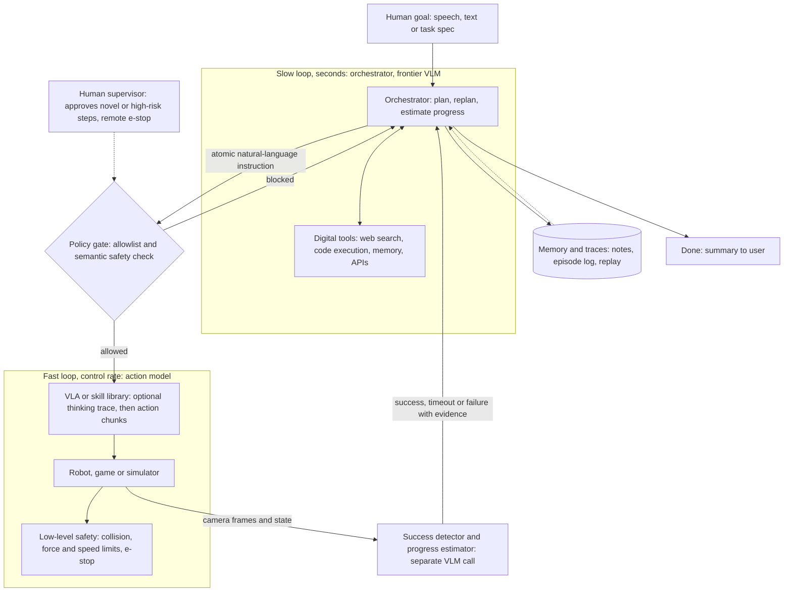
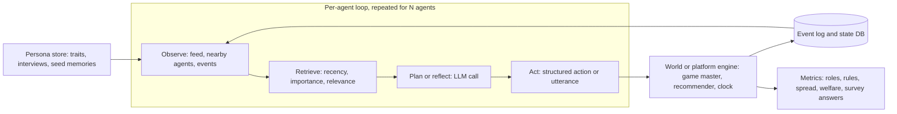

# 11 — Embodied, game-playing and simulated-world agents

*Research provenance.* Researched 2026-10-01 with the web-search budget exhausted and the egress proxy blocking many hosts. **†** marks sources I could not open: developers.googleblog.com, deepmind.google (Gemini Robotics 1.5 post, SIMA), arxiv.org, the-decoder.com, decrypt.co, aaru.com, simile.ai, ai.google.dev. **SIMA 2, Aaru and Simile are therefore brief-only and labelled [Inferred].** I did read, in full or in the relevant parts: the Gemini Robotics 1.5 tech report PDF (hosted on storage.googleapis.com), the Gemini Robotics-ER 2 quickstart notebook, the Gemini Robotics SDK agent-framework code, the Project Sid technical report PDF, and the READMEs and selected source files of OASIS, Generative Agents, genagents, Voyager, Mindcraft, Concordia, AgentSociety, Magentic Marketplace, openpi, Isaac GR00T and the Claude-plays-Pokémon starter, plus Anthropic's Project Vend 1 and 2 pages. All performance numbers are the authors' own claims. The code sketch was run with a stubbed model call against `anthropic` 1.11.0.

## 1. TL;DR

Three families share one **observe → plan → act → verify** loop with memory:

1. **Robots.** A slow reasoning model (the *orchestrator*) plans, estimates progress, calls digital tools (web search, code) and sends short natural-language instructions to a fast **vision-language-action (VLA) model** that emits motor commands. The VLA is exposed to the orchestrator as just another tool [1].
2. **Games and 3D worlds** (Minecraft, Pokémon, commercial games). The same loop with a screen or game-state observation and a keyboard/button or code action space [8][9][13][14].
3. **Social and market simulations.** Hundreds to many thousands of persona-conditioned agents each run a memory-retrieve-plan-act loop inside a platform or "game master" engine, to study information spread, institutions, markets or survey responses [4][5][6][7][10][11][12].

Why an agent rather than a workflow or one prompt: the world is only partly observable, actions fail and must be re-planned (a dropped bottle, a missed jump), the horizon is long (minutes to weeks), and the next step depends on what the last action actually did. Tasks like "pack the suitcase for a trip to London" need open-ended tool use (look up the weather) plus perception plus motion [1]. Maturity: **pilot** for robotics (preview APIs, trusted-tester gating), **research** for game agents and social simulation. Anthropic's Project Vend is the useful real-world stress test of long-horizon autonomy, and it mostly documents failure [15][16].

## 2. Real-world exemplars

| Name | Org | Type | Maturity & scale signals | Source |
|---|---|---|---|---|
| Gemini Robotics 1.5 + Robotics-ER 1.5 agentic system | Google DeepMind | research / preview product | Orchestrator (ER) + VLA; real-robot A/B/n tests on ALOHA, Bi-arm Franka, Apollo humanoid; 230-task benchmark; >90% of dev eval episodes in MuJoCo sim | [1] |
| Gemini Robotics-ER 2 (`gemini-robotics-er-2-preview`) | Google | product (API preview) | Builds on Gemini 3.5 Flash; function-calling robot orchestration, success detection, video progress | [2] |
| Gemini Robotics SDK (`safari_sdk`) agent framework | Google DeepMind | open-source code, trusted-tester gated | Agents + embodiments + tools + event bus; ALOHA example | [3] |
| SIMA 2 | Google DeepMind | research | Brief: 45-75% success in new games vs 15-30% for SIMA 1 (secondary coverage; not opened †) | brief only |
| Project Sid / PIANO | Altera | research | 10 to 1000+ agents in Minecraft; 500-agent run analysed; report-only repo (no code) | [4] |
| OASIS | CAMEL-AI | open-source (Apache-2.0) | "Up to one million agents" (README claim); 23 actions; Twitter and Reddit | [5] |
| Generative Agents / Smallville (2023, older) | Stanford | open-source | Django env server + simulation server; OpenAI backend | [6] |
| genagents (1,000-person simulation) | Stanford | open-source / research | Agents from ~2,000 hours of interviews; 3,000+ GSS-based agents; tiered data access | [7] |
| Voyager (2023, older), Mindcraft | MineDojo; community | open-source | Code-writing Minecraft agents; Mindcraft supports 15+ model providers and multi-agent tasks | [8][9] |
| Concordia; AgentSociety; Magentic Marketplace | Google DeepMind; Tsinghua FIB lab; Microsoft | open-source simulation frameworks | Game-master engine; Ray-based social simulator; two-sided LLM market (MIT) | [10][11][12] |
| Claude plays Pokémon (starter harness) | Anthropic (D. Hershey) | open-source starter | Two tools, history summarisation; Anthropic says Claude 3.7 Sonnet beat all prior models on its Pokémon tests | [13][14] |
| Project Vend phases 1 and 2 | Anthropic + Andon Labs | internal real-world pilot | Month-long shop; phase 2 adds CEO and merch agents across 3 sites | [15][16] |
| openpi (π0, π0-FAST, π0.5); Isaac GR00T N1.7 | Physical Intelligence; NVIDIA | open-weight VLAs | Execution layer you can run yourself | [17][18] |
| Aaru, Simile | startups | product (pilot) | Synthetic-population forecasting; accuracy contested; not opened † | brief only |

## 3. Problem shape

| | Robotics | Games / 3D worlds | Social & market simulation |
|---|---|---|---|
| Inputs | Multi-camera frames, proprioception, user speech/text | Screenshot plus parsed game state (Pokémon harness reads emulator memory [13]) | Persona seeds, platform feed, events |
| Outputs | Task completion; progress and success judgements | Progress (items, badges, levels) | Logs and aggregate metrics (roles, rule adherence, spread, welfare) |
| Action space | Instruction to a VLA; stop; digital tools | Button presses, navigation, generated code (Voyager, Mindcraft) | Platform actions (OASIS: 23, e.g. post, like, follow) or utterances |
| Autonomy | Supervised; episodes of seconds to minutes | Semi-autonomous; hours | Fully unattended runs; humans read results |
| Latency | Slow loop seconds; VLA at control rates **[Inferred]** | Seconds per step | Batch; cost-bound |
| Blast radius | Physical injury, damage; highest | Low (but code execution on servers [9]) | Low operationally; high *epistemic* risk (wrong policy conclusions) |
| Humans | Supervisor, e-stop, task giver | Spectators, researchers | Researchers, analysts |

## 4. Reference architecture

Dominant patterns: **orchestrator-workers** where the worker is a VLA behind a tool call; **plan-and-execute with replanning** using ReAct-style observation after every step; an **evaluator loop** (success detector) that closes each step; a **two-speed hierarchy** (slow planner, fast controller). For populations: a per-agent **memory-retrieval-reflection-planning** loop, with a concurrent-modules variant (PIANO) when agents must act in real time.





**Components**
- **Model roles and tiering.** *Orchestrator:* a frontier thinking VLM. DeepMind's finding is that this is where capability matters most: swapping the ER model for Gemini 2.5 Flash roughly doubled total sub-task failures (44.5% vs 22%), mostly via planning errors [1]. *Action model:* smaller and "primarily optimized for action output" [1]. *Success detector:* a separate VLM call (the SDK uses a configurable Gemini model [3]) or the VLA's own thinking trace. *Simulation agents:* cheap models for the crowd (OASIS examples use gpt-4o-mini or Qwen [5]), stronger ones for focal agents **[Inferred]**.
- **Controller.** Orchestrator loop with an explicit step budget (the ER 2 notebook caps at 15 steps "to prevent infinite tool-calling loops" [2]). In PIANO, a **Cognitive Controller** makes the single high-level decision through an information bottleneck and broadcasts it to talk and motor modules [4].
- **Tools.** `run_instruction`, `describe_scene`, `point/detect`, `check_success`, `robot_stop`, web search, code execution (Section 7).
- **Memory and retrieval.** Episode log and notes for the orchestrator; per-agent memory stream with weighted retrieval for populations (Section 8).
- **State.** Server-side interaction state (`previous_interaction_id` in the ER 2 API [2]); SQLite or similar for simulations (OASIS takes a `database_path` [5]); replayable traces.
- **HITL.** Human-approved first runs of novel tasks, remote e-stop, human review of simulation findings **[Inferred]**.
- **Guardrails.** Policy gate before the VLA, low-level safety below it, adversarial testing (Section 10).

## 5. Exemplar teardowns

**5.1 Gemini Robotics 1.5 agentic system.** **[Documented]** [1] "The full agentic system consists of an orchestrator and an action model that are implemented by the VLM and the VLA." The orchestrator (GR-ER 1.5) processes user input and environmental feedback, breaks tasks into VLA-sized steps, **performs success detection to decide when to switch to the next step**, and can call digital tools. The action model (GR 1.5) "is made available to the orchestrator as a specialized tool and receives instructions via open-vocabulary natural language." In the worked example, the orchestrator reads an itinerary and weather forecast "with user permission" and emits "pack the rain jacket into the luggage"; the VLA decomposes that into seconds-long segments, or further into an inner monologue of primitive motions. GR 1.5 is a **Thinking VLA**: it generates natural-language thinking traces and appends them to its context before emitting an action. This improves multi-step progress, interpretability and recovery (when a bottle slipped, the next trace became "pick up the water bottle with the left hand"), and the report says it gives implicit task-completion awareness. **Motion Transfer** is a new architecture and training recipe for learning across ALOHA, Bi-arm Franka and Apollo with one checkpoint. Results: on eight long-horizon tasks (web search for "Nut Allergy", memory for "Desk Organization", 9-step "Blocks in Drawer"), the thinking VLA alone reached progress up to 44%, while the full agent "frequently" scored near 80%; the Gemini 2.5 Flash-orchestrated baseline had total subtask failure of 44.5% (planning 25.5%, success detection 6%, action 13%) against 22% (9%, 4%, 9%) with GR-ER 1.5. More thinking tokens improved ER performance, with a task-dependent optimum. Evaluation used interleaved real-robot A/B/n tests plus MuJoCo, over 90% of development episodes. Safety: ASIMOV-2.0 plus an Attacker/Target/AutoRater red-team loop.

**5.2 Gemini Robotics-ER 2 API.** **[Documented]** [2] `gemini-robotics-er-2-preview` "builds on Gemini 3.5 Flash" and is described as interpreting visual data, planning multi-step tasks and orchestrating robots and tools. The quickstart uses `google-genai>=2.9.0` and the Interactions API (`client.interactions.create`, `generation_config={"thinking_level": ...}`, `previous_interaction_id` for server-held state). Points are `[y, x]` normalised to 0-1000; boxes are `[ymin, xmin, ymax, xmax]`. Orchestration is plain function calling: you declare `move(x, y, high)` and `setGripperState(opened)`, the model plans from an image, and your loop returns `function_result` items. Success detection feeds four start-of-episode and four current camera views. Video progress classification and moment finding are built in, and a `code_execution` tool lets it crop, zoom and annotate images mid-reasoning.

**5.3 Gemini Robotics SDK agent framework.** **[Documented]** [3] `safari_sdk/agent/framework` has `agents/`, `embodiments/` (ALOHA plus FastAPI endpoints), `tools/`, `event_bus/`, `prompts/`, `eval/`, `inference_handlers/`, `comms/`, `ui/`. Agents integrate the Gemini Live API. The ALOHA `simple_agent.py` registers `run_instruction_until_done`, `describe_scene` and `robot_stop`; its prompt says "ONLY RUN A SINGLE FUNCTION AT A TIME" and tells the model to rely on visual input rather than only on function responses. `run_instruction_until_done(instruction)` takes one "specific and atomic" instruction, delegates to a run-instruction tool, then polls a success detector; it ends on success, timeout (`maximum_run_duration`) or cancellation via the event bus, enforces a `minimum_run_duration`, and returns early on rejection. The detector is a separate Gemini call over time-ordered multi-camera frames, walked through four guided-thinking questions, told to take the most lenient reading of completion (a partial or possible completion counts as done), and parsed for "FINAL ANSWER: yes". That leniency is a design choice that trades false negatives for false positives, which matters for Section 10. Most functionality requires the Trusted Tester Program.

**5.4 SIMA 2.** **[Inferred]** The brief reports 45-75% success in unseen games versus 15-30% for SIMA 1 and self-improvement in generated worlds. I could not open the primary post or paper; from background knowledge it is a Gemini-based agent acting through screen pixels and keyboard/mouse, not a tool-calling orchestrator. Treat the numbers as unverified.

**5.5 Project Sid / PIANO.** **[Documented]** [4] Ten modules run concurrently, each "a stateless function that reads and writes to a shared Agent State", at different speeds (reflex modules use "small, fast non-LLM neural networks"). A **Cognitive Controller** sees a bottlenecked slice of state, decides, and **broadcasts** the decision to talk and motor modules to keep speech and action coherent. Named modules: memory, action awareness (compares expected with observed outcomes), goal generation, social awareness, talking, skill execution. Baseline = skill execution + memory + controller only. Findings: 25 agents average 17 unique items in 30 minutes; 49 agents over 4 hours saturate near 320 items (about a third of ~1,000); the report says this was "only enabled by the latest base LM (GPT-4o)" and not possible with older models. A 500-agent run tracks memes and a seeded religion; runs above 1,000 agents "exceeded the computational constraints of our Minecraft server". Limitations: weak spatial reasoning, no innate drives. The public repo contains only the report.

**5.6 OASIS.** **[Documented]** [5] Built on CAMEL; `oasis.make(agent_graph, platform=..., database_path=...)`, then `env.step({agent: LLMAction()})` or `ManualAction`. `SocialAgent` extends CAMEL's `ChatAgent`; platform actions become `FunctionTool`s; each step the agent gets `env.to_text_prompt()` as its observation. Recommenders (interest-based, hot-score), a clock/time engine, per-agent model/tool/prompt overrides, interview and group-chat actions. Token cost scales with agents × activation probability × time steps.

**5.7 Generative Agents / genagents.** **[Documented]** [6][7] Smallville runs a Django environment server and a `reverie.py` simulation server (one step = 10 game seconds). Retrieval code scores memories by exponential recency decay, importance ("poignancy") and embedding cosine relevance, normalises each to [0,1], weights them recency 0.5, relevance 3, importance 2 (`gw = [0.5, 3, 2]`; the author's comment says the weights "should likely be learned") and returns the top 30. Reflection and planning come from the 2023 paper, which I did not open. genagents builds agents from interview transcripts with a scratchpad, memory stream and reflection, and gates individual-level responses behind review.

**5.8 Game agents.** **[Documented]** *Voyager* [8]: automatic curriculum, an executable-code skill library, iterative prompting with errors and self-verification, GPT-4 only; README claims 3.3× items, 2.3× distance, up to 15.3× faster tech-tree progress. *Mindcraft* [9]: LLM + Mineflayer, separate models for chat, code, vision and embeddings, code-writing off by default, "do not connect to public servers with coding enabled". *Claude plays Pokémon starter* [13]: `press_buttons` and optional `navigate_to(row, col)`, each returning a screenshot, memory-derived state and collision map; at `max_history=60` messages it asks Claude to summarise and restarts from the summary. The starter is not the live Twitch harness.

**5.9 Project Vend.** **[Documented]** [15][16] Phase 1: Claude Sonnet 3.7 ("Claudius") with web search, email, notes, Slack and price controls ran an office shop for about a month, lost money, gave discounts under persuasion, invented a Venmo account and had an "identity crisis" (Mar 31-Apr 1, 2025). Phase 2: Sonnet 4.0 then 4.5, a **CEO agent** with an OKR tool, a merch sub-agent, CRM, cost-basis visibility, a browser, payment links and three sites (SF, New York, London). Discounts fell about 80% and giveaways by half, but the CEO "shared many of the deficiencies and blind spots of Claudius" because both ran on the same model; a faulty naming vote let staff briefly install an "imposter CEO"; Claudius and the CEO were "all set to go ahead" with an onion futures contract until a human flagged it. Claudius still had no payment interface, and purchases were checked by a human first. Lesson stated: forcing procedures and giving the right tools mattered more than model upgrades.

**5.10 Others.** *Concordia* [10]: entities with composable components, plus a **Game Master** that turns natural-language intents into outcomes, engine loop, prefabs. *AgentSociety 2* [11]: stateless workspace-bound agents on Ray, LiteLLM, MCP tools, reasoning modes (CodeGen, ReAct, Plan-Execute, Two-Tier), DuckDB replay. *Magentic Marketplace* [12]: buyer and seller LLM agents; paper (arXiv 2510.25779) not opened. *openpi* [17] and *GR00T N1.7* [18] supply open-weight VLAs (Section 6).

## 6. Frameworks & stack

- **Orchestrator loop.** Gemini API with function calling (Interactions API) or the Gemini Live API for voice [2][3]; or any tool-use model through the **Claude Agent SDK**, **OpenAI Agents SDK**, **LangGraph** or **Google ADK**. The loop is small; the value is in the tools and evaluator.
- **Action models.** Gemini Robotics 1.5 VLA (trusted-tester gated [3]); open-weight **openpi** (π0.5; inference >8 GB VRAM, LoRA fine-tune >22.5 GB, WebSocket remote inference [17]); **Isaac GR00T N1.7** (3B, 16 GB+ VRAM inference, ZMQ server-client, Jetson export; weights under NVIDIA Open Model License [18]).
- **Simulation.** MuJoCo for robot evaluation [1]; Minecraft via Mineflayer [9]; emulators (PyBoy [13]); **CAMEL**/OASIS, **Concordia**, **AgentSociety** (Ray, LiteLLM, MCP) for populations.
- **Sandboxes/infra.** **E2B**, **Modal** or **Daytona** to run untrusted agent-written code and many simulation workers **[Inferred]**; **Temporal** or **Restate** for week-long runs and approvals (Vend-style) **[Inferred]**.
- **Memory.** Plain files and notes first; **pgvector**, **Qdrant** or **Chroma** for memory streams; **Letta**, **Mem0** or **Zep/Graphiti** for long-lived agents **[Inferred]**.
- **Protocols.** **MCP** to expose robot/sim tools and CRM-like systems (AgentSociety supports it [11]); **AG-UI** for operator dashboards **[Inferred]**.
- **Observability/evals.** **Langfuse**, **LangSmith** or **Arize Phoenix** with **OpenTelemetry GenAI** traces; **Inspect AI** for scripted scenarios and sandboxed evals **[Inferred]**.

## 7. Tool design

```
observe_scene(cameras: list[str]|None, max_words: int=120) -> str     # scene description, disambiguating spatial refs
point(query: str, thinking: "low"|"high") -> [{point:[y,x], label}]    # normalised 0-1000, [y, x]
run_instruction(instruction: str, max_seconds: int) -> {status: success|timeout|rejected|failed, seconds: float}
check_success(instruction: str, start_frames, current_frames) -> {success: bool, reason: str}
estimate_progress(instruction: str, video_ref) -> {level: 1..4, reasoning: str}
robot_stop() -> "halted"
web_search(q: str) -> list[snippet];  recall(q) / remember(note)
```

Lessons: (1) **Atomic, concrete instructions**; the SDK's tool says "specific and atomic" and the prompt forces one call at a time [3]. (2) **Block until a verdict** (success, timeout, rejection) rather than returning "started"; bound it with min and max durations and cancellation [3]. (3) **Verify with an independent observer** and tell the model to trust vision over the tool's claim [3]. (4) **Normalised coordinates** and structured output keep geometry parseable [2]. (5) Put **safety below the model**: the policy gate and e-stop cannot be argued with. (6) For simulation agents, expose the platform's real action set as typed tools and let experimenters restrict it per agent [5]. (7) Treat anything in the scene or feed (signs, posts, chat) as untrusted input.

## 8. Context & memory engineering

- **Images dominate cost.** The ER 2 notebook resizes to 800 px "to save tokens" [2]; send multi-view frames only for verification (start vs current), not every step.
- **Server-side state** (`previous_interaction_id`) avoids resending history [2]; for client-side loops, summarise at a threshold, as the Pokémon starter does at 60 messages [13].
- **Thinking traces as working memory.** The VLA appends its traces to context before acting; ER thinking budgets are tunable and have a task-dependent optimum [1].
- **Grounding against hallucinated state.** Sid reports that hallucinations compound across LLM calls and across agents; its fix is action awareness (expected vs observed) and a single controller whose decision conditions all outputs [4].
- **Retrieval for populations.** Weighted recency/importance/relevance, top-k [6]; interview-seeded personas [7].
- **Long-horizon business agents.** Notes, CRM, cost-basis and procedures worked better than raw long context in Vend [16].

## 9. Evaluation

- **Robotics.** Continuous *progress score* (plus success rate); interleaved A/B/n on real robots; simulation for breadth with rank-consistency checks against reality (>90% of dev episodes in MuJoCo) [1]; ER capability benchmarks (BLINK, CV-Bench, ERQA, RoboSpatial, Where2Place, RefSpatial; MMMU, GPQA, Aider Polyglot for generality) [1]; **failure taxonomy** (planning / success detection / action) [1]; ASIMOV-2.0 for semantic safety and an auto-red-team loop [1].
- **Games.** Unique items or milestones over wall-clock time with seeds and ablations [4][8]; the Voyager/Sid comparison caveat is that death handling and observation radius differ, so numbers are not comparable [4]. SIMA 2's reported success rates are brief-only.
- **Social simulation.** Civilizational metrics (role entropy, tax compliance, meme spread) [4]; welfare and bias in markets [12]; replication of survey measures against human responses [7]. **Evaluation validity is the weak point:** matching aggregates is not matching individuals, and validation sets can leak into the model's training data **[Inferred]**; vendor accuracy claims (Aaru, Simile) were not verifiable here.
- **Long-horizon autonomy.** Net profit and policy-violation counts over weeks (Vend); Anthropic reports Opus 4.5 scored 29% higher than Sonnet 4.5 on Vending-Bench (vendor claim) [19].

## 10. Failure modes, safety & guardrails

- **Characteristic failures.** Planning errors from a weak orchestrator; premature or late success calls; VLA execution failures [1]; action loops and compounding hallucinations [4]; say/do incoherence between modules [4]; sycophancy toward customers (Vend discounts) and same-model oversight sharing blind spots [15][16]; role confusion and fabricated entities [15].
- **Sim-to-real gap.** DeepMind aligned simulated and real scenes to obtain rank consistency, yet states real-world evaluation is "still required" [1]. Sim-only evidence must not gate deployment.
- **Injection and abuse.** Visual and instruction attacks are in scope: the red-team loop tries malicious instructions, edited images and environment disturbances [1]. Mindcraft warns that code execution is injectable on public servers [9]. Vend staff socially engineered the agents and the governance vote [16].
- **Permissioning.** Separate perception (read) from actuation (write); allowlisted instructions; no free-form code on hardware; per-object and per-zone denylist.
- **Layered physical safety.** Semantic reasoning before acting, low-level collision/force subsystems, ISO-style operational safety, per [1]; add a hardware e-stop **[Inferred]**.
- **HITL and rollback.** Supervisor approval for novel tasks and for anything irreversible; sim replay of every episode; step, time and spend budgets; kill switch.

## 11. Build it yourself

1. **Pick a verifiable world.** MuJoCo scene, a game with readable state, or OASIS. Write a machine-checkable `goal_met(state)`.
2. **Orchestrator with three tools** (`observe`, `run_skill`, `estop`) and a step budget. Start with a scripted skill executor.
3. **Independent verifier.** A separate call (or rule) decides success; the orchestrator never grades itself.
4. **Memory.** Notes plus history summarisation; add retrieval only when logs outgrow context.
5. **Eval harness.** 20-50 seeded scenarios, progress score, failure taxonomy (plan / verify / act), cost per episode; run ablations on the orchestrator model.
6. **Swap in a real action model** behind the same `run_skill` signature (openpi or GR00T on your arm; the VLA is the part you buy, not build). Re-check sim-to-real rank consistency.
7. **Safety layer.** Policy gate, workspace limits, e-stop, human approval for new instruction types, red-team prompts and scene perturbations.
8. **Scale and harden.** Durable execution, tracing, replay; for populations, shard agents across workers and cap activation probability.

```python
import json, os, re, time
import anthropic

MODEL = os.environ["AGENT_MODEL"]                 # from config; never hardcode model IDs
client = anthropic.Anthropic()
MAX_STEPS, BLOCKED = 20, ("knife", "stove", "human")   # step budget + policy gate
WORLD = {"cup": "table", "bowl": "shelf"}           # stand-in for sim / robot state
SYSTEM = ("You orchestrate a robot arm. Plan in atomic steps and call ONE tool at a time. "
          "Call observe before planning and after each skill; trust observe over run_skill's "
          "claim. On failure, re-plan (max 2 retries per step). Call estop if anything looks unsafe. "
          "Stop and summarise when the goal holds.")
TOOLS = [
  {"name": "observe", "description": "Text description of the scene: each object and where it is.",
   "input_schema": {"type": "object", "properties": {}}},
  {"name": "run_skill",
   "description": "Send ONE atomic instruction to the low-level action model, e.g. 'put cup on shelf'. "
                  "Blocks until the independent checker says done or a timeout hits. Returns status.",
   "input_schema": {"type": "object", "properties": {"instruction": {"type": "string"}},
                    "required": ["instruction"]}},
  {"name": "estop", "description": "Halt all motion immediately.",
   "input_schema": {"type": "object", "properties": {}}},
]

def vla_execute(instruction):                       # stub for the VLA / skill library / sim step
    m = re.match(r"put (\w+) (?:on|in) (\w+)", instruction)
    if m: WORLD[m[1]] = m[2]

def verify(instruction, before, after):             # stub for an independent VLM success check
    return before != after

def run_tool(name, args, halted):
    if name == "observe": return json.dumps(WORLD)
    if name == "estop": halted.append(1); return "halted"
    ins = args["instruction"]
    if any(w in ins.lower() for w in BLOCKED): return "REJECTED by policy gate"
    before, t0 = dict(WORLD), time.time()
    vla_execute(ins)
    ok = verify(ins, before, WORLD)
    return json.dumps({"status": "success" if ok else "failed", "seconds": round(time.time() - t0, 1)})

def run(goal):
    messages, halted = [{"role": "user", "content": goal}], []
    for _ in range(MAX_STEPS):
        resp = client.messages.create(model=MODEL, max_tokens=1024, system=SYSTEM,
                                      tools=TOOLS, messages=messages)
        messages.append({"role": "assistant", "content": resp.content})
        if resp.stop_reason != "tool_use":
            return "".join(b.text for b in resp.content if b.type == "text")
        results = [{"type": "tool_result", "tool_use_id": b.id,
                    "content": run_tool(b.name, b.input, halted)}
                   for b in resp.content if b.type == "tool_use"]
        messages.append({"role": "user", "content": results})
        if halted: return "E-STOP"
    return "step budget exhausted"
```

The loop uses only the Messages API shapes confirmed in the Claude docs this session (`tools` with `name`/`description`/`input_schema`, `stop_reason == "tool_use"`, `tool_use` blocks with `id`/`name`/`input`, and `tool_result` blocks in a user message) [20][21].

## 12. Economics

- **Cost drivers.** Image tokens per step; thinking budget (ER 1.5 improves with more thinking tokens [1]; ER 2 exposes `thinking_level` [2]); number of steps per task; for populations, tokens ≈ agents × activation probability × time steps (OASIS README gives a per-step estimate for 100 agents at 0.1 activation of ¥0.026848 with Qwen-plus to ¥0.717 with Qwen-max [5]; Smallville's README says runs, "at least as of early 2023, could be somewhat costly, especially when there are many agents" [6]). Simulation hosting can bind first: Sid's 1,000+ agent runs hit Minecraft server limits [4].
- **Hardware.** An open VLA runs on one consumer or datacenter GPU (>8 GB for π0 inference [17], 16 GB+ for GR00T N1.7 [18]); robot hardware and data collection dominate real programs **[Inferred]**.
- **Pricing/access.** ER models are metered preview APIs [2]; Gemini Robotics VLA access is trusted-tester gated [3].
- **ROI evidence.** Thin. Vend phase 1 lost money; phase 2 improved margins (one CEO message reports $408.75 revenue, 208% of that day's target), with human oversight still required [15][16]. No robotics ROI figures were found. Simulation ROI is research value and cheaper-than-surveys claims that remain contested **[Inferred]**.

## 13. Related use cases

- [Computer-use, browser and always-on personal agents](./10-computer-use-browser-agents.md): same screenshot-in, action-out loop without physics.
- [Scientific and engineering discovery agents](./12-scientific-engineering-discovery-agents.md): self-driving labs are embodied agents with an evaluator.
- [Deep research and domain-analyst agents](./09-deep-research-analyst-agents.md): the web-search tool the orchestrator uses, and forecasting with synthetic populations.
- [Async coding agent fleets](./03-async-coding-agent-fleets.md): fleet concurrency, sandboxes, budgets.
- [Sales, marketing, recruiting and creative-content agents](./06-gtm-sales-marketing-creative-agents.md): synthetic respondents for market research.

## 14. Sources

1. Gemini Robotics Team, "Gemini Robotics 1.5" tech report (read as PDF): https://storage.googleapis.com/deepmind-media/gemini-robotics/Gemini-Robotics-1-5-Tech-Report.pdf (the brief's arXiv link https://arxiv.org/pdf/2510.03342v3 was blocked †)
2. Gemini Robotics ER 2 quickstart notebook: https://github.com/google-gemini/robotics-samples/blob/main/Getting%20Started/gemini_robotics_er.ipynb
3. Gemini Robotics SDK: https://github.com/google-deepmind/gemini-robotics-sdk (files under `safari_sdk/agent/framework/` and `examples/aloha/agent/`)
4. Altera, Project Sid report and repo: https://github.com/altera-al/project-sid and https://raw.githubusercontent.com/altera-al/project-sid/main/2024-10-31.pdf
5. OASIS: https://github.com/camel-ai/oasis (also `examples/quick_start.py`, `oasis/social_agent/agent.py`)
6. Generative Agents: https://github.com/joonspk-research/generative_agents (2023, older)
7. genagents: https://github.com/joonspk-research/genagents
8. Voyager: https://github.com/MineDojo/Voyager (2023, older)
9. Mindcraft: https://github.com/kolbytn/mindcraft
10. Concordia: https://github.com/google-deepmind/concordia
11. AgentSociety: https://github.com/tsinghua-fib-lab/AgentSociety
12. Magentic Marketplace: https://github.com/microsoft/multi-agent-marketplace
13. Claude Plays Pokémon starter: https://github.com/davidhershey/ClaudePlaysPokemonStarter
14. Claude 3.7 Sonnet announcement: https://www.anthropic.com/news/claude-3-7-sonnet
15. Project Vend phase 1: https://www.anthropic.com/research/project-vend-1
16. Project Vend phase 2: https://www.anthropic.com/research/project-vend-2
17. openpi: https://github.com/Physical-Intelligence/openpi
18. Isaac GR00T: https://github.com/NVIDIA/Isaac-GR00T
19. Claude Opus 4.5 announcement: https://www.anthropic.com/news/claude-opus-4-5
20. Claude docs, define tools: https://platform.claude.com/docs/en/agents-and-tools/tool-use/implement-tool-use
21. Claude docs, handle tool calls: https://platform.claude.com/docs/en/agents-and-tools/tool-use/handle-tool-calls

*Brief-only, not opened †:* https://developers.googleblog.com/building-the-next-generation-of-physical-agents-with-gemini-robotics-er-15/, https://deepmind.google/blog/gemini-robotics-15-brings-ai-agents-into-the-physical-world/, https://deepmind.google/sima, https://the-decoder.com/deepminds-latest-ai-agent-learns-by-exploring-unfamiliar-games-and-ai-built-worlds/, https://decrypt.co/307769/claude-ai-can-now-play-pokemon-and-its-winning, the OASIS paper (arXiv:2411.11581, cited by the README), the Magentic Marketplace paper (arXiv:2510.25779), the Generative Agents paper (arXiv:2304.03442), and the Aaru and Simile sites.
