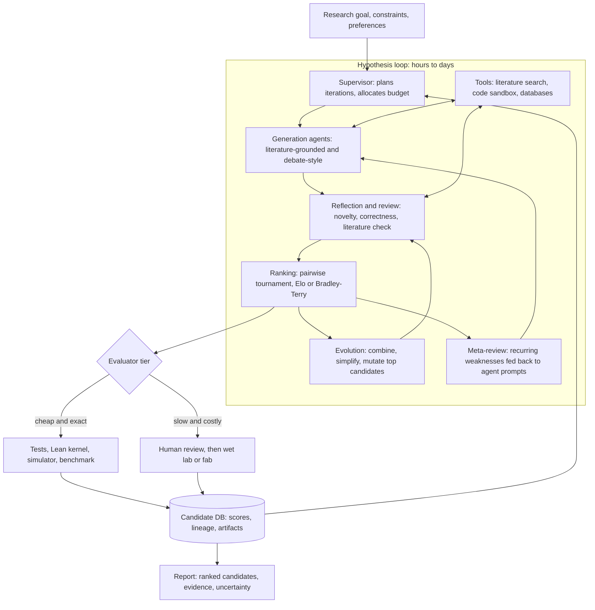
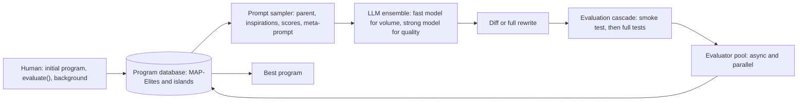

# 12 — Scientific and engineering discovery agents

*Research provenance.* Researched 2026-10-01 with the web-search budget exhausted and the egress proxy blocking many hosts. **†** marks sources I could not open: deepmind.google and research.google (Co-Scientist), arxiv.org and nature.com (Kosmos, Aristotle, Robin, Co-Scientist papers), futurehouse.org, sakana.ai, docs.cloud.google.com (Co-Scientist/AlphaEvolve docs), iclr.cc (STARK), news.synopsys.com, theregister.com and futurumgroup.com (EDA agents), intuitionlabs.ai (NovoScribe). **Co-Scientist's internals, Kosmos, Aristotle, STARK, the EDA agents, NovoScribe, MAI-DxO and the 2026 self-driving-lab preprint are therefore brief-only or known through third-party code, and are labelled [Inferred] where I could not read a primary source.** I did read: the AlphaEvolve white paper (PDF on storage.googleapis.com), the MLE-bench README and leaderboard, and the code or READMEs of Robin, AI Scientist v1 and v2, Biomni, AIDE, Agent Laboratory, OpenEvolve, ShinkaEvolve, KernelBench, VerilogEval and Coscientist (2023), plus open adaptations of Co-Scientist and Kosmos. All results are the authors' own claims. The code sketch was run with a stubbed model call against `anthropic` 1.11.0 and a real subprocess evaluator.

## 1. TL;DR

A set of LLM agents **generates** candidates (hypotheses, programs, designs, proofs), **critiques and ranks** them, **evolves** the best, and **scores** them with an evaluator: a test suite, simulator, Lean checker, benchmark harness or a human-run wet lab. The loop runs for hours to days. Variants: AI scientists and co-scientists (biomedicine, ML), evolutionary algorithm and kernel search, ML-engineering agents, formal-math provers, self-driving labs, and chip-design/verification agents.

Why an agent, not a fixed workflow or one prompt: the next experiment depends on the last result, the search space branches and backtracks, and tools (literature, code execution, instruments) must be chosen adaptively. But **the evaluator, not the agent graph, decides whether a system works.** AlphaEvolve states its own limit plainly: it "handles problems for which it is possible to devise an automated evaluator" [1]. Where the evaluator is an LLM judge or a wet lab, results are slower, noisier and harder to verify. Maturity is mostly research-grade; EDA agents are nearest to production, though their speedups are vendor-reported.

## 2. Real-world exemplars

| Name | Org | Type | Maturity & scale signals | Source |
|---|---|---|---|---|
| AI Co-Scientist (Nature, May 2026) | Google DeepMind | research / enterprise product | Brief: Generation, Reflection, Ranking, Evolution, Meta-review agents; Co-Scientist and AlphaEvolve agents offered in Gemini Enterprise docs (not opened †) | brief only; open adaptations [2][3] |
| AlphaEvolve | Google DeepMind | research, used internally | 4x4 complex matrix product in 48 multiplications; 0.7% fleet compute recovered; 23% kernel speedup | [1] |
| Robin | FutureHouse | open-source (agent code) | Hypothesis, assay and candidate ranking on 10 pre-run diseases; wet-lab by humans | [4] |
| AI Scientist v1 / v2 | Sakana AI | open-source | v1 under $15 per paper (Claude 3.5 Sonnet); v2 claims a peer-reviewed workshop paper | [5][6] |
| Kosmos | Edison Scientific | research (brief: up to 12-hour runs) | Third-party reimplementation says it has not reproduced the paper's numbers | [7] |
| Biomni | Stanford SNAP | open-source (Apache-2.0) | A1 agent, CodeAct; Biomni-Eval1 with 433 instances | [8] |
| MLE-bench + agents (AIDE and others) | OpenAI; Weco and leaderboard entrants | benchmark + open agents | 75 Kaggle competitions; top entry 64.44% any-medal (Feb 2026) | [9][10] |
| Agent Laboratory | S. Schmidgall et al. | open-source | Literature, experiment, report phases with a co-pilot mode | [11] |
| OpenEvolve; ShinkaEvolve | community; Sakana AI | open-source AlphaEvolve-style | MAP-Elites islands, evaluator cascade; Shinka: bandit model selection | [12][13] |
| KernelBench | Stanford Scaling Intelligence | benchmark | 250 PyTorch-to-GPU-kernel tasks, `fast_p` metric | [14] |
| Aristotle | Harmonic | product (Lean prover API) | Known here only via third-party driver code | [17]; paper not opened † |
| Coscientist (2023, older) | Gomes group, CMU | research | Nature 2023; repo has data and basic implementation | [16] |
| AgentEngineer (L2-L5 roadmap); ChipStack AI Super Agent | Synopsys; Cadence | vendor products | Brief: agentic EDA race; e.g. 40x RTL validation (vendor/partner-reported); not opened † | brief only |
| NovoScribe; MAI-DxO; STARK; 2026 self-driving-lab preprint | Novo Nordisk; Microsoft; ICLR 2026; arXiv | adjacent / research | Brief only † | brief only |

## 3. Problem shape

- **Inputs.** A research goal with constraints; or a seed program plus an `evaluate()` function; or a theorem and a Lean project; or an RTL spec and testbench; plus literature, datasets and instrument APIs.
- **Outputs.** Ranked hypotheses with rationale and citations, experimental protocols, improved programs or kernels, checked proofs, draft papers.
- **Environment.** Code sandbox, literature and biological databases, simulators, EDA toolchains, lab automation.
- **Action space.** Write and run code, search and read papers, call evaluators, submit jobs to a platform or lab, rank and revise.
- **Autonomy.** Semi-autonomous to autonomous *inside* a sandbox; humans gate wet-lab runs, fabrication, and publication.
- **Latency.** Hours to days. AlphaEvolve's authors consider spending "on the order of 100 compute-hours to evaluate any new solution" feasible [1]; MLE-bench caps a run at 24 hours [9].
- **Blast radius.** Low inside a sandbox (but agents execute arbitrary code [5][8]); physical and biosafety exposure in labs **[Inferred]**; epistemic harm from confident false claims.
- **Humans.** Domain experts pick goals, steer, review the top candidates, run experiments and sign off.

**The evaluator spectrum** (this is the design axis):

| Evaluator | Examples | Speed / cost | Trust |
|---|---|---|---|
| Exact checker | Lean kernel (Aristotle [17]); unit tests; KernelBench correctness [14] | Seconds | Highest |
| Simulator or benchmark | Data-centre simulator for Borg [1]; iverilog testbenches [15]; Kaggle grading [9] | Seconds to hours | High if held-out |
| LLM judge / tournament | Elo or Bradley-Terry ranking [2][3][4]; automated reviewer [5] | Cheap | Circular, unvalidated |
| Human wet lab | Robin follow-up experiments [4] | Weeks, costly | Ground truth |

## 4. Reference architecture

Dominant patterns: **supervisor/hierarchical multi-agent** with specialised roles (generate, reflect, rank, evolve, meta-review); **evaluator-optimizer** at two levels (LLM critique inside the loop, hard evaluator at the boundary); **evolutionary search over programs** with a database and parallel evaluators (AlphaEvolve); **tree search** over solution scripts (AIDE, AI Scientist v2); **orchestrator-workers** with parallel trajectories (Robin, Kosmos); **CodeAct** (Biomni).





**Components**
- **Model roles and tiering.** AlphaEvolve pairs Gemini 2.0 Flash (throughput) with Gemini 2.0 Pro (occasional higher-quality jumps) [1]. ShinkaEvolve selects among models with a bandit (UCB by default) with cost-aware weighting [13]. Robin defaults to `o4-mini` via LiteLLM [4]. Strong models for review, meta-review and final write-up, cheap ones for bulk generation **[Inferred]**.
- **Planner/controller.** A supervisor decides which action to run next and when to stop [3]; in evolutionary systems the controller is plain code (`database.sample()`, build prompt, generate, apply diff, evaluate, add) [1].
- **Tools.** Literature search (PubMed via MCP in Open Coscientist [2]; Semantic Scholar for novelty in AI Scientist [5]), sandboxed code execution, domain databases and tool libraries (Biomni [8]), evaluators, lab or platform job submission.
- **Memory/retrieval/state.** A candidate or program database with scores and lineage (SQLite in ShinkaEvolve [13]); literature-grounded reflection; meta-review summaries.
- **HITL.** Goal setting, review of top-ranked outputs, wet-lab execution, publication decisions; AI Scientist v2's licence requires disclosing AI use in manuscripts [6].
- **Guardrails.** Container sandboxes, held-out evaluation data, rule-violation and plagiarism detectors [9].

## 5. Exemplar teardowns

**5.1 AlphaEvolve.** **[Documented]** [1] An evolutionary coding agent. The user supplies an initial program with `# EVOLVE-BLOCK-START/END` markers and a Python `evaluate` function returning a dict of scalars. The distributed controller (an `asyncio` pipeline of controller, LLM samplers and evaluation nodes, optimised for throughput) loops: sample parent and inspirations from the program database, build a prompt (prior programs with scores, explicit context, stochastic formatting, rendered evaluation results, **meta-prompts co-evolved in a separate database**), have the LLM emit a diff or a full rewrite, apply it, run the evaluator, store the result. The database mixes MAP-Elites with island models. The **evaluation cascade** tests candidates on increasingly hard cases and prunes early; optional LLM-graded feedback covers hard-to-code properties such as simplicity. Models: Gemini 2.0 Flash plus Pro. Results: 14 matrix-multiplication settings improved (48 multiplications for 4x4 complex matrices); over 50 open math problems with about 75% matched and about 20% improved; a Borg scheduling heuristic recovering 0.7% of fleet compute, validated on a simulator and unseen data before rollout; a Gemini kernel-tiling heuristic with 23% average kernel speedup and 1% shorter Gemini training time, with optimisation time cut "from several months" to "days"; a 32% FlashAttention kernel speedup; and a Verilog rewrite in a TPU arithmetic circuit validated by designers (which downstream synthesis tools would also have caught). Ablations on two tasks (no evolution, no prompt context, no meta-prompt evolution, no full-file evolution, small base LLM only) each lose to the full system: "each of the components is responsible for a significant improvement."

**5.2 Co-Scientist.** **[Inferred]** I could not open the Nature paper, blog or Cloud docs. The brief names the role graph: Generation, Reflection, Ranking, Evolution, Meta-review. Two open adaptations built from Google's paper add a Supervisor, a literature-review step and (in [2]) a Proximity (cluster and de-duplicate) node, and rank hypotheses in an **Elo tournament** of pairwise matchups. Both use LangGraph; Open Coscientist uses LiteLLM [2], the other GPT Researcher for literature analysis [3]. Open Coscientist reviews hypotheses on six criteria with a batch strategy that changes with pool size, and degrades to "only LLM's latent knowledge" without a literature MCP server [2]; the other targets 20-30 hypotheses and warns of untested, hard-coded settings [3]. Treat these as reconstructions, not evidence about Google's system.

**5.3 Robin.** **[Documented]** [4] Python package with `assays.py`, `candidates.py`, `analyses.py`, `configuration.py`, `multitrajectory_runner.py`, `prompts.py`. Flow in `assays.py`: the LLM proposes assay ideas as JSON; each idea becomes a hypothesis-report job on the Edison platform (agents Crow and Falcon, job `assay_hypothesis_report_agent`); `uniformly_random_pairs()` and `run_comparisons()` run **LLM pairwise comparisons**; `choix.ilsr_pairwise()` fits a **Bradley-Terry** model; the top-strength assay becomes the goal for candidate generation. A later optional Finch step analyses experimental results, which come from outside the system. Defaults: 3 queries, 3 assays, 5 candidates. The multi-trajectory runner submits parallel tasks with `asyncio` but has **no consensus mechanism**. A reported drug-repurposing result for dry AMD comes from the brief and my background knowledge; I did not verify it.

**5.4 AI Scientist v1 and v2.** **[Documented]** [5][6] v1 runs five stages: template-bound idea generation (NanoGPT, 2D diffusion, grokking), a Semantic Scholar novelty check, Aider-driven experiments, LaTeX write-up and an automated LLM review; "less than $15 per paper" with Claude 3.5 Sonnet; completion rates vary by template, model and idea. v2 drops templates for "progressive agentic tree search, guided by an experiment manager agent", adds VLM review of figures, costs about $15-20 per experiment run plus about $5 for writing (README), and claims the first fully AI-written workshop paper accepted through peer review. Both warn that the code executes LLM-written code and must run in a container.

**5.5 Kosmos.** **[Inferred]** From the brief (runs up to 12 hours) and a third-party reimplementation [7]: roles are Research Director, Hypothesis Generator, Experiment Designer, Data Analyst, Literature Analyzer; paper-reported figures include 79.4% statement accuracy, about 1,500 papers and 42,000 lines of code per run, and up to 200 rollouts. The reimplementation uses Docker-sandboxed Python and R, optional Neo4j, and states it has "not yet reproduced the paper's 79.4% accuracy or 7 validated discoveries."

**5.6 Biomni.** **[Documented]** [8] The A1 agent runs a CodeAct loop over a tool/database/software environment with retrieval-augmented planning (an ~11 GB data lake downloads on first use). Biomni-R0 is a Qwen-32B model trained with RL on agent data; Biomni-Eval1 has 433 instances over 10 tasks (GWAS, rare-disease diagnosis, CRISPR method choice). It "executes LLM-generated code with full system privileges"; sandbox it.

**5.7 ML-engineering agents and MLE-bench.** **[Documented]** [9][10] MLE-bench uses 75 Kaggle competitions graded by the competition's own metric, 24-hour runs, 36 vCPUs, 440 GB RAM and one A10, at least 3 seeds, a 22-competition Lite split, plus rule-violation and plagiarism detectors. Leaderboard (any medal): Famou-Agent 2.0 with Gemini-3-Pro-Preview 64.44% ± 1.18 (2026-02-23), AIBuildAI with Claude-Opus-4.6 63.11% (2026-03-06), MARS+ 62.67%, against AIDE with o1-preview at 17.12% in Oct 2024. The top entries list no source code, and the maintainers paused new submissions on 2026-04-24 while they fix how fairness and comparability are ensured. AIDE grows a tree of solution scripts, drafting, debugging and improving nodes under a metric, and claims 4x the medals of the best linear agent (OpenHands) [10]. Agent Laboratory splits work into `mle-solver` and `paper-solver` with an optional co-pilot mode [11].

**5.8 Open evolutionary frameworks and kernel search.** **[Documented]** [12][13][14] OpenEvolve reimplements the AlphaEvolve components (MAP-Elites islands, evaluator cascade, prompt sampler, LLM ensemble) and claims 2-3x speedups on real hardware. ShinkaEvolve ("Towards Open-Ended and Sample-Efficient Program Evolution") adds novelty rejection sampling (`code_embed_sim_threshold` 0.99), "diff / full / cross" patches and UCB model selection (`llm_dynamic_selection` default `"ucb"`), and logs to SQLite and W&B. KernelBench has 100 + 100 + 50 tasks and the `fast_p` metric (correct and at least `p`x faster); its README does not discuss reward-hacking safeguards. STARK is brief-only †.

**5.9 Formal math and EDA.** **[Inferred]** Aristotle: third-party drivers show a job API that takes a Lean project as context and returns `sorry`-free Lean, with statuses `QUEUED`, `IN_PROGRESS`, `COMPLETE`, `COMPLETE_WITH_ERRORS`, `FAILED`, `OUT_OF_BUDGET`, `CANCELED`; retries resubmit with a "continuation context" note [17]. The Lean kernel is the evaluator, which is why formal math is the most trustworthy discovery domain. EDA: Synopsys AgentEngineer and Cadence ChipStack are vendor products I could not open; the readable evidence is AlphaEvolve's Verilog case [1] and VerilogEval, where each problem has a prompt, testbench and reference, graded with `iverilog` v12 for Pass@1 [15].

## 6. Frameworks & stack

- **Orchestration.** **LangGraph** (both Co-Scientist adaptations [2][3]), **Google ADK**, **Claude Agent SDK**, **OpenAI Agents SDK**, or a plain `asyncio` controller as in AlphaEvolve [1]. **Temporal**, **Inngest** or **Restate** for multi-day runs with human gates **[Inferred]**.
- **Models/gateway.** **LiteLLM** (Robin, Open Coscientist, Kosmos reimplementation [2][4][7]).
- **Sandboxes.** Docker is the minimum (AI Scientist, Kosmos [5][6][7]); **E2B**, **Modal** or **Daytona** for isolated evaluators at scale (KernelBench runs on Modal [14]).
- **Tools/protocols.** **MCP** for literature servers [2]; Biomni's tool library [8]; SLURM or Ray-style clusters for parallel evaluation [13].
- **Memory.** SQLite or Postgres for candidate lineage; **pgvector** or **Qdrant** for novelty embeddings (ShinkaEvolve embeds code for novelty checks [13]); Neo4j optional [7].
- **Observability/evals.** **W&B Weave**, **Langfuse**, **Arize Phoenix** or **LangSmith** traces; **Inspect AI** for harnessed evals; **Promptfoo**/**DeepEval** for judge prompts **[Inferred]**.

## 7. Tool design

```
search_literature(query: str, k: int=10, sources: list[str]) -> [{id, title, abstract, year}]
run_code(code: str, timeout_s: int, sandbox: str) -> {stdout, stderr, files, exit_code}
evaluate(candidate_id: str, stage: "smoke"|"full"|"heldout") -> {scores: dict, error: str|None}
compare(candidate_a: str, candidate_b: str, criteria: list[str]) -> {winner, rationale}
propose_experiment(hypothesis_id: str, protocol: str) -> {ticket_id}   # human or lab gated
lean_check(project_ref: str) -> {status, errors}
db_query(filter: dict) -> [candidate]        # read-only lineage and score history
```

Lessons: (1) **The evaluator is a tool the agent cannot edit.** Keep scoring code and held-out data outside the agent's write scope; AlphaEvolve's authors keep evaluation as a user-owned function with fixed signature [1]. (2) **Cascade the cost.** Cheap smoke test, then full test, then held-out [1]. (3) **Return structured scores plus artefacts** so the prompt sampler can show "program, result, score" triples [1]. (4) **Make experiment submission a ticket, not an action**; a human or lab scheduler executes it. (5) **Pairwise comparison beats absolute scoring** for noisy LLM judges: Robin and the Co-Scientist adaptations rank by tournament, not by 1-10 grades [2][3][4]. (6) **Idempotent, resumable jobs**, as Aristotle drivers do by reattaching to in-flight project IDs [17].

## 8. Context & memory engineering

- **Prompts are built from the database.** Parent, sampled inspirations with scores, background documents and evaluation feedback; AlphaEvolve also evolves the meta-prompt [1].
- **Diversity is a memory problem.** MAP-Elites plus islands (AlphaEvolve, OpenEvolve), novelty rejection by embeddings (ShinkaEvolve) [1][12][13]. Without it, loops collapse to near-duplicates.
- **Meta-review as compression.** Recurring weaknesses summarised and fed back into generation prompts (Co-Scientist role, per the adaptations [2][3]).
- **Long-run state.** Kosmos-style runs of many hours need a structured store of findings rather than raw history **[Inferred]**; Aristotle drivers bundle the Lean project and a `marathon.md` log as context on each submission [17].
- **Reproducibility metadata.** Log seeds, model versions, prompts, evaluator version and lineage with every candidate; MLE-bench requires at least 3 seeds because "agents/LLMs can be quite high-variance" [9].

## 9. Evaluation

- **ML engineering.** MLE-bench any-medal % with mean ± SEM over at least 3 seeds, split by complexity [9]. **GPU kernels.** KernelBench `fast_p` with randomised correctness checks and repeated timing [14]. **RTL.** VerilogEval Pass@1 at temperature 0 and Pass@1 from 20 samples at temperature 0.85 [15]. **Bio agents.** Biomni-Eval1 [8]. **Math/algorithms.** Provably better constructions and checked proofs [1][17].
- **Scientific claims.** Statement accuracy by expert review (Kosmos, per the paper as relayed by [7]); the reimplementation shows how little of this has been independently reproduced [7]. Hypothesis quality is often reported as tournament Elo or expert ratings, which measures agreement with a judge, not truth **[Inferred]**.
- **Wet-lab validation.** The only convincing test for biomedical hypotheses; slow and human-run.
- **Internal deployment metrics.** Fleet resources recovered, kernel speedup, training time saved [1].
- **Leaderboard integrity.** Closed-source top entries and a submission freeze show the benchmark itself needs governance [9].

## 10. Failure modes, safety & guardrails

- **Evaluator exploitation.** Candidates that satisfy the scorer without solving the problem (overfitting to fitness data, special-casing tests). Defences: held-out data (AlphaEvolve split kernel shapes 50/50 into optimisation and evaluation sets [1]), rule and plagiarism detectors [9], independent re-run. KernelBench documents no reward-hacking safeguards [14].
- **Judge circularity and homogenisation.** LLM judges rank LLM ideas; models share blind spots **[Inferred]**; Vend-style same-model oversight evidence is in [dossier 11](./11-embodied-simulated-world-agents.md).
- **Novelty versus verifiability.** Novelty checks via Semantic Scholar [5] reduce rediscovery but not error; unverifiable claims need explicit uncertainty in the report.
- **Hallucinated citations and numbers.** Require retrievable evidence IDs for every claim **[Inferred]**.
- **Reproducibility.** Unreproduced headline numbers (Kosmos [7]), variance across seeds [9], closed top systems [9].
- **Code-execution exposure.** Three of the repos warn that LLM-written code runs with full privileges [5][6][8]. Use containers, no network by default, resource limits, secrets out of reach.
- **Prompt injection through literature and web content.** Treat retrieved text as untrusted data **[Inferred]**.
- **Physical and dual-use risk.** Self-driving labs and chemistry agents need hardware interlocks, reagent and protocol allowlists, and human release of every physical run **[Inferred]**; Robin's analysis step consumes data that humans produced [4].
- **Disclosure.** AI Scientist v2's licence mandates disclosing AI use in resulting manuscripts [6].
- **Rollback.** Immutable candidate lineage; every promoted result re-run from scratch by an independent pipeline before anyone acts on it.

## 11. Build it yourself

1. **Start where an exact evaluator exists** (tests, benchmark, simulator, Lean). Write `evaluate()` first, with a smoke stage, a full stage and a held-out stage.
2. **Single-agent baseline.** One LLM call that improves a seed program given its score; log score per call.
3. **Add a population.** Keep top-k plus diverse samples in a database; build prompts from parent and inspirations [1].
4. **Parallelise evaluation** with a worker pool and a hard timeout per candidate; cap total spend.
5. **Add critique and ranking** only if the evaluator is slow or soft: reflection agent, pairwise tournament (Bradley-Terry), meta-review back into prompts [2][4].
6. **Add tools** (literature search, code execution) for hypothesis work; keep retrieved text untrusted.
7. **Insert human gates:** review of the top candidates, ticketed experiment submission, sign-off before publication or fabrication.
8. **Harden:** container sandbox, durable execution, tracing, seed and version logging, independent re-run of winners, and a regression suite of known problems.

```python
import math, os, random, re, subprocess, sys
import anthropic

MODEL = os.environ["AGENT_MODEL"]                   # from config; never hardcode model IDs
client = anthropic.Anthropic()
random.seed(0)
f = lambda x: math.sin(x) + 0.5 * x                 # hidden target: owned by the evaluator, not the agent
TRAIN = [(i / 10, f(i / 10)) for i in range(40)]          # fitness data
HELD = [(i / 10 + 0.05, f(i / 10 + 0.05)) for i in range(40)]   # held-out data, reported only at the end
SEED = "def predict(x):\n    return 0.0\n"
PROMPT = """Improve the Python function predict(x) so it fits hidden data (x -> y). Lower score is better.
Parent (score {ps:.4f}):
```python
{parent}```
Other good programs:
{others}
Return ONLY the full improved function in one ```python block, standard library only."""

def evaluate(code, data):                           # deterministic evaluator; use a container in production
    script = code + f"\nd = {data!r}\nprint(sum((predict(x) - y) ** 2 for x, y in d) / len(d))\n"
    try:
        r = subprocess.run([sys.executable, "-c", script], capture_output=True, text=True, timeout=5)
        return float(r.stdout.strip()) if r.returncode == 0 else math.inf
    except (subprocess.TimeoutExpired, ValueError):
        return math.inf

def fitness(code):
    if evaluate(code, TRAIN[:3]) == math.inf:       # cascade: cheap smoke test before the full run
        return math.inf
    return evaluate(code, TRAIN)

def propose(db):
    ps, parent = random.choice(db[:5])              # elites are parents; extra programs add diversity
    others = "\n".join(f"score {s:.4f}:\n{c}" for s, c in random.sample(db, min(2, len(db))))
    msg = PROMPT.format(ps=ps, parent=parent, others=others)
    resp = client.messages.create(model=MODEL, max_tokens=1500,
                                  messages=[{"role": "user", "content": msg}])
    text = "".join(b.text for b in resp.content if b.type == "text")
    m = re.search(r"```python\n(.*?)```", text, re.S)
    return m.group(1) if m else None

def evolve(generations=30):
    db = [(fitness(SEED), SEED)]
    for g in range(generations):
        code = propose(db)
        score = fitness(code) if code else math.inf
        if score < math.inf:
            db = sorted(db + [(score, code)])[:20]  # bounded population, best first
        print(g, round(db[0][0], 4))
    best = db[0][1]
    return best, evaluate(best, HELD)               # report the held-out score, not the fitness score
```

This is an AlphaEvolve-style loop in miniature: program database, prompt built from parent and inspirations, cascade evaluation, bounded population. It uses only the Messages API shapes confirmed in the Claude docs this session (`messages.create` with `model`, `max_tokens`, `messages`; `text` content blocks) [18]. Run the candidate subprocess inside a container with no network before using it on anything real.

## 12. Economics

- **Cost drivers.** Candidates generated × tokens per prompt (prompts carry parent plus inspirations) × evaluation compute. AlphaEvolve's economics rest on evaluator cost: its authors accept up to about 100 compute-hours per candidate evaluation [1]. Sample-efficiency work is aimed at this: ShinkaEvolve is explicitly pitched as sample-efficient, using novelty rejection to avoid paying for near-duplicate evaluations [13].
- **Published per-run costs.** AI Scientist v1 "typically less than $15 per paper" with Claude 3.5 Sonnet; v2 about $15-20 per experiment run plus about $5 to write, and a few dollars for ideation [5][6]. MLE-bench per run: 24 h on 36 vCPUs, 440 GB RAM and an A10, times at least 3 seeds times up to 75 competitions [9].
- **Latency.** Hours to days; throughput-optimised pipelines rather than low-latency ones [1].
- **Pricing models.** Open-source frameworks plus metered model APIs; managed offerings (Gemini Enterprise Co-Scientist/AlphaEvolve agents per the brief †; Aristotle API with an `OUT_OF_BUDGET` status [17]) meter by job or budget.
- **ROI evidence.** Strongest where the evaluator is cheap and the artefact is reusable at scale: 0.7% of Google's fleet resources, 1% of Gemini training time, months of kernel engineering reduced to days [1]. Weak for biomedical discovery: wet-lab validation dominates cost and time **[Inferred]**, and headline numbers are mostly self-reported. EDA speedups (e.g. 40x RTL validation) are vendor or partner claims I could not verify.

## 13. Related use cases

- [Embodied, game-playing and simulated-world agents](./11-embodied-simulated-world-agents.md): self-driving labs are embodied agents; simulation-first evaluation.
- [Deep research and domain-analyst agents](./09-deep-research-analyst-agents.md): literature review and report generation inside the hypothesis loop.
- [Interactive coding agents](./01-interactive-coding-agents.md) and [async coding agent fleets](./03-async-coding-agent-fleets.md): the evolve-evaluate loop is a coding agent with a stronger test harness; ML-engineering and kernel agents are coding agents.
- [Document-centric back-office and case-processing agents](./08-back-office-case-processing-agents.md): regulated writing (NovoScribe-type pilots) shares the evidence-and-sign-off pattern.
- [Computer-use, browser and always-on personal agents](./10-computer-use-browser-agents.md): lab-instrument GUIs and web portals.

## 14. Sources

1. AlphaEvolve white paper (read as PDF): https://storage.googleapis.com/deepmind-media/DeepMind.com/Blog/alphaevolve-a-gemini-powered-coding-agent-for-designing-advanced-algorithms/AlphaEvolve.pdf
2. Open Coscientist (third-party adaptation): https://github.com/jataware/open-coscientist
3. open-coscientist-agents (third-party, LangGraph, archived): https://github.com/conradry/open-coscientist-agents
4. Robin: https://github.com/Future-House/robin (also `robin/assays.py`, `robin/configuration.py`, `robin/multitrajectory_runner.py`)
5. AI Scientist: https://github.com/SakanaAI/AI-Scientist
6. AI Scientist-v2: https://github.com/SakanaAI/AI-Scientist-v2
7. Kosmos reimplementation (third-party): https://github.com/jimmc414/Kosmos
8. Biomni: https://github.com/snap-stanford/Biomni
9. MLE-bench: https://github.com/openai/mle-bench
10. AIDE: https://github.com/WecoAI/aideml
11. Agent Laboratory: https://github.com/SamuelSchmidgall/AgentLaboratory
12. OpenEvolve: https://github.com/codelion/openevolve
13. ShinkaEvolve: https://github.com/SakanaAI/ShinkaEvolve
14. KernelBench: https://github.com/ScalingIntelligence/KernelBench
15. VerilogEval: https://github.com/NVlabs/verilog-eval
16. Coscientist (2023, older): https://github.com/gomesgroup/coscientist
17. Aristotle driver "marathon" (third-party): https://github.com/Deicyde/marathon
18. Claude docs, define tools: https://platform.claude.com/docs/en/agents-and-tools/tool-use/implement-tool-use

*Brief-only, not opened †:* https://deepmind.google/blog/co-scientist-a-multi-agent-ai-partner-to-accelerate-research/, https://futurehouse.org/research-announcements/demonstrating-end-to-end-scientific-discovery-with-robin-a-multi-agent-system, https://sakana.ai/ai-scientist/, https://docs.cloud.google.com/gemini/enterprise/docs/co-scientist-and-alphaevolve, https://arxiv.org/html/2511.02824v2 (Kosmos), https://arxiv.org/html/2510.01346v1 (Aristotle), https://iclr.cc/virtual/2026/poster/10007471 (STARK), https://arxiv.org/pdf/2607.04508 (self-driving-lab preprint), https://news.synopsys.com/2026-03-11-Synopsys-Outlines-Vision-for-Engineering-the-Future, https://theregister.com/2026/02/10/cadences_agentic_chip_design_tool, https://www.futurumgroup.com/insights/cadence-and-synopsys-accelerate-agentic-eda-race-at-computex, https://intuitionlabs.ai/articles/novo-nordisk-anthropic-rd-pilot.
